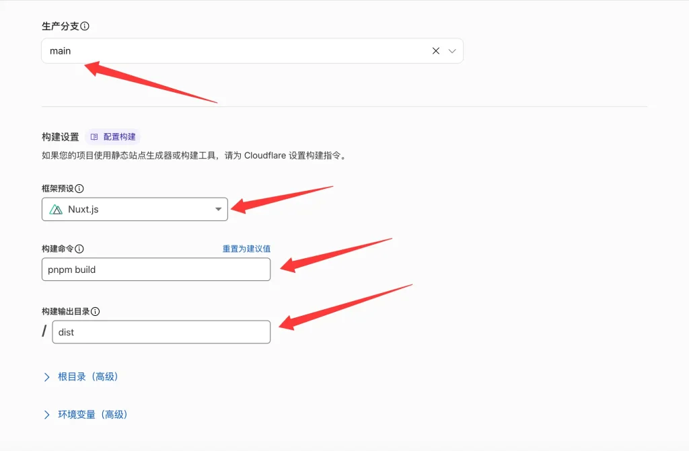
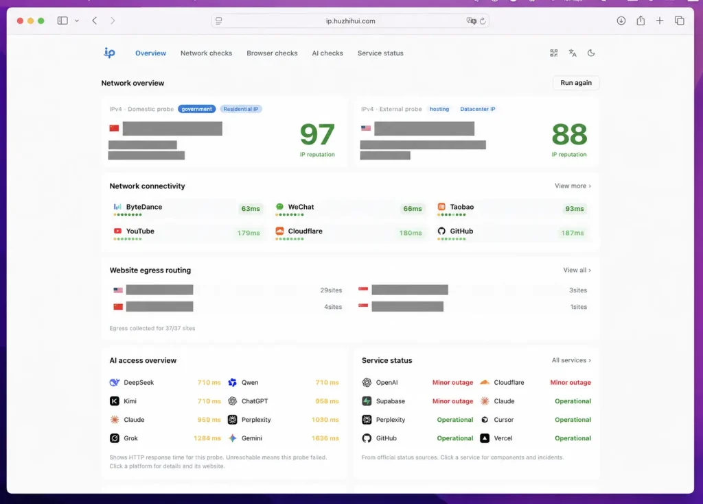
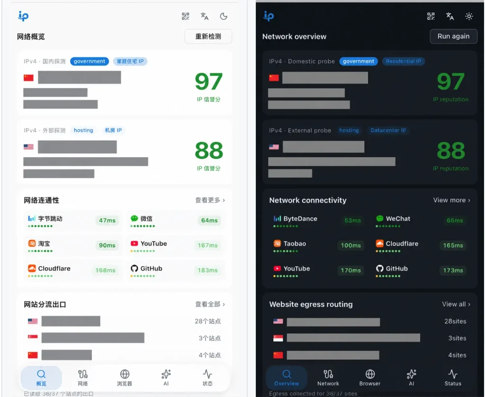

平时查 IP、看网络出口、测试 DNS、检测浏览器指纹，往往需要打开好几个网站。

今天分享一个比较实用的开源项目——One IP。

👉 项目地址：One IP GitHub开源项目 

它将 IP查询、网络诊断、全球Ping、DNS/CDN检测、浏览器指纹检测 等功能整合到一个页面中，还支持部署到自己的 Cloudflare Workers，适合开发者、站长和网络爱好者使用。

## 🌐 One IP可以解决什么问题？

很多时候，我们遇到网络问题并不是简单的“能不能打开网站”，而是：

- 当前公网IP到底是什么？
- IPv4和IPv6是否正常？
- 当前IP属于哪个运营商或数据中心？
- 网站为什么打不开？
- DNS解析是否正常？
- 当前网络是否经过代理或CDN？
- 浏览器暴露了哪些信息？

One IP就是把这些零散的检测功能集中起来，减少来回切换工具的麻烦。

## 🧰 主要功能介绍

### 🔍 IP信息查询

可以查看当前IP的基础信息，包括：

- IPv4 / IPv6
- IP归属信息
- 运营商
- ASN
- CIDR
- 数据中心或住宅网络类型
- 代理、Tor等相关标记
- IP地理位置和地图信息

适合用来快速了解当前网络出口。

### 📡 网络连通性检测

支持全球Ping、网站连通性检测等功能，可以帮助判断：

- 网站是否可以正常访问
- 不同地区访问是否存在差异
- 网络延迟是否过高
- 是否存在丢包或连接异常

对于排查网站访问问题、服务器线路问题比较有帮助。

### 🌍 DNS与CDN检测

可以查看域名解析和CDN相关信息，帮助判断：

- DNS解析是否生效
- 域名解析到了哪里
- 是否使用了CDN
- 不同网络环境下解析是否一致

站长在配置域名、Cloudflare或其他CDN时，可以用它做基础检查。

### 🧬 浏览器指纹检测

One IP还集成了浏览器检测功能，可以查看浏览器在当前环境下暴露的一些信息，例如：

- 浏览器与系统信息
- 屏幕参数
- 时区与语言
- WebRTC相关信息
- 浏览器指纹哈希

需要注意，指纹检测结果只是当前环境下的检测快照，并不代表绝对结论。

### 🤖 AI网站连通性检测

项目还提供部分常见AI站点的连通性检测，可以用来判断相关网站是否能够正常访问。

当某个AI网站打不开时，可以辅助判断问题究竟来自网络、DNS还是目标服务本身。

## ☁️ 支持Cloudflare零成本部署

One IP采用 React、Vite、TypeScript 开发，前端静态资源配合Cloudflare Workers接口运行。

项目支持Fork后自行部署，基本思路是：

Fork项目 → 导入Cloudflare Workers → 构建项目 → 部署上线

如果使用Cloudflare免费额度，个人使用和小型工具站通常可以做到低成本甚至零成本部署。

部署完成后，还可以绑定自己的域名，搭建一个专属的IP检测工具站。🚀

## 🔐 为什么建议自己部署？

公共演示站适合体验功能，但如果你比较在意隐私，或者想长期使用，自己部署会更灵活。

自建之后可以：

- 使用自己的域名
- 自定义页面样式
- 修改功能和文案
- 方便后续维护
- 减少对第三方演示站的依赖
- 打造自己的网络检测工具

尤其是站长、开发者和做工具站副业的朋友，可以把它作为一个不错的开源项目来研究。

## 🎯 适合哪些人？

One IP比较适合：

👨‍💻 开发者 🌐 站长和运维人员 🛠️ 网络排障用户 ☁️ Cloudflare玩家 🔐 关注网络隐私的人 💻 想搭建在线工具站的人

## ⚠️ 使用时需要注意

IP归属、风险标签、地理位置和浏览器指纹等信息，通常来自数据源或规则判断，可能存在误差。

检测结果适合用来辅助排查问题，不建议仅凭某一个标签就下结论。

## 📌 总结

One IP 不只是一个简单的查IP网站，而是一个集成了：

IP查询 + 全球Ping + DNS/CDN检测 + 浏览器指纹 + AI网站连通性检测

的开源网络工具箱。

更重要的是，它支持通过 Cloudflare Workers零成本部署，可以自己搭建、自己维护，适合用来做个人工具站或网络检测平台。

一个项目，解决多个网络检测需求，值得收藏。⭐

### **部署教程：**

**1.Fork 本项目到你的 GitHub 账号。**  
**2.登录 Cloudflare 控制台，进入 Workers & Pages，创建 Pages，选择导入 Git 仓库。**  
**3.连接 GitHub，选择你的 one-ip Fork，生产分支填 main。**  
**4.构建命令填 pnpm build，根目录保持默认。**  
**5.点击部署，完成后打开 workers.dev 地址。自定义域名在 Worker 设置中绑定。**

# 🖼️相关截图

### **🔗项目地址:**[https://github.com/zhihui-hu/one-ip](https://github.com/zhihui-hu/one-ip)
