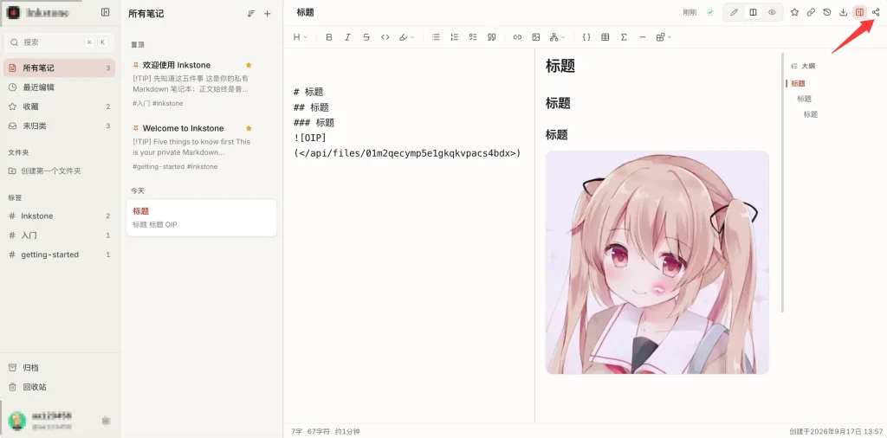

平时写笔记、整理资料，是不是经常遇到这些问题？

- 笔记分散在不同平台，查找麻烦
- 想使用Markdown，却没有合适的在线工具
- 担心数据存放在第三方平台，无法自己掌控
- 多设备同步、备份和知识整理功能不够完善

今天分享一个非常适合开发者和知识管理爱好者的开源项目：Inkstone。

👉 项目地址：Inkstone GitHub开源项目 

Inkstone是一款自托管Markdown笔记应用，运行在Cloudflare Workers上，支持写作、知识整理、搜索、双链、同步、分享和备份等功能。

## 📝 Inkstone可以做什么？

Inkstone不只是一个简单的记事本，更像是一个可以自己掌控的在线知识库。

你可以用它记录：

📚 学习笔记 💻 技术文档 🧠 个人知识库 📝 文章草稿 🔖 收藏资料 📂 项目文档 💡 灵感和待办事项

所有笔记以普通Markdown文本为基础，方便编辑、迁移和长期保存。

## ✍️ 支持丰富的Markdown语法

Inkstone支持多种Markdown格式，包括：

- 表格
- 任务列表
- 脚注
- 数学公式
- Mermaid流程图
- 代码高亮
- Callout提示框
- 折叠内容
- 标签页
- Front Matter
- Pandoc属性

写作时可以实时预览，也支持编辑、分栏和纯预览模式。

对于经常写技术文章、教程、README或者博客内容的人来说，使用起来会比较顺手。✨

## 🔗 双链笔记与知识整理

项目支持多级文件夹、标签、收藏、置顶、归档和回收站等功能。

同时还提供：

🔗 Wiki双向链接 ↩️ 反向链接 🧩 块引用 📌 笔记嵌入 🕸️ 知识关系图谱

通过这些功能，可以把零散笔记连接起来，逐渐形成自己的知识网络。

## 🔍 全文搜索与AI语义搜索

Inkstone内置全文搜索功能，支持中文索引、条件筛选、最近笔记和命令面板。

此外，还可以选择接入Cloudflare Workers AI，实现语义搜索或混合搜索。

也就是说，除了搜索关键词，还可以尝试根据内容含义查找相关笔记。

## ☁️ Cloudflare零成本部署

Inkstone最大的亮点之一，就是可以部署到自己的Cloudflare账户中。

官方提供的部署方式比较清晰：

Fork GitHub仓库 → 连接Cloudflare Workers → 配置构建命令 → 部署上线

项目支持Cloudflare D1存储笔记数据，也支持R2或Workers KV存放附件。免费套餐下可以用于个人学习和小型知识库，但实际使用仍需要遵守Cloudflare的免费额度和资源限制。

## 🔐 数据自己掌控

与普通在线笔记平台不同，Inkstone属于自托管应用。

部署之后，数据库、附件和运行环境都由自己管理。

同时支持：

- JSON导出
- ZIP导出
- Markdown文件导出
- WebDAV备份
- S3兼容存储备份
- 手动备份
- 定时备份

如果你比较在意数据可控性，或者希望长期保存自己的知识资料，这种模式会更加灵活。

## 📱 支持离线使用和多设备同步

Inkstone支持PWA，可以安装到桌面或手机主屏幕。

项目还提供：

📱 桌面端和移动端布局 🌙 深色与浅色主题 💾 浏览器本地缓存 📡 离线编辑 🔄 多设备同步 🕘 版本历史 📢 实时变更通知

即使网络不稳定，也可以先在本地编辑，之后再进行同步。

## 🌍 笔记分享与扩展能力

Inkstone支持生成公开笔记链接，还可以设置访问密码和有效期。

此外，项目还支持私有远程MCP，可以让符合权限的AI工具搜索、读取或写入自己的笔记内容。

对于想把个人知识库与AI助手结合起来的用户来说，也有一定的扩展空间。

## 🎥 本次教程内容

这次录制的是一套详细的Cloudflare零成本部署Inkstone保姆级教程，主要带大家完成：

✅ Fork开源项目 ✅ 连接GitHub仓库 ✅ 配置Cloudflare Workers ✅ 设置构建和部署命令 ✅ 配置D1、R2或KV存储 ✅ 部署Inkstone笔记系统 ✅ 绑定自己的域名 ✅ 登录并开始使用 ✅ 常见问题排查

整个过程会从基础环境开始讲解，适合第一次接触Cloudflare Workers和自托管笔记系统的朋友。

## 🎯 总结

Inkstone是一款功能比较全面的开源Markdown知识库，集成了：

Markdown写作 + 实时预览 + 双链笔记 + 全文搜索 + 离线编辑 + 多设备同步 + 分享 + 备份

再配合Cloudflare Workers进行部署，可以低成本搭建一个属于自己的在线笔记和知识管理系统。

如果你正在寻找：

Inkstone部署教程、Cloudflare零成本部署、Markdown笔记系统、开源知识库、自托管笔记、个人知识管理工具

这个项目值得收藏。🚀

# 🖼️相关截图

### **🔗项目地址:[https://github.com/shuaiplus/inkstone](https://github.com/shuaiplus/inkstone)**
