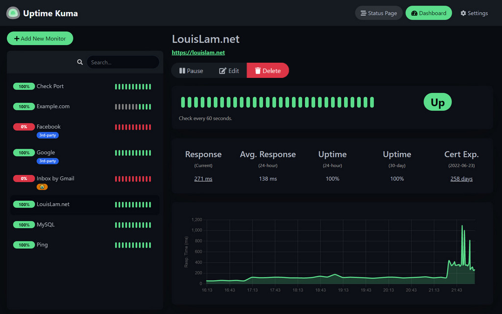
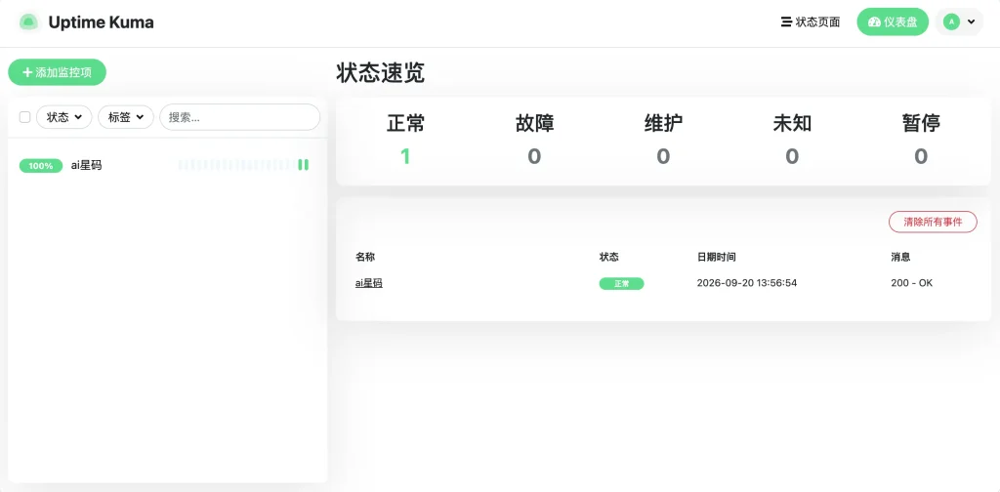

很多人自己搭建网站、博客、API或者服务器后，最怕遇到一个问题：

**网站什么时候挂的？服务器什么时候异常的？**

平时没问题还好，一旦网站宕机，可能过了几个小时才发现。😅

今天分享一个非常实用的开源项目——**Uptime Kuma**。

它是一款自托管的网站与服务监控工具，可以直接部署到自己的服务器上，用来持续监控网站、端口、DNS、Docker 容器等服务。

---

## 🔥 Uptime Kuma 能干什么？

简单来说：

**你的服务器负责运行网站，Uptime Kuma 负责盯着它。**

一旦出现异常，就可以通过配置好的通知渠道提醒你。

### 🌐 网站/服务监控

支持多种监控方式，包括：

- HTTP / HTTPS 网站监控
- TCP 端口监控
- Ping 监控
- DNS 记录监控
- WebSocket
- HTTP 关键词检测
- HTTP JSON Query
- Push Monitor
- Steam 游戏服务器
- Docker 容器监控

覆盖的场景还是比较丰富的。

---

## 🚨 网站挂了，及时通知

这也是 Uptime Kuma 很实用的地方。

可以配置多种通知方式，例如：

📱 Telegram  
💬 Discord  
📧 Email  
🔔 Gotify  
📨 Slack  
以及其他大量通知服务（50+种通知服务）。

官方文档目前还支持通过 Apprise 扩展更多通知方式。

这样就不用一直打开网页盯着服务器了。

---

## 📊 清晰的监控面板

Uptime Kuma 的界面比较直观，可以查看网站运行状态、Ping 图表、证书信息等。

还支持创建多个 **Status Page（状态页面）**，方便把多个服务的运行状态集中展示出来。

对于个人站长、开发者、小型团队来说，这种集中式监控还是挺方便的。

---

## 🐳 Docker 部署非常方便

这次我也是直接用**服务器搭建 Uptime Kuma**，并且录制了一套详细的保姆级教程。

官方项目本身就提供 Docker 和 Docker Compose 部署方式，部署完成后即可通过服务器访问 Uptime Kuma。

所以不需要专门准备一台复杂的监控服务器，普通 Linux 服务器也可以作为入门环境。

---

## 🔐 还有这些功能

除了基础的网站监控之外，Uptime Kuma 还提供：

✅ 多语言支持  
✅ 多个状态页面  
✅ 域名映射  
✅ Ping 图表  
✅ SSL 证书信息  
✅ 代理支持  
✅ 2FA 双因素认证  
✅ Docker 容器监控  
✅ 多种通知渠道

项目采用 **MIT License** 开源。

---

## 👨‍💻 哪些人适合用？

如果你属于下面这些情况，可以考虑搭一个：

👉 个人站长  
👉 VPS 玩家  
👉 Docker 用户  
👉 网站开发者  
👉 API 开发者  
👉 自建服务用户  
👉 运维人员  
👉 有多个网站需要监控的人

尤其是自己服务器上跑了好几个项目的，**一个 Uptime Kuma 就可以把它们集中监控起来。**

---

## 🎬 我录了一套保姆级搭建教程

这次没有只介绍项目，而是直接用**服务器实战搭建 Uptime Kuma**。

从环境准备、安装部署，到访问后台、添加监控、配置通知等，都做了详细演示。

对于第一次接触 Uptime Kuma 的朋友，可以跟着视频一步一步搭建。

---

## 💡 最后

Uptime Kuma 最大的特点其实就一句话：

> **让服务器自己帮你盯着网站。**

开源、自托管、功能丰富，而且支持 Docker 部署。

如果你平时有自己搭建网站、API、Docker 服务或者各种自建项目，部署一个 Uptime Kuma，确实可以省掉不少“网站到底有没有挂”的焦虑。

# 🖼️相关截图

### **🔗项目地址:[https://github.com/louislam/uptime-kuma](https://github.com/louislam/uptime-kuma)**

---

> 本文转载整理自 [Ai星码博客](https://aixmb.com/1019.html)，版权归原作者所有。

