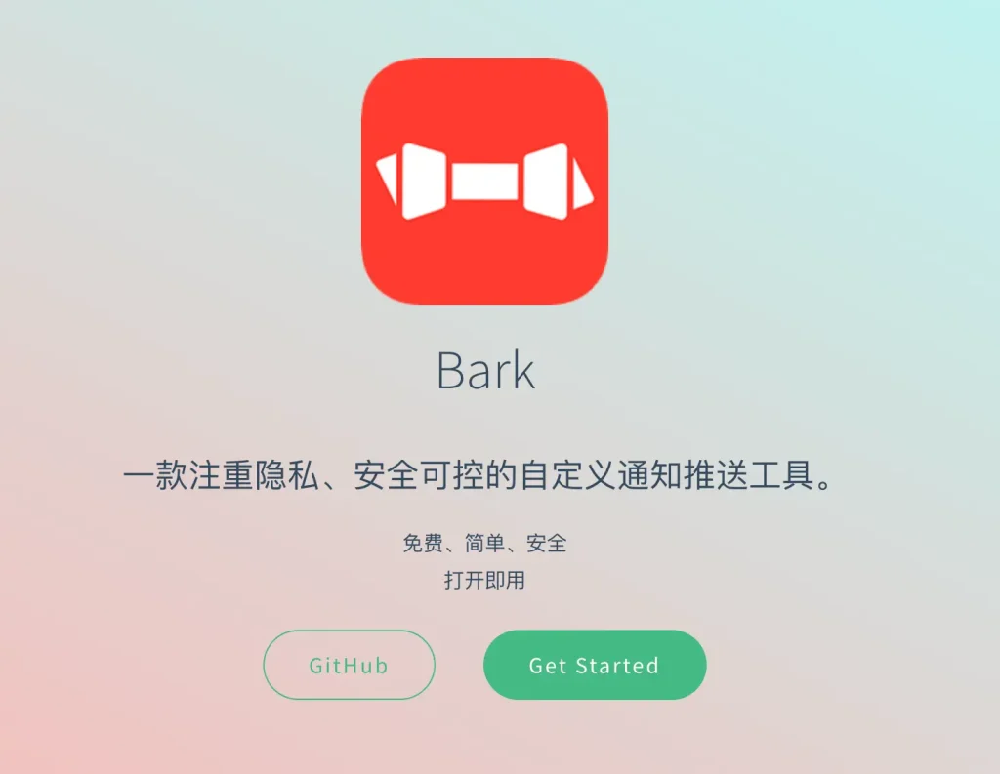

平时自己折腾服务器、网站、Docker、自动化脚本，最麻烦的是什么？

**任务执行完了没人告诉你，服务器出现异常也不知道。** 😅

很多人第一时间想到的都是：

👉 企业微信机器人  
👉 钉钉机器人  
👉 Telegram Bot

其实，还有一个非常适合 **iPhone 用户** 的开源推送方案——**Bark**。

Bark 是一个基于 Apple 推送服务 APNs 的通知工具，支持自建服务器，并且可以通过简单的 HTTP GET / POST 请求，把消息直接推送到 iPhone。

如果你平时有服务器、网站、脚本需要接收通知，Bark 还是非常值得了解一下的。📱

---

## 🔔 Bark 能干什么？

简单理解：

> **只要你的程序会发 HTTP 请求，就可以让它给你的 iPhone 发通知。**

例如：

📌 网站运行异常  
📌 服务器任务执行完成  
📌 Docker 服务状态变化  
📌 自动化脚本运行结果  
📌 定时任务提醒  
📌 SSL 证书续期通知  
📌 Uptime Kuma 监控报警

甚至可以把 Bark 接入自己的各种项目，实现自动消息推送。

这也是它比较方便的地方：

**不用专门开发一套复杂的通知系统，会调用 API 就能接入。** 🚀

---

## 🛠️ 为什么很多人需要这种工具？

以前做服务器自动化，经常遇到一个问题：

**脚本跑完了，然后呢？**

你总不能一直 SSH 登录服务器看日志吧？

网站挂了，也不可能一直守着服务器。

有了 Bark，就可以让服务器主动通知你。

比如：

> 🔥「服务器备份完成」
>
> 🚨「网站无法访问」
>
> ✅「SSL证书续期成功」
>
> 📦「Docker更新完成」

消息直接出现在手机通知栏，省去了反复登录服务器查看状态的麻烦。

---

## 🤔 别只知道企业微信、钉钉、Telegram

企业微信、钉钉、Telegram 这些机器人大家都比较熟悉。

但如果你的需求只是：

**“服务器有事情，直接通知我的手机。”**

其实不一定非要使用复杂的消息平台。

Bark 的定位更加简单：

**服务器 / 程序 → HTTP API → Bark → iPhone 📱**

对于个人站长、开发者、VPS 玩家来说，这种方式非常直接。

尤其是自己搭建服务器、运行 Docker、维护各种自动化脚本的时候，一个统一的推送接口还是很方便的。

---

## ⭐ Bark 有哪些功能？

Bark 不只是简单的“发一条消息”，还支持不少实用功能：

- 🔔 自定义通知标题、正文
- 🔊 自定义通知声音
- 🖼️ 自定义通知图标
- 📂 通知分组
- 🔗 点击通知跳转指定 URL
- ⏰ 时效性通知
- 🚨 Critical Alerts
- 🔐 加密推送
- 📡 GET / POST / JSON API
- 🖥️ 自建 Bark Server
- 🧩 浏览器扩展、脚本、SDK 等生态

所以它不仅可以拿来手动推送消息，更适合接入各种自动化场景。

---

## 🖥️ 这次直接用服务器搭建

Bark 不仅可以使用官方服务，还提供了 **Bark Server**，可以自己部署。

官方提供 Docker、Docker Compose 以及直接运行二进制文件等部署方式。

我这次也是直接用**服务器搭建 Bark**，并录制了一套详细的保姆级教程。

从服务器环境、Bark Server 部署，到后面的配置和测试，都进行了实际演示。

如果你之前没搭过 Bark，也可以直接跟着视频一步一步操作。💻

---

## 🔥 Bark + Uptime Kuma，组合起来更实用

比如你已经搭建了 **Uptime Kuma**。

Uptime Kuma 负责监控网站：

**网站异常 → Uptime Kuma 检测到 → 调用 Bark → Bark 推送到 iPhone 📱**

这样一套组合下来：

**自动监控 + 自动报警 + 手机通知**

基本就形成了一套简单的服务器监控通知方案。

同样的思路，也可以用于 Docker、定时任务、备份脚本、证书续期等场景。

---

## 👨‍💻 适合哪些人？

如果你平时喜欢：

✅ 玩 VPS  
✅ 搭建 Docker  
✅ 自建网站  
✅ 做自动化脚本  
✅ 搭建监控系统  
✅ 做服务器运维  
✅ 开发自己的项目

那么 Bark 还是非常值得折腾一下的。

尤其适合把它当成一个**通用消息推送接口**来使用。

---

## 🎬 最后

Bark 的思路其实很简单：

**你的程序负责产生消息，Bark 负责把消息推到手机。**

不需要复杂的消息系统，也不用为了一个简单的通知功能折腾半天。

开源、自托管、API 简单，而且可以和各种自动化项目组合使用。

这次我也录制了完整的**Bark 服务器搭建保姆级教程**，从零开始部署，适合新手跟着操作。🚀

如果你还只知道**企业微信机器人、钉钉机器人、Telegram Bot**，不妨了解一下 Bark，说不定正好适合你的服务器通知需求。

# 🖼️相关截图

### **🔗项目地址：[https://bark.day.app](https://bark.day.app)**
