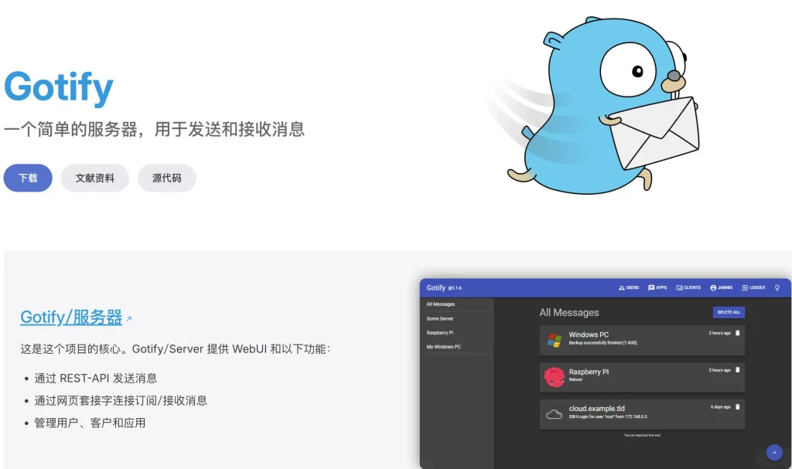

上期给大家分享了 **Bark**，主要解决的是 **iPhone 苹果端的消息推送**。

这期换个方向，给使用 **安卓手机** 的朋友分享一个同样非常实用的开源项目——**Gotify**。🚀

如果你平时有服务器、网站、Docker、自动化脚本，经常需要接收各种通知，那么 Gotify 可以了解一下。

Gotify 是一个简单的**自托管消息推送服务**，服务器负责接收和发送消息，安卓客户端负责接收推送。官方提供 Web 管理界面、REST API 和 Android 客户端。

---

## 🤔 为什么需要 Gotify？

平时折腾服务器，经常会遇到这种情况：

网站挂了不知道 ❌  
脚本执行完不知道 ❌  
Docker 更新完成不知道 ❌  
服务器备份完成还要自己查看日志 ❌

总不能一直 SSH 登录服务器看状态吧？

有了 Gotify，可以变成：

**服务器/程序 → Gotify → 安卓手机 📱**

服务器有消息，就直接推送到手机。

---

## 🔔 Gotify 能干什么？

Gotify 最核心的功能就是**消息推送**。

它提供 REST API，任何能够发送 HTTP 请求的程序，都可以向 Gotify 推送消息。官方文档也提供了 Bash、Python、Go、PHP、JavaScript 等多种调用示例。

例如：

📌 网站监控报警  
📌 服务器异常提醒  
📌 Docker 服务通知  
📌 自动化脚本  
📌 定时任务  
📌 网站备份完成  
📌 SSL 证书续期  
📌 Uptime Kuma 监控  
📌 程序运行日志提醒

基本上只要你的程序能调用 API，就可以接入。

---

## ⭐ Gotify 有哪些功能？

Gotify 不只是一个简单的推送工具，还提供：

- 📱 安卓手机推送
- 🌐 Web 管理后台
- 🔌 REST API
- ⚡ WebSocket 实时消息
- 👤 用户管理
- 📦 Application 应用管理
- 📲 Client 客户端管理
- 🔔 消息优先级
- 📝 标题、正文等消息内容
- 🔗 点击通知打开指定 URL
- 🖼️ 通知图片
- Markdown 消息显示
- 🐳 支持 Docker 部署

官方文档还提供了消息扩展机制，可以控制客户端如何显示通知。

---

## 🆚 上期是苹果，这期是安卓

如果你看过上期的 **Bark** 教程，那么这期 Gotify 可以理解成：

🍎 **Bark → iPhone 推送**

🤖 **Gotify → Android 推送**

一个面向苹果端，一个面向安卓端。

所以如果你使用的是安卓手机，又想搭建自己的消息推送服务，Gotify 就非常适合拿来折腾一下。

---

## 🖥️ 这次直接用服务器搭建

这次我也是直接使用**服务器搭建 Gotify**，并录制了一套详细的**保姆级教程**。

从服务器环境准备，到 Gotify 部署、安卓客户端连接，再到实际发送测试，都进行了详细演示。

官方本身也提供 Docker 镜像以及 Docker Compose 部署方式，对于服务器用户来说，上手会比较方便。

---

## 🔥 一个非常实用的玩法

比如你已经部署了 **Uptime Kuma**：

**网站异常 → Uptime Kuma 检测 → Gotify → 安卓手机收到报警 📱**

再比如：

**服务器备份 → 脚本执行 → Gotify → 手机收到“备份完成”**

以后就不用一直登录服务器检查任务状态了。

---

## 👨‍💻 适合哪些人？

如果你平时喜欢：

✅ 玩 VPS  
✅ 搭 Docker  
✅ 自建网站  
✅ 做自动化脚本  
✅ 搭建监控系统  
✅ 做服务器运维  
✅ 开发自己的项目

那么 Gotify 都可以折腾一下。

尤其适合想要**自己搭建安卓消息推送服务**的朋友。

---

## 🎬 最后

上期我们分享了 **Bark——苹果 iPhone 推送方案**。

这期继续安排：

**Gotify——安卓手机消息推送服务。** 🤖📱

开源、自托管、支持 REST API，而且可以直接部署在自己的服务器上。

这次也录制了完整的**Gotify 安卓推送服务搭建保姆级教程**，从零开始部署，适合新手跟着视频一步一步操作。

# 🖼️相关截图 

### **🔗项目地址：[https://gotify.net](https://gotify.net)**

---

> 本文转载整理自 [Ai星码博客](https://aixmb.com/1033.html)，版权归原作者所有。

