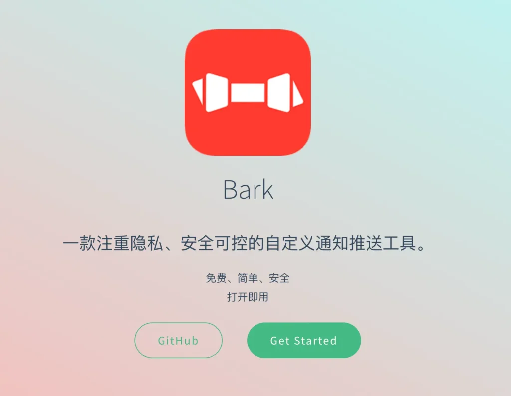

上期给大家分享了 **Bark 服务器搭建保姆级教程**。

当时很多朋友跟着教程，直接用自己的服务器搭建了 Bark 推送服务。📱

不过昨天我重新看了一下 Bark 的部署方案，发现它其实还可以通过 **Cloudflare Workers** 来部署。

于是今天直接安排：

> **Bark + Cloudflare 零成本部署！**

这次同样录制了一套详细的**保姆级教程**，从部署到测试，一步一步带大家搭起来。🚀

---

## 🔔 Bark 到底能干什么？

如果你还没看过上期内容，可以简单理解：

**Bark 就是一个给 iPhone 推送消息的开源工具。**

比如：

🚨 网站挂了  
📦 Docker 更新完成  
💾 服务器备份完成  
🔐 SSL 证书续期  
⚙️ 定时任务执行完成  
📡 Uptime Kuma 监控报警

你的服务器或者程序只需要调用 Bark API，就可以把消息直接推送到 iPhone。

而且支持自定义标题、正文、声音、图标、通知分组等功能，适合接入各种自动化场景。

---

## 🤔 为什么又要做一个 Cloudflare 版本？

其实原因很简单。

**上期是服务器部署，这期是 Cloudflare 部署。**

服务器部署的优点是资源相对独立，更适合长期运行、团队使用以及推送量比较大的场景。

而 Cloudflare Workers 的优势是：

☁️ 不需要自己维护服务器  
⚡ 部署简单  
🌍 全球边缘网络  
💰 个人低频使用可以利用免费额度

Bark 官方目前的部署文档也列出了 Cloudflare Workers 方案，并明确说明相关 Bark Worker 实现更推荐用于**个人使用和偶尔推送**，并不适合频繁或大规模推送。

---

# ⚠️ Cloudflare 免费部署有额度限制

这里一定要提醒一下。

**Cloudflare 零成本 ≠ 无限使用。**

目前 Cloudflare Workers Free 有每日 **100,000 次请求**的限制；如果使用 D1，免费计划同样存在读取、写入和存储等额度限制。

而且从 **2026 年 9 月 1 日**开始，Cloudflare 已经对 D1 免费计划的每日行读取、行写入额度进行限制执行，超过额度后相关查询会失败，直到额度重置。

所以：

### 👤 个人使用

偶尔给自己的手机推送数量非大量消息：

**Cloudflare 部署非常合适。** ☁️

### 👥 团队使用

如果是团队内部使用，有多个设备、大量服务、频繁推送：

**更建议使用服务器部署 Bark。** 🖥️

毕竟团队业务的通知量和稳定性需求，不能简单按照个人低频使用来考虑。

---

## ⭐ Bark 有哪些功能？

Bark 本身还是非常实用的：

- 📱 iPhone 消息推送
- 📡 GET / POST API
- 🔔 自定义标题和正文
- 🔊 自定义通知声音
- 🖼️ 自定义通知图标
- 📂 通知分组
- 🔗 点击通知打开指定 URL
- ⏰ 时效性通知
- 🚨 Critical Alerts
- 🔐 加密推送
- 🖥️ 自建 Bark Server
- ☁️ Cloudflare Workers 部署方案

对于喜欢折腾服务器、自动化脚本、监控工具的人来说，可以把 Bark 当成一个**通用的手机消息通知接口**。

---

# 🔥 Bark + Uptime Kuma

这里还有一个非常实用的组合。

例如你已经部署了 Uptime Kuma：

**Uptime Kuma**

↓

监控网站运行状态

↓

发现网站异常

↓

调用 Bark API

↓

**Cloudflare Bark**

↓

📱 iPhone 收到报警

这样就实现了：

**网站监控 + 自动报警 + 手机推送**

同样也可以接入 Docker、服务器备份、定时任务、自动化脚本等。

---

# 🆚 服务器部署还是 Cloudflare？

简单给大家整理一下：

| 部署方式 | 更适合 |
| --- | --- |
| 🖥️ 服务器部署 | 团队、长期运行、推送量较大 |
| ☁️ Cloudflare 部署 | 个人、低频推送、想省去服务器维护 |
| 🐳 Docker 部署 | 已经有服务器、熟悉 Docker 的用户 |
| 🚀 Workers 部署 | 已经在使用 Cloudflare 的用户 |

所以并不是说 Cloudflare 一定比服务器好。

而是：

**不同使用场景，选择不同的部署方式。**

---

# 🎬 这次录制了 Cloudflare 保姆级教程

上期分享：

> 🖥️ **Bark 服务器搭建保姆级教程**

昨天重新研究了一下发现：

> ☁️ **原来 Bark 还可以部署到 Cloudflare！**

所以今天又录了一期。

这次是 **Bark Cloudflare 零成本部署详细教程**，从 Cloudflare 环境准备，到 Worker、数据库配置，再到 Bark 部署和实际测试，都进行了详细演示。

如果你看过上期服务器搭建教程，这一期可以继续尝试 Cloudflare 版本。🚀

---

# 📌 最后

Bark 这个项目还是挺有意思的。

**想自己维护服务器 → 服务器部署。**

**个人偶尔使用 → 可以尝试 Cloudflare。**

**团队、大量通知 → 更建议服务器部署。**

Cloudflare 的免费方案确实方便，但一定要注意**免费额度和使用限制**，不要把“零成本”理解成“无限量”。

这次我也把整个 Cloudflare 部署过程录成了详细的**保姆级视频教程**，新手可以直接跟着操作。

# 🖼️相关截图

### **🔗项目地址：[https://bark.day.app](https://bark.day.app)**
