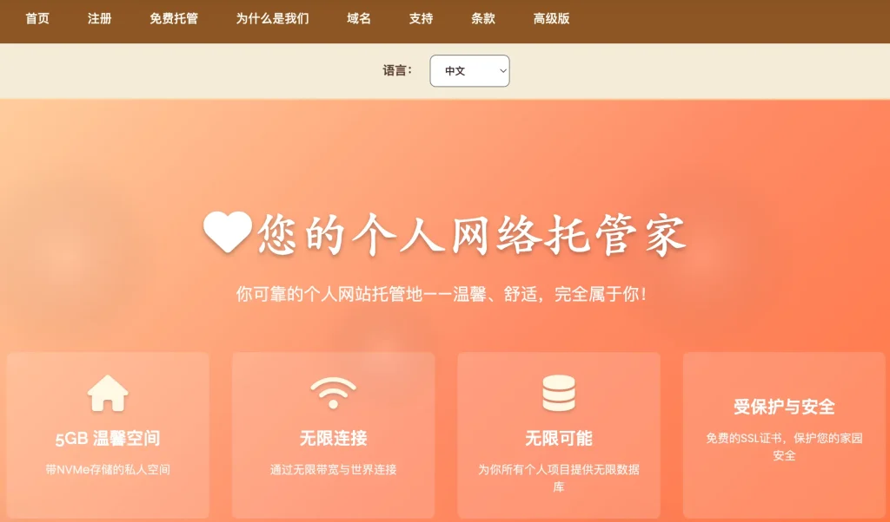

想搭一个自己的 **WordPress 博客**，但又不想一开始就花钱买服务器？

尤其是刚接触建站的新手，买服务器、配置环境、安装 PHP、MySQL，一套流程下来确实有点麻烦。😅

这次给大家分享一个比较适合新手折腾的免费虚拟主机——**MyPlace**。

[MyPlace 官方网站](https://my-place.us/?utm_source=chatgpt.com)

官方目前提供免费的 Web Hosting，包含 **5GB 存储空间、无限带宽、免费 SSL、PHP、MySQL、cPanel 控制面板以及 Softaculous 一键安装器**等功能。

而我这次也专门录制了一期视频：

> 🎬 **如何免费使用 MyPlace 搭建自己的 WordPress 博客**

整个过程会从注册、进入控制面板，到 WordPress 搭建进行详细演示。

---

## 🤔 为什么需要免费虚拟主机？

很多刚开始做网站的朋友，都会遇到几个问题：

💰 买服务器需要成本  
⚙️ 不会配置网站运行环境  
🐳 Docker、Linux 对新手有一定门槛  
🛠️ 想学习 WordPress，却不想先花钱

如果只是：

- 个人博客
- WordPress 学习
- 网站测试
- 个人作品展示
- 小型项目
- 建站练手

其实没必要一上来就购买高配置服务器。

**先用免费虚拟主机把网站跑起来，再慢慢折腾，也是一种不错的方式。** 🚀

---

# ⭐ MyPlace 有哪些功能？

根据目前官网公布的信息，MyPlace 免费主机主要提供这些功能：

### 💾 5GB 存储空间

官方提供 **5GB 磁盘空间**，可以用来存放网站程序、数据库以及邮件等数据。官网首页还标注使用 NVMe 存储。

对于个人博客、学习项目和测试网站来说，可以作为入门环境。

---

### 🌐 无限带宽

官方免费主机页面目前标注 **Unlimited Bandwidth**。

对于个人博客、展示站等轻量网站来说，可以减少对月度流量额度的顾虑。

当然，免费主机依然属于共享托管环境，具体资源和使用规则还是要以官方条款为准。

---

### 🔐 免费 SSL

网站可以使用免费的 SSL 证书。

也就是说，搭建 WordPress 后可以配置：

**HTTP → HTTPS 🔒**

对于博客来说，HTTPS 基本已经是网站的标配。

---

### 🐘 支持 PHP + MySQL

WordPress 本身就是基于 PHP 和数据库运行的。

MyPlace 官方目前列出了 **PHP 8.2 和 MySQL 5.7** 支持，可以满足常见 PHP 网站以及 WordPress 的运行需求。

---

# 🚀 最大的亮点：WordPress 可以快速安装

对于不会配置服务器的新手来说，这个功能还是非常方便的。

MyPlace 提供 **Softaculous Auto Installer**，官方介绍支持 **400+ Scripts**，可以通过控制面板快速安装 WordPress 等常见网站程序。

也就是说，不需要自己：

❌ 手动上传 WordPress 文件  
❌ 手动创建复杂环境  
❌ 从零配置 PHP  
❌ 折腾一堆命令

通过控制面板就可以快速开始。

---

## 🖥️ 自带 cPanel 控制面板

MyPlace 还提供比较熟悉的 **cPanel 控制面板**。

里面可以管理：

📁 网站文件  
🗄️ MySQL 数据库  
📧 邮箱  
🔐 SSL  
📊 网站统计  
💾 备份  
⏰ Cron 定时任务  
🛠️ PHP 环境

同时还有 phpMyAdmin 和文件管理器等工具。

对于第一次接触虚拟主机的人来说，比直接面对一台 Linux 服务器更容易上手。

---

# 💡 一个免费主机，可以拿来干什么？

其实玩法还不少。

### 📝 搭建个人 WordPress 博客

这是我这次视频教程主要演示的内容。

注册免费主机 → 安装 WordPress → 配置博客 → 开始写文章。

整个过程不需要先购买服务器。

---

### 🧪 搭建测试网站

想测试一个 WordPress 主题？

想研究插件？

想学习网站后台？

都可以先搭一个测试站。

---

### 🎨 搭建个人展示网站

例如：

个人主页  
作品展示  
项目介绍  
技术博客  
摄影网站

都可以使用 WordPress 来完成。

---

# 📊 官方还提供这些资源

根据 MyPlace 当前免费主机页面，除了 5GB 空间和免费 SSL 外，还提供：

✅ 400 个 MySQL 数据库  
✅ 400 个邮箱账户  
✅ 400 个附加域名  
✅ 400 个子域名  
✅ 400 个停放域名  
✅ PHP 8.2  
✅ MySQL 5.7  
✅ Softaculous 400+ 脚本  
✅ phpMyAdmin  
✅ 文件管理器  
✅ Cron 定时任务  
✅ 网站统计  
✅ 备份管理器

具体额度和功能可能会根据平台规则调整，实际使用时建议以官网当前页面和账户控制面板为准。

---

# 🎬 我已经录好了保姆级教程

这次我直接做了一期：

> **《免费虚拟主机搭建 WordPress 博客保姆级教程》**

从注册开始，到免费主机使用，再到 **WordPress 博客搭建**，全部进行实际操作演示。

如果你一直想做一个自己的博客，又不想刚开始就购买服务器，可以跟着视频一步一步搭建。📹

---

# ⚠️ 免费主机适合什么场景？

这里也提醒一下：

**免费虚拟主机 ≠ 高性能生产服务器。**

它更适合：

📝 个人博客  
🧪 学习测试  
🎓 建站练习  
💻 个人项目  
🎨 展示网站

如果以后网站访问量越来越大，或者运行比较重要的商业项目，再考虑升级到更高资源的主机或 VPS。

这样其实更加合理。

---

# 🚀 最后

如果你只是想：

**“我想拥有一个自己的 WordPress 博客，但暂时不想花钱买服务器。”**

那么 MyPlace 这种免费虚拟主机，可以拿来研究一下。

**5GB 空间 + PHP + MySQL + 免费 SSL + cPanel + WordPress 一键安装**，对于刚开始学习 WordPress 的朋友来说，已经能够满足不少基础需求。

这次我也把完整的**免费搭建 WordPress 博客保姆级教程**录好了，从零开始实际操作，新手跟着视频就可以一步一步搭建自己的博客。🔥

# 🖼️相关截图

### **🔗领取地址:[https://my-place.us](https://my-place.us)**
