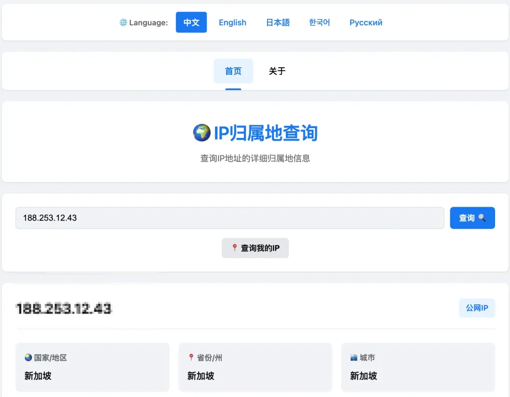
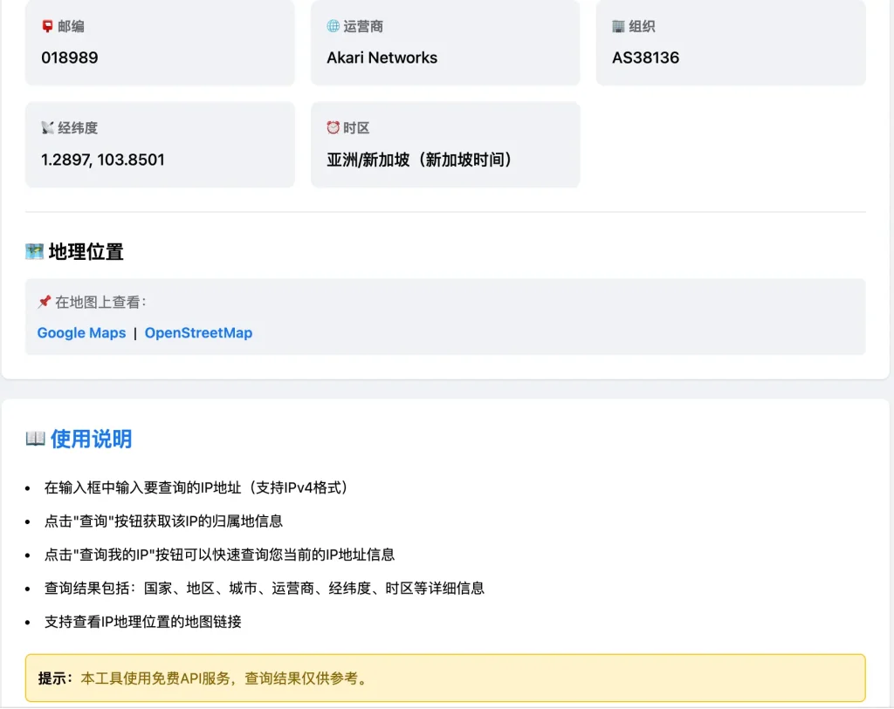

平时遇到一个陌生 IP，想知道它来自哪里、属于哪个运营商，很多人第一反应就是到处找在线查询网站。

但如果你自己也想搭一个**IP归属地查询工具**，其实没必要从零开发。

今天分享的这个开源项目 **IP-Carrier-Lookup**，就是一个非常适合拿来搭建个人工具站的小项目。项目采用纯前端方案，直接输入 IP 就能查询详细归属地信息。

## 🔎 它能查什么？

这个工具虽然界面比较简单，但实用功能还是挺齐全的：

- 🌐 查询 IPv4 地址
- 📍 国家/地区
- 🗺️ 省份/州
- 🏙️ 城市
- 📮 邮政编码
- 📡 运营商 ISP
- 🏢 组织 / AS 号
- 🌐 经纬度
- 🕐 时区
- 🔵 公网 IP / 内网 IP 类型识别
- 🗺️ Google Maps 地图查看
- 🌍 OpenStreetMap 地图查看
- 📱 手机端、PC端自适应
- 🔍 自动查询当前公网 IP
- ⚡ 手动输入 IP 查询

## 😩 解决了什么痛点？

很多时候我们并不需要复杂的 IP 数据分析。

比如：

👉 想快速判断一个 IP 来自哪个城市  
👉 想查看某个服务器 IP 属于哪家运营商  
👉 网站开发测试时需要一个 IP 查询工具  
👉 做网络运维时需要快速查看 IP 基本信息  
👉 想自己搭建一个简单的在线工具网站

这时候，一个**打开网页、输入 IP、直接出结果**的工具就足够了。

而且这个项目是纯前端结构，核心文件就是 HTML、CSS 和 JavaScript，部署门槛相对比较低。

## ☁️ 最关键：Cloudflare零成本部署

这个项目非常适合部署到 **Cloudflare Pages**。

因为它本身就是静态网页，不需要购买服务器，也不需要折腾 Nginx、Docker 等环境。

基本思路就是：

**GitHub项目 → Cloudflare Pages → 部署 → 绑定域名 → 上线**

Cloudflare Pages 支持直接连接 Git 仓库或者上传已经构建好的静态文件；目前 Free 计划的静态资源请求不收费，并提供相应的免费额度和项目限制。

所以对于这种小型在线工具来说，可以把服务器成本压到很低。

⚠️ 不过这里要注意：项目依赖的免费 IP API 本身存在调用限制，README 当前说明免费接口每分钟最多 45 次请求，并提醒商业用途考虑升级 API 服务。因此，如果后期访问量明显增长，API 成本和服务条款需要单独考虑。

## 💰 还能不能做成副业？

这也是我比较推荐这个项目的地方。

如果只是自己部署出来玩，当然只是一个小工具。

但如果进一步做成：

**IP查询工具网站 → SEO优化 → 搜索流量 → 广告位 → 收益**

玩法就完全不一样了。

比如可以在：

📌 查询页面  
📌 查询结果区域  
📌 工具说明区域  
📌 相关文章页面

加入符合广告平台规则的广告位。

用户免费使用工具，你通过网站广告获得收入。

当然，广告收益和实际访问量、用户来源、广告平台政策等都有关系，并不是部署以后就一定产生收益。

## 🚀 为什么适合做工具站？

这个项目还有一个优势：

**功能足够简单，但用户搜索需求比较明确。**

可以围绕：

- IP地址查询
- IP归属地查询
- IP地址定位
- IP运营商查询
- IP地理位置查询
- IPv4查询
- IP地址信息查询

这些关键词继续扩展网站内容。

甚至可以后面增加：

📖 IP知识文章  
🔍 IP查询教程  
🌐 网络工具  
📡 DNS工具  
🛠️ 其他在线查询工具

慢慢把一个简单的 IP 查询页面，扩展成一个小型**网络工具站**。

## 🎬 我也录制了详细搭建教程

这次我已经把整个搭建过程录制成了详细教程，从项目准备、**Cloudflare零成本部署**，到网站上线以及后续广告变现思路，都进行了实际演示。

不想自己一点点摸索的，可以直接跟着视频一步一步搭建。

## ✅ 最后总结

如果你正在找一个：

**开源 + 简单 + 免费部署 + 有实际使用场景 + 可以继续扩展**

的小项目，那么这个 IP 归属地查询工具还是挺适合拿来练手的。

尤其是想做**在线工具站、Cloudflare项目、SEO网站、副业项目**的朋友，可以研究一下。

先把工具跑起来，再慢慢做 SEO、增加内容、优化页面和广告位。

**小工具不一定要做得多复杂，能解决一个明确的问题，就有存在的价值。** 🌍

# 🖼️相关截图

### **博主演示站：[https://ip.kixtools.com](https://ip.kixtools.com)**

### **🔗项目地址:[https://github.com/aixmbcom/IP-Carrier-Lookup](https://github.com/aixmbcom/IP-Carrier-Lookup)**
