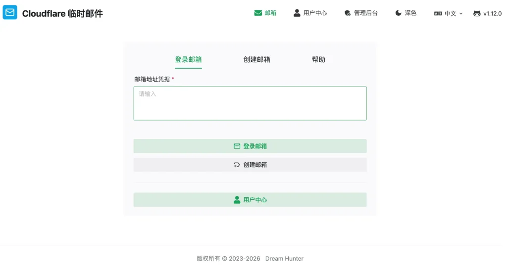
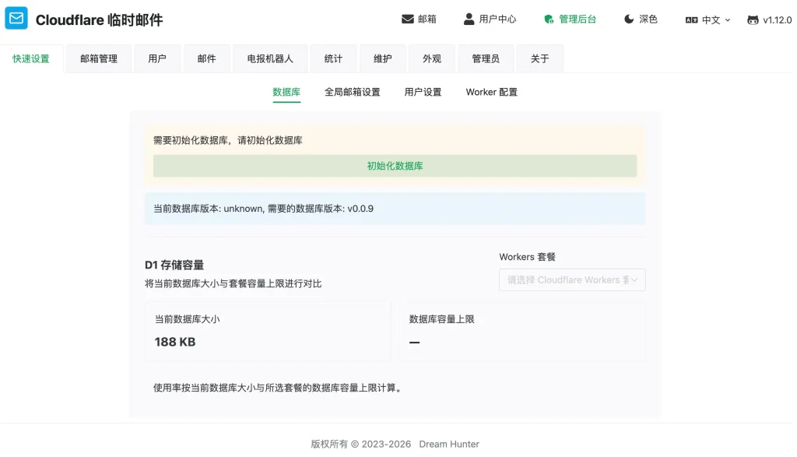

平时注册一些网站、测试程序、接收测试邮件的时候，很多人都不太愿意直接使用自己的常用邮箱。

原因很简单：

**怕垃圾邮件、怕泄露主邮箱、测试邮箱不方便管理。**

所以临时邮箱一直都有比较明确的使用场景。

今天分享一个我最近比较关注的开源项目：**Cloudflare Temp Email**。

它可以自己搭建一个完整的临时邮箱服务，支持收邮件、发邮件、附件、邮件转发、Telegram 推送、Webhook、AI 邮件识别等功能。

更重要的是，它本身就是围绕 **Cloudflare Workers、Pages、D1、KV、Email Routing** 这套体系设计的，非常适合喜欢折腾 Cloudflare 的朋友。项目 README 目前也明确将它定位为基于 Cloudflare 免费服务构建的临时邮件服务。

---

## 😩 为什么需要一个临时邮箱？

相信很多人都遇到过这种情况：

注册一个网站，只是想体验一下。

结果：

📩 每天收到一堆营销邮件  
📩 邮箱被各种网站记录  
📩 测试程序需要反复注册邮箱  
📩 开发邮件功能时没有测试环境  
📩 接收验证码的时候不想暴露自己的常用邮箱

如果只是偶尔使用，第三方临时邮箱当然可以。

但如果你本身就喜欢自己搭建工具站，那么完全可以考虑：

**自己搭一个临时邮箱服务。**

域名自己控制，网站自己部署，功能也可以自己调整。

---

# 🚀 Cloudflare Temp Email 是什么？

**Cloudflare Temp Email** 是一个开源的临时邮箱项目。

它不是单纯做一个“随机邮箱地址生成器”，而是把**邮箱创建、收件、邮件解析、用户管理、管理员后台、邮件发送、附件、转发、Webhook 等功能**都整合到了一起。

项目采用 Vue 3 + Vite + TypeScript 构建前端，后端使用 Cloudflare Workers，数据库使用 Cloudflare D1，同时结合 Cloudflare Email Routing 接收邮件，邮件解析部分使用 Rust WASM。

简单理解就是：

**Cloudflare + 域名 + 临时邮箱系统 = 自己的在线邮箱工具站。**

---

# 📬 到底能干什么？

这个项目功能还是比较丰富的。

### 📩 1. 临时邮箱收件

这是最基础也是最核心的功能。

用户可以创建邮箱地址，然后通过网页查看收到的邮件。

对于网站测试、开发测试、临时收件等场景都比较方便。

---

### 🔐 2. 邮箱地址密码

项目支持给邮箱地址设置独立密码。

这样相比简单的“谁知道地址谁就能看”的临时邮箱，安全控制会更加完善。

同时项目还提供用户注册、登录、邮箱绑定等功能，可以管理多个邮箱地址。

---

### 🤖 3. AI 自动识别邮件

这个功能就比较有意思了。

项目支持使用 **Cloudflare Workers AI** 对邮件内容进行识别，可以自动提取：

🔢 验证码  
🔗 认证链接  
🌐 服务链接  
📌 其他重要信息

对于临时邮箱来说，这个功能非常实用。

收到一封很长的验证邮件，不需要自己慢慢翻，直接找关键内容即可。

项目近期版本还加入了在没有 Workers AI 配置时使用内置正则提取验证码的能力。

---

### 📎 4. 支持邮件附件

收到邮件不只是看文字。

项目支持查看邮件附件，而且支持显示图片附件。

同时还可以使用 S3 兼容存储保存和删除附件。

对于测试注册、程序邮件、系统通知等场景都比较方便。

---

### ↪️ 5. 邮件转发

如果临时邮箱收到重要邮件，还可以进一步配置邮件转发。

项目支持全局转发地址。

这样可以把临时邮箱和自己的其他邮箱服务连接起来。

---

### 📤 6. 支持发送邮件

它也不只是“只能收不能发”。

项目支持邮件发送，并可以通过：

- SMTP
- Resend
- Cloudflare Email Sending 等方式

完成发信能力，具体使用哪种方式取决于你的部署配置。项目当前文档同时支持 SMTP、Resend 等发送方式。

---

# 🤖 Telegram、Webhook 也能接

如果你平时有服务器、网站监控或者自动化需求，这部分功能就比较实用了。

项目支持：

📱 Telegram Bot  
🔔 Telegram 推送  
🔗 Webhook  
📨 消息推送  
📡 SMTP / IMAP

例如收到新邮件后，可以通过 Telegram 推送通知。

也可以利用 Webhook 把邮件事件连接到自己的其他系统。

项目还提供 SMTP Proxy Server，可以提供 SMTP 发信和 IMAP 查看邮件的能力。

---

# 🌍 多语言 + 移动端

对于想把它做成公开工具站的人来说，多语言也是一个不错的功能。

项目支持多语言界面，当前版本的前端已经支持包括中文、英文、日语、德语、西班牙语、葡萄牙语等语言。

另外还有一个社区客户端 **CloudMail**，可以用于 Android 端的邮箱和管理操作。

也就是说，它不仅仅适合自己部署着玩。

如果后面真的准备运营成一个在线工具网站，扩展空间还是比较大的。

---

# 🛡️ 防滥用功能也考虑到了

临时邮箱这种服务比较容易被滥用，所以如果准备公开运营，安全和限制功能非常重要。

项目提供了：

🛡️ Cloudflare Turnstile  
🚦 API 限流  
🚫 IP 黑名单  
✅ IP 白名单  
📩 垃圾邮件检测  
⚙️ 黑名单 / 白名单  
🧹 邮件定时清理

近期版本还增加了更细的 IP 白名单、限流 API 和邮箱清理策略等功能。

对于个人使用和小型工具站来说，这些功能能够减少很多后期维护压力。

---

# ☁️ 最大亮点：Cloudflare 零成本部署

我觉得这个项目最适合拿来做教程的地方，就是它的架构非常适合 Cloudflare。

官方架构主要包括：

**Cloudflare Pages**  
负责前端。

**Cloudflare Workers**  
负责后端 API。

**Cloudflare D1**  
负责数据库。

**Cloudflare KV**  
用于相关数据存储。

**Cloudflare Email Routing**  
负责邮件接收。

整体就是一套 Cloudflare 生态。

所以不需要像传统邮箱项目那样，一上来就购买服务器、配置 Linux、安装各种邮件组件。

对于想研究：

☁️ Cloudflare  
💻 Workers  
📧 邮箱系统  
🛠️ 在线工具  
🚀 开源项目

的人来说，非常适合拿来练手。

不过要注意，**“零成本”是建立在 Cloudflare 免费资源额度、相关服务规则以及其他依赖服务限制之内**，并不代表无限资源、无限邮件发送。项目本身也有部分功能需要额外的服务配置。

---

# 💰 还能不能做成一个副业项目？

如果你只是部署出来自己使用，那就是一个实用工具。

但如果你进一步把它做成一个网站，就可以考虑另一种玩法：

### **免费临时邮箱 → SEO → 用户访问 → 广告变现**

例如网站可以围绕这些关键词进行内容建设：

🔎 临时邮箱  
📧 免费临时邮箱  
📩 临时邮箱接收邮件  
🔐 一次性邮箱  
📨 在线临时邮箱  
📱 临时邮箱验证码  
🌐 临时邮箱地址  
💻 免费邮箱工具

然后把网站做成一个真正的**在线临时邮箱工具站**。

---

# 📢 页面还能接入广告

这个项目官方 README 已经提供了 **Google Ads 集成支持**。

所以从项目能力上来说，可以进一步研究广告变现。

比如：

📌 首页工具区域  
📌 邮箱列表页面  
📌 使用说明区域  
📌 SEO文章页面  
📌 工具周边内容

当然，广告能不能获得收益，最终还是取决于网站访问量、用户来源、广告平台审核、广告展示情况等，并不是部署完成就一定有收入。

而且临时邮箱属于容易被滥用的工具，做公开网站的时候，**一定要遵守广告平台和相关服务的规则，同时做好反滥用措施**。

# 🖼️相关截图

### **博主临时邮箱：[https://email.aixmb.cn](https://email.aixmb.cn)**

### **🔗项目地址:[https://github.com/dreamhunter2333/cloudflare_temp_email](https://github.com/dreamhunter2333/cloudflare_temp_email)**

---

> 本文转载整理自 [Ai星码博客](https://aixmb.com/1084.html)，版权归原作者所有。

