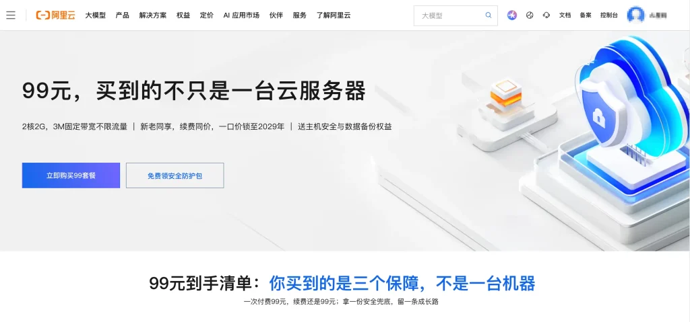
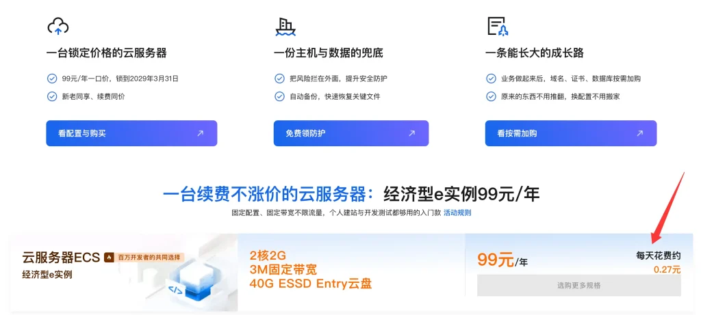

最近想买一台**国内云服务器**，又不想一年花几百上千元的，可以看看阿里云这次的活动。

这次比较吸引人的地方不是单纯的“99元/年”，而是：

> **2核2G + 3M固定带宽 + 40GB ESSD Entry，国内节点，连续4年每年99元！**

而且**新老用户都可以参加**，对于已经用过阿里云的老用户来说也比较友好。🔥

---

## 💰 99元一年，具体是什么配置？

活动指定的是阿里云 **ECS经济型e实例**，配置如下：

- 🖥️ **2核 CPU**
- 🧠 **2GB 内存**
- 🌐 **3M固定带宽**
- 💾 **40GB ESSD Entry系统盘**
- 🇨🇳 **国内服务器节点**
- 💰 **99元/年**

平均下来：

**99 ÷ 12 ≈ 8.25元/月**

也就是一个月不到10元，就可以拥有一台国内云服务器。

对于个人用户来说，这个价格确实比较低。

---

# 🔥 最大亮点：连续4年，每年只要99元

这次活动真正值得关注的是**续费价格**。

符合活动规则的情况下，指定配置可以继续按照：

### **99元/年**

进行续费。

也就是说，可以连续：

**第1年：99元**  
**第2年：99元**  
**第3年：99元**  
**第4年：99元**

连续4年，每年都是99元。

如果按照4年计算：

### 💰 99 × 4 = 396元

**4年服务器费用一共396元。**

对于个人建站、开发测试、跑一些轻量级项目来说，成本还是非常低的。

⚠️ 注意：这里说的是**符合活动规则的低价续费权益**，不是购买一次之后永久锁定99元。每年的续费需要按照活动规则执行，具体以阿里云购买和续费页面实际展示为准。

---

# 🇨🇳 国内服务器，3M固定带宽

这次还有一个比较重要的点：

### **服务器是国内节点。**

活动指定地域包括：

📍 北京  
📍 杭州  
📍 上海  
📍 呼和浩特  
📍 深圳  
📍 成都  
📍 河源  
📍 乌兰察布  
📍 广州

对于主要面向国内用户的网站来说，国内节点也是很多人的选择。

3M固定带宽虽然不算特别高，但对于：

- 📝 个人博客
- 🌐 企业展示站
- 🛠️ 小型工具网站
- 💻 开发测试
- 🐳 Docker项目
- 📚 学习Linux
- 🔧 部署开源项目

这类场景，作为入门服务器还是可以的。

---

# 👨‍💻 可以拿来干什么？

如果你平时喜欢折腾服务器，这台机器可以玩出不少东西。

### 📝 搭建个人博客

WordPress、Typecho、Halo等博客程序都可以作为部署对象。

自己的服务器、自己的域名，搭一个属于自己的博客。

### 🐳 Docker部署

如果你喜欢开源项目，可以直接用服务器部署各种 Docker 应用。

比如：

**Uptime Kuma、RustDesk、Gotify、Bark以及各种Web项目。**

### 💻 开发测试

程序员也可以拿来做：

- API测试
- Web项目测试
- Git项目部署
- Linux环境学习
- Nginx测试
- MySQL测试
- Docker学习

### 🌐 做自己的小网站

甚至可以搭建：

**网站 + 工具 + SEO + 内容**

慢慢做成自己的在线工具站。

如果后面网站有了流量，还可以根据平台规则考虑广告等变现方式。

**还可以搭建闲鱼自动发货系统！（可以看博主往期视频）**

# 👨‍💻挂软件

淘宝虚拟自动发货！

多多虚拟自动发货！

小红虚拟书自动发货！

---

# 🎯 新用户、老用户都能参加

这也是这次活动比较吸引人的地方。

不是只有新用户。

按照活动规则：

### ✅ 新用户可以参加

### ✅ 老用户也可以参加

但需要满足活动要求，包括：

- 阿里云注册会员
- 完成实名认证
- 符合活动参与条件
- 购买活动指定配置

所以如果你已经有阿里云账号，也可以登录后台看看自己是否具备购买资格。

---

# 📅 活动时间

目前活动规则显示，活动时间截至：

### **2029年3月31日**

并且活动规则中明确了指定配置的低价购买和续费方式。

因此，如果你准备长期使用这台服务器，**购买时间也会影响后续能够享受多少次99元续费**。

简单来说：

**越早符合条件参与，能够享受低价续费的时间窗口越充足。**

---

# ⚠️ 购买之前注意这几点

虽然99元确实便宜，但还是建议大家购买前看清规则。

### 1️⃣ 是国内服务器

如果你的网站主要面向国内用户，可以重点关注。

### 2️⃣ 需要实名认证

新老用户都需要满足活动参与条件。

### 3️⃣ 指定配置才能享受99元

不是阿里云所有服务器都99元。

指定的是：

**2核2G + 3M固定带宽 + 40GB ESSD Entry。**

### 4️⃣ 每年99需要符合续费规则

不是永久锁定99元。

活动期间，符合条件的指定实例可以按照规则进行低价续费。

### 5️⃣ 其他资源可能产生费用

例如额外购买其他云产品、增值服务等，需要按照对应产品的资费计算。

---

# 🔥 总结

如果你最近正好想买一台**国内云服务器**，这次阿里云的99元活动还是值得关注的。

**2核2G + 3M固定带宽 + 40GB ESSD Entry**

重点是：

🇨🇳 **国内节点**  
💰 **99元/年**  
👨‍💻 **新老用户同享**  
🔥 **符合规则可连续4年每年99元**  
💵 **4年服务器费用仅396元**

对于个人博客、网站搭建、Docker、开发测试以及各种开源项目部署来说，都可以作为一台低成本入门服务器。

如果你本来就准备买服务器，与其一年花几百元，不妨先看看这个99元方案。

**一年99元，连续4年每年99元，4年就是396元。** 🚀

> 📌 **注意：活动配置、资格、地域及续费规则可能调整，最终以阿里云活动页面实际展示为准。**

# 🖼️相关截图

### **🔗阿里云活动地址:[https://t.aliyun.com/U/uDcdi2](https://t.aliyun.com/U/uDcdi2)**

---

> 本文转载整理自 [Ai星码博客](https://aixmb.com/1091.html)，版权归原作者所有。

