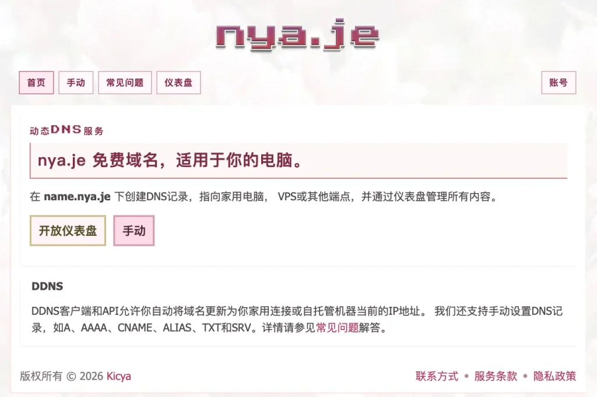
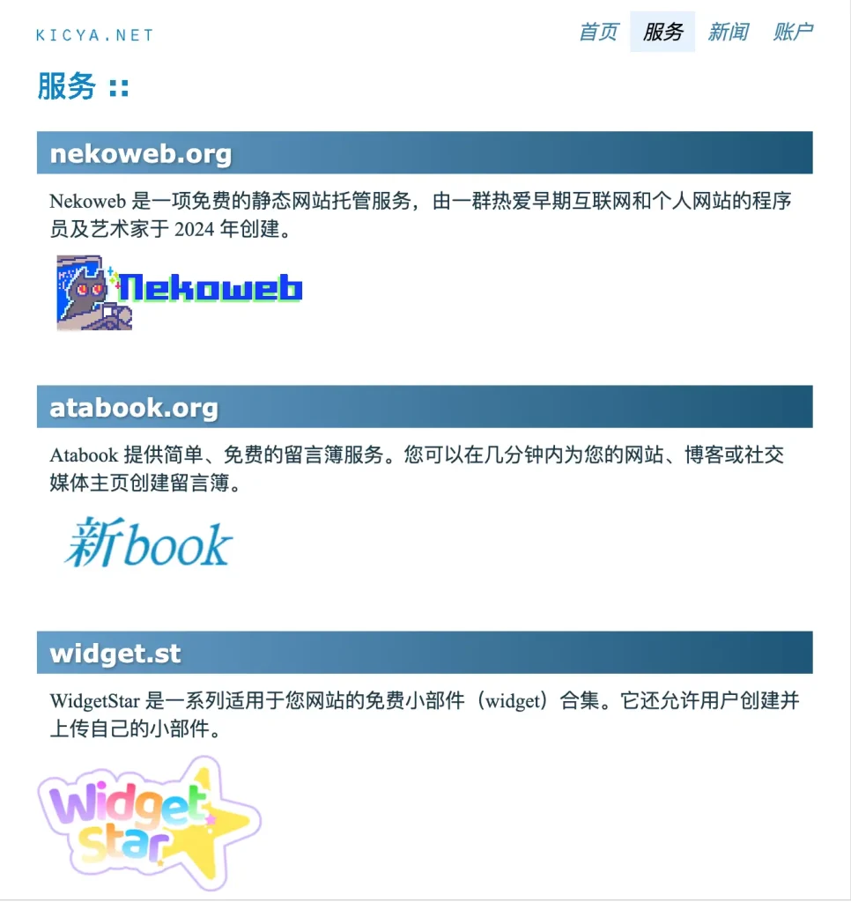
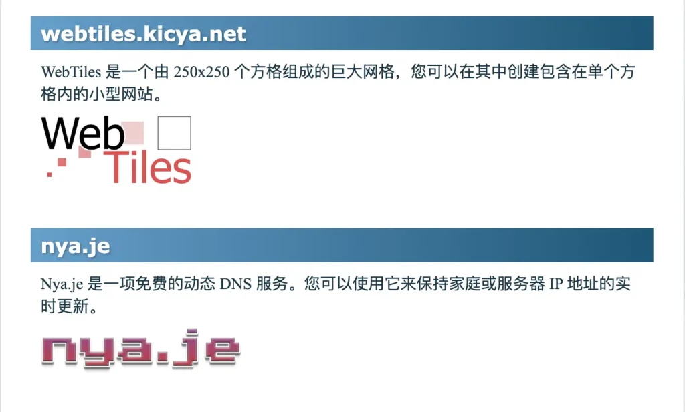

还在到处找**免费域名**吗？

想做个人博客、个人主页、开源项目展示，却又不想每年花钱买域名？

今天分享一个比较特别的免费域名服务：**Nya.je**。

它是 Kicya.net 旗下的免费 DDNS 服务，可以创建类似：**.nya.je**

这样的域名，并且可以自己管理 DNS，适合个人网站、服务器、家庭网络以及各种折腾项目。

---

## 🌐 .nya.je 是什么？

简单来说，Nya.je 提供的是：

> **免费的 xxx.nya.je 域名 + DNS 管理 + DDNS**

你可以自己选择一个喜欢的名称，例如：**yourname.nya.je**

然后把它指向自己的：

- 🖥️ VPS服务器
- 🏠 家庭电脑
- 🌐 个人网站
- 🔧 自建服务
- 💻 其他网络服务

官方目前将 Nya.je 定位为免费动态 DNS 服务，同时也支持手动管理 DNS 记录。

---

# 😩 为什么需要免费域名？

很多人折腾网站的时候，第一步就卡在域名。

买域名吧：

💰 每年需要续费  
💰 有些后缀价格比较高  
💰 只是做个测试项目感觉不划算

但如果只是做：

**个人主页、博客、开源项目、服务器服务、测试网站**

其实未必需要一个昂贵的顶级域名。

这时候一个免费的二级域名就很方便了。

---

# 🚀 Nya.je 有什么功能？

### 🌐 免费 nya.je 域名

可以创建：

**xxx.nya.je**

作为自己的网络地址。

适合个人网站、项目主页、服务器等场景。

### 🔄 DDNS 动态解析

如果家里的公网 IP 经常变化，可以使用 DDNS 自动更新 DNS，让域名始终指向当前 IP。

官方提供 DDNS Client 和 API，可以自动更新家庭网络或自托管服务器的 IP。

### 🛠️ 支持多种 DNS 记录

目前支持：

- A
- AAAA
- CNAME
- ALIAS
- TXT
- SRV

同时还支持通配符记录。

所以它并不只是“给你一个免费网址”，还可以拿来做一些实际的 DNS 配置。

---

# 💻 可以拿来做什么？

用途其实不少。

### 📝 搭个人博客

例如：

**blog.nya.je**

可以用来搭建自己的个人博客、技术博客。

### 🌐 个人主页

可以做一个：

**me.nya.je**

放个人介绍、作品集、联系方式等。

### 🖥️ 服务器

如果你有 VPS 或家里的服务器，也可以让：

**server.nya.je**

指向自己的服务器。

### 🏠 家庭网络

配合 DDNS，即使家庭公网 IP 发生变化，也可以自动更新 DNS。

### 🔧 开源项目

自己部署一些开源项目，也可以使用 **.nya.je** 作为访问地址。

---

# 🆓 免费领取，适合折腾党

Nya.je 的一个特点就是比较适合喜欢研究**个人网站、独立互联网、自建服务**的人。

Kicya.net 本身也提供 Nekoweb、Atabook、WebTiles、WidgetStar 等多个面向独立互联网用户的免费服务。

如果你平时喜欢：

☁️ Cloudflare  
🌐 免费域名  
🖥️ VPS  
🏠 家庭服务器  
📝 个人博客  
💻 开源项目

这个域名可以收藏一下。

---

# ⚠️ 有几个地方需要注意

这里需要特别说明一下：

目前官方页面明确显示 Nya.je 是**免费域名 / 免费 DDNS 服务**，但并没有在当前官方页面明确写出“永久有效、永不过期”的承诺，但是没有到期时间。

所以更严谨的说法是：

> **目前免费提供，可以长期使用，但具体服务规则以后是否调整，以官方公告和服务条款为准。**

另外，目前每个账号只能创建 **1 个域名**，每个域名最多 **25 条 DNS 记录**。

同时，Nya.je 目前不支持创建 NS、SPF、DMARC、MX 等记录。

---

# 🎬 我已经录制了免费领取教程

这次我也专门录制了一个详细教程。

从：

**注册账号 → 免费领取 .nya.je → 创建域名 → DNS配置 → 实际使用**

都会进行演示。

如果你也想拥有一个免费的：

### **xxx.nya.je**

可以跟着视频操作。

---

# 🔥 总结

如果你正在寻找一个**免费域名、免费二级域名、DDNS域名**，Nya.je 是一个挺有意思的选择。

不用购买传统域名，就可以拥有：

**你的名字.nya.je**

还支持 A、AAAA、CNAME、ALIAS、TXT、SRV 等 DNS 记录，并且可以用于 VPS、家庭服务器、个人网站和各种自建项目。

📌 **免费域名不一定非要拿来做大型网站，对于个人项目和折腾小项目来说，一个好记的免费域名已经够用了。**

# 🖼️相关截图

### **🔗领取地址:[https://ddns.kicya.net](https://ddns.kicya.net)**

---

> 本文转载整理自 [Ai星码博客](https://aixmb.com/1098.html)，版权归原作者所有。

