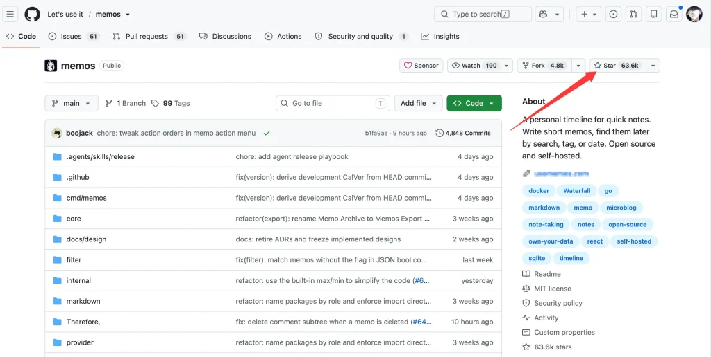
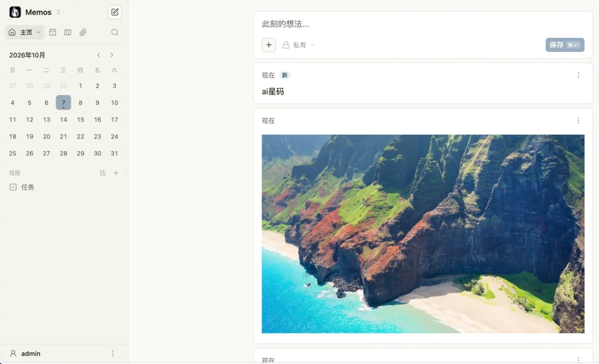
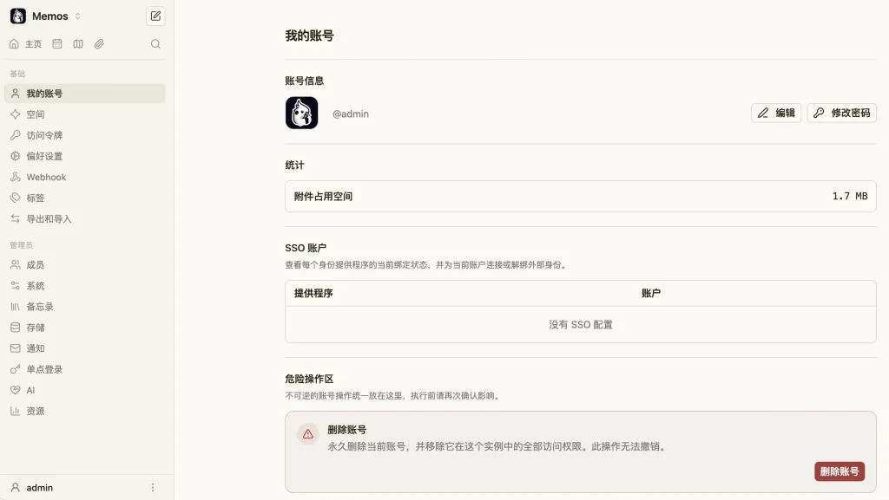

你有没有遇到过这种情况？

💭 突然想到一个灵感，却不知道记在哪里。  
🔗 收藏了一堆网页，真正需要的时候又找不到。  
📚 笔记软件用了很多，但数据分散在不同平台。  
💻 技术教程、服务器配置、代码片段越来越多，想整理却越来越麻烦。  
🔐 有些重要内容又不太想长期放在第三方平台。

如果你也有这些问题，可以看看今天分享的这个开源项目——**Memos**。

Memos 是一款开源、轻量级、支持自托管的笔记工具，核心思路非常简单：**想到什么就记录什么，先记下来，再慢慢整理。**

它不像一些传统知识库软件，上来就让你创建文件夹、分类、层级结构，而是以时间线的方式记录内容，同时提供 Markdown、标签、搜索、附件、分享等功能。

而且最重要的是：**Memos 可以自己部署到服务器上。**

这次我也专门录制了一期 **Memos 宝塔保姆级搭建教程**，如果你有服务器，可以跟着教程一步一步搭起来。🚀

---

## 🤔 为什么需要一个自己的笔记系统？

现在的笔记软件其实非常多，但真正长期使用以后，往往会发现一个问题：

**功能越多，使用成本反而越高。**

有时候只是想记录一句话，却要先考虑：

📁 放在哪个文件夹？  
🏷️ 应该设置什么分类？  
📑 要不要创建一个新的页面？  
🔗 以后还能不能找到？

最后可能还没记录下来，灵感已经没了。

Memos 的思路就简单很多。

**打开 → 写下来 → 保存。**

不需要提前创建标题、文件夹或者模板，可以直接记录 Markdown 内容，然后通过时间线、搜索、标签等方式重新找到它。

这也是 Memos 很适合做**个人知识库、工作日志、技术笔记、灵感记录**的原因。

---

# ⭐ Memos 到底能干什么？

## 📝 1、快速记录笔记

Memos 最核心的功能就是记录。

无论是：

- 💡 一个突然想到的点子
- 💻 一段代码
- 📚 一篇文章的重点
- 🔗 一个有用的网址
- 🛠️ 一条服务器命令
- 📌 一个待办事项
- ✍️ 一段工作日志

都可以直接扔进去。

不用考虑复杂的知识库结构，**先记录，再整理**。

---

## ✍️ 2、原生支持 Markdown

对于程序员、开发者以及经常写技术文章的人来说，Markdown 是非常实用的。

Memos 支持 Markdown，可以使用：

- 标题
- 列表
- 待办清单
- 表格
- 代码块
- 链接
- 标签等

所以它不仅可以当普通备忘录，也可以用来记录大量技术内容。

比如平时折腾服务器时，可以把：

**Docker 命令**  
**Nginx 配置**  
**宝塔配置**  
**Linux 命令**  
**项目部署记录**  
**域名解析记录**  
**更多好玩方法等您发现！**

全部记录下来。

以后再次遇到类似问题，就不用重新搜索。

---

# 🔎 3、搜索功能

笔记软件最重要的功能之一，其实不是“写”，而是**找**。

笔记少的时候感觉不明显，一旦用了几个月甚至几年，没有搜索功能基本就会变成“数字垃圾场”。

Memos 支持搜索，可以根据内容和相关信息查找以前记录的笔记。

例如你之前记录过：

> Docker 部署 Nginx

过了一段时间忘记具体怎么配置了，直接搜索关键词，就能把以前的记录找回来。

---

# 🏷️ 4、标签管理

如果你平时记录的内容比较多，可以给笔记添加标签。

例如：

#Docker

#Linux

#Cloudflare

#宝塔

#服务器

#开发

#SEO

#记录美好

#图片等等

这样以后查看某一个主题的时候，就可以快速筛选相关内容。

Memos 还支持标签层级，让标签管理可以更加灵活。

---

# 📎 5、支持图片和文件附件

有时候一条笔记并不是只有文字。

可能还需要：

🖼️ 图片  
📄 文件  
📸 截图  
📎 项目资料

Memos 支持给笔记添加附件，所以拿来做工作记录、项目记录也比较方便。

比如服务器出现问题的时候，可以把错误截图直接保存到对应的笔记里面。

以后再遇到类似问题，就能快速回顾。

---

# 🔗 6、支持分享

Memos 并不是只能自己使用。

笔记可以根据需求控制可见范围。

一些内容可以保持私密；需要分享的时候，也可以单独分享出去。

也就是说：

🔒 私人内容自己看  
👥 团队内容一起看  
🌐 部分内容公开分享

官方文档也明确提供了不同的笔记可见性和分享机制。

---

# 🌐 7、Web Clipper 网页收藏

这个功能我觉得也比较实用。

平时我们看到一个不错的网站或者文章，经常会：

**收藏 → 收藏夹越来越多 → 最后再也找不到。**

Memos 提供 Web Clipper，可以从浏览器直接把网页、选中的内容以及图片保存到 Memos，并以 Markdown 的形式记录来源。

对于经常收集资料的人来说，这个功能还是非常方便的。

---

# 👥 8、Spaces：适合团队协作

除了个人笔记之外，新版 Memos 还提供了 **Spaces**。

可以创建一个共享空间，然后邀请其他成员加入。

例如：

📌 项目资料  
📌 团队知识  
📌 产品记录  
📌 工作日志  
📌 项目讨论

都可以放在对应的 Space 里面。

需要注意的是，Space 更偏向于共享和协作浏览，并不是简单地把所有人的笔记变成共同编辑文档。

---

# 🌍 9、支持移动端和 PWA

Memos 不只是电脑浏览器使用。

官方提供了响应式界面，同时支持 PWA，可以把它添加到设备主屏幕使用。

也就是说，自己搭建以后：

💻 电脑可以访问  
📱 手机可以访问  
🌐 浏览器可以访问

非常适合做一个长期使用的个人笔记系统。

---

# 🔌 10、API 和自动化

如果你是开发者，还可以进一步折腾。

Memos 提供 REST 和 gRPC API，可以用来做自定义记录、自动化以及第三方服务集成。官方文档目前也提供了 API、Webhook、MCP 等集成能力。

例如可以结合自己的脚本，把一些信息自动写入 Memos。

这就不只是一个“笔记软件”了，而可以变成自己的**信息收集中心**。

---

# 🔐 为什么很多人喜欢自托管？

Memos 最大的优势之一就是：

> **数据放在自己的服务器上。**

它采用开源模式，使用 MIT License，并且官方强调自托管和数据控制。Memos 本身也比较轻量，可以使用 SQLite，也支持 MySQL、PostgreSQL 等数据库。

自己部署以后，服务器、域名、数据和备份策略都可以自己掌握。

当然，自托管也意味着：

**服务器安全、账号安全和数据备份需要自己负责。**

所以正式长期使用的话，建议做好定期备份。

---

# 🐳 Memos 部署难不难？

如果按照官方方式直接部署，Memos 本身其实并不复杂，官方提供 Docker 部署方式。

而这次我采用的是：

**宝塔面板 + Docker + Memos**

对于平时习惯使用宝塔的朋友来说，这种方式会更加直观。

整个部署过程主要就是：

**服务器准备 → 宝塔安装 → Docker环境 → 创建Memos → 配置域名 → 设置反向代理 → HTTPS → 完成访问**

具体操作我已经录制成了**保姆级视频教程**。

所以这里就不把文章写成复杂的命令教程了，直接跟着视频操作会更加方便。👇

---

# 🛠️ 宝塔搭建 Memos，适合哪些人？

如果你已经有一台服务器，又想自己搭建一个笔记系统，那么 Memos 很适合以下人群：

👨‍💻 **程序员**

记录代码、项目、API、技术资料。

🖥️ **服务器玩家**

记录 Docker、Linux、宝塔、Nginx、Cloudflare 等配置。

📚 **学习党**

把每天学习的内容记录下来。

✍️ **自媒体 / 博主**

记录选题、灵感、素材和文章资料。

🚀 **独立开发者**

记录项目进度、Bug、需求和开发日志。

🏠 **喜欢自托管的人**

把自己的常用服务都部署到服务器上。

---

# 💡 一个很实用的使用方式

如果你平时经常折腾各种开源项目，可以专门给 Memos 建一个自己的“服务器知识库”。

比如：

### 🐳 Docker

记录常用 Docker 命令。

### ☁️ Cloudflare

记录域名、DNS、Workers、Pages 配置。

### 🖥️ 宝塔

记录网站、PHP、Nginx、SSL 等配置。

### 🔧 开源项目

记录每一个项目的部署方法和踩坑记录。

### 📝 内容创作

记录文章选题、标题、素材和灵感。

时间久了以后，你会发现：

**Memos 不只是一个笔记软件，而是在慢慢积累属于自己的个人知识库。**

---

# 🚀 总结

Memos 给我的感觉就是：

**简单、轻量、开源、自托管。**

它没有强迫你一开始就把所有东西整理得井井有条，而是让你先把想法记录下来。

然后再通过：

**时间线 + Markdown + 搜索 + 标签 + 附件 + 分享 + Web Clipper**

慢慢把这些零散的信息整理起来。

如果你手里刚好有服务器，又想搭建一个属于自己的**开源笔记系统 / 私人知识库 / 自托管笔记工具**，Memos 值得试一下。

这次我也已经录制了 **「Memos 宝塔 + Docker 保姆级搭建教程」**，从安装到最终访问都会一步一步演示。

👉 **想自己搭建 Memos 的，可以直接跟着视频操作。**

# 🖼️相关截图

### **🔗项目地址:[https://github.com/usememos/memos](https://github.com/usememos/memos)**

---

> 本文转载整理自 [Ai星码博客](https://aixmb.com/1108.html)，版权归原作者所有。

