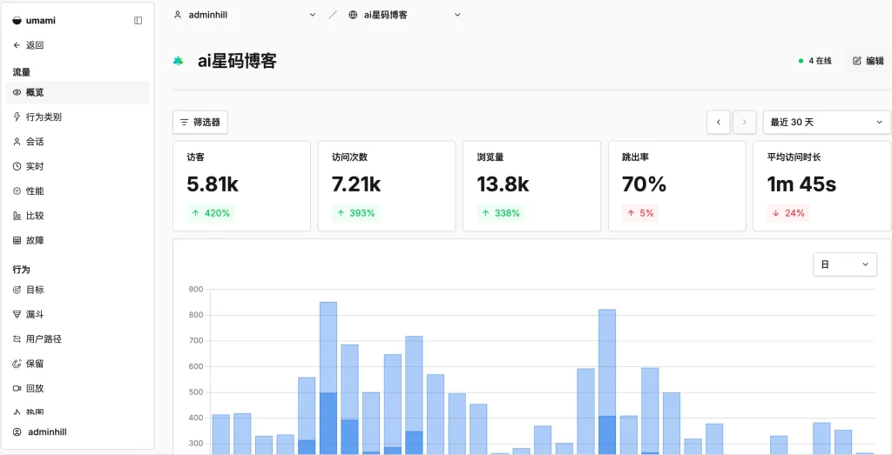
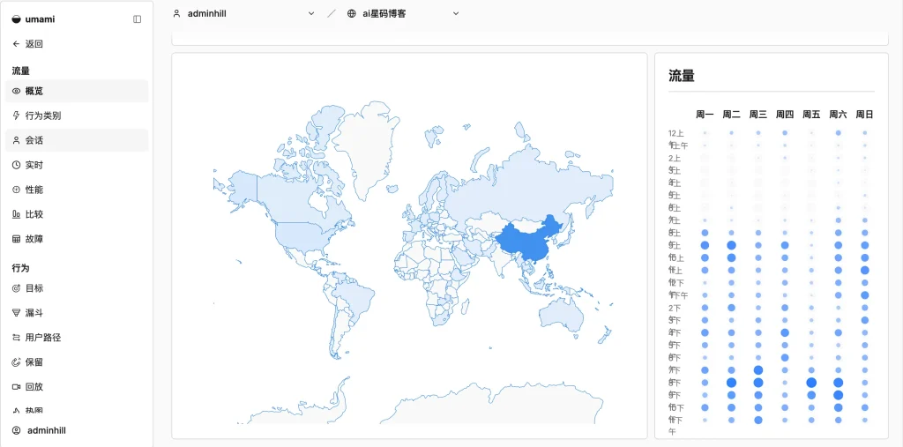

你有没有遇到过这些问题？

😵 网站每天到底有多少人访问？  
🌍 用户来自哪个国家、地区？  
📱 手机用户多还是电脑用户多？  
🔗 用户是从搜索引擎、社交平台还是其他网站进来的？  
📈 哪个页面访问量最高？  
🎯 用户到底有没有完成注册、点击、购买等操作？

很多网站上线以后，只知道“有人访问”，却不知道**用户从哪里来、看了什么、最后做了什么**。

这时候就需要一套网站统计分析工具。

今天分享一个非常值得关注的开源项目——**Umami**。它是一款开源的网站与产品分析平台，可以把流量、访问者行为、营销活动、转化、留存以及收入等数据集中到一个后台进行分析。

而且 Umami 支持**自己部署**，这次我也录制了一期 **宝塔保姆级搭建教程**，通过宝塔部署自己的 Umami 数据统计平台。🚀

---

## 🤔 Umami 到底是干什么的？

简单来说：

> **Umami 就是给你的网站装一个“数据仪表盘”。**

网站接入 Umami 后，就可以在后台查看网站访问数据。

比如：

- 👀 页面浏览量
- 👤 访客数量
- 🌍 访客地区
- 📱 设备类型
- 💻 操作系统
- 🌐 浏览器
- 🔗 来源网站
- 🔎 搜索来源
- 📈 实时访问
- 📊 用户行为
- 🎯 转化目标
- 🔥 热力图
- 🎥 Session Replay
- 💰 收入数据

官方目前的 Umami v3 已经不仅仅是简单的“访问量统计”，而是覆盖网站分析、产品分析、用户行为和转化分析的一整套工具。

---

# 🔥 为什么推荐 Umami？

以前做网站统计，很多人第一时间想到的是 Google Analytics。

但对于一些个人站长、独立开发者或者企业项目来说，可能更希望：

**数据自己掌握、系统自己部署、后台自己控制。**

Umami 的特点就是：

### 🟢 开源

项目采用开源模式，可以自行部署和使用。GitHub 项目目前拥有较高的社区关注度。

### 🔐 更注重隐私

Umami 官方强调 Privacy-first，支持在不依赖 Cookie、跨站追踪的情况下进行网站分析，并且可以自托管数据。

### 🖥️ 支持自托管

不想使用云端服务，可以直接部署到自己的服务器。

这也是我这次录制教程的主要原因。

---

# 📊 Umami 可以查看哪些数据？

## 👀 1、网站访问量

最基础也是最重要的功能。

可以查看：

**访问量、访客、页面浏览量、实时活动等。**

网站运营一段时间以后，就可以直观看到网站每天的流量变化。

比如：

📈 今天流量上涨了？

📉 为什么昨天突然下降？

🔥 哪篇文章带来了最多访问？

这些都可以通过数据进行分析。

---

## 🌍 2、访客来源分析

用户从哪里进入你的网站？

这个问题非常重要。

Umami 可以帮助你分析：

🔎 搜索引擎  
🔗 外部网站  
📱 社交媒体  
📧 营销活动  
🌐 直接访问

还可以结合 **UTM Campaign** 等方式分析不同推广渠道的效果。

对于做 SEO、自媒体、网站推广的人来说，这个功能非常实用。

---

# 📱 3、设备和用户环境

想知道你的用户主要使用什么设备？

Umami 可以查看：

📱 手机  
💻 桌面电脑  
🌐 浏览器  
🖥️ 操作系统  
🌍 地区等信息。

这样你就能更清楚自己的用户群体。

比如发现：

> 80%的访问来自手机。

那网站就应该更加重视移动端体验。

---

# 🎯 4、事件统计

仅仅知道“用户访问了页面”还不够。

有时候我们更关心：

**用户有没有点击按钮？**

比如：

👉 点击下载  
👉 点击注册  
👉 点击购买  
👉 点击广告  
👉 提交表单  
👉 播放视频

Umami 支持自定义事件，可以对这些用户行为进行统计。

这样就可以从简单的“流量统计”，进一步分析**用户到底做了什么**。

---

# 🔥 5、热力图

网站到底哪里最吸引用户？

用户点击最多的地方在哪里？

通过 Heatmaps，可以更加直观地分析用户在页面上的行为。

对于：

🛒 电商网站  
📝 内容网站  
🚀 产品官网  
💰 营销落地页

都非常有价值。

---

# 🎥 6、Session Replay

如果你想进一步了解用户是怎么使用网站的，Umami 还提供 **Session Replay**。

它可以帮助你分析用户访问过程中的行为。

比如：

用户进入页面 → 浏览内容 → 点击按钮 → 返回 → 最终离开。

相比单纯看访问量，这类数据能够提供更多用户行为信息。

---

# 🎯 7、目标与漏斗分析

如果你运营一个网站，最终目的通常不只是“让别人访问”。

而是希望用户：

**访问 → 点击 → 注册 → 使用 → 转化**

Umami 支持 Goals 和 Funnels，可以帮助分析用户在不同步骤中的转化情况，并找到用户流失的位置。

这对于产品网站、SaaS、营销页面等尤其有用。

---

# 💰 8、收入与营销分析

如果网站存在商业化，那么流量最终能带来多少价值也很重要。

Umami 可以把事件与价值关联起来，并通过 Revenue 等分析功能查看不同页面、活动以及用户群体带来的价值。

也就是说，它不仅告诉你：

> “来了多少人。”

还可以进一步帮助你分析：

> **“这些用户最终带来了什么结果？”**

---

# 📈 9、用户留存与行为分析

如果是一个长期运营的网站，只看 PV、UV 其实远远不够。

Umami 还提供：

- 👥 Segments
- 📊 Cohorts
- 🔄 Retention
- 🧭 Journey

可以从不同角度分析用户行为和留存情况。

---

# 🖥️ 10、支持多个网站

如果你手里不止一个网站，也可以使用 Umami 集中管理统计数据。

例如：

🌐 个人博客  
🛠️ 在线工具站  
📱 产品官网  
💻 开源项目官网  
📰 内容网站

都可以统一放到 Umami 后台进行分析。

这样就不用每个网站都单独登录不同的统计平台。

---

# 🔌 11、API 与扩展能力

对于开发者来说，Umami 还提供 API，可以围绕网站、事件、会话以及报表等数据进行开发和集成。

官方文档还提供了 MCP 等集成能力，可以进一步连接其他工具。

所以它不只是一个“看数据的后台”，也可以成为网站数据分析基础设施的一部分。

---

# 🔐 为什么适合自己部署？

Umami 支持 Self-hosted。

也就是说，你可以把它安装到自己的服务器上。

数据存储在哪里？

**自己决定。**

系统怎么管理？

**自己决定。**

网站统计后台放在哪里？

**自己决定。**

对于比较重视隐私、数据控制权，或者喜欢折腾开源项目的人来说，这种方式非常有吸引力。

---

# 🛠️ 这次使用宝塔搭建

这次我录制的是：

> **Umami + 宝塔保姆级搭建教程**

通过宝塔来完成服务器环境、Docker、Umami 等相关配置。

整体思路就是：

**服务器 → 宝塔 → Docker → Umami → 数据库 → 域名 → HTTPS → 网站接入统计**

Umami 官方本身也提供 Docker 镜像和 Docker Compose 部署方式，因此非常适合通过 Docker 进行部署。

具体搭建过程我已经放到视频教程里面了，文章这里主要介绍项目功能和使用场景。

---

# 👨‍💻 哪些人适合使用 Umami？

### 🌐 网站站长

想知道自己的网站每天有多少访问。

### 🔎 SEO 玩家

分析搜索流量和页面表现。

### ✍️ 博主 / 自媒体

看看哪些文章真正有人看。

### 🚀 独立开发者

分析产品用户行为和转化。

### 💻 程序员

喜欢开源、自托管和自己掌控数据。

### 🏢 企业网站

统计访问来源、用户行为和营销效果。

---

# 💡 最后说一下

如果你的网站目前只是：

> “网站上线了，然后每天不知道有没有人访问。”

那么 Umami 就非常值得部署一个。

它可以让你从简单的：

**“网站有没有人访问？”**

进一步变成：

**“用户从哪里来？”**

**“用户看了什么？”**

**“用户点击了什么？”**

**“用户为什么离开？”**

**“哪个渠道带来的用户更有价值？”**

这才是真正的数据分析。📊

而且 Umami 开源、支持自托管，同时提供网站分析、事件、漏斗、热力图、Session Replay、留存、UTM、归因和收入分析等功能。

如果你手里有一台服务器，又想搭建自己的**网站统计分析平台**，可以试试 Umami。

👉 **我也已经录制了 Umami 宝塔保姆级搭建教程，从环境配置到最终网站接入统计，跟着视频一步一步操作即可。**

### **💻 部署代码：**

```
---
services:
  umami:
    image: ghcr.io/umami-software/umami:latest
    ports:
      - "3000:3000"
    environment:
      DATABASE_URL: postgresql://umami:您的数据库密码@db:5432/umami
      APP_SECRET: 生成一串64位的随机十六进制密钥
      # Required for two-factor authentication, generate with: openssl rand -hex 32
      TWO_FACTOR_ENCRYPTION_KEY: 再生成一串64位的随机十六进制密钥
    depends_on:
      db:
        condition: service_healthy
    init: true
    restart: always
    healthcheck:
      test: ["CMD-SHELL", "curl http://localhost:3000/api/heartbeat"]
      interval: 5s
      timeout: 5s
      retries: 5
  db:
    image: postgres:15-alpine
    environment:
      POSTGRES_DB: umami
      POSTGRES_USER: umami
      POSTGRES_PASSWORD: 您的数据库密码
    volumes:
      - umami-db-data:/var/lib/postgresql/data
    restart: always
    healthcheck:
      test: ["CMD-SHELL", "pg_isready -U $${POSTGRES_USER} -d $${POSTGRES_DB}"]
      interval: 5s
      timeout: 5s
      retries: 5
volumes:
  umami-db-data:
```

服务器终端里直接输

```
openssl rand -hex 32
```

回车就会生成一串**64位的随机十六进制密钥**，

把它分别填到**APP_SECRET**和**TWO_FACTOR_ENCRYPTION_KEY**的位置！

**默认登陆账号：admin 密码：umami**

# 🖼️相关截图





### **🔗项目地址:[https://github.com/umami-software/umami](https://github.com/umami-software/umami)**
