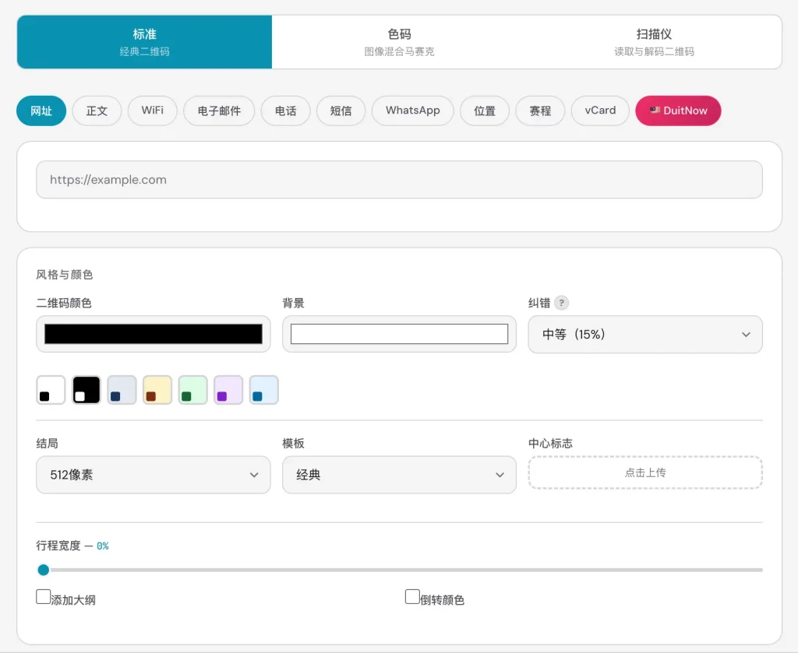
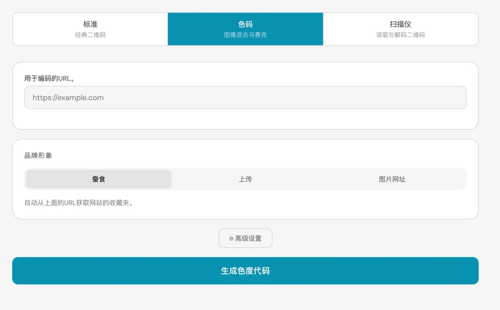
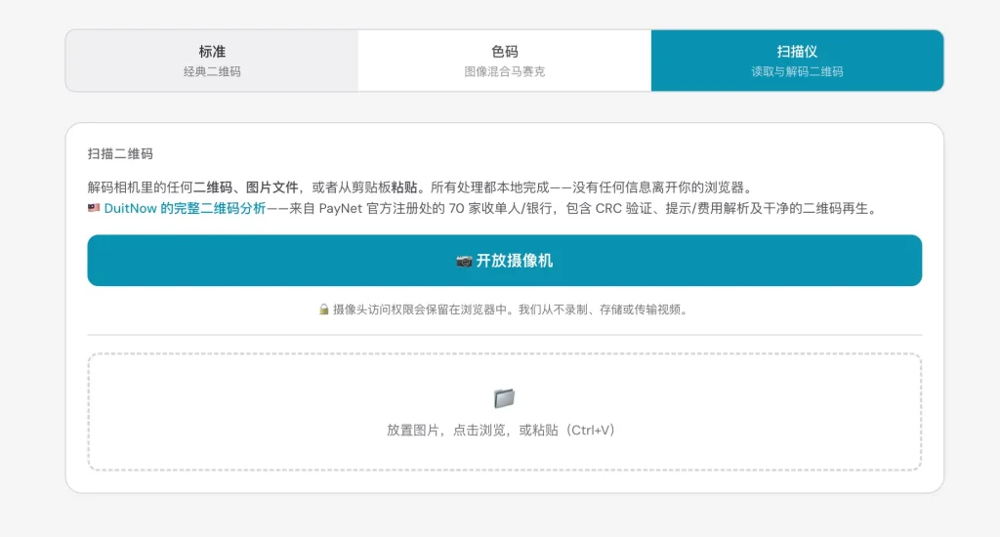

> 视频教程：我已经录制了 **QR Studio 保姆级搭建教程**，手把手教你如何部署属于自己的在线二维码生成工具。

现在二维码已经成为生活中不可缺少的一部分：

📌 网站推广需要二维码  
📌 商家收款需要二维码  
📌 WiFi 分享需要二维码  
📌 名片、活动、文章分享都离不开二维码

但是很多在线二维码工具都有一些问题：

❌ 免费版限制功能  
❌ 导出图片带水印  
❌ 需要注册账号  
❌ 上传数据到第三方服务器，隐私无法保证  
❌ 高级功能需要付费

今天分享一个开源项目：**QR Studio**，它可以让你拥有一个属于自己的在线二维码生成平台，而且还能通过 Cloudflare 免费部署，实现零成本运行。

---

# 🌟 QR Studio 是什么？

QR Studio 是一个开源的在线二维码生成工具，最大的特点就是：

✅ 免费开源  
✅ 无需注册  
✅ 无广告限制（自行部署后可接入自己的广告）  
✅ 浏览器本地运行  
✅ 不需要数据库  
✅ 不需要服务器

整个项目主要由前端 HTML、CSS、JavaScript 构成，甚至可以直接部署到 Cloudflare Pages，实现低成本甚至零成本运行。

对于想搭建工具站、个人导航站、流量站的小伙伴来说，非常适合。

---

# 😍 它可以做什么？

## 1️⃣ 在线生成二维码

支持多种二维码类型：

🔗 网站链接二维码  
📝 文本二维码  
📶 WiFi二维码  
📧 邮箱二维码  
📞 电话二维码  
💬 WhatsApp二维码  
📍 地理位置二维码  
📅 日历事件二维码  
👤 vCard电子名片二维码

满足日常大部分二维码生成需求。

---

# 🎨 支持二维码个性化设计

普通二维码太单调？

QR Studio 支持：

✨ 自定义二维码颜色  
✨ 修改背景颜色  
✨ 添加中心Logo  
✨ 调整二维码样式  
✨ 多种模板效果  
✨ PNG高清导出  
✨ SVG矢量格式导出

可以制作：

✅ 企业二维码  
✅ 个人品牌二维码  
✅ 产品宣传二维码  
✅ 活动二维码

让二维码更加符合自己的品牌风格。

---

# 🖼️ 创意图片融合二维码

项目还支持 ChromaCode 图片融合二维码功能。

简单来说：

上传一张图片或者网站图标，可以让二维码和图片结合，在保持扫码能力的同时，让二维码更加美观。

例如：

🌐 网站Logo + 二维码  
🏪 商家品牌图 + 二维码  
👨‍💻 个人头像 + 二维码

非常适合做营销推广。

---

# 📷 自带二维码扫描功能

除了生成二维码，它还支持二维码扫描：

📸 摄像头扫描  
📂 上传图片扫描  
📋 粘贴二维码识别

可以快速查看二维码里面隐藏的信息。

---

# 💡 为什么推荐自己部署？

很多二维码网站看似免费，但是：

❌ 后期限制下载  
❌ 添加水印  
❌ 插入第三方广告  
❌ 用户数据不可控

自己部署以后：

✅ 网站属于自己  
✅ 数据自己管理  
✅ 可以绑定自己的域名  
✅ 可以优化SEO获取搜索流量  
✅ 可以接入广告实现收益

---

# ☁️ Cloudflare 零成本部署

这个项目非常适合 Cloudflare 部署。

无需：

❌ 购买服务器  
❌ 配置数据库  
❌ 安装复杂环境

只需要：

1️⃣ 下载项目文件  
2️⃣ 上传到 Cloudflare Pages  
3️⃣ 绑定域名  
4️⃣ 等待部署完成

几分钟即可拥有自己的二维码工具网站。

对于刚入门建站的小白来说，非常友好。

---

# 💰 做工具站还能赚钱吗？

如果你喜欢折腾网站，这类工具其实非常适合做副业。

例如：

搭建：

✅ 在线二维码生成器  
✅ 图片压缩工具  
✅ IP查询工具  
✅ 临时邮箱工具  
✅ 文件转换工具

然后：

📌 发布SEO文章获取搜索流量  
📌 分享到社交平台  
📌 接入第三方广告平台

通过网站访问量获得广告收益。

一个小工具可能每天只有几百访问，但长期积累下来，也是一种不错的被动收入方式。

---

# 🎯 适合哪些人？

✅ 想学习 Cloudflare 部署的小白  
✅ 想搭建个人工具站的人  
✅ 想做网站副业的人  
✅ 想拥有自己的二维码平台的人  
✅ 想学习开源项目部署的人

---

# 📌 总结

QR Studio 是一个非常轻量级的开源二维码工具。

它解决了传统二维码网站：

❌ 收费  
❌ 限制  
❌ 水印  
❌ 数据隐私问题

通过 Cloudflare 免费部署，你可以快速拥有一个属于自己的：

🚀 在线二维码生成网站  
🚀 SEO流量入口  
🚀 工具站项目  
🚀 副业变现渠道

如果你也想搭建一个自己的二维码工具站，可以跟着我的视频教程一步步完成部署。🔥

# 🖼️相关截图

### **🔗项目地址:[点击进入](https://github.com/aixmbcom/qr-studio)**

---

> 本文转载整理自 [Ai星码博客](https://aixmb.com/1130.html)，版权归原作者所有。

