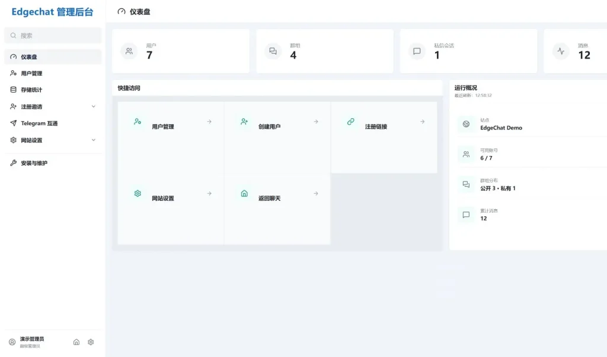
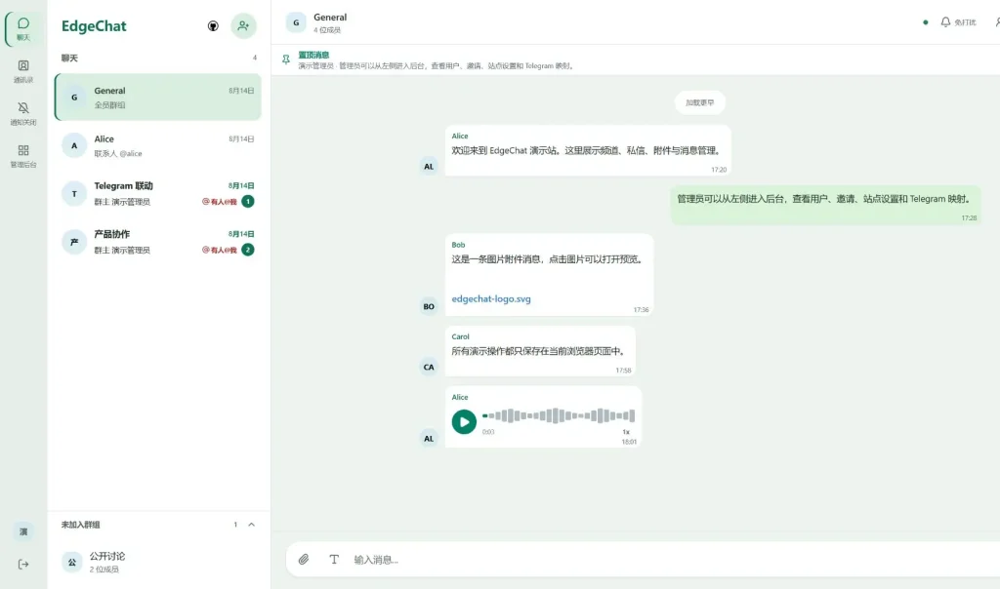
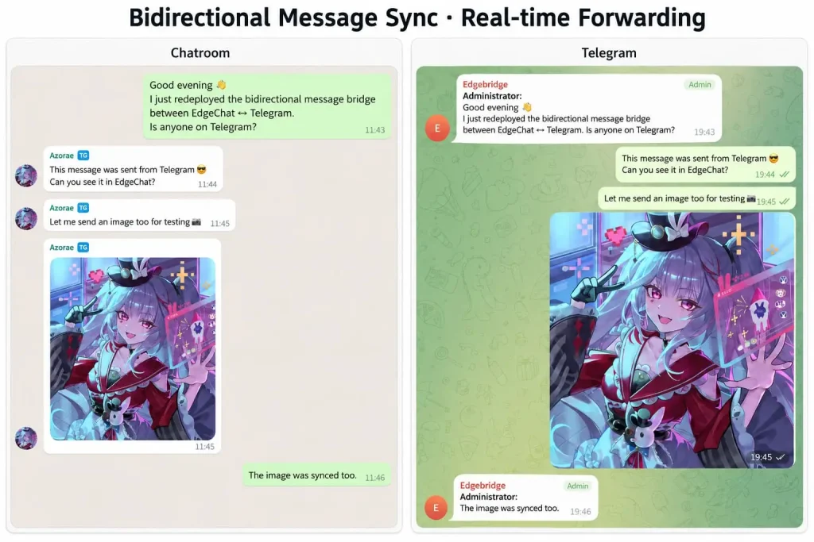
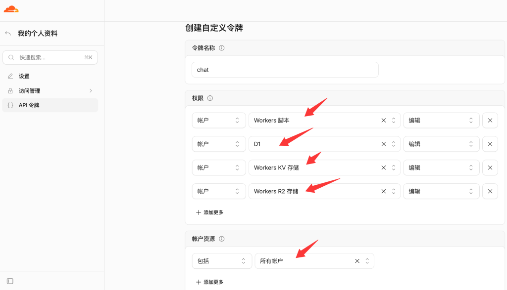
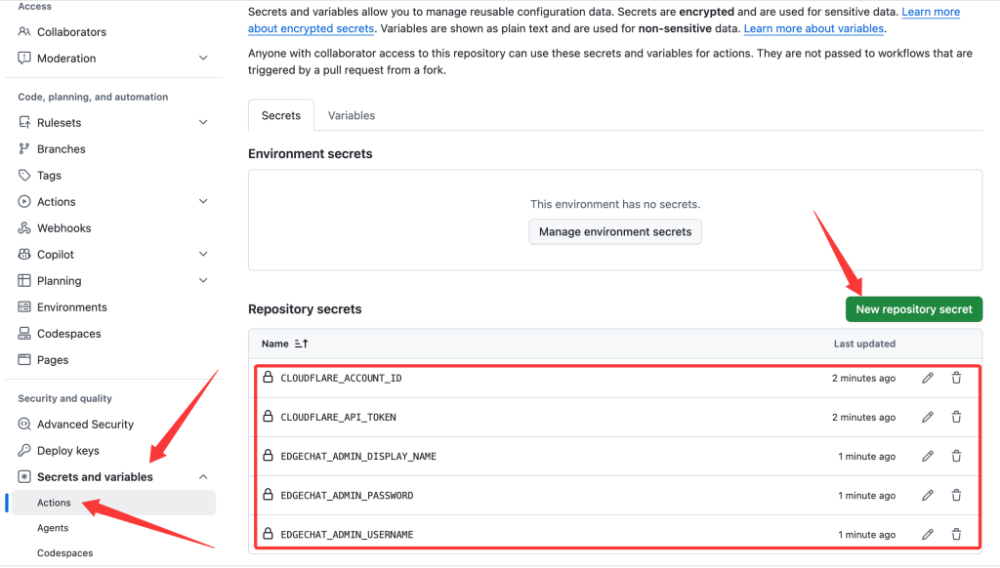

平时和朋友、团队或者小圈子聊天，你是不是也遇到过这些问题？

❌ 公共聊天软件广告多、功能受限制  
❌ 团队讨论和私人聊天混在一起  
❌ 文件、图片、语音信息不好统一管理  
❌ 使用第三方聊天平台，数据始终放在别人手里  
❌ 想自己搭一个聊天系统，却发现服务器、数据库、运维都很麻烦

如果你也想拥有一个**属于自己的私密聊天工具**，今天这个开源项目值得关注一下。

它就是 **EdgeChat**。

EdgeChat 是一个基于 Cloudflare 构建的开源自部署聊天系统，支持群聊、私信、文件、语音、管理后台等功能，而且整个项目可以运行在自己的 Cloudflare 账号中，不需要额外维护一台常驻服务器。

---

## 💬 EdgeChat 是什么？

简单来说，EdgeChat 可以理解成：

**自己搭建一个类似团队聊天软件的网页版平台。**

你可以创建自己的聊天空间，让团队成员、朋友或者小圈子用户加入。

支持：

💬 实时群聊  
🔐 私密群组  
👤 一对一私信  
📁 文件分享  
🎙️ 语音消息  
📞 一对一语音通话  
🔔 消息提醒  
🛠️ 管理后台

而且项目开源，可以根据自己的需求进行修改和扩展。

---

# 🚀 为什么这个项目值得玩？

最大的亮点就是：

**Cloudflare + 开源 + 自部署 + 聊天系统。**

传统聊天系统一般需要准备：

服务器  
数据库  
WebSocket环境  
文件存储  
运行环境  
后期维护

对于普通用户来说，搭建起来并不轻松。

而 EdgeChat 直接围绕 Cloudflare Workers 构建，可以把应用和数据资源部署到自己的 Cloudflare 账号中，并通过 GitHub Actions 自动部署和更新。

对于喜欢折腾 Cloudflare 的小伙伴来说，确实非常有意思。🔥

---

# 🔐 私密聊天，自己掌握数据

这是我比较喜欢 EdgeChat 的一个地方。

项目支持对**新写入的消息正文和新上传附件进行 AES-256-GCM 服务端加密**。

同时，管理后台不会提供直接查看群聊或者私信正文的入口，只展示一些聚合统计，例如消息数量。

不过这里需要特别说明：

⚠️ **它不是端到端加密（E2EE）。**

这是服务端加密，Cloudflare 运行环境以及掌握密钥的一方仍然需要被信任。官方也明确说明了这一点。

所以更准确地说，它适合希望**自己部署、自己管理聊天空间**的用户，而不是把它理解成绝对匿名的聊天工具。

---

# 👥 支持公开群组、私有群组和私信

EdgeChat 不只是一个简单的聊天室。

它支持：

🌐 公开群组  
🔒 私有群组  
👤 一对一私信

可以按照不同用途创建聊天空间。

比如：

📌 技术交流群  
📌 项目讨论组  
📌 团队内部群  
📌 私人小圈子  
📌 开源项目社区

把不同类型的聊天内容分开管理，使用起来更加方便。

---

# 📁 文件、图片、语音都能发

聊天最基本的功能自然不能少。

EdgeChat 支持：

📎 文件上传  
🖼️ 图片分享  
🎙️ 语音消息  
👤 头像管理

语音消息还支持录制、波形进度以及倍速播放。私信还支持一对一语音通话。

也就是说，它不是只能“打字聊天”的简单项目，而是已经具备比较完整的即时通讯体验。

---

# ✈️ 一个非常有意思的功能：Telegram 双向桥接

如果你平时已经在使用 Telegram，那么这个功能非常实用。

EdgeChat 可以通过 Telegram Bot，把 EdgeChat 群组和 Telegram 群组连接起来。

例如：

**EdgeChat ⇄ Telegram**

在 EdgeChat 发送消息，可以同步到 Telegram。

Telegram 群里的消息，也可以同步回 EdgeChat。

甚至支持文字、图片、视频、语音、文件等内容的双向同步。

这样就不用强制所有人更换聊天入口。

---

# 🔔 网页关闭了，也能收到提醒

还有一个比较实用的功能：

成员可以绑定配置好的 Telegram Bot。

当网页关闭以后，如果收到私信或者被 @ 提及，仍然可以通过 Telegram 获得提醒。

而且提醒内容不会直接包含消息正文，可以减少内容泄露风险。

---

# 🛠️ 自带管理后台

对于自己搭建聊天系统来说，管理功能非常重要。

EdgeChat 提供：

👥 用户管理  
📊 数据统计  
📨 注册邀请  
⚙️ 网站设置  
🚫 用户封禁  
⏱️ 临时封禁

管理员可以控制谁能够加入自己的聊天空间。

而且项目采用邀请制，不开放普通用户自行注册，可以进一步控制聊天系统的成员范围。

---

# 🌐 支持电脑和手机访问

EdgeChat 使用现代化的 Liquid Glass 风格界面，同时适配桌面端和移动端。

也支持 PWA 安装，并提供 Android 客户端相关能力。

所以不管是：

💻 电脑  
📱 手机  
🌐 浏览器

都可以使用自己的聊天平台。

---

# ☁️ Cloudflare 零成本部署

这也是这次重点推荐它的原因。

EdgeChat 本身就是围绕 Cloudflare Workers 构建的。

部署以后：

☁️ Cloudflare Workers  
🗄️ D1 / KV / R2 等 Cloudflare 资源  
⚙️ GitHub Actions 自动部署

整个系统不需要自己长期维护传统服务器。官方也提供了 GitHub Actions 自动部署方案。

对于想学习：

**Cloudflare Workers + Serverless + 开源项目部署**

的小伙伴来说，也是一个很好的练手项目。

不过需要注意，所谓“零成本”主要是指**可以在 Cloudflare 免费额度范围内运行**，实际费用仍然取决于 Cloudflare 套餐、资源配置和实际使用量。

---

# 🎯 谁适合搭建 EdgeChat？

我觉得以下几类用户特别适合：

✅ 想自己搭建聊天系统  
✅ 想学习 Cloudflare Workers  
✅ 有自己的团队或小型社区  
✅ 想搭建私有聊天空间  
✅ 想研究 Serverless 项目  
✅ 喜欢开源项目折腾

尤其是已经在玩 Cloudflare 的用户，这个项目可以直接加入自己的“工具箱”。😎

---

# 🧩 EdgeChat 能解决什么问题？

以前想自己搭建聊天系统，往往需要：

服务器 + 数据库 + WebSocket + 文件存储 + 运维

现在有了 EdgeChat，可以直接基于 Cloudflare 搭建。

从“自己维护服务器”，变成：

**Cloudflare + GitHub + EdgeChat**

部署和维护成本大幅降低。

---

# 📌 总结

EdgeChat 并不是一个简单的网页聊天室。

它已经集成了：

💬 实时群聊  
👤 私信  
🔐 私密群组  
📁 文件分享  
🎙️ 语音消息  
📞 一对一语音通话  
🔔 消息提醒  
✈️ Telegram 双向桥接  
🛠️ 管理后台  
🔐 消息与附件服务端加密  
☁️ Cloudflare 部署

最关键的是，它还是一个**开源、可自部署的聊天系统**。

如果你一直想拥有一个自己的聊天平台，又不想折腾传统服务器，那么这个项目确实值得收藏。

# 🖼️相关截图

### **关键文字部署教程：**

cloudflare api权限设置：

github工作流配置：

回你 Fork 的仓库，Settings → Secrets and variables → Actions，新建：

1.**CLOUDFLARE_API_TOKEN**：**Cloudflare Token**  
2.**CLOUDFLARE_ACCOUNT_ID**：**Cloudflare ID**  
3.**EDGECHAT_ADMIN_USERNAME**：**管理员用户名，比如 admin**  
4.**EDGECHAT_ADMIN_PASSWORD**：**管理员密码，用强密码**  
5.**EDGECHAT_ADMIN_DISPLAY_NAME**：**显示名，比如 ai星码**  
注意：工作流只在首次部署时创建管理员，后面再部署不会覆盖密码。改密码去网页里改。

### **🔗项目地址:[点击进入](https://github.com/aozorae/Edgechat)**
