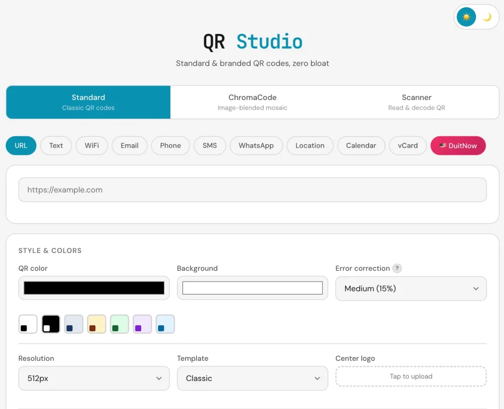

之前分享过一个开源项目：QR Studio，一个可以在线生成二维码、制作个性化二维码，还能扫描和解析二维码的工具。

最近，这个项目又进行了更新。

除了原本的二维码生成、图片融合和扫码识别功能，现在还增加了博客文章内容，并扩展到了 **5 种语言，总计 40 篇文章**。

这意味着，它不再只是一个单纯的二维码生成页面，还可以结合博客内容，做成一个功能更丰富的在线工具网站。

对于喜欢研究开源项目、Cloudflare 部署和网站 SEO 的朋友来说，这次更新值得了解一下。

## 🌍 1.新增博客内容，支持 5 种语言

这次更新中，一个比较值得介绍的变化就是博客内容。

对于在线工具网站来说，工具功能固然重要，但如果只有一个功能页面，网站能够展示的内容也比较有限。

增加博客之后，就可以围绕二维码相关知识、使用技巧、应用场景和常见问题等方向，进一步丰富网站内容。

而多语言支持，则可以让不同语言的用户更方便地阅读网站信息。

例如，可以围绕以下主题扩展内容：

- 📱 如何制作适合宣传推广的二维码
- 🎨 如何设计带有品牌 Logo 的二维码
- 📶 如何生成 WiFi 分享二维码
- 👤 如何制作电子名片二维码
- 🔍 如何扫描二维码并识别其中的信息
- 🌐 不同场景下二维码的使用方法

如果后续继续完善文章内容、内部链接和页面标题，还可以进一步提升网站的内容完整度。

这次我对 QR Studio 进行了进一步优化。如果你之前了解过这个项目，会发现它现在不仅仅是一个在线二维码生成工具，还增加了更多适合搭建个人工具站的内容和配置。

### 🗺️ 2. 新增网站地图 Sitemap

这次还加入了网站地图功能。

网站地图可以帮助搜索引擎发现网站中的相关页面，让搜索引擎更容易了解网站的页面结构，为后续 SEO 优化打下基础。

如果你准备长期运营自己的工具站，网站地图也是值得完善的一项配置。

当然，生成网站地图并不意味着页面一定会被搜索引擎收录，实际效果仍然取决于页面质量、抓取情况和搜索引擎规则。

### 📝 3. 新增 10 篇博客文章，5 种语言共计 50 篇文章页面

除了二维码工具本身，这次还加入了 **10 篇博客文章，并覆盖 5 种语言，总计 50 篇文章页面**。

博客内容可以围绕二维码的使用技巧、个性化设计、常见问题以及实际应用场景展开。

这样一来，网站就不再只有一个二维码生成页面，而是同时具备工具功能和内容展示，可以进一步完善网站的内容结构。

如果后续持续优化文章质量、关键词、页面标题和内部链接，也有利于为 SEO 打下更好的基础。

### 📊 4. 加入网站统计代码

网站统计也是这次优化的一部分。

接入自己使用的统计代码后，就可以根据统计平台提供的数据，了解网站访问情况，例如访问量、热门页面以及用户访问趋势等。

通过这些数据，可以进一步判断哪些二维码功能更受欢迎、哪些博客文章更值得继续完善，从而有针对性地优化网站。

具体统计哪些指标，需要以你接入的统计平台及其配置为准。

### 💰 5. 增加广告位，为网站变现预留空间

如果你打算长期运营在线工具站，还可以考虑广告变现。

这次我也加入了广告位相关配置，方便后续根据自己的需求接入广告平台。

对于工具站来说，用户可能会通过搜索引擎找到二维码生成工具，完成操作后离开。通过完善工具功能、博客内容和页面布局，可以尝试让网站既能满足用户需求，也具备探索广告收益的基础。

需要注意的是，实际能否获得收益取决于网站流量、用户体验、广告平台政策和审核要求，不能保证一定产生收入。广告展示也应合理安排，避免影响二维码生成和下载等核心操作。

### ⚠️ 6. 部署前注意：记得替换原博主链接！

如果你准备部署这份项目，**记得把原本指向博主网站的链接替换成你自己的链接**。

通过这次优化，QR Studio 不仅具备二维码生成、个性化设计和扫码识别功能，还进一步完善了多语言支持、博客内容和网站地图，更适合用来搭建自己的在线工具站。

## 🛠️ 二维码工具本身也很实用

除了博客内容，QR Studio 的核心功能依然是在线二维码制作。

它支持多种常见二维码类型，包括：

- 🔗 URL 网站链接
- 📝 普通文本
- 📶 WiFi 网络信息
- 📧 电子邮件
- 📞 电话号码
- 💬 SMS 短信和 WhatsApp
- 📍 地理位置
- 📅 日历事件
- 👤 vCard 电子名片
- 💳 DuitNow 二维码

不同场景可以选择对应类型，不需要手动研究二维码编码格式。

在样式方面，还可以调整二维码颜色、背景色、纠错等级和导出分辨率，也能上传中心 Logo，让生成的二维码更符合个人或品牌风格。

项目还提供 ChromaCode 图片融合二维码功能，以及二维码扫描和解析功能。对于需要制作宣传物料、分享联系方式或处理二维码信息的人来说，使用起来比较方便。

## ☁️ 适合搭建自己的在线工具站

QR Studio 的另一个优势是项目比较轻量。

根据项目 README，它主要使用 HTML、CSS 和 JavaScript，核心工具可以在浏览器中运行，不需要传统意义上的数据库和后端服务。项目也提供了自托管和 GitHub Pages 部署方式。

如果你想将它部署到 Cloudflare Pages，可以结合项目实际文件和部署要求进行配置。

对于个人开发者来说，这种轻量级项目比较适合用来练习静态网站部署，也可以作为搭建个人工具站的起点。

如果后续还想继续扩展，可以考虑完善博客内容、增加使用说明、优化页面 SEO，并根据实际访问情况探索广告变现。

当然，Cloudflare 的免费额度和相关服务规则可能发生变化，实际运行成本还需要结合使用情况判断。

## 💡 为什么值得关注这次更新？

我觉得，这次更新最值得关注的地方，不只是增加了多少篇文章，而是工具功能和内容开始结合起来了。

一方面，二维码生成、图片融合和扫码识别可以满足用户的实际需求；另一方面，博客内容能够为用户提供操作说明和知识介绍，多语言则进一步扩大了潜在的内容覆盖范围。

如果你正在研究在线工具站、开源项目部署或多语言网站建设，这类项目可以作为一个参考案例。

### **对比图：**

**旧版**

**新版**

### **演示站：[https://qrcode.aixmb.cn](https://qrcode.aixmb.cn)**

### **🔗项目地址:[点击进入](https://github.com/aixmbcom/QRstudio)**

---

> 本文转载整理自 [Ai星码博客](https://aixmb.com/1173.html)，版权归原作者所有。

