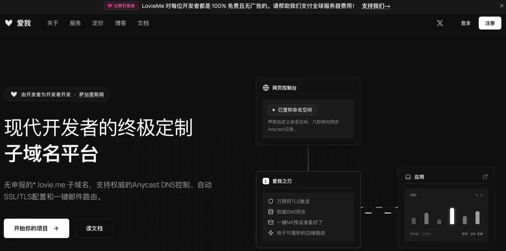
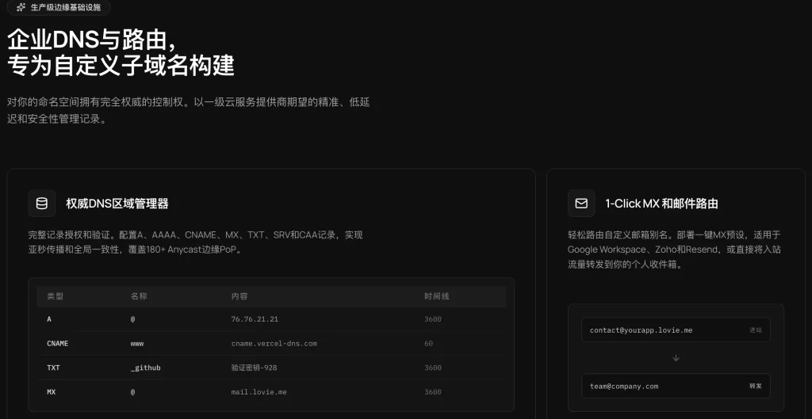
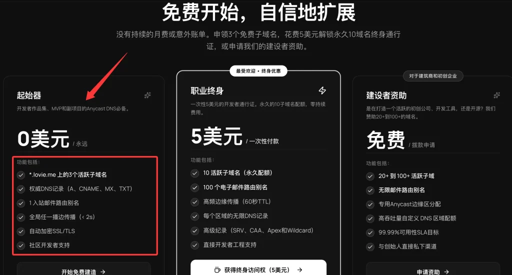

想搭建个人博客、网站或者在线工具，又不想花钱购买域名？🤔 今天分享一个值得收藏的免费子域名平台：**LovieMe**！

🎉 根据官网目前的介绍，普通免费方案每个账号可以领取 **3个以 .lovie.me 结尾的子域名**，支持DNS解析管理和自动SSL/TLS证书。

最吸引人的地方是：**免费方案标注为 Free Forever，不需要每年手动续费！** 🆓

## 🌐 一、LovieMe是什么？

LovieMe是一个提供免费子域名和DNS管理服务的平台，适合个人建站、开发者测试和开源项目使用。

普通免费方案目前包含以下权益：

- 🆓 每个账号最多领取3个活跃子域名
- 🌍 免费使用 **.lovie.me** 后缀
- 🛠️ 支持DNS记录管理
- 🔒 支持自动SSL/TLS证书
- 📧 提供邮件转发功能
- 💰 免费方案标注为Free Forever

具体功能和额度以官网当前说明为准。

## 💰 二、最大优势：免费使用，不用每年续费！

很多人搭建网站时，除了服务器费用，还需要考虑域名续费问题。

有些域名首年价格比较便宜，但到了第二年还需要继续付费。对于个人博客、小型工具网站或者练手项目来说，这也是一笔额外开支。😅

LovieMe的普通免费方案标注为每个账号3个活跃子域名，价格为0美元，并且无需每年手动续费。

例如，可以尝试申请以下形式的子域名：

- ✍️ **blog.lovie.me**：用于个人博客
- 🧰 **tools.lovie.me**：用于在线工具
- 🚀 **demo.lovie.me**：用于项目演示

以上仅为地址示例，实际能否注册取决于前缀是否可用。

对于想低成本搭建网站的朋友来说，这种免费子域名还是很实用的！🎯

需要注意，**.lovie.me**属于子域名，并不是独立购买的顶级域名。免费服务也需要遵守平台的使用规则。

## 🛠️ 三、支持DNS解析管理

领取子域名后，可以根据网站托管服务的要求配置DNS记录。

常见记录类型包括：

- 🌐 **A记录**：指向IPv4地址
- 🌐 **AAAA记录**：指向IPv6地址
- 🔗 **CNAME记录**：将域名指向另一个主机名
- 📧 **MX记录**：用于邮件路由
- 📝 **TXT记录**：用于域名验证等配置

官网目前列出的免费方案包含一定数量的DNS记录额度，具体上限请以官网方案页面和实际控制台为准。

## 🔒 四、支持自动SSL/TLS证书

现在搭建网站，HTTPS基本是必不可少的。

LovieMe提供自动SSL/TLS证书相关功能，可以减少手动申请和管理证书的操作。✨

实际启用情况还取决于DNS解析是否正确，以及目标托管平台的配置。

## ☁️ 五、可以搭配哪些建站平台？

LovieMe主要负责子域名和DNS管理，网站本身仍然需要部署在相应的托管平台或服务器上。

常见用途包括：

- 📝 **个人博客**：给自己的博客配置专属访问地址。
- 🧰 **在线工具**：用于图片压缩、二维码生成等网页工具。
- ☁️ **静态网站**：根据平台要求连接GitHub Pages、Cloudflare Pages、Vercel或Netlify。（不能完全托管到Cloudflare）
- 🧪 **项目演示**：为不同测试项目配置不同子域名。
- 📚 **学习建站**：练习DNS解析、HTTPS配置和网站部署。

如果你平时喜欢折腾Cloudflare、GitHub Pages或者各种开源项目，可以把它作为一个低成本建站选择。🚀

注意：免费子域名不代表免费服务器，网站托管服务仍可能产生费用。

## 📹 六、免费子域名领取教程

为了方便大家上手，我已经录制了LovieMe免费子域名领取视频教程！🎬

不会操作的朋友，可以跟着视频一步步完成。

📌 基本流程如下：

1. 🌐 打开LovieMe官方网站。
2. 👤 根据网站提示注册或登录账号。
3. 🛠️ 进入子域名申请页面。
4. ✍️ 选择自己想要的子域名前缀。
5. 🎉 按照页面提示完成申请。
6. ⚙️ 根据实际建站需求配置DNS解析。

页面布局和申请流程可能会调整，具体以网站当前显示为准。

## 🎯 七、总结

如果你正在寻找免费子域名，用于个人博客、在线工具、静态网站或项目测试，可以了解一下LovieMe。

它的普通免费方案目前提供每个账号**3个 .lovie.me** 活跃子域名，并支持DNS管理、自动SSL/TLS证书等功能。

⭐ **值得关注的优势：免费方案标注为Free Forever，无需每年手动续费。**

对于想降低个人项目建站成本、又不想额外承担域名续费费用的朋友来说，可以去官网了解一下。

# 🖼️相关截图

### **🔗 官方网站：**[点击进入](https://www.lovie.me)

---

> 本文转载整理自 [Ai星码博客](https://aixmb.com/1181.html)，版权归原作者所有。

