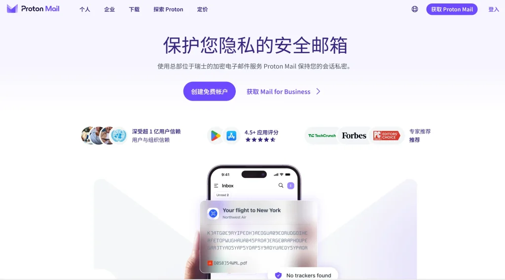

📧 你有没有想过，平时使用的邮箱，到底有多重视你的隐私？

注册网站、接收验证码、联系客户、发送私人邮件……邮箱几乎贯穿了我们的整个网络生活。但如果你不想让自己的邮件被广告追踪，也希望个人通信得到更好的保护，那么今天介绍的 **Proton Mail** 值得了解一下！

它是一款来自瑞士的加密邮箱服务，以隐私保护和邮件加密为核心，提供免费套餐，不仅适合日常收发邮件，也适合注重网络隐私的用户。🔒

## 🌍 一、Proton Mail 是什么？

Proton Mail 是由瑞士 Proton 公司提供的加密电子邮件服务，创立团队与欧洲核子研究中心 CERN 有关。

它最大的特点就是重视隐私保护，通过端到端加密、零访问加密等技术，尽可能降低邮件内容被未经授权访问的风险。

与普通邮箱相比，Proton Mail 更强调用户隐私、数据安全和透明度。它的应用程序采用开源方式，并接受独立安全审计。

对于希望寻找 Gmail 等传统邮箱替代方案的用户来说，这是一个值得尝试的选择。

## 🔐 二、为什么很多注重隐私的人会选择它？

### 🛡️ 1. 瑞士邮箱，重视隐私保护

Proton Mail 总部位于瑞士，用户数据受到当地法律框架保护。

瑞士以隐私保护法律闻名，Proton 也将隐私作为其产品设计的重要原则。

对于记者、研究人员、开发者、隐私爱好者，以及不希望在网络上暴露过多个人信息的普通用户来说，这一点具有吸引力。

网上有时会把 Proton Mail 和匿名通信、暗网用户等话题联系起来，但不能因此认定它主要被某个群体使用。它是一款面向普通用户的合法邮箱服务。

### 🔒 2. 端到端加密，保护邮件内容

Proton Mail 支持端到端加密。

当双方使用 Proton Mail 进行通信时，邮件默认采用端到端加密保护，邮件内容只有具备相应密钥的一方才能解密。

它还支持零访问加密，邮箱中存储的邮件内容和附件受到加密保护，服务提供商无法像读取普通未加密邮件那样直接查看内容。

需要注意：向其他普通邮箱发送邮件时，并不意味着邮件自动具备端到端加密。可以根据需要使用密码保护邮件等功能。

### 🚫 3. 不靠邮件内容投放广告

很多用户不喜欢邮箱中的广告和跟踪机制。

Proton Mail 的运营模式主要由付费订阅用户支持，官方表示不会通过出售用户数据来盈利，也不会根据邮件内容向用户投放广告。

如果你希望使用一个更加注重隐私、没有广告干扰的邮箱，可以考虑体验一下。

### 🧩 4. 开源并接受独立安全审计

Proton 的应用程序采用开源方式，安全研究人员可以检查相关代码，部分安全问题也能够通过社区审查和独立审计得到发现。

对于在意安全性和透明度的用户来说，开源是一个值得关注的特点。

## 📬 三、Proton Mail 可以用来做什么？

Proton Mail 不只是一个用来收发邮件的工具，它还可以用于多种日常场景。

- 👤 **个人日常通信**：收发私人邮件，与朋友、家人保持联系。
- 🌐 **网站账号注册**：用于注册支持该邮箱的网站和在线服务。
- 🔑 **接收验证码及通知**：接收网站发送的验证邮件和账号提醒，具体取决于对方平台的支持情况。
- 💼 **工作沟通**：处理个人工作邮件和重要通信。
- 🔒 **隐私敏感通信**：在需要更强邮件内容保护的场景中，使用合适的加密功能。
- 🧪 **开发者测试**：用于项目注册、邮件通知测试等合法开发用途。

如果你经常注册各种网站，又不希望所有账号都绑定在同一个邮箱上，可以考虑使用不同邮箱管理不同用途的账号。

不过，注册邮箱并不等于匿名身份。网站仍可能通过 IP 地址、浏览器信息、付款记录或其他数据识别用户。

## 🆓 四、免费吗？普通用户可以直接注册

Proton Mail 提供免费邮箱套餐，不需要先购买付费会员就能体验基础的加密邮件服务。

免费套餐的具体存储空间、邮箱地址数量和其他功能可能随官方政策调整，注册前可以查看当前方案。

如果只是日常收发邮件、体验加密邮箱，建议先从免费套餐开始。等到需要更多存储空间、自定义域名或额外邮箱地址时，再考虑是否升级。

## 📱 五、支持哪些设备？

Proton Mail 支持通过网页和移动应用使用，也提供桌面应用。

无论你习惯在电脑上处理邮件，还是喜欢在手机上查看通知，都可以根据自己的设备选择合适的使用方式。

它还属于 Proton 的隐私产品生态，同一个 Proton 账号可以使用其他相关服务，例如 Proton Calendar、Proton Drive 和 Proton VPN。各项服务的免费额度和功能有所不同。

## 🎬 六、Proton Mail 注册与使用教程

为了方便大家上手，我已经录制了 **Proton Mail 邮箱注册和使用详细教程**！

如果你第一次接触加密邮箱，或者不知道如何注册账号、进入邮箱、发送邮件和管理收件箱，可以跟着视频一步步操作。

建议注册后开启双重身份验证，并妥善保管恢复信息。不要重复使用其他网站的密码，也不要把重要账号的登录信息随意分享给别人。

## 🎯 七、总结

如果你正在寻找一款免费、注重隐私保护的加密邮箱，Proton Mail 值得收藏。

🇨🇭 瑞士背景、🔐 端到端加密、🛡️ 零访问加密、🚫 无广告商业模式，以及开源和独立安全审计，都是它受到隐私关注者青睐的原因。

当然，没有任何邮箱可以保证绝对匿名或绝对安全。使用时仍然需要注意账号安全、设备安全，以及邮件接收方是否支持端到端加密。

如果你想体验更注重隐私的邮箱服务，可以先注册一个免费账号，再跟着我的教程了解具体使用方法。

# 🖼️相关截图

### **🔗项目地址:****[点击进入](https://mail.proton.me/)**

---

> 本文转载整理自 [Ai星码博客](https://aixmb.com/1197.html)，版权归原作者所有。

