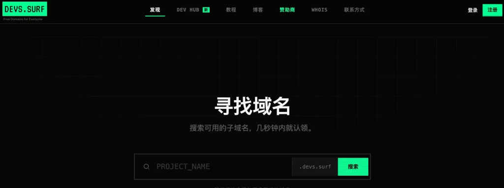
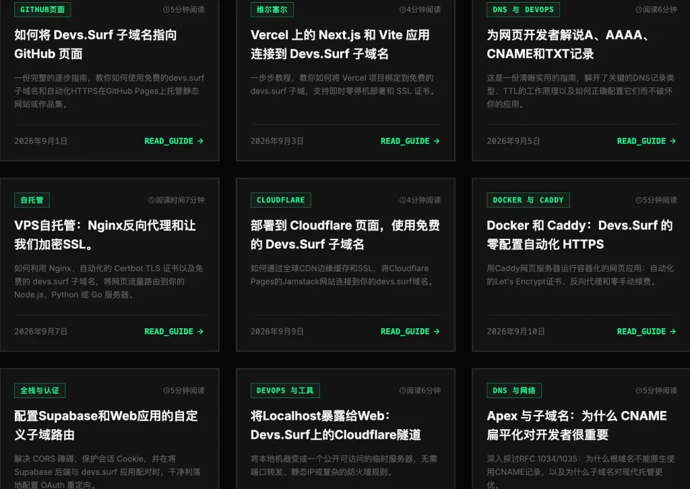
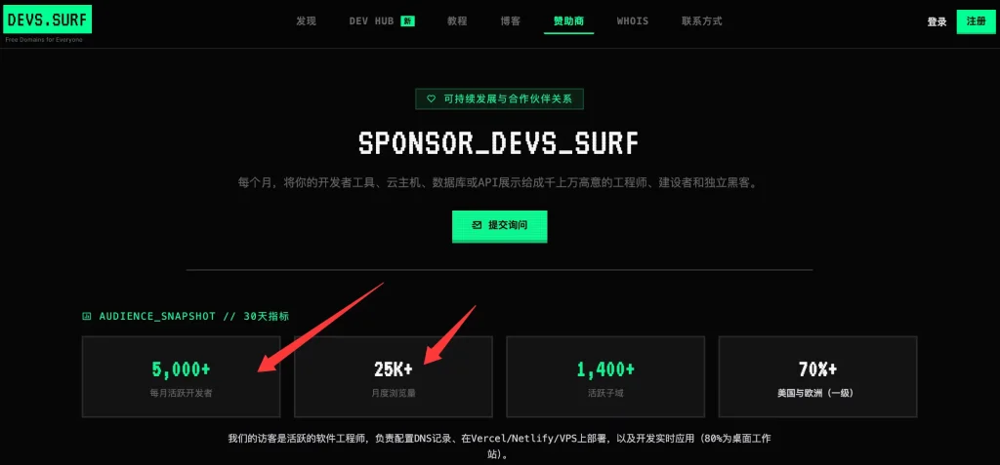

🔥 想搭建个人博客、在线工具、项目主页，却不想花钱购买域名？今天分享一个值得收藏的免费子域名平台：**Devs.Surf**！

很多人搭建网站时，往往会遇到几个问题：服务器需要花钱，域名需要续费，项目还没做起来，每年就要先承担一笔成本。对于个人开发者、学生和喜欢折腾开源项目的人来说，能省一点是一点。

今天介绍的 Devs.Surf，就是一个面向开发者的免费子域名服务平台，提供 **.devs.surf** 后缀，可以用来连接自己的博客、网站、在线工具和项目演示页面。

🎉 **按照本文介绍的申请额度，每个账号可以获取5个 .devs.surf 子域名。平台主打永久免费，无需每年手动续费！**

如果你一直在寻找免费域名、永久免费子域名，或者想搭配 Cloudflare Pages、GitHub Pages 搭建网站，可以了解一下。

## 🌐 一、Devs.Surf 是什么平台？

Devs.Surf 是一个面向开发者的免费子域名平台，用户可以在官网查找可用名称、申请子域名，并通过 DNS 管理功能将它连接到自己的网站或服务器。

与需要购买域名的传统方式不同，这个平台主打免费子域名服务。对于没有域名预算，又想给自己的项目配置一个独立访问地址的用户来说，是一个值得尝试的选择。

它适合哪些人？

- 🧑‍💻 想搭建个人博客的开发者
- 📝 想创建个人主页和作品集的用户
- 🛠️ 正在开发在线工具的程序员
- ☁️ 使用 Cloudflare Pages 或 GitHub Pages 的建站爱好者
- 🧪 需要测试网站、API 或演示项目的人
- 💰 希望降低建站成本、不想承担域名续费费用的人

如果你平时喜欢研究开源项目、折腾免费服务器、部署网页工具，那么可以把它加入自己的免费建站资源收藏夹。

## 💰 二、最大亮点：免费子域名，不用每年续费！

为什么很多人寻找免费域名？

因为域名并不是买一次就一定能永久使用。常见域名通常需要按照注册期限续费，忘记续费还可能影响网站正常访问。

对于个人项目来说，如果网站没有收入，或者只是用于学习和展示，每年额外支付域名费用，多少有些不划算。

Devs.Surf 主打的就是免费子域名服务。

✨ 主要特点包括：

- 🆓 提供免费的 **.devs.surf** 子域名
- 🎯 每个账号可申请5个子域名，具体以账号实际额度为准
- 💸 **无需每年手动续费**
- 🚀 支持 DNS 记录管理
- 🌍 可以连接自己部署的网站和项目
- 🔒 可以配合支持自定义域名的托管平台启用 HTTPS

官网将这项服务描述为永久免费，并说明没有常规续费费用。需要注意，官网同时提到，长期没有 DNS 记录、持续处于闲置状态的域名可能被清理，因此建议申请后正常配置和使用，并遵守平台规则。

这里的 **.devs.surf** 属于子域名，并不是独立购买的顶级域名，但对于个人网站、项目展示和开发测试来说，已经能够满足不少基础需求。

## 🔥 三、5个免费子域名，可以拿来做什么？

如果一个账号能够申请5个子域名，就可以根据不同用途进行规划，不必把所有项目都放在同一个地址下面。

例如，可以考虑以下几种用法。

**1. 搭建个人博客**

给自己的博客配置一个容易记忆的网址，用来记录技术文章、学习笔记和开发经验。

示例：**blog.devs.surf**

**2. 创建个人主页**

如果你是程序员、设计师或独立开发者，可以搭建一个个人主页，展示自己的项目、技能和作品。

示例：**home.devs.surf**

**3. 发布在线工具**

如果你开发了图片压缩、二维码生成、文本处理、地址生成等网页工具，可以使用单独的子域名作为访问入口。

示例：**tools.devs.surf**

**4. 部署项目演示页面**

开源项目开发完成后，可以部署一个演示网站，方便其他人直接体验功能。

示例：**demo.devs.surf**

**5. 用于开发测试**

如果你正在学习前端、后端或 API 开发，也可以把子域名用于测试环境，方便区分不同项目。

示例：**test.devs.surf**

以上都是用途示例，实际申请时需要检查名称是否可用。

对于喜欢同时维护多个项目的人来说，合理分配子域名，可以让个人网站和项目入口更加清晰。

## 🛠️ 四、支持 DNS 解析管理，不只是一个网址

申请到子域名之后，还需要将它指向实际运行的网站。

Devs.Surf 官网提供 DNS 管理功能，支持常见的 A、AAAA、CNAME 和 TXT 记录。

这些记录有什么作用？

- 🌐 **A 记录**：将子域名指向 IPv4 地址，常用于连接服务器。
- 🌐 **AAAA 记录**：将子域名指向 IPv6 地址。
- 🔗 **CNAME 记录**：将子域名指向另一个主机名，常用于连接网站托管平台。
- 📝 **TXT 记录**：用于域名所有权验证以及其他文本类配置。

举个例子，如果你已经在某个平台部署了一个网站，平台可能会要求你添加一条 CNAME 记录，或者添加 TXT 记录完成验证。

这时就可以根据托管平台给出的目标地址，在 Devs.Surf 的 DNS 管理页面进行配置。

官网还介绍了实时 DNS 更新能力，方便用户在修改记录后连接目标服务。不过，最终访问生效时间仍可能受到本地 DNS 缓存和托管平台验证等因素影响。

## ☁️ 五、搭配 Cloudflare Pages，低成本搭建个人网站（不能完全托管）

如果你经常关注免费建站资源，应该听说过 Cloudflare Pages。

它可以用于部署符合要求的静态网站和前端项目，而 Devs.Surf 可以提供一个自定义子域名。两者搭配，就能尝试搭建一个拥有独立访问地址的网站。

例如，你可以将个人主页、项目介绍页面或者在线工具部署到 Cloudflare Pages，再按照平台要求配置 **.devs.surf** 子域名。

基本流程是：

1. 在 Cloudflare Pages 创建并部署网站。
2. 在项目设置中添加自定义域名。
3. 根据 Cloudflare Pages 提供的要求，进入 Devs.Surf 管理 DNS 记录。
4. 添加对应的 CNAME 记录。
5. 等待平台完成域名验证和 HTTPS 配置。

具体配置值需要以你自己的 Cloudflare Pages 项目显示的信息为准。

需要注意，Cloudflare Pages 对自定义域名有相应的配置要求，能否直接绑定需要以平台当前规则为准。

如果你本身就喜欢使用 Cloudflare 免费服务，那么可以把 Devs.Surf 作为一个值得尝试的子域名来源。

## 🚀 六、还可以搭配 GitHub Pages、Vercel 和 Netlify

除了 Cloudflare Pages，Devs.Surf 官网还介绍了与其他常见网站托管平台搭配使用的方式。

**GitHub Pages**

适合个人主页、项目文档、静态博客和作品集。你可以在 GitHub Pages 项目中添加自定义域名，再按照提示配置 DNS。

**Vercel**

适合使用 Next.js、React、Vite 等技术构建的网站。将子域名添加到项目的域名设置中，再按照 Vercel 提供的要求配置 DNS 记录。

**Netlify**

适合静态网站和前端项目部署。添加自定义域名后，根据平台给出的解析目标完成设置。

**自己的 VPS 服务器**

如果你有自己的服务器，也可以通过 A 记录将子域名指向服务器公网 IP，再根据服务器环境配置网站和 HTTPS。

这些平台的具体配置要求并不完全相同，建议优先查看对应托管平台的官方文档。

值得一提的是，免费子域名只解决网址的问题，并不自动提供服务器、数据库或网站存储空间。网站能否运行，仍取决于你选择的部署方式。

## 🔒 七、网站能否启用 HTTPS？

现在的网站通常都会使用 HTTPS 加密访问。

Devs.Surf 提供 DNS 管理能力，可以配合支持自定义域名的托管平台使用。对于 Cloudflare Pages、GitHub Pages、Vercel 和 Netlify 等服务，通常可以按照平台的要求完成域名验证和证书配置。

如果使用自己的 VPS，则需要根据服务器环境配置 SSL/TLS 证书，例如通过 Let’s Encrypt 和 Certbot 等工具进行申请。

需要注意，申请到子域名并不意味着 HTTPS 会自动立即生效。DNS 解析、域名验证以及托管平台的证书签发流程，都可能影响最终结果。

## 🧑‍💻 八、哪些人最适合使用 Devs.Surf？

如果你符合下面这些情况，可以考虑试试。

**个人建站用户**

想搭建一个个人博客或主页，但不想额外购买域名，可以先体验免费子域名方案。

**开源项目开发者**

想给自己的项目添加演示地址、文档页面或在线体验入口，可以用子域名进行区分。

**前端开发者**

使用 Cloudflare Pages、GitHub Pages、Vercel 等平台部署项目时，可以尝试绑定自己的子域名。

**正在学习建站的新手**

想了解 DNS 解析、域名绑定和 HTTPS 配置，可以通过实际操作熟悉网站部署流程。

**喜欢折腾免费资源的用户**

如果你平时经常收集免费服务器、免费域名、免费托管平台，那么 Devs.Surf 也值得收藏。

当然，如果你准备搭建重要的商业网站，建议提前了解平台的使用条款、稳定性和管理政策，不要只根据免费这一点做决定。

为了让大家更容易上手，我已经录制了 Devs.Surf 的相关视频教程！🎬

如果你不熟悉英文网站，或者第一次接触免费子域名，可以跟着视频了解具体操作流程。

建议先打开官网，按照页面提示注册账号、查找可用名称并申请子域名。领取之后，再根据自己的建站平台配置 DNS 记录。

不会操作的朋友，可以直接参考我的视频教程，跟着步骤一步步尝试。

## 🎯 十、总结：一个值得收藏的免费子域名平台

对于喜欢搭建个人博客、开发在线工具、发布开源项目的人来说，Devs.Surf 是一个可以了解的免费子域名平台。

它主打 **.devs.surf** 免费子域名，支持 DNS 记录管理，并介绍了与 Cloudflare Pages、GitHub Pages、Vercel、Netlify 等托管平台的连接方式。

相比需要定期续费的传统域名，平台最大的吸引力在于免费方案无需每年手动续费。按照本文介绍的额度，每个账号可以申请5个子域名，能够用于不同的个人项目。

不过，使用前仍建议确认账号实际额度，并留意平台关于闲置域名和服务使用的规则。免费子域名也不等于免费服务器，建站过程中可能涉及的其他费用需要单独考虑。

如果你正好在寻找免费子域名，或者想给自己的项目配置一个新网址，不妨去官网看看。

# 🖼️相关截图

### **🔗项目地址:**[**点击进入**](https://devs.surf)

---

> 本文转载整理自 [Ai星码博客](https://aixmb.com/1205.html)，版权归原作者所有。

