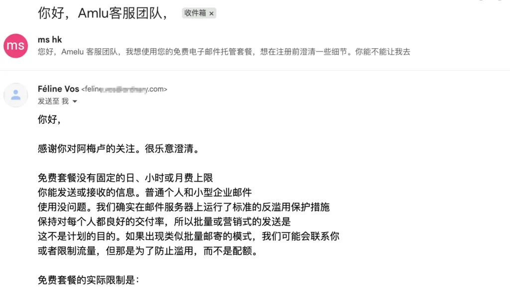
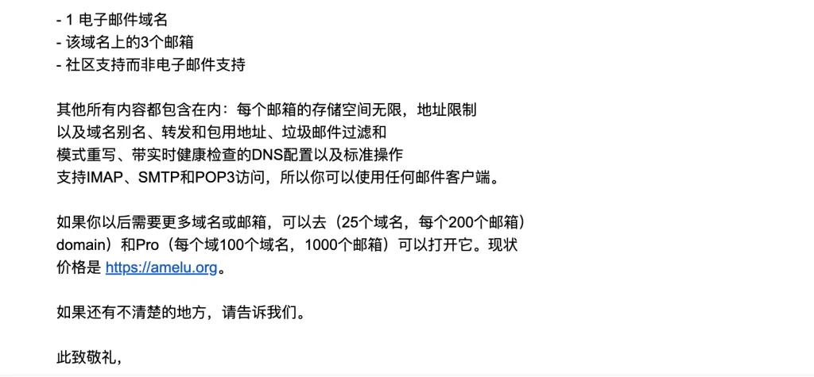
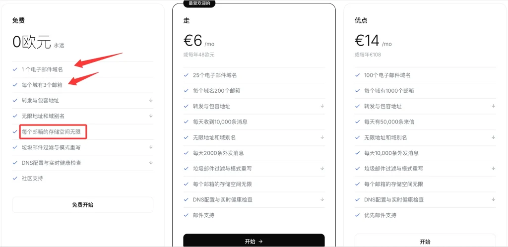

想拥有一个带自己域名后缀的邮箱，又不想每个月花钱订阅？🤔 今天分享一个值得收藏的免费邮箱托管平台：**Amelu**！

它不仅提供免费域名邮箱，还主打欧盟数据主权。邮件存储在欧盟服务器上，服务由平台自己运营，不是简单转售其他大型云厂商的邮箱服务。

🆓 免费版标注为 **€0 Forever（永久免费）**，对于注重隐私、希望降低邮箱成本的个人用户和开发者来说，值得了解！

## 🌍 一、Amelu 是什么？

Amelu 是一个自定义域名邮箱托管平台，由注册于荷兰的公司运营。你可以绑定自己已有的域名，创建专属邮箱地址。

例如：

- 📧 **hello@你的域名**
- 💼 **contact@你的域名**
- 🛠️ **support@你的域名**

这些地址可以用于个人博客、网站联系页面、开源项目和日常工作沟通，让邮箱看起来更加专业。

## 🆓 二、免费版有哪些功能？

根据官网目前公布的免费方案，主要功能包括：

- 💰 **价格：€0，永久免费**
- 🌐 **支持1个邮箱域名**
- 📮 **每个域名最多3个邮箱**
- 🔀 支持邮件转发和 Catch-all 全收件
- ✉️ 无限邮箱地址别名和域名别名
- ♾️ 每个邮箱无限存储空间
- 🛡️ 自动垃圾邮件过滤
- ⚙️ DNS 配置及实时健康检查
- 📬 支持 IMAP、SMTP、POP3 标准邮件协议
- 🤝 提供社区支持

对于个人博客、小型项目和日常邮箱需求来说，这些功能已经相当实用。

需要注意，Amelu 不会免费赠送域名。你需要先拥有自己的域名，再按照平台要求完成 DNS 配置。

## 🔐 三、最大亮点：荷兰运营，欧盟数据主权

现在注册邮箱非常方便，但很多人可能没有仔细考虑过：**自己的邮件到底存储在哪里？由谁管理？**

Amelu 的一个重要卖点，就是强调欧盟数据主权。

根据官网介绍，Amelu 由荷兰注册的公司运营，邮件基础设施和主要数据库运行在欧盟境内的服务器上。平台表示，邮件数据受欧盟隐私法律框架保护，并由其自行运营邮件基础设施，而不是将邮箱托管在其他大型科技公司的云邮箱服务中。

官网对此的描述是：

**你的邮件和数据存放在欧盟服务器上，受到欧盟隐私法保护，不会被悄悄转移到其他大型科技公司的邮箱基础设施中。**

这对于比较关注数据存储位置、隐私和服务自主性的用户来说，是一个值得关注的特点。

当然，欧盟数据主权并不意味着任何情况下都绝对不会发生跨境数据处理。Amelu 的隐私政策也说明，部分辅助服务可能涉及其他处理商，并对相关数据处理和国际传输作出说明。建议对数据合规有较高要求的用户阅读官方隐私政策。

## 🛡️ 四、注重隐私，不靠扫描邮件投放广告

Amelu 的隐私政策表示，平台不会为了广告目的阅读邮件内容、扫描邮件投放广告，也不会出售用户数据。

平台会通过自动化系统进行垃圾邮件过滤，这是邮件服务正常运行的一部分。

如果你不希望自己的邮箱服务与广告画像绑定，或者希望更清楚地了解邮件数据由谁管理，可以进一步研究 Amelu 的隐私政策和数据处理协议。

🔗 隐私政策：[https://amelu.org/privacy](https://amelu.org/privacy)

## 📮 五、支持邮件转发和 Catch-all 全收件

免费版还提供邮件转发和 Catch-all 功能。

📨 **邮件转发：** 可以将收到的邮件转发到另一个常用邮箱，方便集中管理。

📬 **Catch-all 全收件：** 根据配置接收发送到域名下不同地址的邮件，包括一些没有单独创建邮箱的地址。

此外，平台支持无限邮箱地址别名和域名别名，可以根据不同用途管理联系地址，而不必为每个别名单独创建一个邮箱。

具体转发行为和别名使用规则，以官网当前说明为准。

## 💻 六、可以使用哪些邮件客户端？

Amelu 支持标准 IMAP、SMTP 和 POP3 协议，因此可以使用兼容的邮件客户端收发邮件，例如：

- 📱 Apple Mail
- 💻 Microsoft Outlook
- ✉️ Mozilla Thunderbird

你不必只能通过某个专用应用管理邮件，可以按照自己的使用习惯选择兼容的客户端。

## 🛠️ 七、如何免费创建域名邮箱？（博主也录制了详细部署视频）

基本流程如下：

1. 🌐 打开官网
2. 👤 注册账号并登录。
3. 📌 添加自己已经拥有的域名。
4. ⚙️ 按照提示配置 MX、SPF、DKIM 等 DNS 记录。
5. 🔍 等待域名验证和邮件配置检查完成。
6. 📧 创建邮箱地址并测试邮件收发。

如果你的域名使用 Cloudflare 管理 DNS，也可以按照 Amelu 给出的记录进行配置。操作时注意保留网站原有的 DNS 记录，避免影响网站访问。

## 🎯 八、总结

如果你正在寻找免费域名邮箱服务，希望使用自己的域名创建邮箱，同时重视数据存储位置和隐私保护，可以了解一下 Amelu。

它的免费版标注为永久免费，提供1个邮箱域名、最多3个邮箱、无限存储空间、邮件转发、无限别名以及垃圾邮件过滤等功能。

⭐ **核心亮点：荷兰公司运营、邮件基础设施位于欧盟、强调欧盟数据主权，免费版无需常规订阅费用。**

如果你已经拥有域名，不妨去官网看看，给自己的个人网站或项目配置一个专属邮箱。

## **官方回复：**

### **原文：**

Hi,

Thanks for your interest in Amelu. Happy to clarify.

The Free plan does not have a fixed daily, hourly or monthly cap on the number

of messages you can send or receive. Normal personal and small-business mail

use is fine. We do run standard anti-abuse protections on the mail server to

keep deliverability good for everyone, so bulk or marketing-style sending is

not what the plan is for. If a pattern looks like bulk mailing we may reach out

or throttle it, but that is about abuse prevention, not a quota.

What the Free plan is actually limited by:

– 1 email domain

– 3 mailboxes on that domain

– Community support rather than email support

Everything else is included: unlimited storage per mailbox, unlimited address

and domain aliases, forwarding and catch-all addresses, spam filtering and

pattern rewrites, DNS configuration with live health checks, and standard

IMAP, SMTP and POP3 access so you can use any mail client.

If you later need more domains or mailboxes, Go (25 domains, 200 mailboxes per

domain) and Pro (100 domains, 1,000 mailboxes per domain) open that up. Current

pricing is at [https://amelu.org](https://amelu.org/).

Let us know if anything else is unclear.

Best regards,

# 🖼️相关截图

### **🔗 Amelu 官方网站： [https://amelu.org](https://amelu.org/)**

---

> 本文转载整理自 [Ai星码博客](https://aixmb.com/1213.html)，版权归原作者所有。

