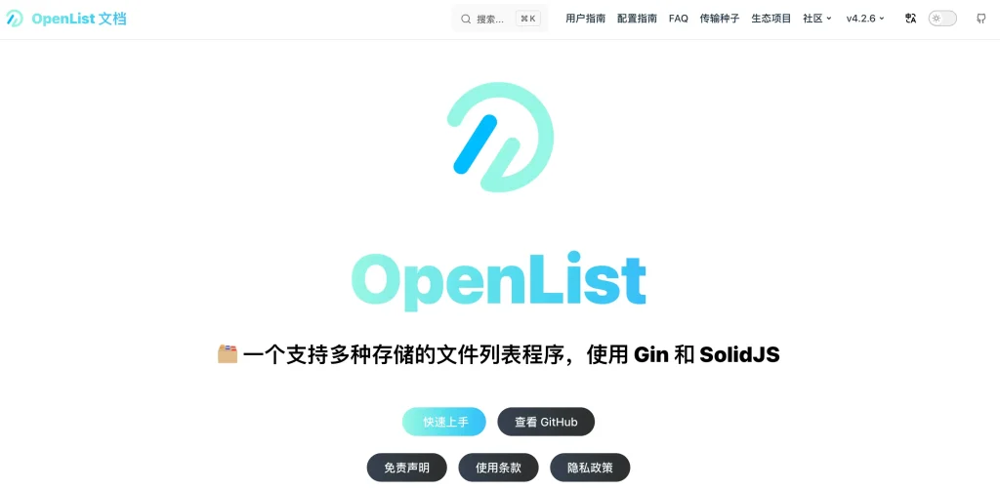
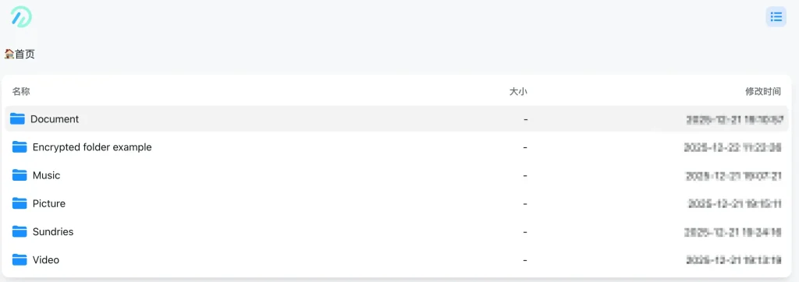

你是不是也有这样的烦恼？🤔

📂 百度网盘、阿里云盘、OneDrive、Google Drive……文件分散在不同平台，每次找文件都要切换好几个网站。

🔗 想分享文件给别人，操作繁琐，还要考虑分享链接、访问权限等问题。

💸 想搭建自己的在线文件管理系统，又不想购买服务器、安装环境、维护程序。

今天给大家分享一个值得收藏的开源项目：**OpenList-Worker！** 🚀

它是 OpenList 团队推出的 Serverless 版本，可以部署到 Cloudflare Workers，将多种网盘和存储服务整合到统一界面中。对于想搭建个人文件管理站、网盘聚合平台，又希望降低部署成本的朋友来说，非常值得体验！

## 🌟 一、OpenList-Worker 是什么？

OpenList 是一款开源的多存储聚合文件管理工具，可以将不同网盘、对象存储和文件服务整合起来，提供统一的文件浏览与管理入口。

而 OpenList-Worker 则是面向 Serverless 环境的版本，采用 TypeScript 技术栈，可以部署到 Cloudflare Workers 等支持的平台。

简单来说，它能够帮助你搭建一个属于自己的在线文件管理平台，不必为了运行这个服务专门购买传统云服务器。

## 🔥 二、OpenList-Worker 有哪些实用功能？

### 1. 多网盘聚合管理

这是 OpenList 最吸引人的功能之一。

平时使用多个网盘，最麻烦的就是文件分散。有的网盘保存工作资料，有的存放照片视频，还有的专门用来备份文件。时间一长，不仅管理混乱，查找文件也越来越困难。

OpenList-Worker 支持多种存储驱动，可以根据需要接入不同的网盘和存储服务，例如：

- 国内常见网盘
- OneDrive、Google Drive 等国际网盘
- Cloudflare R2 等对象存储
- WebDAV、FTP、SFTP 等文件服务
- 其他项目支持的存储后端

这样就可以将不同存储统一整理到一个入口，减少频繁切换平台的麻烦。

具体支持的网盘和驱动，以项目当前版本的官方文档为准。

### 2. 在线浏览文件

有时候，我们只是想查看一张图片、一段视频或者一份文档，却需要先下载到电脑，再打开相应的软件。

使用 OpenList-Worker，可以通过网页浏览文件和目录，并根据文件类型及浏览器支持情况预览图片、视频、音频、文档等内容。

无论是整理学习资料、管理工作文件，还是查看平时保存的素材，都更加方便。

### 3. 文件上传、下载与批量操作

除了浏览文件，文件上传和下载也是日常使用中不可缺少的功能。

OpenList-Worker 提供文件管理相关操作，可以帮助用户更方便地处理目录和文件。对于需要整理大量资料、下载素材或者管理备份文件的人来说，统一操作入口能够减少不少重复工作。

部分批量操作和传输能力还会受到存储驱动、权限以及上游网盘接口的限制。

### 4. 文件分享更方便

想给朋友分享学习资料、给同事传递工作文件，或者公开展示某个文件目录，都可以考虑使用统一的文件管理入口。

OpenList-Worker 支持相关文件分享功能，具体分享权限、有效期和密码设置能力需要根据项目版本及配置确认。

适用场景包括：

📚 分享学习资料和电子书。

🎬 整理并分享图片、视频等素材。

💼 管理工作文档和项目文件。

🌐 搭建个人资料库或公开文件列表。

需要注意，公开分享前应检查文件权限，避免误将私人文件或敏感信息暴露给其他人。

### 5. 支持 WebDAV 等扩展能力

对于喜欢折腾 NAS、自动化工具和个人资料库的用户来说，OpenList 不只是一个网页文件列表。

项目还提供 WebDAV 等相关接口能力，可以根据配置与其他兼容工具配合使用，拓展文件管理方式。

部分版本或部署配置还涉及 S3 兼容接口等能力，实际支持范围应以 OpenList-Worker 官方文档为准。

### 6. 用户权限与安全管理

如果只是自己使用，简单的账号管理就很重要；如果需要多人访问，更要考虑权限划分。

项目提供用户认证及权限管理相关能力，可以根据具体功能配置用户访问范围，降低不必要的文件暴露风险。

建议部署完成后及时修改默认配置、使用高强度密码，并妥善保管密钥。不要为了方便就把管理员账号或敏感存储凭据公开。

### 7. 适合继续扩展的开源项目

OpenList-Worker 不仅可以用于个人文件管理，也适合开发者研究 Serverless 架构、边缘计算和存储服务集成。

如果你喜欢折腾开源项目，还可以结合自己的使用场景，探索个人资料库、文件分享入口以及其他轻量级应用。

## ☁️ 三、为什么推荐部署到 Cloudflare？

很多人想搭建自己的在线文件管理系统，却不想额外购买服务器。

传统部署方式往往需要准备云服务器、安装运行环境、配置数据库，还要考虑后续更新和维护。对于只想管理文件的个人用户来说，这些准备工作可能过于繁琐。

OpenList-Worker 支持部署到 Cloudflare Workers，让部署方式变得更加轻量。

🆓 **降低部署成本**

可以利用 Cloudflare Workers 提供的免费额度运行服务，不必专门购买传统云服务器。是否产生费用取决于实际用量和使用的其他服务。

🌍 **利用边缘计算平台**

Cloudflare Workers 可以在 Cloudflare 的边缘计算网络上运行，适合构建轻量级在线服务。实际访问速度仍会受到网络环境、上游网盘和文件传输方式等因素影响。

🔗 **支持绑定自定义域名**

部署完成后，可以根据 Cloudflare 的配置方式绑定自己的域名，让文件管理入口更容易记忆和访问。

🛠️ **可以通过 GitHub 管理项目**

可以根据项目提供的部署方式进行部署，也可以将仓库 Fork 到自己的 GitHub 账号，再连接 Cloudflare Workers，方便后续更新和管理。

📦 **搭配相应存储服务**

根据项目要求，可以配置相应的数据持久化方案，例如 D1、KV 等 Cloudflare 服务。具体使用哪种方案，应以项目文档和当前版本要求为准。

特别提醒：Cloudflare 免费额度并不代表所有功能都永久免费、不限量。文件实际存储在哪里、需要多少空间，以及上传下载会消耗哪些资源，都取决于挂载的网盘、存储后端和部署配置。

## 🛠️ 四、部署 OpenList-Worker 需要准备什么？

如果你想自己搭建，可以先准备以下内容：

1. 一个 Cloudflare 账号，用于部署 Workers 服务。
2. 一个 GitHub 账号，用于连接或管理项目仓库。
3. 按照项目文档配置必要的环境变量、密钥和存储服务。
4. 准备好需要接入的网盘账号或存储服务，并确认相应授权方式。

整体流程通常包括打开项目仓库、选择部署方式、连接代码仓库、完成构建和配置、访问部署地址，以及初始化管理员账号。

如果部署过程中需要数据库或其他存储绑定，应按照官方文档逐项配置。不要直接跳过项目要求的初始化步骤，否则可能影响登录或数据保存。

## 🎯 五、哪些人适合使用？

**个人网盘用户：** 同时使用多个网盘，希望统一管理文件。

**个人站长：** 想建立自己的在线文件列表或资料分享入口。

**NAS 爱好者：** 希望研究 WebDAV、存储服务和文件管理工具的整合。

**开发者：** 想学习 Cloudflare Workers、TypeScript 和 Serverless 架构。

**想降低成本的用户：** 不想为轻量级文件管理服务专门购买服务器，希望先利用免费额度进行体验。

## 📝 六、写在最后

OpenList-Worker 的核心价值，就是将多种网盘和存储服务整合到统一的文件管理入口，让文件浏览、下载、分享和存储管理变得更加方便。

如果你一直被多个网盘来回切换的问题困扰，或者想搭建一个属于自己的在线文件管理平台，又不想额外购买服务器，那么这个开源项目值得收藏。

# 🖼️相关截图

## 🔗 GitHub 地址：[点击进入](https://github.com/OpenListTeam/OpenList-Worker)

---

> 本文转载整理自 [Ai星码博客](https://aixmb.com/1230.html)，版权归原作者所有。

