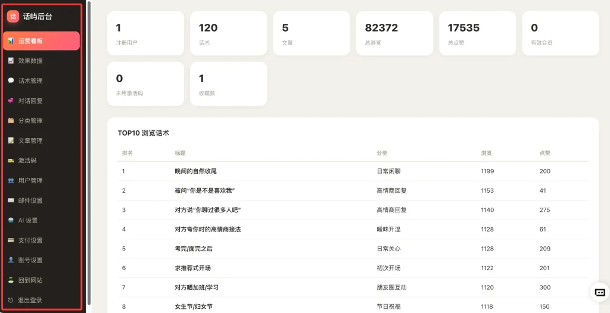

以前总觉得，开发一个完整的网站是一件很难的事情。

不会 HTML、CSS、JavaScript，不懂前端和后端，更不知道数据库怎么配置。即使脑子里有一个不错的想法，也常常因为不会编程，只能停留在想象阶段。

想做一个个人网站，怕技术门槛太高；想开发一个实用工具，又担心代码写不出来；好不容易找到教程，照着操作却发现各种报错……

但现在，AI 编程工具正在改变这种情况！🔥

今天就分享一个我亲自使用的 AI 编程软件：**Trae！**

重点是，我自己做的「话屿·恋爱聊天研究所」网站，**整个项目的代码都是通过 Trae 编写的，我自己不需要懂编程，也能把想要的网站一步步做出来！**

而且根据活动介绍，Trae 新用户注册还能领取 2500 积分，想体验 AI 编程的朋友可以了解一下。🎁

## 🤖 一、Trae 到底是什么？

Trae 是一款 AI 编程工具。与传统编程需要自己一行一行编写代码不同，它可以根据你的需求，帮助你生成代码、修改功能、调整页面、分析错误，还能协助完成整个项目的开发。

你可以把它理解成一个能够协助你写代码的 AI 开发助手。

以前，你可能需要花很长时间学习编程知识，才能做出一个像样的网站。现在，你可以先把自己的想法告诉 Trae，让它帮你实现，再根据实际效果不断调整。

例如，你可以直接告诉它：

💬「帮我开发一个漂亮的个人博客，首页要简洁，支持文章分类、搜索和后台管理。」

💬「帮我做一个在线工具网站，增加用户登录、收藏和历史记录功能。」

💬「这个页面不够好看，帮我调整布局，配色改得更现代一些。」

💬「这里出现了报错，帮我检查项目代码，分析原因并修复。」

Trae 就可以根据你的描述生成或修改相应代码。

**你不一定需要先成为程序员，才能开始尝试开发自己的产品。** 即使没有编程基础，也可以通过清晰的需求描述，让 AI 协助完成开发工作。

当然，复杂项目仍然需要反复测试、检查和调整，但与完全从零手写代码相比，开发门槛确实降低了不少。

## 💻 二、我用 Trae 做了一个真正的网站！

光说 AI 能写代码，可能很多人还是觉得比较抽象。

所以，直接给大家看看我自己做的项目：**话屿·恋爱聊天研究所**！❤️

这不是简单生成一张网页图片，也不是只有首页的静态展示页面，而是一个包含前台页面、内容模块和后台管理功能的网站。

整个项目的代码都是我通过 Trae 编写完成的。我的做法就是把需求告诉 AI，让它根据我的想法进行开发，再不断提出修改意见，逐步完善网站。

<text>🌐 网站首页：话屿·恋爱聊天研究所</text>

网站采用了温暖的粉色渐变风格，整体围绕恋爱聊天、情绪分析和沟通技巧展开。首页有搜索框、热门搜索、聊天演示和场景话术分类，让用户可以快速找到自己需要的内容。

### ❤️ 1. 场景话术库

聊天时最怕什么？

对方发来一句话，自己盯着屏幕想半天，最后还是不知道怎么回复。

比如对方说晚安，应该怎么回才显得自然？遇到暧昧聊天，怎么接话才能不尴尬？想表白、想约对方吃饭，又该如何开口？

这个网站围绕不同聊天场景整理了相应的话术内容，用户可以通过分类或搜索找到适合自己的参考回复。

### 🧠 2. 情绪分析

聊天不只是简单地回复文字，有时候更重要的是理解对方表达的情绪。

网站设置了情绪分析相关入口，帮助用户关注聊天中的语气、表达和沟通状态，让交流不再只是机械地复制一句话。

### 💬 3. 聊天体检

有时候，明明聊了很久，关系却没有进展；有时候，一句话没说好，就让聊天变得尴尬。

通过聊天体检相关功能，可以围绕聊天中的问题进行分析，帮助用户发现沟通中值得注意的地方。

### 🔥 4. 热门话术与实战技巧

网站还设置了热门内容、恋爱干货和实战技巧等栏目。

用户可以浏览高人气话术，学习不同场景下的沟通方式，也可以通过文章内容了解恋爱聊天中的常见问题。

### 🔎 5. 搜索与收藏功能

网站首页提供搜索入口，方便用户根据聊天场景寻找相关内容。

喜欢的话术还可以收藏起来，以便后续查看，不必每次需要时重新翻找。

### 🛠️ 6. 完整的后台管理系统

更重要的是，这个网站不只是前台好看。

后台还包含运营看板、效果数据、话术管理、对话回复、分类管理、文章管理、激活码、用户管理、邮件设置、AI 设置、支付设置和账号设置等模块。

对于一个个人项目来说，从前台页面到后台管理，涉及的功能其实并不少。

而这些代码，都是我通过 Trae 辅助编写完成的。

这也是我想分享这个工具的原因：**以前可能需要找程序员才能完成的事情，现在个人也可以借助 AI 尝试自己实现。**

## 🔥 三、不会编程，真的能用 Trae 开发网站吗？

我的实际体验是：可以尝试，而且入门门槛比传统开发低很多。

如果你完全不懂代码，也不必一开始就学习一大堆编程知识。

可以先从自己想做的网站开始，把需求描述清楚，然后让 Trae 分步骤完成。

例如，你想做一个网址导航站，可以先让它完成首页和网站分类；等页面做好后，再增加搜索功能；接着完善后台管理，让自己能够添加、修改和删除网址。

如果你想做博客，也可以先搭建文章列表和文章详情页，再增加分类、标签、搜索和管理功能。

整个过程就像不断与 AI 沟通：

- 第一步：告诉 Trae，你想做什么。
- 第二步：让它根据需求编写代码。
- 第三步：运行项目，查看实际效果。
- 第四步：发现不满意的地方，就继续提出修改要求。
- 第五步：反复测试和完善，直到网站达到自己的预期。

你不需要一次性把所有功能都想好，也可以边做边完善。

例如，页面不够漂亮，就让它调整布局和配色；功能不符合预期，就具体说明哪里需要修改；遇到错误，就把报错信息交给它分析。

**你负责提出想法、判断效果和验收功能，Trae 则帮助你完成代码编写。**

当然，AI 并不是每次都能一次成功。需求越清晰，反馈越具体，通常越容易得到符合预期的结果。复杂项目仍然需要测试和排错，涉及支付、账号、数据库和用户隐私时，更需要认真检查安全性。

但对于没有编程基础、又想做出自己网站的人来说，这无疑提供了一条新的尝试路径。

## 🎁 四、重点来了！Trae 新用户可以领取 2500 积分

使用 AI 编程工具，很多人最关心的就是成本。

毕竟开发一个网站，不可能只让 AI 生成一次代码就结束。页面需要修改，功能需要完善，报错需要排查，整个过程可能会反复进行。

如果每次使用都需要付费，试错成本自然会增加。

根据 Trae 的活动介绍，新用户可以享受多重积分福利。🎉

### 1️⃣ 注册即送 2500 积分

新用户注册成功后，可获得 **2500 积分**，用于体验相应的 AI 编程功能。

对于刚接触 AI 编程的人来说，可以先利用这部分额度体验代码生成、页面开发和项目修改，看看 AI 能不能帮助自己完成想做的事情。

活动页面介绍该福利价值约百元，实际可使用的次数和价值取决于模型、任务类型及具体积分消耗规则。

### 2️⃣ 每日签到，天天领积分

除了新用户福利，还可以通过每日签到和参与相关活动积累积分。

如果你经常使用 AI 写代码、调整页面或完善功能，可以留意相关签到活动，减少使用成本。

### 3️⃣ 邀请好友，双方都有机会获得积分

Trae 还提供邀请好友相关活动。

符合活动规则时，邀请人和被邀请人都可以获得相应积分奖励。具体奖励数量和领取条件，以官方活动页面为准。

### 4️⃣ 每月首次登录，领取 500 积分

根据活动介绍，每月首次登录可获得 500 积分。

这对于想持续体验 AI 编程的用户来说，也是一个值得关注的福利。

### 5️⃣ 专属模型补贴，降低积分消耗

部分模型或任务可以享受专属积分补贴。

在符合活动规则的情况下，相同任务的积分消耗可能大幅降低，让有限的积分能够支持更多开发尝试。

### 6️⃣ 大学生额外享受 2000 积分

如果你是在校大学生，还可以关注大学生专属福利。

活动介绍显示，符合条件的大学生可以额外领取 2000 积分，具体需要满足哪些认证条件，以官方活动规则为准。

📌 **小提醒：** 以上积分福利根据活动介绍整理，具体领取资格、积分有效期、使用范围和活动时间可能发生变化，请以 Trae 官方页面及账号内显示的信息为准。

## 💡 五、用 Trae 可以开发哪些项目？

如果你觉得自己没有编程基础，不知道应该从哪里开始，可以先考虑这些方向。

🌐 **个人博客：** 搭建自己的博客，发布文章、分享知识，逐步完善分类、搜索和后台管理功能。

🔗 **网址导航站：** 把常用网站整理到一个页面，增加分类、搜索和收藏功能。

🛠️ **在线工具网站：** 开发文本转换、格式处理、图片处理等实用工具。

📚 **资料管理平台：** 建立自己的知识库、资源目录或文件列表。

❤️ **垂直内容网站：** 像我做的恋爱聊天研究所一样，围绕一个具体主题，打造话术、文章和工具相结合的网站。

💰 **个人创业项目：** 将自己的想法做成一个能够解决实际问题的产品，再探索用户增长和商业化方式。

这些项目不一定需要一开始就投入大量资金。你可以先做出一个能用的版本，再根据实际需求逐步迭代。

不过，网站上线并不意味着一定能够赚钱。真正做好一个项目，除了代码，还需要考虑内容质量、用户体验、安全维护和后续运营。

## 🚀 六、为什么我建议编程小白试试 AI 编程？

以前，一个人想做网站，可能需要学习前端、后端、数据库、服务器部署等一系列知识。

现在，借助 Trae 这样的 AI 编程工具，你可以先从自己感兴趣的项目开始，把开发过程拆成一个个具体任务，再逐步完善。

对我来说，最大的改变并不是 AI 能生成多少行代码，而是**即使我不懂代码，也能把自己想要的网站做出来。**

我有一个想法，就可以尝试告诉 Trae；网站有地方不满意，就继续让它修改；需要增加功能，就让它协助开发。

当然，真正想把网站长期运营起来，还是需要不断测试和完善。但至少，编程不再是阻止你开始的唯一门槛。

## 📝 写在最后

如果你一直有开发网站的想法，却因为不会编程迟迟没有行动，不妨试试 Trae。

不用一开始就挑战特别复杂的项目。先从一个简单的网站开始，学会描述需求、检查效果、不断迭代，再慢慢做出自己真正想要的产品。

就像我开发的「话屿·恋爱聊天研究所」，从前台页面到后台管理，整个项目的代码都是通过 Trae 编写完成的。

**不会代码，也可以开始做网站；不懂开发，也可以先把自己的想法变成现实！** 💻

🎁 如果你也想体验 AI 编程，可以了解 Trae 的新用户 2500 积分福利，先用免费额度尝试，再决定是否继续深入。

# 🖼️相关截图

### **前端：**

### **后端：**

