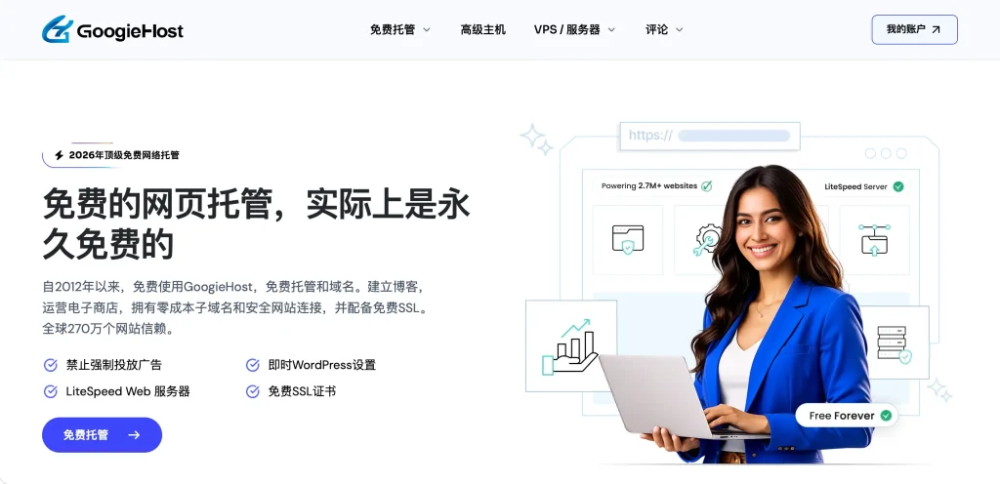
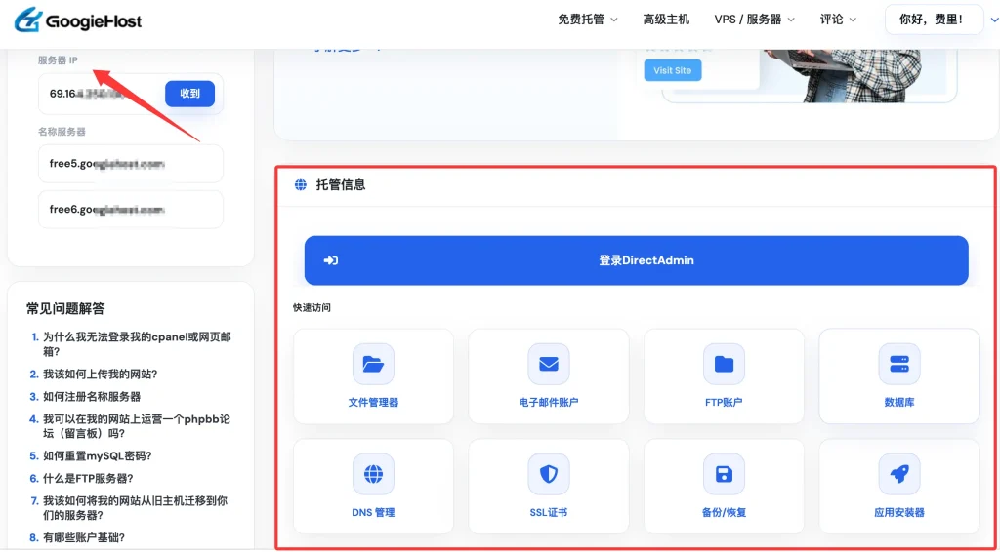

想拥有一个属于自己的网站，却不想每个月花钱购买服务器？

想搭建 WordPress 博客、个人主页，甚至运营一个可以通过广告和推广获得收益的网站，但又不想一开始投入太多成本？

今天介绍一个值得收藏的免费主机平台：**GoogieHost！** 🎉

它提供免费虚拟主机服务，不仅可以创建网站，还支持绑定自己的域名、使用免费子域名、配置 SSL 证书，以及创建域名邮箱。

更值得关注的是，GoogieHost 从 **2012 年运营至今，到了 2026 年已经有十多年的服务历史**。对于正在寻找免费建站资源的个人站长来说，这个平台值得了解一下。

以前想搭建网站，往往需要先购买服务器、配置环境、购买各种服务。现在可以先利用免费主机资源，把自己的第一个网站搭建起来！

## 🌟 一、GoogieHost 是什么？

GoogieHost 是一个提供虚拟主机服务的平台，主要面向个人站长、学生、开发者以及希望低成本建站的用户。

它比较吸引人的地方，就是提供了免费的虚拟主机方案。

很多新手想做网站，可能都会遇到这些问题：

- 不懂服务器配置，不知道应该购买什么配置。
- 只是想搭建一个个人博客，却不想每个月支付主机费用。
- 想学习 WordPress，但不想为了练习先购买服务器。
- 已经有了自己的域名，却不知道在哪里放置网站。
- 想拥有一个专属域名邮箱，但不想额外购买邮箱服务。
- 网站上线以后，还希望能够接入广告、推广项目，探索变现方式。

GoogieHost 可以让你从免费主机开始，先体验网站搭建和运营的完整过程。

它提供的免费套餐虽然不能代替高配置商业服务器，但对于个人博客、学习建站和轻量级项目来说，可以作为一个入门选择。

## 🎁 二、免费虚拟主机有哪些功能？

GoogieHost 的免费套餐提供了不少基础建站功能，不需要一开始就购买付费主机，也能尝试搭建自己的网站。

### 🆓 1. 免费虚拟主机

这是最核心的功能。

平台提供 $0 免费虚拟主机方案，可以用来放置网站程序、网页文件和相关资源。

对于刚开始接触建站的人来说，不必先花钱购买服务器，就可以尝试自己搭建网站。

### 💾 2. NVMe SSD 存储空间

免费套餐提供约 1GB NVMe SSD 存储空间。

可以用来存放：

- 网站程序文件
- 文章和页面资源
- 图片和其他静态文件
- 网站运行所需的相关文件

对于一个简单的个人博客或者展示网站，入门阶段可以先体验使用。

### 🌐 3. 免费子域名

还没有自己的域名？也不用担心！

GoogieHost 提供免费子域名，申请主机时可以根据页面提示选择使用。

这样即使暂时没有购买 .com、.net 等独立域名，也可以先把网站搭建起来。

等以后拥有自己的域名，还可以考虑绑定到主机上。

### 🔗 4. 支持绑定自己的域名

这个功能对于个人站长非常重要！

如果你已经注册了自己的域名，就可以将它绑定到 GoogieHost 主机上。**（支持IP进行绑定）**

使用自己的域名，网站看起来更加专业，也更方便长期运营。

比如你准备搭建一个技术博客，可以使用自己的域名作为网站地址；如果想做个人品牌，也可以使用专属域名展示自己的内容和作品。

不需要一直使用平台提供的免费子域名，拥有自己的域名后，网站地址也更加容易记忆和传播。

### 🔒 5. 免费 SSL 证书

现在的网站基本都建议使用 HTTPS。

GoogieHost 提供 SSL 相关功能，可以为符合条件的域名配置证书。

开启之后，访客就可以通过 HTTPS 访问网站，浏览器也能显示安全连接标识。

对于个人博客、展示网站和内容站来说，这是一个很实用的基础功能。

### 📦 6. WordPress 一键安装

如果你想搭建个人博客，那么 WordPress 是一个非常常见的选择。

GoogieHost 支持通过相关安装工具部署 WordPress 等常见程序。

安装完成后，就可以进入 WordPress 后台：

📝 发布文章。

🎨 更换网站主题。

🧩 安装各种插件。

📂 管理图片和媒体文件。

🌍 创建分类、页面和导航。

即使你没有太多建站经验，也可以从 WordPress 开始学习。

### 🛠️ 7. DirectAdmin 控制面板

平台提供 DirectAdmin 控制面板，可以通过浏览器管理主机。

常见操作包括：

- 管理网站文件。
- 创建和管理数据库。
- 配置域名。
- 管理邮箱。
- 查看主机相关设置。

不需要每次都通过命令行操作，很多基础管理工作都可以在面板中完成。

### 🗄️ 8. MySQL 数据库和 FTP

对于 WordPress 等动态网站来说，数据库是必不可少的。

GoogieHost 提供 MySQL 数据库相关支持，同时也支持 FTP 文件管理。

你可以使用 FTP 工具上传网站文件，也可以通过控制面板管理网站内容。

这些功能基本覆盖了入门级网站搭建所需要的常见操作。

## 📧 三、免费域名邮箱：拥有自己的专属邮箱！

除了免费虚拟主机，还有一个值得关注的功能：**域名邮箱！**

很多人搭建网站之后，往往只关注网站本身，却忽略了联系方式。

例如，网站已经上线了，联系邮箱却还是一个普通的个人邮箱，看起来不够专业。

如果你拥有自己的域名，就可以考虑创建一个专属邮箱。

### 📩 域名邮箱有什么用？

**1. 个人博客**

可以将域名邮箱作为网站联系邮箱，方便访客反馈问题。

**2. 项目网站**

如果你有自己的开源项目或者在线工具，可以使用专属邮箱接收用户反馈。

**3. 个人品牌**

使用自己的域名邮箱，看起来比普通邮箱更加统一、专业。

**4. 商务联系**

如果你经营个人网站或者小型工作室，也可以用它作为对外联系渠道。

对于刚开始建站的人来说，能够在同一个平台管理网站和邮箱，会方便不少。

具体可创建的邮箱数量、收发邮件额度和功能，以当前免费套餐实际提供的配置为准。

## 💰 四、网站搭建完成，还能推广和尝试变现！

很多人搭建网站，并不只是为了拥有一个网址。

更希望通过网站积累访问量、推广自己的项目，甚至获得一些额外收入。

GoogieHost 提供网站运行所需的基础环境，网站上线之后，你就可以开始运营自己的内容。

这里有几个值得了解的方向。

### 📢 1. 可以粘贴第三方广告代码

如果你的网站有一定访问量，可以根据广告平台的要求，在网站页面中添加广告代码。

例如：

- 首页广告位
- 文章内容广告
- 网站侧边栏广告
- 页面底部广告

如果你运营的是技术博客、教程网站、工具网站或者资源分享站，就可以根据网站内容和访问情况，尝试接入第三方广告平台。

通常只需要按照广告平台提供的代码说明，将广告代码放到网站对应位置即可。

需要注意，广告是否能正常展示、网站是否通过广告平台审核，取决于广告平台自身的政策和要求。不要诱导点击，也不要违反广告平台规则。

### 🤝 2. 联盟推广模式

除了网站广告，还可以关注 GoogieHost 的联盟推广计划。

联盟推广是一种比较常见的网络推广模式。

简单来说，就是通过自己的专属推广链接推荐平台的产品或服务。当有人通过你的链接完成符合计划要求的操作后，你就有机会获得相应佣金。

适合哪些人？

- 有个人博客的站长。
- 经常发布建站教程的博主。
- 运营技术网站的创作者。
- 拥有网站流量的个人用户。
- 喜欢分享主机、域名和建站资源的人。

如果你本身就在做网站教程，或者经常分享服务器、域名、WordPress 等内容，就可以了解这类联盟推广机会。

具体佣金、结算方式和参与条件，以官方联盟计划规则为准。

### 📈 3. 通过搜索引擎积累网站流量

还有一种比较适合长期运营的方式，就是认真经营自己的网站。

例如，你可以搭建一个技术博客，持续发布：

- WordPress 建站教程
- 免费主机资源分享
- 域名注册和解析教程
- 实用工具介绍
- 软件使用经验
- 服务器配置教程

当内容逐渐积累起来，就有机会通过搜索引擎获得自然流量。

有了访问量之后，可以进一步探索广告合作、联盟推广和项目引流。

当然，网站流量和收益都需要长期积累，并不是注册免费主机之后就能自动获得收入。

但对于想尝试做个人网站的人来说，先降低建站成本，再慢慢运营，是一个不错的开始。

## 🕰️ 五、2012—2026，十多年持续运营！

免费主机平台并不少，但很多用户在选择时都会关注一个问题：

**这个平台能运营多久？会不会刚注册没多久就停止服务？**

GoogieHost 从 2012 年开始提供相关服务，到 2026 年已经跨越十多年。

这也是它值得关注的一个特点。

对于一个免费主机服务平台来说，能够持续运营多年，说明它并不是刚刚出现的新项目。

当然，运营时间长并不代表所有套餐都没有限制，也不能保证未来永远不会调整服务政策。

但如果你正在寻找免费虚拟主机，想先体验建站流程，那么 GoogieHost 可以列入自己的备选清单。

## 🌍 六、使用 GoogieHost 可以搭建哪些网站？

有了虚拟主机、域名和数据库，就可以尝试很多不同类型的网站。

### 📝 个人博客

使用 WordPress 搭建自己的博客，分享技术教程、生活记录、学习经验。

可以绑定自己的域名，让博客成为一个长期运营的个人空间。

### 💻 技术教程网站

如果你喜欢分享软件、工具和技术知识，可以搭建一个教程网站。

持续发布原创内容，通过搜索引擎获取访问量。

### 🌐 个人主页

制作自己的个人介绍、作品展示和简历页面。

不需要复杂的功能，也能拥有一个属于自己的线上主页。

### 📚 资源分享网站

可以整理各种学习资料、实用工具和资源信息，方便自己管理，也方便其他用户访问。

### 🚀 项目展示网站

如果你有自己开发的工具、开源项目或者个人产品，可以搭建一个项目介绍页面。

通过自己的域名展示功能、使用说明和联系方式。

### 📈 内容推广网站

运营一个有主题、有内容的网站，逐步积累访问量，再结合广告和联盟推广探索变现机会。

对于想尝试副业的人来说，自己的网站也是一个值得长期经营的线上资产。

## 🛠️ 七、GoogieHost 怎么开始使用？（博主录制了详细部署教程）

如果你是第一次接触虚拟主机，也不用太担心。

整体流程可以分成几个步骤：

**第一步：访问官网**

打开 GoogieHost 官方网站：

**第二步：注册账号**

按照网站提示注册账号，进入免费主机套餐页面。

**第三步：申请免费主机**

选择免费虚拟主机方案，根据提示填写相关信息并提交申请。

**第四步：选择域名**

可以先使用平台提供的免费子域名，也可以根据自己的情况绑定已有域名。

**第五步：进入控制面板**

主机开通后，进入 DirectAdmin 控制面板，熟悉网站文件、数据库和邮箱管理功能。

**第六步：安装网站程序**

想搭建博客，可以使用 WordPress；如果有自己的网页程序，也可以通过文件管理或 FTP 上传。

**第七步：配置网站**

根据需要配置 SSL、域名邮箱和网站相关设置。

**第八步：开始运营**

网站上线后，就可以发布文章、推广项目、积累访问量，逐步完善自己的网站。

## ⚠️ 八、免费主机使用前，需要了解这些事情

免费虚拟主机确实能节省成本，但也要理性看待它的限制。

GoogieHost 免费套餐提供的存储空间、月流量、邮箱数量、数据库和其他资源都有相应配置，具体以申请时官网显示为准。

另外，建议注意以下几点：

🔸 **不要把免费主机当成无限资源服务器。** 如果网站图片很多、访问量很大，可能很快遇到资源限制。

🔸 **定期备份网站。** 网站文件和数据库最好保留自己的备份，不要只依赖主机平台。

🔸 **遵守平台规则。** 不要放置违规内容，也不要利用免费主机发送垃圾邮件。

🔸 **重要网站谨慎使用。** 如果是企业官网、商业业务或者对稳定性要求很高的网站，建议先充分测试，再考虑更高配置的服务。

免费套餐最大的价值，是让你能够以较低成本开始学习和尝试，而不是完全替代专业商业主机。

## 🎉 九、总结：想建网站，可以先从免费开始！

如果你一直想拥有一个属于自己的网站，却因为服务器费用、建站成本而迟迟没有开始，那么 GoogieHost 值得了解一下。

它提供的功能包括：

✅ 免费虚拟主机。

✅ 约 1GB NVMe SSD 存储空间。

✅ 免费子域名。

✅ 支持绑定自己的域名。

✅ 免费 SSL 证书。

✅ WordPress 一键安装。

✅ DirectAdmin 控制面板。

✅ MySQL 数据库和 FTP。

✅ 域名邮箱功能。

✅ 网站广告代码接入空间。

✅ 联盟推广计划。

更值得关注的是，从 **2012 年到 2026 年，GoogieHost 已经持续运营十多年**，对于寻找免费主机资源的人来说，是一个值得收藏的平台。

你可以先用免费主机搭建自己的博客，绑定一个喜欢的域名，创建专属邮箱，再慢慢发布内容、积累流量。

如果网站发展起来了，还可以尝试广告推广和联盟模式。

**不懂服务器也没关系，不想一开始花钱也没关系。先把网站做起来，才是最重要的！** 🚀

## 相关截图：

## 域名可以绑定IP，后台面板也非常清爽！

### **虚拟机申请地址：[https://googiehost.com](https://client.googiehost.com/aff.php?aff=19953)**

### **美国地址生成器：[https://address.aixmb.cn](https://address.aixmb.cn)**

---

> 本文转载整理自 [Ai星码博客](https://aixmb.com/1245.html)，版权归原作者所有。

