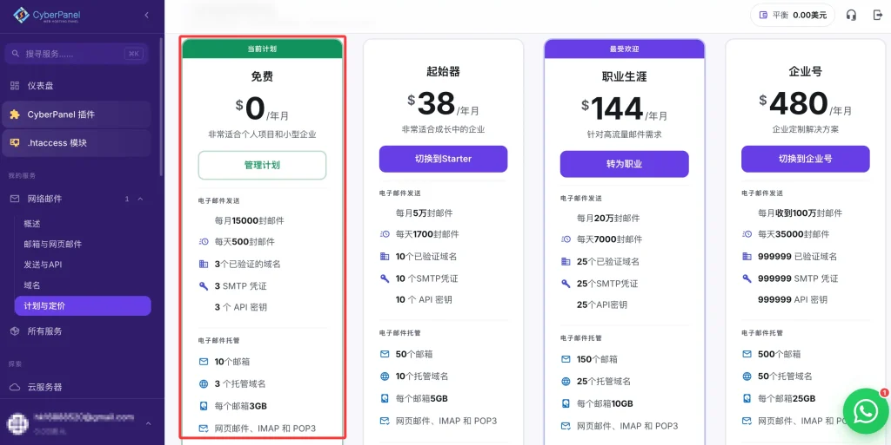

想拥有自己的域名邮箱，却不想每年花钱购买企业邮箱？

很多个人站长、开发者和小型团队，在搭建网站之后都会遇到一个问题：网站可以免费搭建，但邮箱服务往往需要额外付费。

尤其是拥有多个网站的用户，每个网站都希望有独立的联系邮箱。如果全部使用付费企业邮箱，长期下来也是一笔不小的开支。

今天分享一个值得收藏的免费邮件服务平台：**CyberPersons！** 🎉

它提供免费的域名邮箱托管服务，支持绑定自己的域名、创建多个邮箱账户，还提供 SMTP、API、Webmail、IMAP 和 POP3 等功能。

最吸引人的地方是，它的免费计划每月可以发送 15000 封邮件，每天 500 封，最多支持 10 个邮箱账户，每个邮箱还拥有 3GB 存储空间。

对于个人站长、网站运营者和开发者来说，这样的免费额度确实值得了解！

## 🌟 一、CyberPersons 是什么？

CyberPersons 是一个提供网络服务的平台，其中包含邮件托管服务。

这次重点介绍的是它的免费域名邮箱功能。

所谓域名邮箱，就是使用自己拥有的域名来创建和管理邮箱，而不是使用普通公共邮箱服务提供的统一后缀。

对于拥有个人网站、博客、在线工具或者企业网站的用户来说，域名邮箱有很多实际用途。

例如：

- 网站日常联系和用户反馈。
- 网站注册、登录和密码重置通知。
- 项目合作与业务沟通。
- 网站后台管理和系统通知。
- 程序自动发送邮件。
- 多个网站分别管理邮件。

很多邮箱服务需要按账户数量或者使用套餐收费，而 CyberPersons 提供了每月 0 美元的免费计划，可以让用户先体验域名邮箱托管服务。

## 🎁 二、免费套餐到底有多少额度？

先来看最重要的部分！

根据平台展示的免费套餐页面，它提供了以下资源：

免费计划 · $0/月**免费套餐核心额度：**

| 功能 | 免费额度 |
| --- | --- |
| 每月邮件发送量 | 15,000 封 |
| 每天邮件发送量 | 500 封 |
| 邮箱账户数量 | 10 个 |
| 单个邮箱存储空间 | 3GB |
| 已验证域名 | 最多 3 个 |
| 托管域名 | 最多 3 个 |
| SMTP 凭证 | 3 个 |
| API 密钥 | 3 个 |
| 邮件访问方式 | Webmail、IMAP、POP3 |

简单来说，不需要每月支付邮箱套餐费用，就可以获得一定数量的邮箱账户、邮件发送额度和存储空间。

对于个人网站、小型项目以及日常邮件收发需求来说，这些资源可以满足不少基础使用场景。

## 🌐 三、支持自己的域名，打造专属邮箱服务

这是域名邮箱最核心的功能！

如果你已经拥有自己的域名，就可以将域名添加到 CyberPersons 平台，根据提示完成验证和 DNS 配置，然后创建对应的邮箱账户。

使用自己的域名邮箱有什么好处？

**1. 提升网站专业度**

如果你经营个人博客、技术网站或者在线工具，使用自己域名的邮箱作为联系渠道，会显得更加统一和专业。

**2. 方便管理网站邮件**

可以将网站联系、用户反馈、系统通知等邮件进行分类管理，不必所有邮件都混在一个普通邮箱里。

**3. 方便长期运营**

域名邮箱可以跟随自己的域名长期使用。只要域名和邮箱服务正常，就可以持续管理自己的邮件地址。

**4. 适合多个网站**

免费计划支持最多 3 个已验证域名和 3 个托管域名，对于拥有多个网站的站长来说，可以根据实际需求规划不同的邮箱服务。

如果你正在运营个人博客、工具网站或者多个小型项目，这项功能就比较实用。

## 📦 四、最多 10 个邮箱账户，每个邮箱 3GB 空间

很多免费邮箱服务虽然可以创建邮箱，但账户数量和存储空间往往比较有限。

CyberPersons 免费套餐提供最多 10 个邮箱账户，每个邮箱拥有 3GB 存储空间。

这意味着你可以根据不同的用途创建多个邮箱账户，而不是所有邮件都只能使用同一个账户。

例如，你可以将不同网站、不同项目的邮件分开管理。

对于个人站长来说，可以分别管理不同网站的用户反馈和联系邮件。

对于小型团队来说，也可以根据成员和工作职责分配邮箱账户。

3GB 的单邮箱空间也能够用于存储日常邮件和附件，不过如果经常收发大型文件，还是建议定期清理邮箱，避免空间不足。

## 📤 五、每月 15000 封邮件，支持日常邮件发送

免费套餐最值得关注的另一个功能，就是邮件发送额度。

平台免费计划提供：

- 每月最多 15000 封邮件。
- 每天最多 500 封邮件。

对于普通个人用户来说，日常邮件收发通常不需要这么大的发送量。

如果你运营一个网站，还可以将邮件服务用于一些常见场景。

📨 **网站用户通知**

用户提交信息、完成操作或者收到系统消息时，可以通过邮件进行通知。

🔐 **注册验证**

网站可以根据自身程序需求，配置邮件验证功能，辅助完成用户注册和账号管理。

🔑 **密码重置**

用户忘记密码时，网站可以通过邮件发送相关通知或重置链接。

📩 **表单反馈**

如果网站有联系表单，可以将用户提交的信息通过邮件发送给管理员。

📢 **项目消息**

在线工具、个人项目和小型应用，也可以利用邮件发送必要的系统提醒。

需要注意，邮件发送额度不代表可以无限制发送营销邮件。实际使用需要遵守平台的邮件政策，并确保收件人允许接收相关邮件。

## 🛠️ 六、支持 SMTP，网站和程序都能接入

如果你只是普通用户，使用网页邮箱收发邮件就足够了。

但如果你是开发者，或者自己运营网站，那么 SMTP 功能就很有价值。

SMTP 是常见的邮件发送协议，很多网站程序和应用都支持通过 SMTP 发送邮件。

例如：

- WordPress 网站邮件通知。
- 用户注册验证邮件。
- 网站密码重置邮件。
- 在线工具的系统通知。
- 网站表单提交提醒。
- 自己开发的程序发送邮件。

只需要根据平台提供的 SMTP 配置信息，在支持 SMTP 的网站程序中完成设置，就可以让程序调用邮件服务。

对于经常搭建网站的人来说，这样就不必自己购买和维护一套邮件发送服务器。

免费计划提供 3 个 SMTP 凭证，可以根据实际项目需求进行配置。

## 🔌 七、还支持 API，适合开发者和自动化项目

除了普通的邮箱管理和 SMTP 发送功能，CyberPersons 免费计划还提供 API 密钥。

这对于有开发需求的用户来说比较方便。

API 可以让程序按照平台提供的接口规范调用相关服务。

例如：

💻 **网站系统集成**

如果你正在开发一个网站或者在线工具，可以研究如何将邮件服务集成到自己的项目中。

🤖 **自动化邮件处理**

在符合平台接口和使用规则的情况下，可以将邮件功能融入自动化工作流程。

📨 **应用程序通知**

自己的应用需要发送邮件提醒时，可以通过 API 或 SMTP 进行集成。

🧩 **多项目管理**

如果你有多个小型网站或应用，可以根据不同项目的需求规划邮件服务。

免费套餐提供 3 个 API 密钥，对于想体验邮件 API 的开发者来说，也提供了一个不错的入门机会。

具体接口能力、调用限制和认证方式，需要以官方 API 文档为准。

## 🌍 八、支持 Webmail、IMAP 和 POP3，不同设备都能使用

邮箱服务不仅要能创建账户，还要方便日常使用。

CyberPersons 支持多种常见邮件访问方式。

💻 **Webmail 网页邮箱**

不想安装软件？可以通过网页邮箱登录，直接在浏览器中收发和管理邮件。

📱 **IMAP 邮件访问**

可以在支持 IMAP 的邮件客户端中添加邮箱，方便在手机和电脑上管理邮件。

📨 **POP3 邮件访问**

如果你习惯使用 POP3，也可以通过兼容的邮件客户端收取邮件。

这些方式可以满足不同用户的使用习惯。

有人喜欢直接登录网页邮箱，有人喜欢使用桌面邮件软件，也有人希望在手机上统一管理多个邮箱。

多种访问方式让邮箱使用更加灵活。

## 💡 九、哪些人适合使用 CyberPersons？

**📝 1. 个人站长**

如果你拥有自己的博客、资讯网站或者个人主页，可以使用域名邮箱作为网站联系渠道。不用额外购买昂贵的邮箱服务，就能为网站增加一个更加专业的联系方式。

**💻 2. 网站开发者**

如果你经常使用 WordPress、PHP 或者其他程序搭建网站，可以通过 SMTP 或 API 将邮件功能接入项目。

对于网站注册、验证、密码重置和系统通知等场景，都有一定帮助。

**🌐 3. 多网站运营者**

如果你拥有多个域名和网站，可以利用免费套餐支持的多个域名配置，尝试统一管理不同项目的邮件服务。

**🏢 4. 小型团队和工作室**

免费套餐最多支持 10 个邮箱账户，可以根据团队实际需求创建不同账户，方便工作联系和邮件分类。

**🎓 5. 建站学习者**

如果你想学习域名解析、MX 记录、SMTP、邮件托管等知识，也可以利用这个平台熟悉域名邮箱的配置过程。

## 🔧 十、如何申请免费域名邮箱？

申请流程可以按照下面的思路进行：

1. 打开 CyberPersons 官方平台。
2. 注册账号并登录。
3. 找到邮件服务中的计划与定价页面。
4. 选择免费计划。
5. 添加自己拥有的域名。
6. 按照平台要求完成域名验证。
7. 配置所需的 DNS 邮件记录。
8. 创建邮箱账户。
9. 进入 Webmail 测试邮件收发。
10. 如果有网站开发需求，再配置 SMTP 或 API。

域名验证和 DNS 配置是比较关键的步骤，需要按照平台提供的具体记录进行设置。

如果你已经拥有自己的域名，整个过程会更加方便。

## ⚠️ 十一、免费使用也要注意这些限制

虽然免费计划提供了不少资源，但还是建议大家先了解清楚使用规则。

📌 **邮件发送额度有限**

每月 15000 封、每天 500 封属于套餐额度，不是无限发送。

📌 **邮箱空间有限**

每个邮箱 3GB，建议定期清理不需要的邮件和附件。

📌 **域名需要验证**

使用自己的域名需要按照要求完成验证和 DNS 配置，不能只添加域名就直接收发邮件。

📌 **遵守邮件发送规则**

不要发送垃圾邮件、未经许可的营销邮件，也不要滥用 SMTP 或 API 服务。

📌 **免费套餐政策可能调整**

平台可能根据运营情况调整套餐额度、功能和使用规则，注册时请以账号内显示的最新信息为准。

如果是非常重要的商业邮件业务，建议先进行充分测试，并准备备用邮件服务。

## 🎉 十二、总结：免费域名邮箱，值得收藏！

对于想拥有自己域名邮箱，又不想额外支付邮箱服务费用的用户来说，CyberPersons 是一个值得了解的平台。

它的免费计划提供了不少实用功能：

✅ $0/月免费邮箱计划。

✅ 每月 15000 封邮件发送额度。

✅ 每天 500 封邮件发送额度。

✅ 最多 10 个邮箱账户。

✅ 每个邮箱 3GB 存储空间。

✅ 支持最多 3 个已验证域名。

✅ 提供 SMTP 和 API 功能。

✅ 支持 Webmail、IMAP 和 POP3。

无论你是个人站长、网站开发者，还是拥有多个网站的用户，都可以根据自己的需求了解和体验。

以前搭建网站可能需要购买主机，创建域名邮箱又要额外购买企业邮箱服务。现在至少可以先利用这类免费资源，降低网站运营的基础成本。

**如果你正好需要免费域名邮箱，不妨收藏这个平台，给自己的域名配上一套专属邮件服务！** 🚀

## 相关截图：

### **🔗官方网站：**[**https://platform.cyberpersons.co**m](https://platform.cyberpersons.com/)
