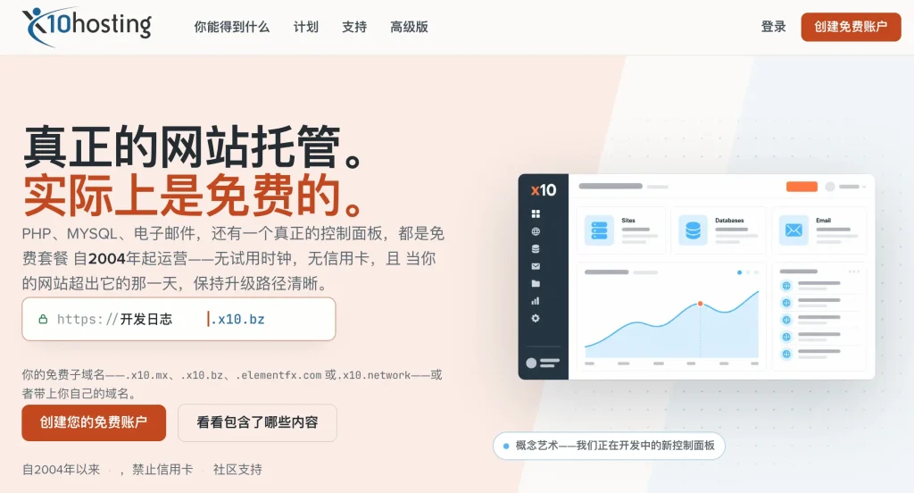
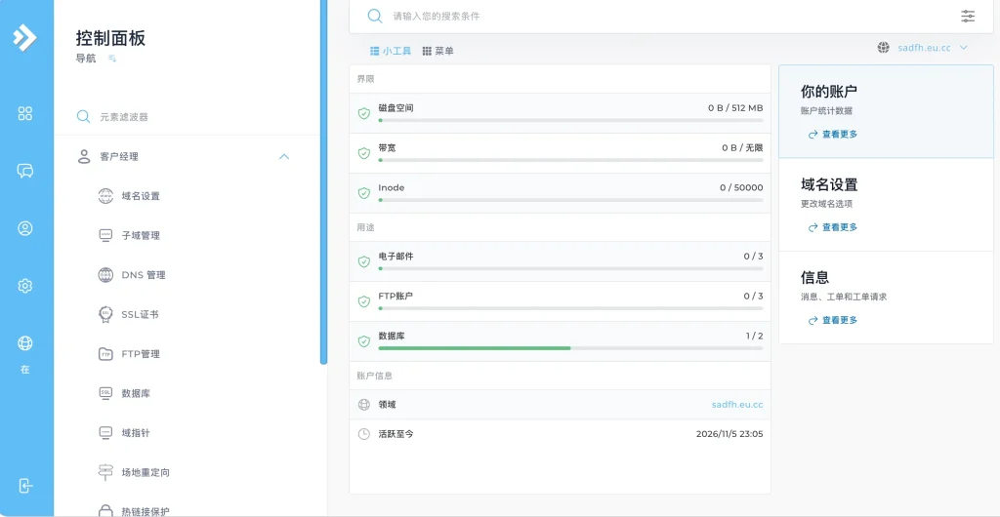

想搭建一个属于自己的网站，却不想每个月花钱购买服务器？

想拥有独立域名、安装 WordPress、搭建个人博客，但又不想折腾复杂的服务器环境？

今天分享一个值得收藏的免费虚拟主机平台：**x10Hosting**！

它提供长期免费的虚拟主机服务，不需要信用卡，也没有传统意义上的短期试用倒计时。支持 PHP、MySQL、WordPress，还能绑定自己的域名，甚至可以通过主机 IP 地址配置域名解析。

对于喜欢免费建站、折腾域名和研究虚拟主机的朋友来说，这个平台值得体验一下！🎉

## 🌐 一、x10Hosting 是什么？

x10Hosting 是一家运营多年的虚拟主机服务商，提供免费和付费主机方案。

与只能托管静态网页的平台不同，它提供的是传统虚拟主机环境，可以运行 PHP 程序、连接 MySQL 数据库，也支持安装 WordPress 等常见建站程序。

最吸引人的地方就是：**免费版每月 0 美元，也能搭建一个真正属于自己的网站。**

不需要先购买服务器，也不需要准备复杂的开发环境。对于刚开始接触建站的小白来说，可以先从免费套餐入手，慢慢熟悉网站搭建和管理。

## 🎁 二、免费版有哪些配置？

x10Hosting 提供名为 x10 Basic 的免费套餐，价格为 $0/月。

根据平台公开的免费套餐信息，主要配置如下：

| 免费版项目 | 提供内容 |
| --- | --- |
| 套餐价格 | $0/月 |
| 网站空间 | 初始 500MB |
| 域名数量 | 最多 3 个 |
| 免费子域名 | 支持 |
| 自定义域名 | 支持 |
| 域名解析 | 支持通过 IP 配置解析 |
| SSL | 支持 SSL 相关配置 |
| MySQL 数据库 | 2 个 |
| 邮箱账户 | 3 个 |
| 网站环境 | PHP + MySQL |
| 控制面板 | DirectAdmin |
| 应用安装 | 支持 300 多种应用 |
| 技术支持 | 社区论坛、Discord |

对于个人博客、小型展示网站、学习测试项目来说，这些基础功能已经能够满足不少入门需求。

当然，免费套餐的空间和资源都有一定限制，具体以官网和账户后台显示为准。

## 🔗 三、支持自定义域名，还能通过 IP 绑定！

这是我觉得比较值得关注的功能之一。

很多免费虚拟主机只允许使用平台分配的免费子域名，如果想使用自己的独立域名，就会受到各种限制。

x10Hosting 免费版支持添加自己的域名。

如果你已经拥有 .com、.net 等域名，就可以尝试将自己的域名绑定到主机上，让网站使用独立的网址访问。

而且还可以通过主机提供的 IP 地址进行域名解析：

1. 在主机后台查看网站对应的 IP 地址。
2. 登录自己的域名服务商后台。
3. 添加 A 记录，将域名指向主机 IP。
4. 根据平台要求完成域名添加和验证。
5. 等待 DNS 解析生效。

这样就能让自己的域名指向 x10Hosting 主机。

对于已经拥有免费域名或者自己购买了域名的站长来说，这种方式非常实用。

需要注意：域名解析指向 IP 并不代表主机端自动完成绑定，还需要在主机后台添加对应域名；如果使用 IPv6 或其他特殊解析方式，也要以平台支持情况为准。

## 🔒 四、支持 SSL，让网站使用 HTTPS

现在搭建网站，HTTPS 基本已经成为标配。

如果网站没有配置 SSL 证书，访客打开页面时可能看到不安全提示，影响访问体验。

x10Hosting 支持 SSL 相关配置，可以根据账户后台提供的功能，为符合条件的域名配置证书。

配置成功之后，网站就可以使用 HTTPS 安全访问。

无论是个人博客、作品展示网站，还是 WordPress 网站，拥有 HTTPS 都能让网站看起来更加正规。

需要说明的是，免费账户的证书申请条件、自动签发方式和域名支持情况，以后台实际提供的选项为准。

## 📝 五、支持 WordPress，轻松搭建个人博客

不会编程，也能搭建网站吗？

当然可以！

x10Hosting 支持 PHP 和 MySQL，并提供应用安装工具，可以安装 WordPress 等常见网站程序。

官方还介绍了 300 多种应用安装选项，对于不熟悉手动部署的新手来说，可以减少不少配置工作。

使用 WordPress，你可以搭建：

- 📰 个人博客：分享技术教程、生活记录和经验。
- 📚 知识网站：整理资料，建立自己的知识库。
- 🏢 企业展示站：展示公司信息、产品和联系方式。
- 🎨 个人作品集：展示设计作品、开发项目。
- 🌍 兴趣网站：围绕自己喜欢的主题创建网站。

如果你一直想拥有一个独立博客，却不想一开始就购买服务器，不妨先用免费主机体验一下。

## 🛠️ 六、DirectAdmin 控制面板，网站管理更方便

主机控制面板也是选择虚拟主机时非常重要的一部分。

x10Hosting 免费版提供 DirectAdmin 控制面板，可以通过网页管理网站相关资源。

常用功能包括：

- 📂 文件管理：上传、编辑和管理网站文件。
- 🌐 域名管理：添加和管理网站域名。
- 🗄️ 数据库管理：创建和管理 MySQL 数据库。
- 🔧 phpMyAdmin：可视化管理数据库。
- 📧 邮箱管理：创建和管理邮箱账户。
- 🔌 FTP 管理：通过 FTP 工具上传网站程序。

对于习惯使用虚拟主机的站长来说，这种管理方式比较熟悉，不需要自己从头配置 Linux 服务器环境。

## ✨ 七、全新控制面板也值得期待

除了目前使用的 DirectAdmin，x10Hosting 官网还展示了正在开发中的全新控制面板设计。

从官方展示来看，平台希望通过新的界面，让用户更直观地管理主机、域名和网站。

对于喜欢尝试新功能的用户来说，这也是一个值得关注的变化。

不过要注意，目前展示的新面板属于开发中的设计，并不代表已经正式向所有免费用户开放。现阶段实际管理功能仍以账户后台为准。

## 👥 八、哪些人适合使用？

如果你属于下面这些人群，可以了解一下 x10Hosting：

**1. 想搭建个人博客的用户**

不想每个月花钱购买服务器，可以先用免费主机搭建自己的博客。

**2. WordPress 初学者**

想学习 WordPress 安装、主题配置和插件使用，可以用它作为入门环境。

**3. 拥有自己域名的站长**

支持自定义域名，还可以通过 IP 配置 A 记录，让自己的域名指向主机。

**4. PHP 学习者**

平台提供 PHP 和 MySQL 环境，可以用于学习和测试简单的网站程序。

**5. 喜欢研究免费资源的人**

如果你平时就喜欢收藏免费域名、免费邮箱和免费虚拟主机，那么 x10Hosting 也值得加入收藏夹。

## ⚠️ 九、免费主机使用前需要注意

免费主机虽然省钱，但也有一定限制。

- 免费版初始空间为 500MB，适合轻量级网站。
- 数据库、邮箱和域名数量都有额度限制。
- 免费账户的技术支持主要依靠社区论坛和 Discord。
- 免费服务的资源、可用性和使用规则可能调整。
- 不建议将重要业务或对稳定性要求很高的网站完全依赖免费主机。

如果只是个人博客、学习建站、测试程序，免费套餐可以作为入门选择；如果网站后续访问量增加，或者需要更高的稳定性，可以再考虑升级。

## 🎯 十、总结

对于想要免费搭建网站的朋友来说，x10Hosting 是一个值得收藏的平台。

它不仅提供免费的虚拟主机空间，还支持 PHP、MySQL、WordPress、自定义域名、IP 地址解析以及 SSL 相关配置。

你可以使用免费子域名开始建站，也可以将自己的独立域名解析到主机 IP，再通过后台完成域名绑定。

**不用一开始就购买服务器，也能拥有一个可以运行 PHP 和 WordPress 的网站环境。**

如果你正准备搭建个人博客、作品展示网站，或者想学习虚拟主机建站，不妨去体验一下。

## 相关截图：

### **🔗官方网站：[https://x10hosting.com](https://x10hosting.com)**
