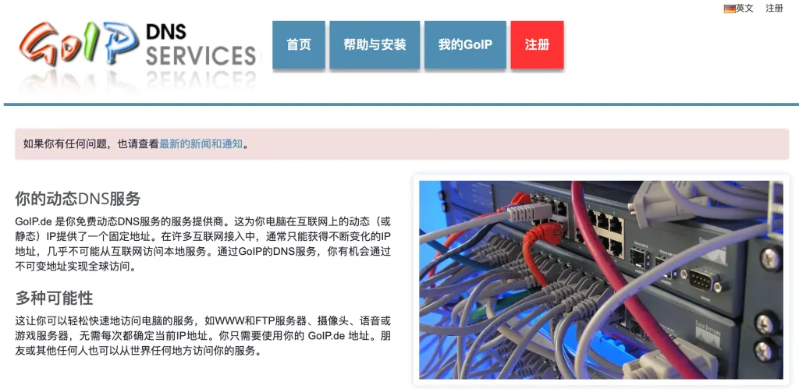

想拥有一个简短、好记的域名，又不想花钱购买？

今天分享一个来自德国的免费动态 DNS 平台：**GoIP.de**！

它可以免费注册自己的专属子域名，支持自定义前缀。只要你选中的名称还没有被注册，就有机会拿到一个简短好记的地址。

例如：

- abc.goip.de
- home.goip.de
- nas.goip.de

相比一些又长又难记的免费域名，这种短前缀看起来更加清爽！

## 🎁 一、免费注册自己的域名

GoIP.de 提供免费的动态 DNS 服务，注册过程比较简单，填写基本信息和想要的子域名前缀，完成邮箱验证后即可使用。

它最大的吸引力就是可以自定义前缀。

如果你喜欢短域名，可以尝试一些简单的英文单词、字母组合或数字组合。只要没有被别人注册，就有机会申请成功。

## ⚡ 二、动态 DNS，有什么用？

很多家庭宽带的公网 IP 地址并不是固定的，可能会随着网络重新连接而变化。

如果直接使用 IP 地址访问自己的设备，一旦 IP 发生变化，就需要重新查找地址，非常麻烦。

GoIP.de 可以将子域名与当前 IP 地址关联起来，并通过动态更新保持域名指向最新地址。

这样，即使 IP 发生变化，也可以继续使用固定的域名访问自己的服务。

## 🛠️ 三、适合哪些用途？

GoIP.de 不只是用来收藏一个短域名，还可以用于：

- 🏠 家庭 NAS 远程访问
- 💻 个人电脑远程连接
- 🌐 家庭网站和个人服务器
- 📷 网络摄像头远程访问
- 🎮 游戏服务器
- 📁 FTP 文件服务
- 🔧 智能家居设备访问

只要设备或软件支持动态 DNS 更新，就可以尝试配置使用。

## ✨ 四、支持 IPv4 和 IPv6

平台支持 IPv4 和 IPv6 地址更新，也提供 DynDNS2 协议及更新接口，可以配合部分路由器、NAS 和其他支持 DDNS 的设备使用。

如果你的路由器支持自定义动态 DNS 服务商，就可以按照官方提供的配置说明进行设置。

## ⚠️ 五、使用前需要注意

虽然 GoIP.de 免费使用，但有几个地方需要留意：

1. 账户如果连续 200 天没有活动，会被暂停；之后再过 14 天可能被彻底删除。
2. 动态 DNS 服务需要设备或软件定期更新 IP，避免域名指向旧地址。
3. 注册的子域名会公开提供访问，建议给 NAS、摄像头等设备设置好密码，避免被他人访问。
4. 平台会收集并关联用户提交的 IP 地址，注册前建议阅读隐私政策。
5. 官方不保证服务始终可用或永久稳定，不建议将重要业务完全依赖于此。

## 🎯 六、总结

如果你正在寻找免费的动态 DNS 域名，或者想给自己的 NAS、家庭服务器、远程设备配置一个简短好记的访问地址，那么 GoIP.de 值得收藏。

**免费注册、自定义子域名前缀、支持动态 IP 更新，还能配合路由器和 NAS 使用。**

喜欢折腾免费域名和个人服务器的朋友，可以去试试看，说不定还能注册到自己喜欢的短前缀！

## 相关截图：

### **👉 官方地址：**[https://www.goip.de](https://www.goip.de/)
