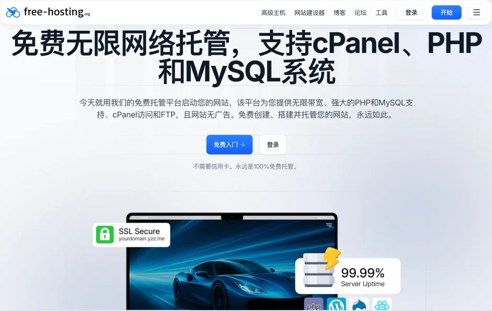
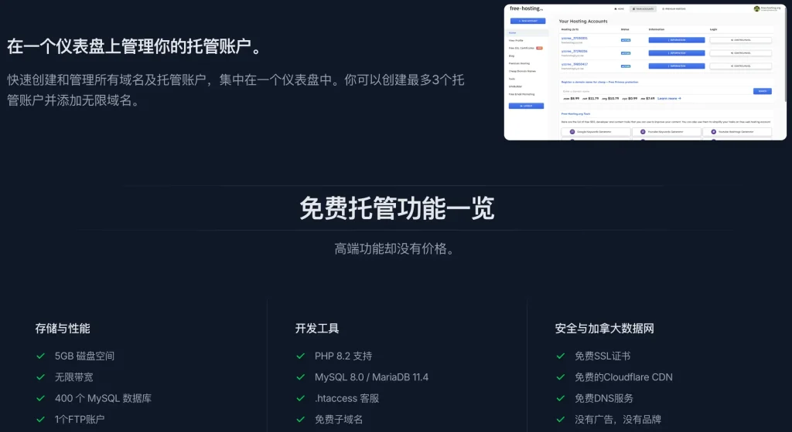

想搭建个人网站、WordPress 博客，却不想每个月花钱购买服务器？

今天分享一个值得收藏的免费虚拟主机平台：**Free-Hosting.org**！

它提供长期免费的网页托管服务，不需要信用卡，也没有强制试用期。最吸引人的是，免费版提供 5GB 磁盘空间、无限带宽、免费 SSL 证书，还支持 Cloudflare CDN！

对于想搭建个人博客、网站作品集，或者学习 PHP 和 MySQL 的朋友来说，可以了解一下。🎉

## 🎁 一、免费版配置有多丰富？

先看看它免费套餐提供的资源：

| 免费功能 | 配置 |
| --- | --- |
| 价格 | $0/月 |
| 磁盘空间 | 5GB |
| 带宽 | 无限带宽（按公平使用政策） |
| MySQL 数据库 | 最多 400 个 |
| FTP 账户 | 1 个 |
| PHP | PHP 8.2 |
| 数据库环境 | MySQL 8.0 / MariaDB 11.4 |
| .htaccess | 支持 |
| 免费 SSL | 支持 |
| Cloudflare CDN | 免费提供 |
| DNS 服务 | 免费提供 |
| 免费子域名 | 支持 |
| 自定义域名 | 支持 |
| 网站广告 | 不强制插入广告 |

5GB 空间对于个人博客、作品展示网站和轻量级项目来说，已经可以存放不少网站文件。

而且平台提供无限带宽，不需要按照传统流量套餐购买额外流量，不过实际使用仍需遵守平台的公平使用政策。

## 🌐 二、支持免费子域名和自定义域名

没有域名也可以开始建站！

Free-Hosting.org 提供免费的子域名，例如：yourname.yzz.me

可以先使用免费子域名搭建网站，不需要额外购买域名。

如果你已经拥有自己的 .com、.net 等域名，也可以绑定到平台。

这样就能使用自己的独立域名访问网站，让个人博客或者展示网站看起来更加专业。

## 🔒 三、免费 SSL + Cloudflare CDN

安全和访问速度也是建站时需要考虑的问题。

平台提供免费的 SSL 证书，可以让网站启用 HTTPS 加密访问。

此外，还支持免费 Cloudflare CDN 和 DNS 服务。

简单来说：

- 🔐 免费 SSL：让网站支持 HTTPS。
- 🌍 Cloudflare CDN：帮助网站加速内容分发。
- 🛡️ DNS 服务：管理域名解析。
- 🚫 无强制广告：不会在你的网站页面强制插入广告。

对于想认真经营个人网站的用户来说，这些功能都很实用。

## 📝 四、支持 WordPress，一键安装 400 多种程序

不会编程，也能搭建网站吗？

当然可以！

平台支持 PHP 和 MySQL，并提供 Softaculous 应用安装工具。

官方介绍支持安装 WordPress、Joomla、Drupal 等 400 多种应用和脚本。

其中 WordPress 尤其适合个人站长，可以用来搭建：

- 📰 个人博客：发布文章、分享教程。
- 🏢 企业网站：展示产品和公司信息。
- 🎨 作品集网站：展示个人项目和设计作品。
- 📚 资源网站：整理资料和实用工具。
- 🌍 兴趣网站：打造属于自己的主题社区。

不想手动上传程序、配置数据库？可以尝试使用一键安装功能，降低建站门槛。

## 🛠️ 五、支持 PHP 和 MySQL，适合折腾网站

除了 WordPress，Free-Hosting.org 也提供比较完整的 PHP 网站运行环境。

主要包括：

- PHP 8.2 支持
- MySQL 8.0
- MariaDB 11.4
- .htaccess 配置支持
- FTP 文件管理
- 最多 400 个 MySQL 数据库

无论是上传自己编写的 PHP 程序，还是部署一些开源网站项目，都可以尝试使用。

对于正在学习 PHP、数据库和网站开发的朋友，也能作为一个免费练习环境。

## ✨ 六、一个后台管理多个网站

平台还支持通过统一的管理后台创建和管理多个主机账户。

官方介绍最多可以创建 3 个托管账户，并添加不限数量的域名。

如果你平时有多个网站项目，就可以在一个后台集中管理，不需要为每个小项目单独购买主机。

这对于喜欢折腾个人博客、工具网站和展示页面的站长来说比较方便。

## ⚠️ 七、免费主机使用注意事项

免费资源虽然香，但也要了解它的使用规则：

1. 免费版空间为 5GB，适合轻量级网站，不适合大量存储文件。
2. 无限带宽不代表 CPU、内存和服务器资源没有限制，仍需遵守公平使用政策。
3. 官方说明，账户需要保持合理的网站活动，并遵守平台规则。
4. 免费主机的稳定性和资源保障不能直接等同于付费 VPS 或独立服务器。
5. 重要网站建议定期备份，避免把所有数据只保存在一个免费平台上。

如果只是个人博客、WordPress 网站、学习项目或小型展示网站，可以先尝试免费套餐。

## 🎯 八、总结

这次分享的 Free-Hosting.org，确实有不少值得关注的免费建站功能。

**5GB 磁盘空间、无限带宽、400 个 MySQL 数据库、PHP 8.2、免费 SSL、Cloudflare CDN，还支持 WordPress 和自定义域名。**

最重要的是，免费版不需要信用卡，也不会强制在你的网站页面插入广告。

如果你一直想搭建自己的个人博客，或者想找一个免费 PHP + MySQL 虚拟主机练习建站，可以把它收藏起来。

不用一开始就花钱买服务器，先用免费资源把自己的网站搭建起来！🚀

## 相关截图：

## 👉 官方地址：[https://free-hosting.org](https://free-hosting.org/)
