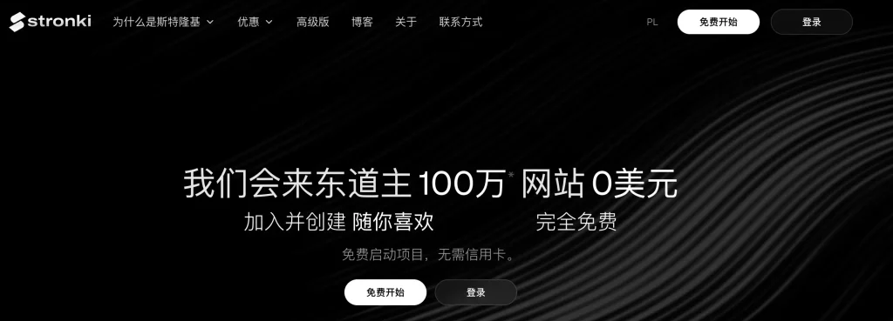
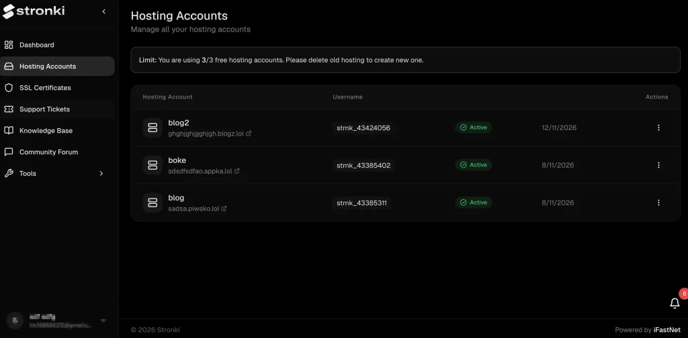

现在想搭建个人网站，真的一定要花钱买服务器吗？

如果你只是想做一个个人博客、WordPress 网站，或者搭建几个自己的小项目，其实可以先看看免费虚拟主机。

今天分享一个值得收藏的平台：**Stronki**！

它主打永久免费虚拟主机，不是几天的试用套餐，也不需要绑定信用卡。根据平台提供的免费主机方案，每台主机拥有 5GB 空间和无限带宽，而且支持绑定自己的域名。

更吸引人的是，每个账号最多可以创建 3 台主机！

对于喜欢折腾网站、拥有多个建站项目的朋友来说，这个资源确实值得关注。🎉

## 🎁 一、免费版到底有多香？

先看看 Stronki 提供的免费主机资源：

| 免费功能 | 提供内容 |
| --- | --- |
| 套餐价格 | $0/月 |
| 使用期限 | 无固定到期时间 |
| 主机数量 | 每个账号最多 3 台 |
| 单台磁盘空间 | 5GB |
| 带宽 | 无限带宽 |
| 自定义域名 | 支持 |
| 免费子域名 | 支持 |
| SSL 证书 | 免费提供 |
| PHP | PHP 运行环境 |
| 数据库 | MySQL |
| 数据库管理 | phpMyAdmin |
| 文件管理 | 在线文件管理器 |
| FTP | 支持 |
| 应用安装 | Softaculous，380+ 应用 |
| WordPress | 支持 |
| 网站广告 | 不强制插入广告 |

最值得关注的就是：一个账号可以创建多台免费主机，每台拥有独立的 5GB 空间。

如果你有个人博客、工具网站、作品展示站等不同项目，就可以根据自己的需求分开管理。

注意：无限带宽不等于没有其他资源限制，免费套餐仍有文件数量和每日请求量等限制，实际以官方规则和账户后台为准。

## 🌐 二、支持自定义域名，不只是免费二级域名

很多免费虚拟主机只能使用平台分配的子域名，想绑定自己的域名还需要升级套餐。

Stronki 支持绑定自己的域名！

如果你已经拥有 .com、.net 等域名，就可以将域名添加到主机后台，按照要求配置 DNS 解析。

如果暂时没有域名，也可以先使用平台提供的免费子域名。

这样一来，不需要额外购买域名，也能先把自己的网站搭建起来。

对于喜欢收藏免费域名、免费主机的站长来说，这个功能还是比较实用的。

## 🔒 三、免费 SSL 证书，网站支持 HTTPS

现在搭建网站，HTTPS 基本已经是标配。

Stronki 提供免费 SSL 证书，可以为符合条件的网站配置 HTTPS。

开启之后，网站访问地址就会显示安全锁标志，访客访问网站时也更加放心。

无论是 WordPress 博客、个人作品展示网站，还是 PHP 项目，都可以使用 HTTPS。

## 📝 四、支持 WordPress，380 多种应用一键安装

不会编程，也能搭建网站吗？

当然可以！

Stronki 提供 Softaculous 应用安装工具，官方介绍支持 380 多种应用。

其中就包括很多常见的网站程序，例如：

- WordPress：搭建个人博客、企业网站。
- Joomla：搭建内容管理网站。
- phpBB：搭建论坛社区。
- 其他 PHP 应用：根据自己的需求选择安装。

如果你想做一个自己的博客，可以直接使用 WordPress，不需要从零开始编写网站代码。

选择主题、安装插件、发布文章，就能逐渐搭建出属于自己的个人网站。

## 🛠️ 五、支持 PHP + MySQL，自己上传程序也可以

除了应用一键安装，Stronki 还提供 PHP 和 MySQL 环境。

主要功能包括：

- PHP 网站运行环境
- MySQL 数据库
- phpMyAdmin 数据库管理
- FTP 文件上传
- 在线文件管理器
- .htaccess 配置支持

如果你有自己的网站源码，也可以通过文件管理器或者 FTP 上传程序。

不管是学习 PHP，还是部署一些简单的开源项目，都可以尝试使用。

## ✨ 六、全新的主机管理面板

Stronki 还有一个比较吸引我的地方，就是它提供了自己的主机管理面板。

用户可以通过后台管理网站、域名、数据库、文件和应用安装等功能。

常用操作不需要自己登录服务器敲命令，对于不熟悉 Linux 的新手来说，使用起来更加直观。

而且平台还提供 Discord 社区支持，遇到问题可以通过官方渠道寻求帮助。

## 🚀 七、免费主机可以拿来做什么？

如果一个账号最多可以创建 3 台主机，那么可以尝试把不同项目分开部署。

例如：

- 第一台：搭建 WordPress 个人博客，记录技术教程。
- 第二台：搭建个人作品展示网站。
- 第三台：部署 PHP 项目或者其他小型网站。

每台主机 5GB 空间，支持自定义域名和 HTTPS。

这样就不用为了几个简单的网站，分别购买多台服务器。

对于喜欢研究免费建站资源的朋友来说，确实是一个不错的尝试方向。

## ⚠️ 八、免费主机使用前需要注意

虽然 Stronki 提供免费主机，但免费不代表没有限制。

根据官方公布的免费套餐说明，还需要留意：

- 单台主机空间为 5GB。
- 免费套餐有 80,000 个文件及目录的数量限制。
- 每天有 50,000 次服务器请求限制。
- 无限带宽不代表无限 CPU、内存或访问请求。
- 免费服务的稳定性和资源保障不能直接等同于付费 VPS。
- 重要网站建议定期备份。

如果只是搭建个人博客、展示网站、学习项目，免费套餐可以作为入门选择；如果是访问量很大的商业网站，建议根据实际需求选择更合适的方案。

## 🎯 九、总结

这次分享的 Stronki，比较吸引人的地方就是它的永久免费虚拟主机方案。

**每个账号最多创建 3 台主机，每台 5GB 空间、无限带宽，还支持自定义域名、免费 SSL、PHP、MySQL 和 WordPress。**

不需要购买服务器，也不用绑定信用卡，就可以开始搭建自己的网站。

如果你一直想拥有一个个人博客，或者手里有几个小项目想找地方托管，不妨收藏这个平台。

有时候，搭建网站并不一定要花很多钱，先利用免费资源把自己的想法实现出来，也是一件很有意思的事情！🔥

## 相关截图：

## **👉 官方网站：[https://www.stronki.dev/en](https://www.stronki.dev/en)**

---

> 本文转载整理自 [Ai星码博客](https://aixmb.com/1289.html)，版权归原作者所有。

