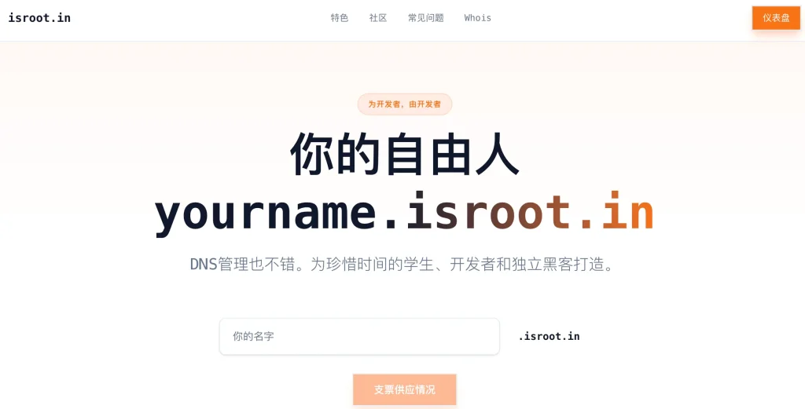
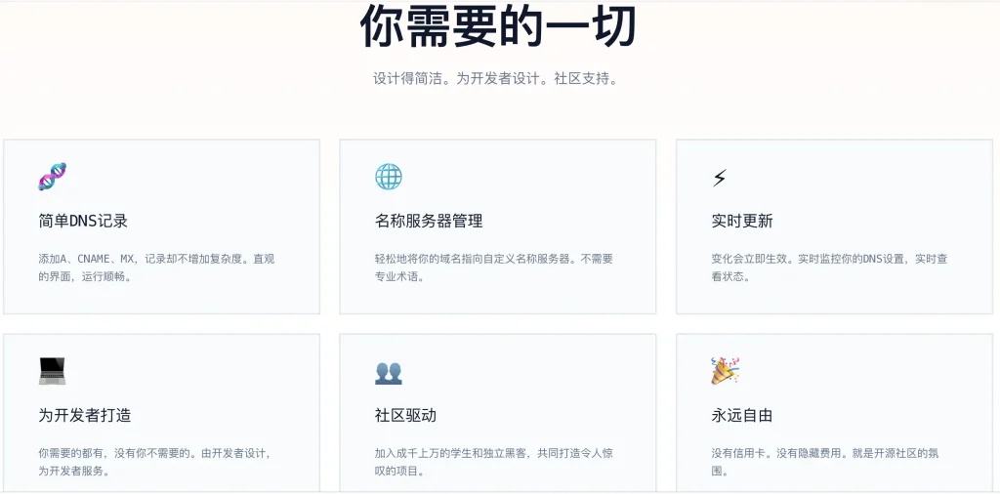

平时喜欢折腾网站的朋友应该都知道，搭建一个网站，除了服务器，域名也是一笔开销。

尤其是手里有好几个小项目，想给每个项目配一个独立网址，买域名虽然不算特别贵，但项目一多，续费也是一笔成本。

最近发现一个挺不错的免费域名平台：**isroot.in**。

它提供免费的 **.isroot.in** 子域名，可以自己选择喜欢的前缀，还能管理 DNS 解析记录。最重要的是，每个账号完成指定的 GitHub 点赞任务后，最多可以注册 5 个！

对于喜欢做个人网站、开发测试项目、搭建 API 服务的朋友来说，可以先收藏起来。🎉

## 🎁 一、每个账号最多5个免费域名

isroot.in 最吸引人的地方，就是可以免费注册自己喜欢的子域名。

注册成功后，你就能拥有类似这样的地址：

- name.isroot.in
- blog.isroot.in
- project.isroot.in
- tool.isroot.in
- api.isroot.in

前缀可以根据自己的项目来选择，只要没有被其他人注册，并且符合平台的命名规则即可。

如果你喜欢短域名，可以尝试一些简单的英文单词或字母组合。好记、简洁，用来做个人项目地址也比较合适。

不过要注意，短名称往往更容易被别人抢先注册，喜欢的名字最好早点去查询。

## ⭐ 二、如何解锁5个注册名额？

这里有一个小细节，刚注册账号时，并不是直接就能注册5个。

平台默认每个账号只有 **1个免费注册名额**。

如果想解锁更多名额，需要完成官方指定的 GitHub 项目 Star 任务。

大致流程：

1. 使用 GitHub 登录 isroot.in。
2. 进入账号后台，查看提升注册额度的提示。
3. 点击后台提供的 GitHub 项目链接。
4. 使用登录 isroot.in 的 GitHub 账号给项目点一个 Star。
5. 返回平台后台，点击 Refresh status 刷新状态。
6. 验证成功后，注册额度最高可以提升到 5 个。

也就是说，不需要购买套餐，通过完成这个简单的社区支持任务，就有机会获得更多免费域名名额。

注意：解锁后是总共最多 5 个，而不是在原有名额之外再增加 5 个。

## 🌐 三、支持 DNS 管理，不只是注册一个域名(暂时不支持托管到cloudflare，后期大概率会加入)

注册域名只是第一步，真正实用的是后续的 DNS 管理功能。

isroot.in 提供了自己的 DNS 管理界面，可以添加常见的解析记录，例如：

- A 记录：将域名指向服务器 IPv4 地址。
- CNAME 记录：将子域名指向其他主机名。
- MX 记录：配置邮件服务地址。
- TXT 记录：添加验证信息等文本记录。

举个例子，如果你有一台服务器，就可以给自己的 **.isroot.in** 地址添加 A 记录，让域名指向服务器 IP。

如果你使用其他网站托管平台，也可以根据平台提供的解析要求配置相应记录。

对于不想购买独立域名、又需要一个固定访问地址的开发者来说，这个功能很方便。

## 🚀 四、免费域名可以用来做什么？

这个域名不只是拿来收藏，还可以用于不少实际场景。

**1. 搭建个人博客**

给自己的博客配置一个简洁的网址，分享技术教程、生活记录和各种经验。

**2. 网站项目测试**

开发新网站时，可以先使用免费子域名进行测试，不必每个项目都购买一个独立域名。

**3. API 接口服务**

如果自己部署了 API 服务，可以配置一个容易记住的域名，方便调用和测试。

**4. 个人作品展示**

设计师、开发者或者学生，可以用它搭建作品展示页面。

**5. NAS 和个人服务器**

如果有自己的服务器或 NAS，也可以通过 DNS 解析，将域名指向对应的服务。

需要注意，isroot.in 本身提供的是域名和 DNS 管理，并不提供网站空间或服务器。网站还需要自己准备主机、服务器或其他托管服务。

## 📅 五、每年免费续约，不用购买套餐

免费域名还有一个大家比较关心的问题：能用多久？

根据官方说明，isroot.in 的注册有效期为 **365天，也就是一年**。

到期前，平台会发送邮件提醒用户续约。

续约不需要购买付费套餐，在符合条件的情况下，可以进入后台手动点击 Renew 进行免费续约。成功续约后，会增加 365 天有效期。

还有一个细节：官方说明续约入口会在到期前 60 天开放。

所以注册之后，建议留意自己的邮箱，也可以偶尔登录后台查看域名的到期时间。

它不是注册一次就永远不用管理的域名，但只要按要求及时免费续约，就可以继续使用。

## ⚠️ 六、注册前需要了解

虽然这个平台免费，但有几个地方还是要提前知道：

- 默认每个账号只有 1 个名额，GitHub Star 验证后最多提升到 5 个。
- 注册的域名有效期为 365 天，需要每年手动免费续约。
- 两次成功注册之间有 1 小时的间隔限制。
- 域名名称需要符合平台规则，已经被注册或保留的名称无法使用。
- 部分第三方托管平台对 **.isroot.in** 这类子域名有兼容性限制，绑定前建议先确认。
- 平台不提供服务器空间，域名注册成功后还需要自行配置网站托管服务。

## 🎯 七、最后聊几句

现在免费域名资源其实不少，但能自己选择前缀、管理 DNS，而且还能通过 GitHub Star 解锁多个注册名额的平台，还是值得关注一下的。

isroot.in 的规则比较简单：

**免费注册 .isroot.in 子域名，默认1个名额，完成 GitHub Star 验证后最多5个，每个域名有效期一年，到期前可以免费续约。**

如果你平时喜欢搭建个人网站、测试项目、API 服务，或者只是想给自己的小项目准备几个独立网址，可以去看看有没有喜欢的名称。

有合适的短前缀就先注册下来，毕竟好记的名字通常比较抢手！

## 相关截图：

## 👉 官方注册地址：[https://isroot.in](https://isroot.in/)

---

> 本文转载整理自 [Ai星码博客](https://aixmb.com/1295.html)，版权归原作者所有。

