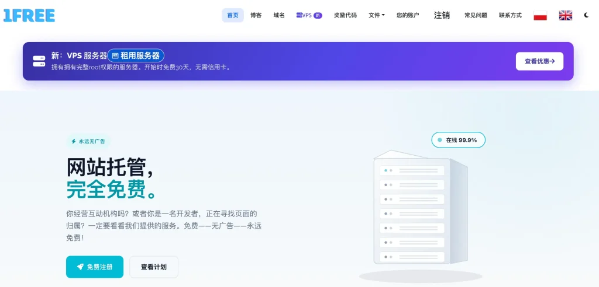
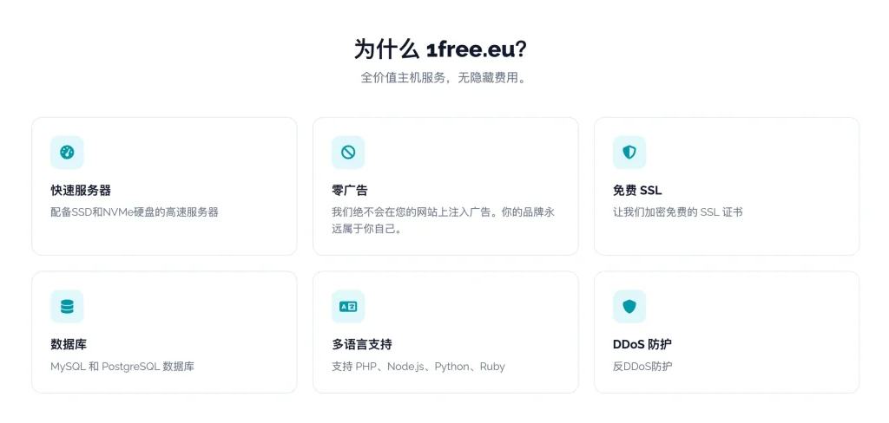
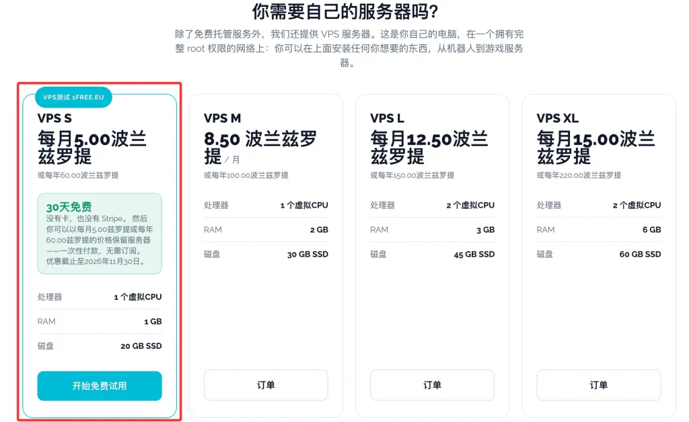
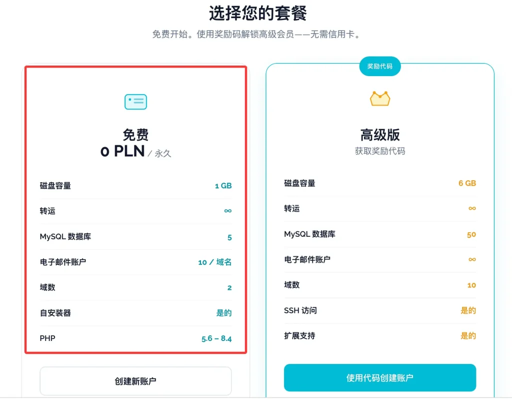

最近发现一个国外的免费建站平台：**1Free.eu**。

刚开始看到这个名字的时候，我还以为只是一个普通的免费空间服务，仔细看了一下才发现，它提供的东西还挺多。除了永久免费虚拟主机，还能创建域名邮箱，另外甚至提供了一个月的 VPS 免费试用。

对于经常折腾网站、喜欢收集免费资源的朋友来说，这种平台还是值得放进收藏夹的。

现在搭建一个网站，最基本的开销往往就是域名和服务器。域名可能一年几十元，服务器即使选择便宜的配置，一年下来也需要一笔费用。如果只是想搭建一个个人博客、测试项目，或者做一个简单的展示网站，专门花钱购买服务器，有时候确实没太大必要。

这次分享的 1Free.eu，恰好可以作为一个免费建站的选择。

而且它有一个比较实用的地方：免费虚拟主机并不是只能创建一个托管账户，平台页面显示最多可以创建 **2个托管账户**，可以用来管理不同的网站项目。

下面就详细聊聊这个平台到底有哪些功能。

## 🆓 一、永久免费虚拟主机，不用每个月花钱买空间

先说最核心的功能。

1Free.eu 提供免费的 Web Hosting 服务，免费套餐价格为 0，官方标注为长期免费。

对于刚开始接触建站的人来说，免费虚拟主机最大的好处就是降低了入门成本。

以前想搭建一个 WordPress 博客，通常需要先购买服务器、安装运行环境、配置数据库，再处理网站运行问题。对于完全没有经验的新手来说，光是这些准备工作就可能折腾半天。

而使用虚拟主机，很多环境已经由服务商提前准备好了。你可以把更多精力放在网站内容和功能上，而不是一开始就研究服务器配置。

根据平台目前展示的免费套餐信息，主要配置包括：

- 1GB 网站存储空间
- 支持绑定自己的域名
- 最多支持2个域名
- 最多5个 MySQL 数据库
- 支持 PostgreSQL
- 支持 PHP 5.6–8.4
- 免费 SSL 证书
- 自动安装程序
- 不强制展示平台广告

1GB 空间虽然不算特别大，但如果只是放一个个人博客、简单企业展示页面或者轻量级网站，还是可以尝试的。

比如：

**个人博客：** 分享技术文章、生活记录、建站教程。

**作品展示：** 放自己的设计作品、项目介绍和个人简介。

**测试网站：** 测试 WordPress 主题、插件以及 PHP 程序。

**小型项目：** 搭建一些不需要太多资源的网页应用。

当然，免费空间的资源肯定不能和付费服务器相比。如果网站图片特别多、访问量很大，或者需要运行比较复杂的程序，就要考虑空间和性能是否够用。

## 📦 二、一个账号最多创建2个托管账户

这个功能我觉得有必要单独拿出来说一下。

进入 1Free.eu 的账户后台，可以看到一个名为“您的托管账户”的管理区域。

页面显示可以创建：

**2个账户**

并且提供了“创建新账户”的入口。

这意味着平台不只是给你一个网站空间，而是允许你创建两个托管账户，分别管理不同的网站。

举个例子：

- 第一个账户用来搭建 WordPress 个人博客。
- 第二个账户用来放自己的作品展示网站，或者测试其他建站程序。

这样就不需要把所有网站都挤在同一个空间里，管理起来也更加方便。

对于喜欢做网站实验的朋友来说，这一点还是挺实用的。

比如你平时可能会收集各种开源建站程序，有时候想测试一个新主题，有时候又想搭建一个独立博客。如果每次测试都要另外购买主机，成本就比较高。

有了两个托管账户，就可以根据自己的需求进行分配。

当然，两个托管账户不代表资源可以无限使用，具体空间、流量和其他限制仍然要遵守平台的免费套餐规则。

## 🔄 三、免费主机如何续订？这个规则一定要看

很多免费主机平台都有一个问题：注册的时候说免费，使用一段时间后却需要重新激活，甚至因为长期不登录而被停用。

1Free.eu 的免费服务采用了一种自动续订机制。

平台页面给出的说明是：

**每次你管理免费服务时，该服务会自动续订一个月。**

这个规则其实不难理解。

只要你平时有登录后台管理免费服务的习惯，服务就会自动延长一个月，不需要像传统套餐那样每个月单独购买续费。

不过，这里有几个细节一定要注意：

- 每次管理免费服务，都会自动续订一个月。
- 如果不登录，服务将会被封锁3个月。
- 如果一年后仍未恢复使用，服务将被移除。

所以，虽然它提供的是长期免费的虚拟主机，但并不代表注册之后就可以完全不管。

我的建议是：如果你准备长期使用，最好把后台地址收藏起来，隔一段时间登录检查一下网站状态。

尤其是已经绑定域名、发布了文章的网站，不要因为忘记管理账户而导致服务被封锁。

免费资源最怕的不是配置低，而是好不容易搭建好的网站，因为自己长期没注意而丢失。

重要网站还是建议定期备份，不能把唯一一份数据只放在免费主机上。

## 🌐 四、支持绑定自己的域名，网站更像一个正式项目

如果只是使用服务商提供的二级域名，虽然也能访问，但总感觉少了一点自己的特色。

1Free.eu 的免费主机支持使用自己的域名。

比如你已经拥有一个域名，就可以考虑把它绑定到自己的托管账户上，再搭建个人网站。

这样网站地址就是自己的域名，而不是一串平台分配的地址。

对于个人站长来说，独立域名还是很重要的。

以后不管是更换网站主题、调整网站内容，还是迁移到其他服务器，自己的域名都可以继续使用。

另外，平台还提供免费的 SSL 证书。

配置好之后，网站就可以使用 HTTPS 访问。现在浏览器对 HTTPS 已经非常普遍，个人博客和展示网站也没必要一直停留在 HTTP。

需要提醒的是，免费主机套餐的域名数量有上限，具体能绑定多少个域名，以后台显示为准。

## 📧 五、还能创建域名邮箱，最多10个邮箱账户

除了虚拟主机，我觉得域名邮箱也是一个比较实用的功能。

很多人搭建网站之后，都会遇到一个问题：网站有了，但联系邮箱还是普通邮箱地址。

比如个人博客想留下联系方式，项目网站想提供客服邮箱，或者自己想拥有一个看起来更专业的邮箱地址。

这时候域名邮箱就派上用场了。

1Free.eu 的免费套餐支持创建域名邮箱，页面显示每个域名最多可以创建10个邮箱账户。

例如，你可以创建：

- [admin@yourdomain.com](mailto:admin@yourdomain.com)
- [info@yourdomain.com](mailto:info@yourdomain.com)
- [contact@yourdomain.com](mailto:contact@yourdomain.com)
- [support@yourdomain.com](mailto:support@yourdomain.com)
- [webmaster@yourdomain.com](mailto:webmaster@yourdomain.com)

不同邮箱可以承担不同用途。

比如 admin 用来接收网站管理通知，contact 用来接收访客留言，support 用来处理用户问题。

如果你有自己的个人网站或者小型项目，域名邮箱确实比普通邮箱更有辨识度。

而且对于一些刚开始做网站的人来说，不需要单独寻找其他邮箱服务，就可以先体验平台提供的域名邮箱功能。

需要注意的是，创建域名邮箱通常需要先拥有并配置好自己的域名，具体邮箱功能和使用限制以后台实际提供的选项为准。

## 🖥️ 六、除了免费虚拟主机，还有30天 VPS 服务器试用

这个平台还有一个比较吸引人的地方：提供 VPS 免费试用。

如果你平时喜欢研究 Linux、Docker，或者想体验一下拥有 Root 权限的服务器，那么这个功能也可以看看。

平台提供的 VPS S 试用配置如下：

- 1核 CPU
- 1GB 内存
- 20GB SSD 存储
- 30天免费试用
- 支持 Root 权限
- 支持 SSH 连接
- 可选择 Debian、Ubuntu 等系统
- 支持 Docker

官方说明，申请试用不需要绑定银行卡。

对于没有使用过 VPS 的新手来说，可以利用这30天熟悉一下 Linux 命令、SSH 连接和 Docker 部署。

比如安装一个简单的程序，学习如何配置运行环境，或者体验一下服务器的基本管理操作。

不过这里必须强调：

**VPS 只是免费试用30天，并不是永久免费服务器。**

试用结束后，如果还想继续使用，需要按照平台的收费标准付费。目前页面显示的价格为每月5 PLN，或者每年60 PLN。

如果试用结束后不续费，服务器会被封锁，之后还可能被删除。

另外，这款 VPS 的技术架构和网络资源也有一定限制，并不是传统意义上完全独立、没有限制的物理服务器。因此更适合体验和学习，不要直接把它当成长期生产环境。

## 🛠️ 七、这个平台适合拿来做什么？

把上面的功能放在一起看，1Free.eu 其实适合几类不同的用户。

**1. 想搭建个人博客的人**

如果你一直想拥有一个自己的博客，但又不想一开始就花钱购买服务器，可以先用免费虚拟主机体验建站。

**2. 喜欢 WordPress 的新手**

平台支持 PHP 和数据库，也提供自动安装程序，可以尝试用来搭建 WordPress 网站。

**3. 想拥有域名邮箱的人**

如果你已经有自己的域名，可以看看它提供的邮箱功能，给网站配置专属邮箱地址。

**4. 喜欢测试开源项目的人**

两个托管账户可以用来区分不同的网站项目，适合做一些轻量级测试。

**5. 想学习 Linux 和 Docker 的朋友**

30天 VPS 试用可以作为入门体验，先熟悉服务器操作，再决定以后是否需要购买付费 VPS。

## ⚠️ 八、免费资源也有一些需要注意的地方

虽然这个平台提供的免费功能不少，但也不要看到“永久免费”就认为没有任何限制。

有几个地方建议提前了解：

1. 免费虚拟主机只有1GB存储空间，适合轻量级网站。
2. 免费套餐存在数据库、域名和其他资源数量限制。
3. 平台首页和服务条款对流量额度的描述并不完全一致，使用前应以后台和最新条款为准。
4. 免费服务需要定期管理，否则可能被封锁，长期不恢复还会被移除。
5. VPS 只有30天免费试用，后续使用需要付费。
6. 重要网站一定要做好数据备份，不建议把免费主机作为唯一的数据存储位置。

这些规则并不复杂，注册之前看清楚，后面使用起来会省去不少麻烦。

---

## 最后说几句

现在免费建站资源其实不少，但真正把虚拟主机、域名邮箱和 VPS 试用放在同一个平台上的服务，还是值得关注一下的。

1Free.eu 最值得体验的，还是它的免费虚拟主机。

1GB 空间，支持自己的域名，提供免费 SSL，还能创建2个托管账户。对于只想搭建个人博客、展示页面或者测试小项目的人来说，至少可以先拿来体验，不用一开始就购买服务器。

另外，域名邮箱也能满足一些基础使用需求，30天 VPS 则适合想学习服务器操作的朋友。

当然，免费服务也有自己的规则，尤其是自动续订和长期不登录后的封锁机制，一定要提前了解。

如果你平时也喜欢收集免费域名、免费主机和各种建站资源，这个平台不妨先收藏起来，说不定哪天就能用上。

## 相关截图：

## **👉 官方注册地址：[https://1free.eu](https://1free.eu)**

---

> 本文转载整理自 [Ai星码博客](https://aixmb.com/1301.html)，版权归原作者所有。

