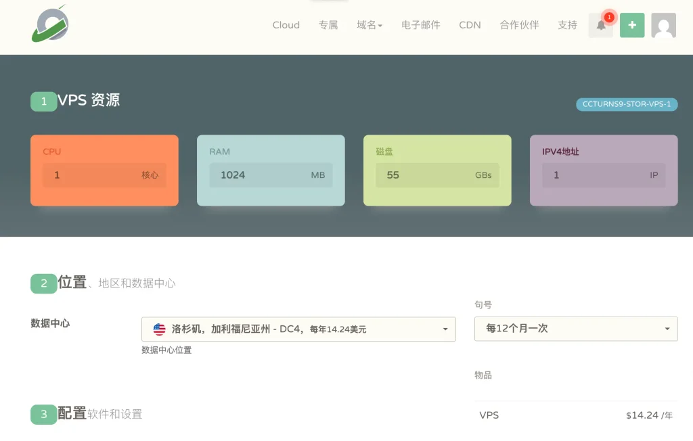
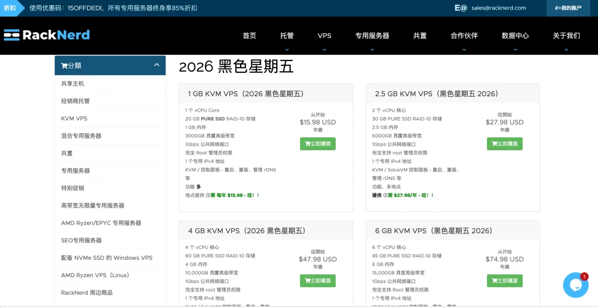

**一、准备工作**

**1、准备域名一个，提前在Cloudflare上做好解析**

**2、VPS一台重置好Dibian系统**

**3、下载 FinalShell SSH 工具（点击下方链接即可下载）**  
**Windows 下载：**

[**https://dl.hostbuf.com/finalshell3/finalshell_windows_x64.exe**](https://dl.hostbuf.com/finalshell3/finalshell_windows_x64.exe)

**MacOS M芯片下载：**

[**https://dl.hostbuf.com/finalshell3/finalshell_macos_arm64.pkg**](https://dl.hostbuf.com/finalshell3/finalshell_macos_arm64.pkg)

**MacOS intel 芯片下载：**

[**https://dl.hostbuf.com/finalshell3/finalshell_macos_x64.pkg**](https://dl.hostbuf.com/finalshell3/finalshell_macos_x64.pkg)

**提醒一下：不同商家提供的 VPS 环境存在差异，防火墙策略也各不相同。开始部署之前，记得提前开放教程所需端口，防止部署完成后面板访问失败、节点连接异常。**

二、Debian / Ubuntu 系统安装 sudo curl

```
apt update && apt install -y sudo curl
```

三、安装 BBR 网络拥塞控制

```
sh -c 'echo "net.core.default_qdisc=fq" >> /etc/sysctl.conf' && sh -c 'echo "net.ipv4.tcp_congestion_control=bbr" >> /etc/sysctl.conf' && sysctl -p && lsmod | grep bbr
```

四、安装 3X – UI 面板

```
bash <(curl -Ls https://raw.githubusercontent.com/mhsanaei/3x-ui/master/install.sh) v3.11.0
```

五、入站｜安全

目标

```
www.apple.com:443
```

SNI

```
www.apple.com
```

最小客户端版本

```
1.0.0
```

## **cloudcone服务器年费价格（年费14.24刀）**



## Racknerd黑色星期五活动**（年费15.98刀）**

**注意：如果选择Racknerd，可以选择加利福尼亚州圣何塞或落山机机房，距离国内较近，网络好些！官网也有对应地区IP可以测试！**



## **cloudcone****服务器活动****地址****：[cloudcone](https://app.cloudcone.com.cn/vps/528/create?token=ccturns9-stor-vps-1&amp;ref=10425)**

## **2026cloudcone黑五活动12.24刀年：[点击进入](https://app.cloudcone.com.cn/vps/548/create?token=bf-26-stor-vps-1&amp;ref=774)**

## Racknerd黑色星期五活动地址：[Racknerd](https://my.racknerd.com/index.php?rp=%2Fstore%2Fblack-friday-2026&amp;language=chinese)

---

> 本文转载整理自 [Ai星码博客](https://aixmb.com/1311.html)，版权归原作者所有。

