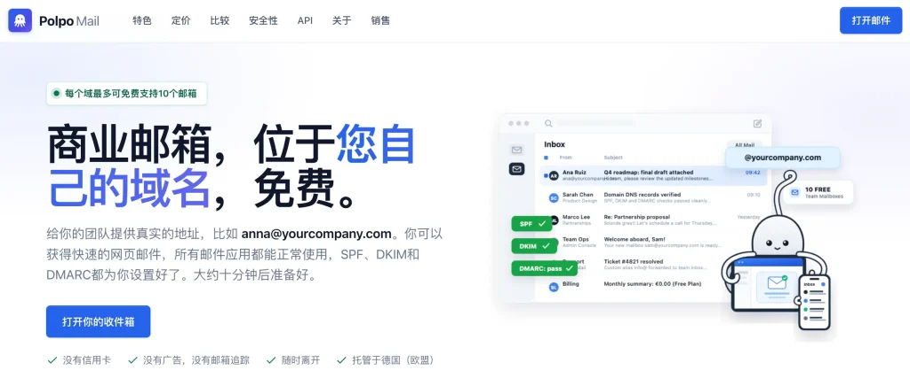
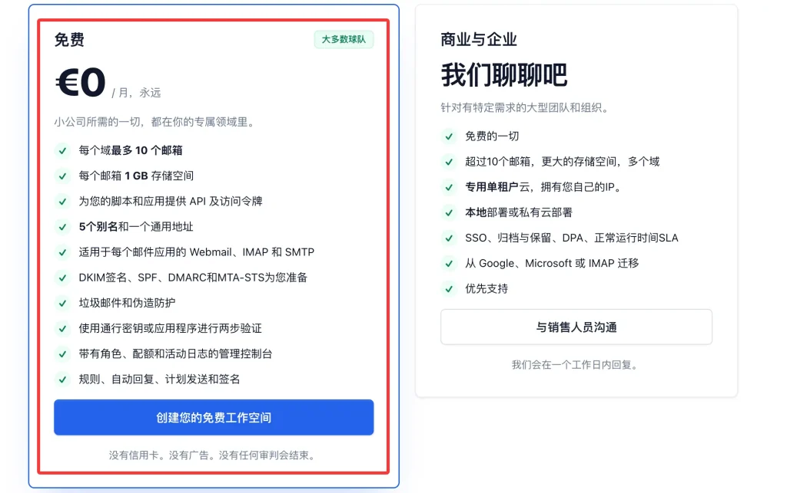

平时做网站的朋友，应该都遇到过这样一个问题：网站有了，域名也买了，唯独还缺一个像样的邮箱。

比如网站想留一个联系方式，总不能一直使用普通的个人邮箱吧？如果能拥有一个 **admin@你的域名.com** 或者 **contact@你的域名.com**，看起来会专业不少。

但问题也来了。

不少商业邮箱服务都是按人数收费，一个人可能感觉没什么，等到需要给几个项目、团队成员分别创建邮箱时，每个月的费用就慢慢增加了。

最近发现一个来自西班牙的邮箱服务商：**Polpo Mail**。

它提供了一个相当有吸引力的免费套餐：一个域名最多创建10个独立邮箱，每个邮箱有1GB存储空间，月费为0欧元，官方标注为永久免费。

更重要的是，它并不是那种只能在网页上收发邮件的简易邮箱。常用的 IMAP、SMTP、Webmail 都支持，还提供 API、访问令牌、邮件认证和安全管理功能。

我看了一下官网的套餐介绍，这个免费方案确实有不少值得说的地方。特别是已经拥有自己域名的个人站长、小型团队和开发者，可以重点了解一下。

## 📧 一、Polpo Mail 是什么？

Polpo Mail 是一个提供自定义域名商业邮箱的服务平台，服务提供方位于西班牙。

它主要解决的问题很简单：让你使用自己的域名创建专业邮箱，而不必按照传统商业邮箱的方式，为每个用户单独支付月费。

举个例子，假设你已经拥有一个 **example.com** 域名。

接入 Polpo Mail 后，就可以创建这样的邮箱：

- [admin@example.com](mailto:admin@example.com)
- [info@example.com](mailto:info@example.com)
- [contact@example.com](mailto:contact@example.com)
- [support@example.com](mailto:support@example.com)
- [hello@example.com](mailto:hello@example.com)

这些地址都使用你自己的域名。

如果你运营着个人博客，可以把 contact@example.com 放在网站底部；如果你有一个工具网站，可以使用 support@example.com 接收用户反馈；如果是团队使用，也可以给不同成员分配各自的邮箱。

相比普通个人邮箱，这种地址更适合网站、项目和业务场景。

而且，Polpo Mail 的免费套餐不是只给你一个邮箱体验一下，而是允许一个域名最多创建10个独立邮箱账户。

<badge color=”success”>€0 / 月 · 官方标注永久免费</badge>

## 🎁 二、免费套餐有什么？10个邮箱，每个1GB空间

先看大家最关心的配置。

Polpo Mail 官网目前展示的免费套餐包含以下内容：

| 项目 | 免费配置 |
| --- | --- |
| 月费 | €0，永久免费 |
| 独立邮箱 | 每个域名最多10个 |
| 单个邮箱空间 | 1GB |
| 邮箱别名 | 最多5个 |
| 通用邮箱 | 支持 Catch-all |
| 网页邮箱 | 支持 Webmail |
| 邮件协议 | IMAP、SMTP |
| API | 支持 |
| 邮件认证 | SPF、DKIM、DMARC、MTA-STS |
| 两步验证 | 支持 |
| 广告 | 无广告 |
| 信用卡 | 无需绑定 |
| 单封邮件大小 | 最大25MB |

这里有两个地方值得注意。

第一，10个邮箱是10个独立账户，每个账户都有自己的登录信息、收件箱和存储空间，并不是简单地创建10个转发地址。

第二，免费套餐没有试用期。官网明确写明无需信用卡，也没有试用到期后自动收费的问题。

对于个人站长来说，10个邮箱已经足够分配给不同的网站用途；如果是小团队，也可以让不同成员拥有自己的邮箱。

当然，每个邮箱的空间是1GB，不属于大容量邮箱。如果主要用于网站联系、日常沟通和接收通知，倒是可以先体验看看。

## 👥 三、一个域名10个独立邮箱，个人和小团队都能用

我觉得这个配置最有吸引力的地方，就是它考虑到了多人使用的需求。

比如你经营一个网站，不同岗位可能需要不同的邮箱：

- [admin@yourdomain.com](mailto:admin@yourdomain.com)：管理员邮箱
- [support@yourdomain.com](mailto:support@yourdomain.com)：用户支持
- [contact@yourdomain.com](mailto:contact@yourdomain.com)：访客联系
- [billing@yourdomain.com](mailto:billing@yourdomain.com)：账单相关
- [jobs@yourdomain.com](mailto:jobs@yourdomain.com)：招聘联系

如果是小型团队，还可以给每个人创建独立账户。

例如：

- [anna@yourdomain.com](mailto:anna@yourdomain.com)
- [david@yourdomain.com](mailto:david@yourdomain.com)
- [mike@yourdomain.com](mailto:mike@yourdomain.com)

每个人都有自己的登录密码、邮件文件夹和邮箱空间，不需要所有人共用一个邮箱。

对于刚起步的小团队来说，省去一笔邮箱订阅费用，还是挺实在的。

需要说明的是，免费套餐目前是每个工作区绑定一个域名，最多10个邮箱账户。如果想在同一个组织下管理多个域名、创建更多邮箱，需要咨询平台的商业方案。

## ✨ 四、除了10个邮箱，还有5个别名和Catch-all

除了独立邮箱，Polpo Mail 还提供了5个邮箱别名，以及一个 Catch-all 通用地址。

这两个功能可能有些朋友不太熟悉，简单解释一下。

**邮箱别名（Alias）**

假设你已经创建了一个真正的邮箱：

**admin@example.com**

但你还想在网站上展示：

**info@example.com**

以及：

sales@example.com

这时候就可以使用邮箱别名。

别名可以对应到已有邮箱，不需要为每个地址单独创建一个完整的邮箱账户，也不会占用10个独立邮箱的名额。

**Catch-all 通用地址**

这个功能更加灵活。

开启之后，发送到你域名下、没有单独创建的其他邮箱地址的邮件，也可以交给指定的邮箱接收。

例如有人把你的邮箱地址写错了，或者访客随手填写了一个你没有创建的地址，Catch-all 就有机会帮你接住这些邮件。

对于需要公开联系地址的网站来说，这个功能还是挺方便的。

## 💻 五、支持 Outlook、Apple Mail、Thunderbird，不用只在网页上收邮件

有些免费邮箱虽然能用，但只能通过服务商自己的网页收发邮件。

如果想在电脑或者手机上使用，还得看它是否支持标准邮件协议。

Polpo Mail 支持：

- Webmail 网页邮箱
- IMAP
- IMAP IDLE 邮件推送
- SMTP 邮件发送

这意味着你可以直接使用官网提供的网页邮箱，也可以连接自己熟悉的邮件客户端。

例如：

- Microsoft Outlook
- Apple Mail
- Thunderbird
- iPhone / iPad 邮件应用
- Android 邮件应用
- 其他支持 IMAP 和 SMTP 的客户端

平时在电脑上使用 Outlook，出门之后再用手机查看邮件，两边都可以使用同一个域名邮箱。

而且 IMAP 支持同步邮件状态和文件夹，不需要每次都登录网站查看。

对于习惯使用邮件客户端的人来说，这一点非常重要。

## 🛡️ 六、SPF、DKIM、DMARC、MTA-STS，邮件认证也安排好了

如果以前配置过域名邮箱，应该听说过 SPF、DKIM 和 DMARC。

这几个东西看起来有点技术含量，但它们和邮件能不能正常投递有很大关系。

简单来说：

**SPF：** 用来声明哪些邮件服务器可以代表你的域名发送邮件。

**DKIM：** 给发出的邮件添加数字签名，帮助接收方验证邮件来源和内容完整性。

**DMARC：** 根据 SPF、DKIM 的验证结果制定处理策略，并帮助域名所有者了解邮件认证情况。

**MTA-STS：** 提高邮件服务器之间传输时的 TLS 加密安全性。

很多新手第一次配置域名邮箱，最头疼的就是 DNS 记录。

MX、SPF、DKIM、DMARC 一堆名称，看着就容易头大。

Polpo Mail 会为用户生成需要添加的 DNS 记录，并提供实时检查功能。按照后台提示添加记录，就可以完成相应的域名验证和邮件认证配置。

对于不太熟悉邮件服务器的新手来说，可以省去不少自己研究的时间。

当然，认证记录配置正确，并不意味着邮件一定百分之百进入收件箱。新域名的发送信誉、邮件内容以及收件方的过滤规则，都会影响最终投递结果。

## 🔐 七、支持两步验证、访问令牌，邮箱安全也有考虑

邮箱通常会保存不少重要信息，比如网站注册通知、业务往来、账户验证邮件等。

所以，安全功能不能忽略。

Polpo Mail 提供了几种安全措施：

**1. 两步验证**

支持 Passkey、身份验证器应用等方式进行额外验证，还提供备用邮箱和恢复代码等选项。

**2. TLS 加密连接**

支持通过 TLS 加密连接收发邮件，减少传输过程中被窃听的风险。

**3. 垃圾邮件和伪造邮件防护**

平台会检查邮件认证信息，对可疑邮件进行垃圾邮件评分和处理。

**4. 独立访问令牌**

连接邮件客户端或第三方程序时，可以使用单独的访问令牌，而不是直接使用账户密码。

**5. 管理操作日志**

管理员可以查看登录、安全和管理操作记录，方便了解账户的使用情况。

这些功能对于个人使用可能不是每天都会用到，但如果准备给团队成员创建多个邮箱，统一管理和安全控制就很有价值。

## 🤖 八、还支持 API，开发者可以用程序收发邮件

这个功能我觉得开发者可以重点看看。

Polpo Mail 不只是提供一个网页邮箱，还提供 REST API 和访问令牌。

简单来说，就是可以让自己的程序通过接口读取、整理和发送邮件。

例如：

- 网站自动发送通知邮件。
- 脚本读取指定邮箱中的邮件。
- 自己开发的应用集成邮件收发功能。
- 自动化程序处理邮件任务。
- 通过程序发送项目状态通知。

平台提供不同权限范围的访问令牌，可以根据实际用途分配读取、发送或修改邮件等权限。

不再需要把主账户密码直接交给脚本或第三方程序。

对于喜欢折腾自动化工具、自己开发网站和小程序的朋友来说，这个功能就不只是一个普通邮箱了。

而且平台支持标准 IMAP 和 SMTP，开发者也可以继续使用熟悉的邮件库，不必完全依赖某一种专用接口。

## 🇪🇺 九、西班牙服务商，邮件数据存储在德国

隐私方面也是 Polpo Mail 官网重点介绍的内容。

这里有一个细节值得说明：

**Polpo Mail 的服务提供方位于西班牙，邮件和账户数据则处理并存储在德国，使用欧洲云服务商 OVHcloud 的服务器基础设施。**

也就是说，服务商所在国家和邮件数据存储位置并不是同一个地方。

官网还介绍了以下隐私和安全措施：

- 不展示广告
- 不进行邮箱广告追踪
- 不为了广告目的读取邮件内容
- 邮件连接支持 TLS
- 密码采用加盐 bcrypt 哈希方式存储
- 支持两步验证
- 邮件可以通过标准格式导出

对于在意数据存储地区、邮箱隐私的用户来说，这些信息可以作为选择服务时的参考。

不过，大家也要理性看待：不展示广告不代表邮件内容拥有端到端加密，也不意味着任何情况下都绝对安全。

如果邮箱涉及重要业务资料，还是建议做好本地备份。

## 📦 十、邮件可以导出，不想用了也不怕被绑定

还有一个容易被忽略的功能：邮件导出。

Polpo Mail 支持将邮箱中的邮件下载为标准 MBOX 文件。

同时，它使用常见的 IMAP、SMTP 邮件协议。

这意味着以后如果你想更换邮箱服务商，可以使用邮件客户端迁移已有邮件，再调整域名的 MX 记录。

不需要因为换了邮箱平台，就只能放弃以前的邮件记录。

对于准备长期使用域名邮箱的人来说，数据能不能带走，其实也是一个很重要的考虑因素。

## ⚠️ 十一、免费归免费，使用限制还是要提前了解

看到这里，可能有人已经准备注册了。

不过，在使用之前，有几个限制还是建议先了解清楚。

**1. 必须拥有自己的域名**

Polpo Mail 提供的是域名邮箱服务，并不是免费赠送域名。

你需要先拥有一个域名，例如 **.com、.net** 或其他后缀，然后通过 DNS 验证域名所有权。

**2. 每个域名最多10个独立邮箱**

免费套餐有数量限制，超过10个邮箱或者需要更大空间，就需要咨询商业方案。

**3. 每个邮箱默认1GB空间**

如果经常收发大附件，或者长期保存大量邮件，需要留意空间使用情况。

**4. 有邮件发送限制**

官网列出的免费套餐限制为每人每小时最多向500个外部收件人发送邮件。批量营销邮件和群发邮件不允许使用该服务。

所以不要把它当成无限量邮件群发平台。

**5. 单封邮件最大25MB**

如果经常发送大型附件，需要提前考虑这个限制。

**6. 免费服务没有企业级 SLA 保障**

官网服务条款说明，免费服务不承诺固定的正常运行时间、支持响应时间以及数据恢复保障。重要邮件建议自行备份，不要把它作为唯一存储位置。

这些限制其实都比较容易理解。作为个人网站和小型团队的基础邮箱，免费套餐可以先体验；如果是对邮件可用性要求很高的正式业务，就需要认真评估服务条款。

## 🔗 十二、Polpo Mail 官网地址

如果你已经有自己的域名，想创建几个专属邮箱，可以去官网了解一下。

🌐 **官方网站：**

[https://polpomail.com/](https://polpomail.com/)

官网可以查看免费套餐、功能介绍、安全说明和注册入口。

免费套餐重点配置再整理一下：

- 🆓 €0/月，官方标注永久免费
- 📧 每个域名最多10个独立邮箱
- 💾 每个邮箱1GB存储空间
- ✨ 5个邮箱别名
- 📥 支持 Catch-all 通用地址
- 💻 支持 Webmail、IMAP、SMTP
- 🤖 提供 REST API 和访问令牌
- 🛡️ 支持 SPF、DKIM、DMARC、MTA-STS
- 🔐 支持两步验证
- 🚫 没有广告，不需要绑定信用卡

---

## ❤️ 最后聊几句

现在免费域名邮箱其实不算特别少，但很多服务要么限制比较多，要么只支持自己的网页邮箱，要么免费用户无法使用 IMAP、SMTP 这些基础功能。

Polpo Mail 这次比较吸引我的地方，就是它把不少常用的商业邮箱功能直接放进了免费套餐。

一个域名最多10个独立邮箱，每个1GB空间，还有5个别名、Catch-all、API、邮件认证和两步验证。

如果你只是想给自己的博客、工具网站或者小型项目配置一个专属邮箱，这个方案确实值得收藏。

当然，它不是免费送域名，注册前需要准备好自己的域名；免费套餐也有空间和发送额度限制，重要业务最好做好备份和备用联系方式。

如果你手里正好有闲置域名，不妨试试给它配置一个 **admin@ 或 contact@** 邮箱，让自己的网站也拥有一个真正属于自己的邮箱地址。📬

## **相关截图：**

## **👉 官方地址：[https://polpomail.com](https://polpomail.com)**
