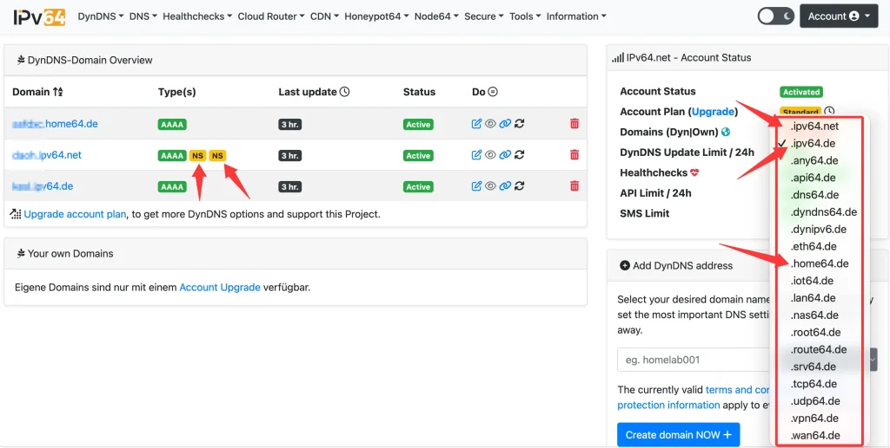

平时喜欢搭建个人网站、博客、NAS 或者家庭服务器的朋友，应该都知道域名有多重要。

无论是给个人博客配置一个好记的网址，还是给自己的服务器、NAS 设置远程访问地址，都离不开域名。

但如果只是个人使用，专门花钱购买域名，有时候又觉得没必要。尤其是平时喜欢折腾各种开源项目、测试网站的朋友，如果能找到几个免费域名，确实能省下不少成本。

今天分享一个值得收藏的平台：**IPv64.net**。

这是一个来自德国的 DynDNS 动态 DNS 服务平台。免费账户最多可以使用 **3 个 DynDNS 域名**，而且有多种后缀可以选择。

更值得关注的是，其中 **.ipv64.de**、**.ipv64.net** 和 **.home64.de** 这三个后缀还支持托管到 **Cloudflare**。

如果你平时经常使用 Cloudflare，或者喜欢折腾 VPS、NAS、家庭服务器，可以了解一下这个平台。👇

## 🆓 一、IPv64.net 是什么平台？

IPv64.net 是一个德国开发和运营的动态 DNS 服务平台，主要功能是帮助用户通过域名访问自己的网络设备和服务器。

它和普通的域名注册商有些区别。

简单来说，普通域名主要解决的是网址问题，而 IPv64.net 更侧重于动态 DNS：当你的网络 IP 地址发生变化时，可以通过客户端、路由器或者脚本自动更新域名解析，让域名始终指向当前使用的 IP 地址。

举个例子：

假设你家里有一台 NAS 或者 Linux 服务器，网络 IP 可能会不定期发生变化。

如果每次 IP 变化都需要手动修改访问地址，就比较麻烦。

使用动态 DNS 后，可以给设备配置一个固定的域名。当 IP 地址发生变化时，平台自动更新对应的 DNS 记录，之后仍然可以通过域名访问设备。

这就是 DynDNS 的主要用途。

IPv64.net 支持 DynDNS2 协议，同时支持 IPv4 和 IPv6 地址更新，适合个人用户和喜欢折腾网络服务的朋友。

## 🎁 二、免费账户可以申请 3 个域名

这应该是很多人最关心的部分。

IPv64.net 当前提供免费的 DynDNS 服务，免费账户最多可以使用 **3 个 DynDNS 域名**，不需要购买付费套餐，就可以体验平台的基础动态 DNS 功能。

平台提供了多种域名后缀，目前官网介绍有 19 种后缀可选。

例如：

- **.ipv64.net**
- **.ipv64.de**
- **.home64.de**
- **.nas64.de**
- **.dns64.de**
- **.dyndns64.de**

还有其他后缀可以选择，具体以注册页面显示为准。

你可以根据自己的喜好选择域名前缀和后缀。

比如：

- **blog.ipv64.net**
- **home.home64.de**
- **nas.ipv64.de**

以上只是格式示例，实际能否注册，需要在官网查询。

三个免费域名也可以分开使用，一个用于个人博客，一个用于 NAS，另一个留给自己的服务器或测试项目。

对于平时喜欢搭建网站、研究网络服务的人来说，这个免费额度还是挺实用的。

## ☁️ 三、重点来了：这 3 个后缀支持托管到 Cloudflare

如果你平时经常使用 Cloudflare，那么这部分建议重点关注。

根据实际使用信息，IPv64.net 提供的以下三个域名后缀支持托管到 Cloudflare：

**1. .ipv64.de**

**2. .ipv64.net**

**3. .home64.de**

如果你准备将域名搭配 Cloudflare 使用，可以优先考虑这三个后缀。

为什么要接入 Cloudflare？

对于经常建站的朋友来说，Cloudflare 的 DNS 管理、代理以及其他相关服务都比较方便。

拿到合适的域名后，可以根据自己的项目需求配置解析，例如：

- 🌐 给个人博客配置访问域名
- 🛠️ 给自己搭建的网站绑定域名
- 📦 给在线工具或开源项目配置网址
- 🖥️ 给服务器、NAS 等设备配置访问地址
- ☁️ 配合 Cloudflare 管理 DNS 解析

需要注意，Cloudflare 托管需要按照对应域名的权限和平台要求进行配置，具体以实际操作结果为准。

## 🚀 四、除了免费域名，还有哪些实用功能？

IPv64.net 并不只是一个领取免费域名的平台，它本身还提供了不少动态 DNS 相关功能。

**1. IPv4 和 IPv6 动态更新**

支持 A 记录和 AAAA 记录，可以根据实际网络环境更新 IPv4、IPv6 地址。

如果你的网络环境支持 IPv6，也可以利用它来管理相关解析记录。

**2. DynDNS2 协议支持**

平台兼容常见的 DynDNS2 更新协议，可以配合不少路由器、网络设备以及客户端使用。

官网列出了 FRITZ!Box、Speedport、UniFi、MikroTik、OPNsense、Synology 等设备的集成方式，也支持通过 Linux 定时任务更新。

**3. API 接口**

平台提供 API 和自动化更新功能，方便有一定技术基础的用户通过脚本或程序管理域名记录。

**4. Let’s Encrypt DNS 验证**

支持 DNS Challenge，可以配合 ACME.sh、Certbot 等工具申请 SSL 证书。

对于自己搭建网站、服务器的朋友来说，这个功能也比较实用。

**5. DNS Failover**

平台还提供 DNS 故障切换功能，在符合配置条件的情况下，可以帮助用户处理 DNS 服务节点故障时的切换问题。

**6. DDoS 防护和负载均衡**

官网介绍了 DNS 服务器的负载均衡和 DDoS 防护机制，主要用于提升 DNS 服务的可用性。

整体来看，它提供的功能已经不只是简单的免费域名申请，更偏向于一套动态 DNS 和网络管理服务。

## 💡 五、哪些人适合申请？

如果你有下面这些需求，可以考虑注册一个：

**个人博客和网站**

想给自己的博客、作品展示页面或者在线工具配置一个独立的网址，可以先用免费域名进行测试。

**NAS 用户**

家里有 NAS，希望通过域名访问自己的设备，可以了解一下动态 DNS。

**家庭服务器**

自己搭建了 Linux 服务器、Docker 服务或者其他自托管项目，也可以使用域名作为访问入口。

**VPS 和网络爱好者**

平时喜欢折腾 VPS、DNS、IPv6、Cloudflare 等服务，可以把它作为学习和测试工具。

**开源项目体验**

有些开源项目需要域名进行测试或配置服务，使用免费 DynDNS 域名也能减少前期成本。

## ⚠️ 六、免费套餐需要注意什么？

免费服务虽然实用，但也建议提前了解平台的使用规则。

根据官网当前公开的说明：

- 免费账户最多支持 3 个 DynDNS 域名
- 提供 19 种域名后缀供选择
- 支持 IPv4 和 IPv6 动态更新
- 免费套餐每天最多支持 64 次 DynDNS 更新
- DynDNS TTL 为 60 秒
- 免费账户不包含自有域名托管额度

这里也提醒一下：IPv64.net 提供的是免费动态 DNS 子域名，并不等于可以在这里注册任意普通顶级域名。它也不是传统域名注册商。

免费服务的功能额度和政策未来可能调整，建议申请前查看官网最新套餐说明。

## 📝 七、平台注册入口

进入官网后，注册一个免费账户，找到 DynDNS 域名管理页面，就可以查询自己想要的域名前缀是否可用。

注册时可以先考虑自己的用途，再选择合适的后缀。

如果希望后续托管到 Cloudflare，建议优先看看前面提到的三个后缀：

- **.ipv64.de**
- **.ipv64.net**
- **.home64.de**

一个账户最多可以使用 3 个免费 DynDNS 域名，可以根据自己的实际需求安排。

## 🎯 最后总结

这次分享的 IPv64.net，比较适合喜欢折腾个人网站、NAS、家庭服务器和网络服务的朋友。

它的亮点主要有三个：

✅ **免费额度：** 一个免费账户最多可以使用 3 个 DynDNS 域名。

✅ **后缀选择：** 提供多种域名后缀，不同用途可以选择不同的域名。

✅ **动态 DNS：** 支持 IPv4、IPv6 更新，以及 DynDNS2、API 等功能。

另外，**.ipv64.de、.ipv64.net 和 .home64.de** 这三个后缀还支持托管到 Cloudflare，对于经常使用 Cloudflare 的朋友来说，是一个值得关注的地方。

如果你平时也喜欢搭建个人博客、部署开源项目，或者给 NAS 和家庭服务器配置域名，不妨收藏一下这个平台。

有需要可以先去注册体验，免费服务的具体额度和规则以官网最新页面为准。

## **相关截图：**

## **👉 官方地址：[https://ipv64.net](https://ipv64.net)**
