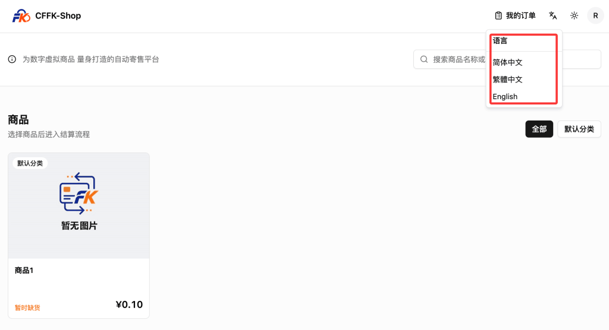
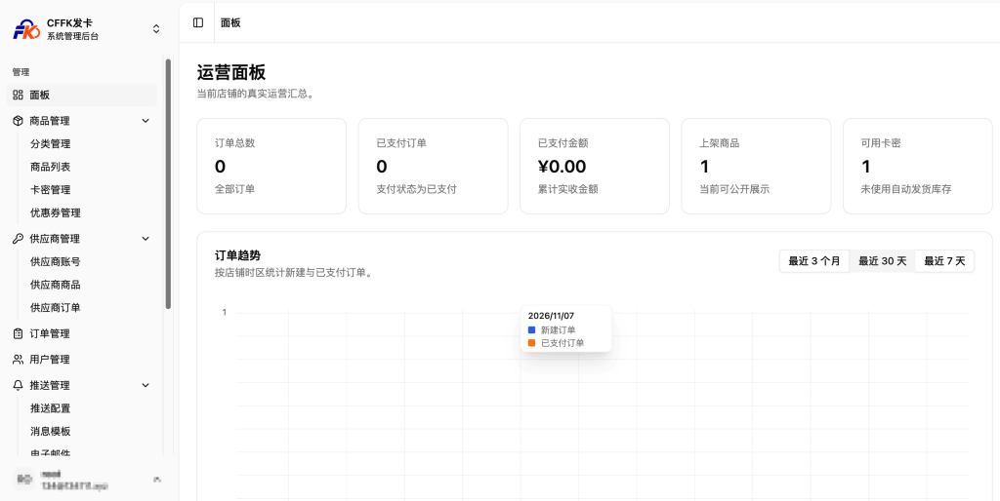

想搭建一个属于自己的发卡商城，却被服务器费用、程序安装、支付接口和订单管理这些问题劝退了？

如果只是想卖一些数字商品、卡密、兑换码，或者搭建一个自己的在线小商城，其实不一定非要购买服务器，也不一定需要从零开发一套系统。

今天分享一个挺有意思的开源项目：**CFFK**。

它是一套基于 Cloudflare Workers 开发的轻量级数字商品商城系统，可以直接部署到 Cloudflare 上运行。项目集成了商品管理、订单支付、卡密自动发货、会员账户、消息通知以及运营管理后台等功能。

最吸引人的地方是：**支持一键部署，合理使用 Cloudflare 免费额度，就有机会实现低成本甚至零成本运行。**

而且，它并不是只有一种支付方式，项目已经集成支付宝、易支付、BEpusdt、Stripe 和 HashPay 等支付渠道。

对于想拥有自己商城，又不想承担传统服务器成本的朋友来说，值得研究一下。🚀

## 🛍️ 一、CFFK 是什么？

CFFK 是一个运行在 Cloudflare Workers 上的开源发卡系统，也可以理解为一个轻量级的数字商品商城。

它主要面向个人商店和小型数字商品销售场景。

以前想搭建一个发卡网站，通常需要准备服务器、安装运行环境、配置数据库，再部署商城程序，后续还要自己处理商品库存、订单、支付和发货等问题。

对于不熟悉服务器操作的人来说，整个过程并不轻松。

CFFK 则把这些功能整合到了一套系统中。

你可以通过后台管理商品、设置价格、配置支付渠道，买家在前台选择商品并完成支付，系统根据商品的发货方式自动交付内容。

不需要自己从头开发商城，也不用单独拼凑多个管理工具。

项目基于 Cloudflare Workers 运行，使用 Cloudflare D1 保存数据，适合个人搭建轻量级在线商城。

## ☁️ 二、最大的亮点：可以免费部署到 Cloudflare

这也是我比较推荐这个项目的原因。

传统商城一般需要购买 VPS 或云服务器，再配置网站环境、数据库和相关服务。

而 CFFK 可以直接部署到 Cloudflare Workers。

Cloudflare 提供免费套餐，对于个人测试、小型项目和访问量不大的商城，在符合免费套餐额度及使用规则的情况下，可以不购买传统服务器来运行。

项目还使用了 Cloudflare D1 数据库保存商品、订单等数据，并通过相关任务机制处理订单等业务。

部署完成后，你就拥有了一个可以独立管理的在线商城。

当然，这里说的零成本是有前提的：

- 使用 Cloudflare 免费套餐，并且不超过相应资源额度。
- 支付渠道本身可能存在手续费或其他费用。
- 自定义域名、对象存储等外部服务可能产生额外费用。
- 如果商城访问量较大，或者超出免费额度，就需要根据实际情况考虑付费方案。

所以，对于个人小型商城来说，它提供了一条非常值得尝试的低成本建站路线。

## 💳 三、支持多种支付渠道，不再局限于单一支付方式

一个发卡商城好不好用，支付功能非常重要。

如果只能支持一种支付方式，实际使用时就会受到不少限制。

CFFK 已经集成了多种支付渠道：

**1. 支付宝**

支持支付宝支付渠道，具体使用需要根据对应接口配置商户信息。

**2. 易支付**

支持易支付接口，方便对接兼容相关协议的支付服务。

**3. BEpusdt**

支持 BEpusdt，可以根据项目需求配置相应的支付服务。

**4. Stripe**

支持 Stripe 支付，适合有国际支付需求的业务场景，实际开通和使用需要符合 Stripe 的地区、账户及业务要求。

**5. HashPay**

支持 HashPay 支付网关，可以根据自身需求配置对应的收款服务。

多种支付渠道集中在一个后台中管理，可以根据自己的业务类型选择合适的方式。

需要注意，程序提供支付接口支持，并不代表注册后就能直接使用所有支付方式。实际收款仍然需要准备相应的商户账户、接口密钥，并遵守支付服务商的审核和使用规则。

## 🔑 四、支持卡密自动发货，付款后不用一直盯着订单

如果你销售的是卡密、兑换码、账号授权码或者其他数字商品，自动发货功能就非常重要。

想象一下：

买家进入商城，选择商品，提交订单并完成付款，系统确认支付后，就可以自动发出对应的商品内容。

整个过程不需要卖家每次手动处理。

CFFK 支持多种商品交付方式：

**1. 卡密自动发货**

可以批量导入卡密库存，买家付款后系统自动分配并发放对应卡密。

适合兑换码、授权码、数字序列号等商品。

**2. 固定内容发货**

对于交付内容固定的数字商品，可以设置对应的发货内容，订单完成后自动交付。

**3. 人工发货**

如果商品需要人工处理，可以通过后台管理订单，再进行手动发货。

**4. 实物快递发货**

它不仅限于虚拟商品，也支持实物商品的订单和快递发货场景。

这点还是比较实用的。

也就是说，你可以根据自己销售的商品类型，选择自动发货、固定内容交付或者人工处理，不必局限于传统的卡密发货模式。

## 📦 五、完整的商品和库存管理系统

商城搭建起来之后，商品管理同样重要。

CFFK 提供了比较完整的商品管理功能。

主要包括：

- 商品分类管理
- 商品创建、编辑和删除
- 商品上架与下架
- 商品封面图片
- 富文本商品详情
- 商品价格设置
- 商品购买数量限制
- 库存管理
- 优惠券功能
- 卡密批量导入
- 库存和商品状态管理

比如，你可以创建不同的商品分类，把不同类型的数字商品放在对应分类中。

每个商品可以单独设置价格、介绍、库存和购买限制。

如果某个商品暂时没有库存，也可以通过后台进行管理。

此外，项目还支持上游供应商管理，可以对接相关供应商，进行商品导入、供应商绑定、库存和成本同步，以及自动履约发货。

对于希望进一步扩展商城业务的人来说，这部分功能也值得关注。

## 👤 六、会员系统和订单管理

以前一些简单的发卡程序只有访客购买功能，买家购买完成后，需要自己保存订单信息。

CFFK 则进一步完善了用户体系。

项目支持：

- 邮箱和密码注册登录
- 用户账户管理
- 双因素认证
- 注册用户订单记录
- 访客订单查询
- 访客订单找回
- 订单状态管理
- 支付日志记录
- 超时订单自动关闭

买家可以注册账户，后续查询自己的购买记录。

对于没有注册的访客，也提供订单查询和找回机制。

后台则可以查看订单状态、支付记录以及相关信息。

另外，系统还支持支付回调验证、超时订单自动关闭，以及库存和优惠券释放等订单处理机制。

对于一个在线商城来说，这些功能能够减少不少重复性的管理工作。

## 📩 七、支持邮件、Telegram 和微信消息通知

如果商城有新订单，或者出现需要处理的业务，及时收到通知会方便很多。

CFFK 集成了消息推送功能，支持多种通知渠道：

- 📧 邮件通知
- ✈️ Telegram 通知
- 💬 微信第三方通知

并且支持消息模板、通道测试、发送重试和发送日志。

你可以根据自己的使用习惯配置通知方式。

例如，有新订单时接收消息提醒，方便及时查看订单和处理发货。

如果你不想每天都登录后台检查订单，这类通知功能就很实用。

## 🖼️ 八、内置媒体库和 SEO 功能

除了商城本身的功能，CFFK 还考虑到了网站运营方面的需求。

**媒体库功能：**

支持兼容 S3 协议的对象存储，可以上传图片和 PDF 文件，并提供站内代理访问及缓存功能。

商品封面、商品介绍等内容可以更方便地管理。

**SEO 功能：**

项目支持站点标题、描述等基础 SEO 配置，同时还支持：

- 商品级 Title 和 Description
- 动态 Canonical
- Open Graph
- Twitter Card
- 社交分享图片

对于准备长期运营商城的人来说，这些功能有助于完善网站的搜索引擎和社交分享信息。

## 🎨 九、后台界面也进行了重新设计

CFFK 并不是一个只有基本功能的简单程序。

项目对前台商城和后台管理界面都进行了重构，采用统一的 UI 组件体系，并支持暗黑模式。

同时提供简体中文、繁体中文和英文等多语言支持。

后台可以集中管理商品、订单、支付、用户、消息通知、媒体存储和站点配置。

此外，后台管理路径支持自定义，不必固定使用常见的管理地址。

首次部署时需要初始化管理员账户，并设置好相关安全密钥。

## 🚀 十、项目如何部署？

CFFK 的一个优势就是支持直接部署到 Cloudflare Workers。

项目提供了一键部署方式，部署流程会引导你创建所需的 GitHub 仓库，并配置 Cloudflare Workers 和 D1 数据库。

大致流程如下：

1. 打开项目 GitHub 页面。
2. 点击项目提供的 Cloudflare 部署入口。
3. 按照页面提示授权 GitHub 和 Cloudflare。
4. 创建并绑定 D1 数据库。
5. 配置后台访问路径和必要的安全密钥。
6. 部署完成后，访问初始化页面创建第一个管理员账户。
7. 登录后台，配置站点信息、支付渠道和商品。

部署成功后，就可以开始配置自己的商城了。

后续项目更新也提供了 GitHub Actions 工作流方式，可以从上游仓库同步新版本，再由 Cloudflare 自动检测提交并重新部署。

需要注意，一键部署后还需要按照项目说明配置更新工作流，并不是所有更新操作都会自动完成。

如果你没有接触过 Cloudflare Workers，也不用太担心，可以跟着项目文档逐步配置。

## 🎯 十一、哪些人适合使用？

我觉得下面这些场景都可以考虑：

**个人数字商品商城**

想销售合法的数字资料、电子内容、兑换码等，可以使用系统搭建自己的商城。

**卡密自动发货网站**

如果商品需要通过卡密或兑换码交付，可以利用自动发货功能减少人工操作。

**个人在线商店**

不只是虚拟商品，也可以根据系统支持的发货方式管理人工发货和实物订单。

**开源项目学习**

如果你对 Cloudflare Workers、D1 数据库、支付接口和商城系统感兴趣，也可以通过这个项目学习完整的业务系统是如何组织的。

## 🔗 十二、项目地址

项目名称：CFFK

GitHub 开源地址：

https://github.com/34892002/cffk

项目采用 Apache-2.0 开源许可证，具体使用和二次开发请遵循项目许可证及相关依赖的许可要求。

## ✨ 最后总结

以前想搭建一个自己的发卡商城，往往需要购买服务器、安装环境、部署程序，再一点点配置支付、商品、库存和订单系统。

而 CFFK 把这些功能整合在了一起，还支持直接部署到 Cloudflare Workers。

它比较吸引人的地方主要有：

✅ Cloudflare Workers 部署，符合免费额度时可以低成本运行。

✅ 支持支付宝、易支付、BEpusdt、Stripe、HashPay 等支付渠道。

✅ 支持卡密自动发货、固定内容发货、人工发货和实物快递发货。

✅ 商品、分类、库存、优惠券和订单管理功能齐全。

✅ 支持会员注册、登录、订单查询和双因素认证。

✅ 支持邮件、Telegram、微信消息通知。

✅ 内置媒体库、SEO 配置和运营管理后台。

如果你一直想拥有一个自己的在线商城，又不想从零开发，CFFK 确实是一个值得收藏的开源项目。

**不用先购买传统服务器，也不用自己从头写商城程序。利用 Cloudflare 的免费资源，就可以尝试搭建属于自己的发卡商城。** 🚀

感兴趣的朋友可以去 GitHub 查看项目源码和部署说明。

温馨提示：项目仅适用于合法合规的商品和服务销售。实际运营前，请确认所在地法律法规、商品销售资质以及支付服务商的业务规则；支付通道可能涉及手续费，Cloudflare 免费资源也有使用额度限制。

## **相关截图：**

## **项目地址：[https://github.com/34892002/cffk](https://github.com/34892002/cffk)**

---

> 本文转载整理自 [Ai星码博客](https://aixmb.com/1340.html)，版权归原作者所有。

