很多人一直想做自己的网站，但一上来就被劝退了。

域名要钱 💸  
服务器要钱 💸  
SSL证书要配 💸  
还要备案、还要折腾环境

最后一句话总结就是：  
👉 **想做个网站，先花一两百起步。**

但最近我发现一个有点“离谱”的东西：  
**居然可以免费拿“永久域名”，还可以直接托管到 Cloudflare。**

而且我试了一下，是真的能用。

---

# **🌐就是这个东西（我已经实测）**

一开始我也以为是噱头，毕竟“免费永久域名”听起来太夸张了。

但实际看了一圈，它主要做了三件事：

- 提供免费域名（可长期使用）
- 可以直接绑定 Cloudflare
- 配合托管实现0服务器建站

说白了就是一句话：

👉 **帮你把“建站成本”直接打到接近0**

---

# **💡它到底解决了什么问题？**

以前你要做一个网站，流程是这样的：

域名（10～80元/年）  
↓  
服务器（几十～几百/月）  
↓  
解析配置  
↓  
SSL证书  
↓  
部署上线

整个过程不仅贵，还麻烦。

---

而现在这种方案变成了：

👉 免费域名 + Cloudflare = 网站上线

甚至可以做到：

- 不买服务器
- 不写复杂配置
- 不花钱维护

---

# **👤适合哪些人？**

这个东西不是万能的，但非常适合：

✔ 想做个人博客的人  
✔ 想做导航站的人  
✔ 想练手前端项目的人  
✔ 想做副业网站的人  
✔ 想体验建站流程的新手

如果你只是想“搞个网站玩玩”，这个方案真的够用了。

**相关教程：**

**永久域名注册网站**

```
https://my.dnshe.com
```

第一步,进入网站，可以多种注册方法，选择符合你的

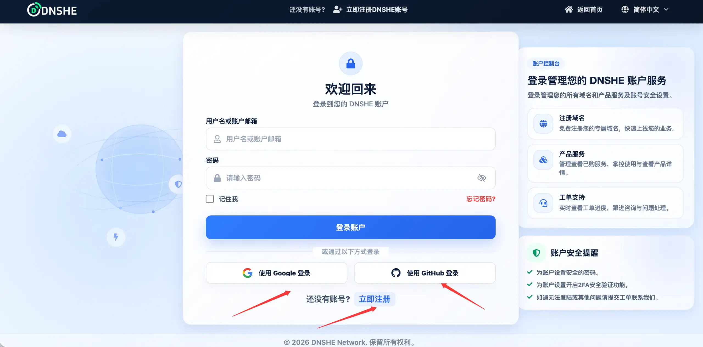

第二步，注册成功后点击免费域名

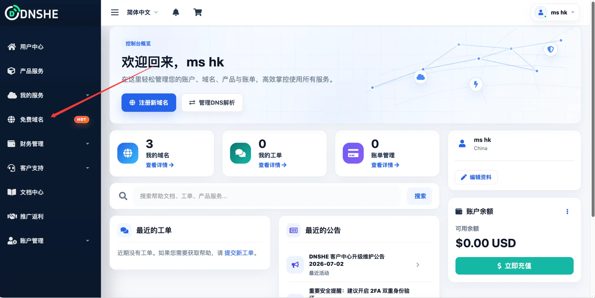

第三步，注册域名

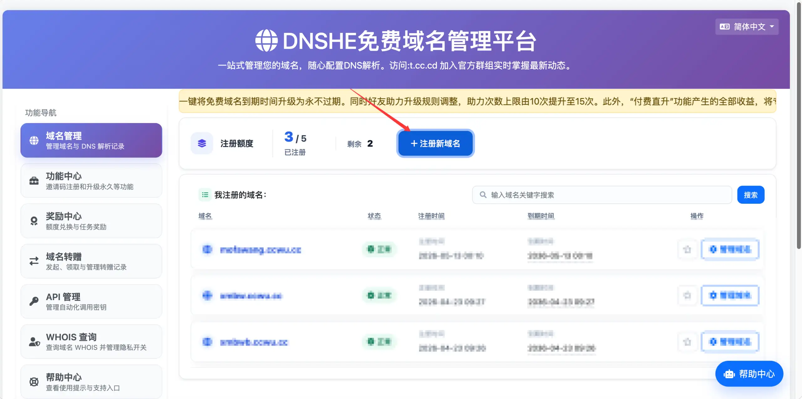

第四步，有四种域名后缀可以选，.bbroot.com暂时不支持托管到cloudflare，

.ddns.ge需要特点要求，

其他三个随便注册，输入前缀后点击注册即可。

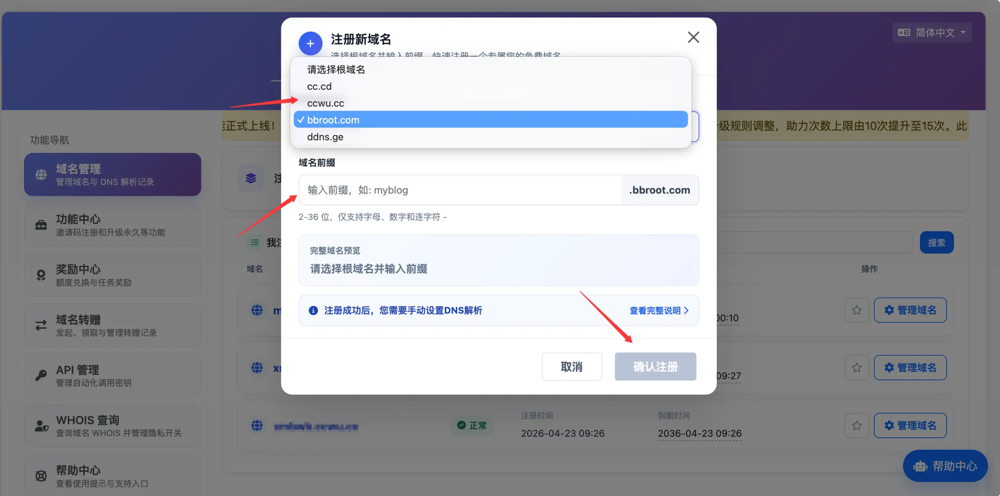

10年到期后可以提前180天再免费续10年

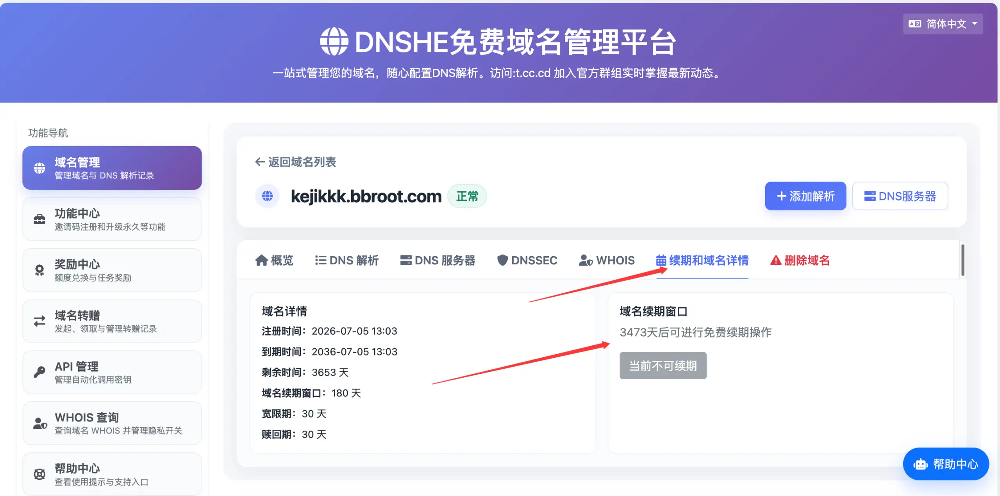

第五步，免费托管到cloudflare，点击域名下面的概览，再点击添加域名

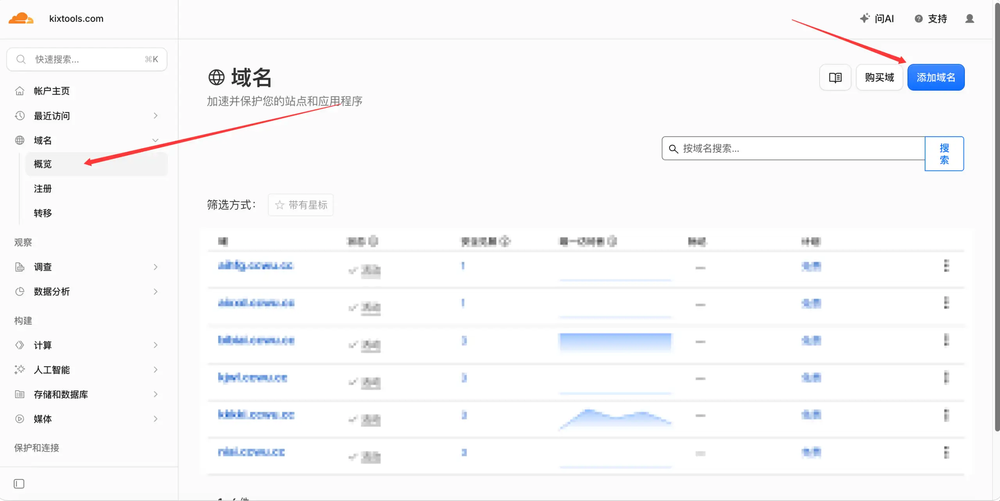

第六步，连接域名

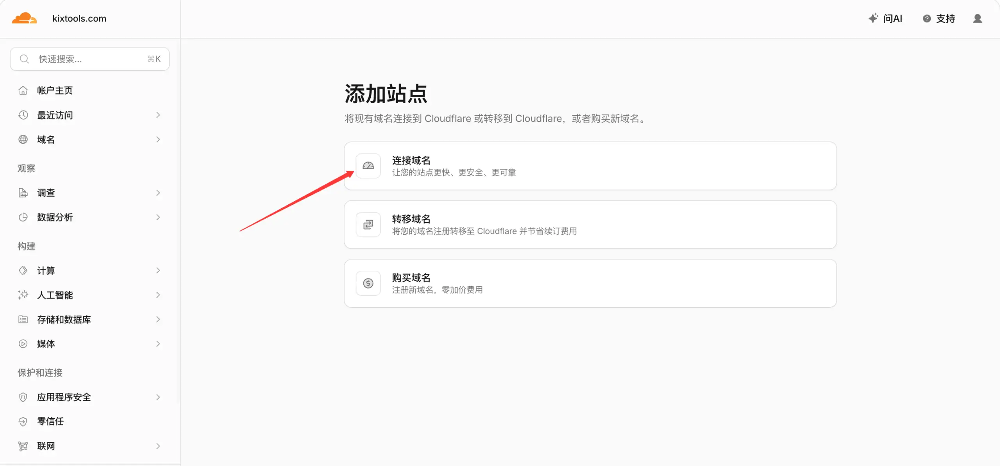

第七步，添加你的域名，点击继续

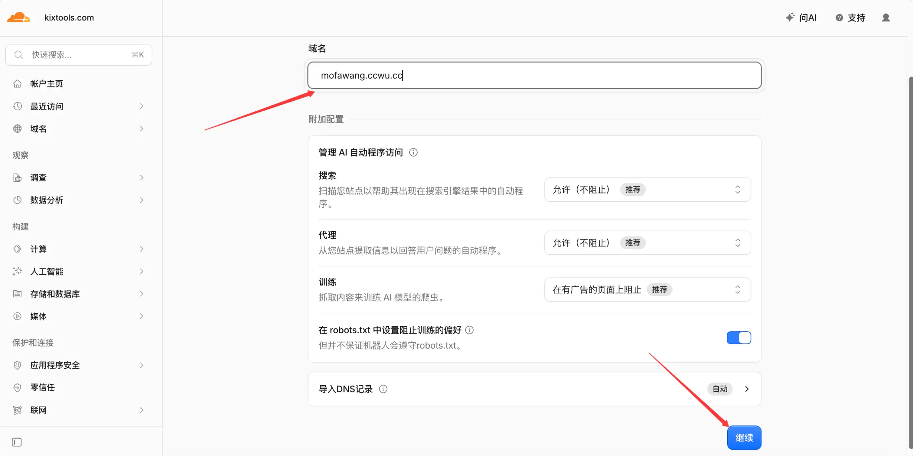

第八步，选择免费计划

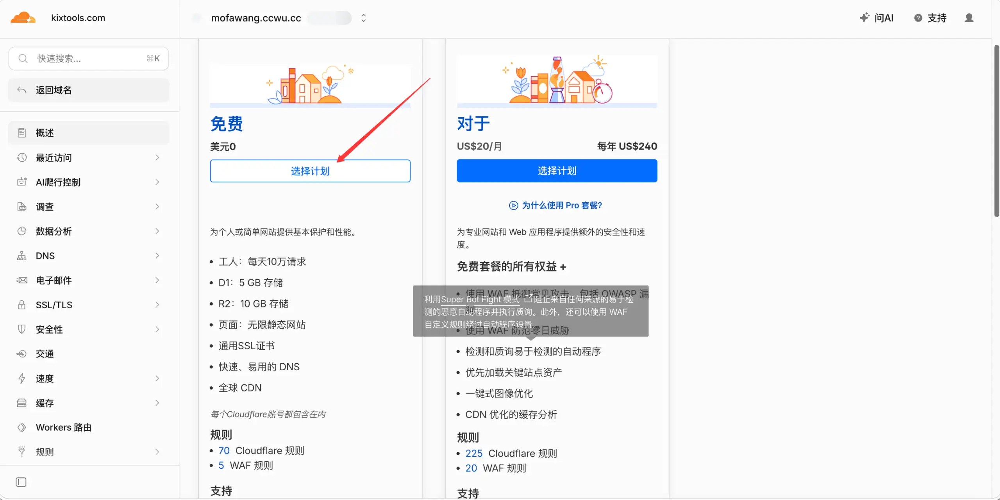

第九步，下拉继续前往激活

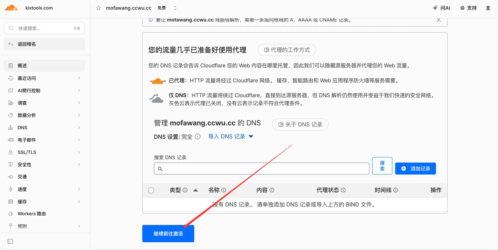

第十步，拿到两个DNS值复制

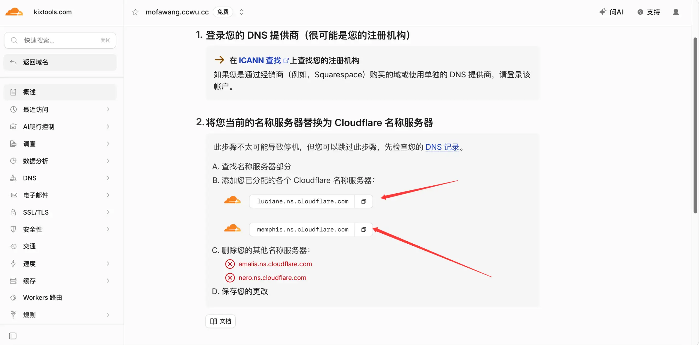

十二步，返回域名平台点击DNS服务，粘贴cloudflare两填值进入点击保存

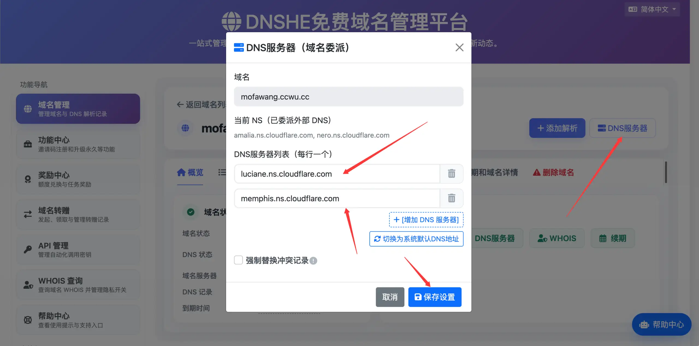

十三步，cloudflare下拉点击我已更新名称服务器

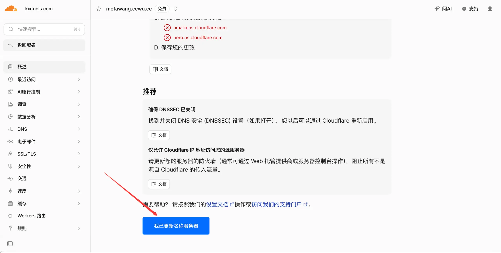

等待1-30分钟左右，已经生效。以后域名解析就在你的cloudflare上解析即可，不再需要打开域名平台。cloudflare还有免费的十年SSL证书➕全球CDN加速服务。

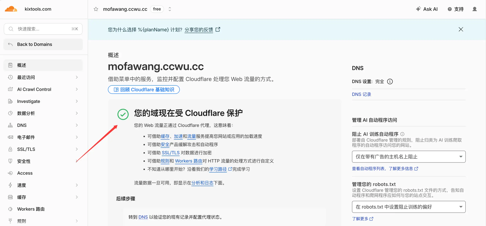
