很多人都有一个想法：

👉 做一个自己的网站  
👉 搞点副业流量  
👉 或者做一个工具站放广告赚钱

但现实是：

- 不会后端
- 不想买服务器
- 还怕部署太麻烦

结果就是：想法一直停留在“想”。

直到我看到一个开源项目，我试了一下——  
**居然真的可以0成本上线一个完整工具网站。**

---

# **🌐这个项目：Shot Easy Website（真的能用）** 👉简单说，它是一个：

👉 在线图片处理 + 截图 + 美化工具站

而且功能不是那种“玩具级别”，是可以直接上线用的。

---

# **🧠这个网站到底是干嘛的？**

它本质上是一个“浏览器里的PS工具箱”，主要做这些事情：

## **📸 1. 在线截图工具**

可以直接在浏览器里截图、生成图片

---

## **🖼️ 2. 图片编辑器**

支持基础编辑，比如：

- 裁剪图片
- 调整尺寸
- 简单处理图片效果

---

## **✨ 3. 图片美化工具**

比如：

- 图片圆角处理
- 图片滤镜效果
- 图片样式优化

---

## **🧹 4. 背景移除（核心功能之一）**

可以直接抠图，去掉背景

👉 不用PS  
👉 不用下载软件  
👉 直接网页操作

---

## **📦 5. 图片压缩工具**

可以压缩图片大小，用于：

- 网站上传
- SEO优化
- 加速加载

---

## **🧩 6. Chrome扩展支持**

还能做浏览器扩展：

👉 在网页上直接调用工具功能

---

**相关功能部分截图：**


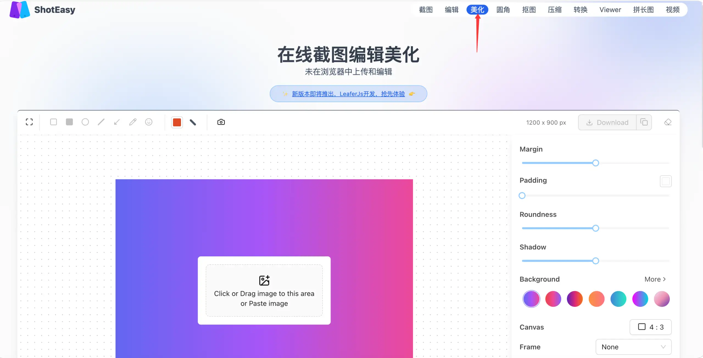

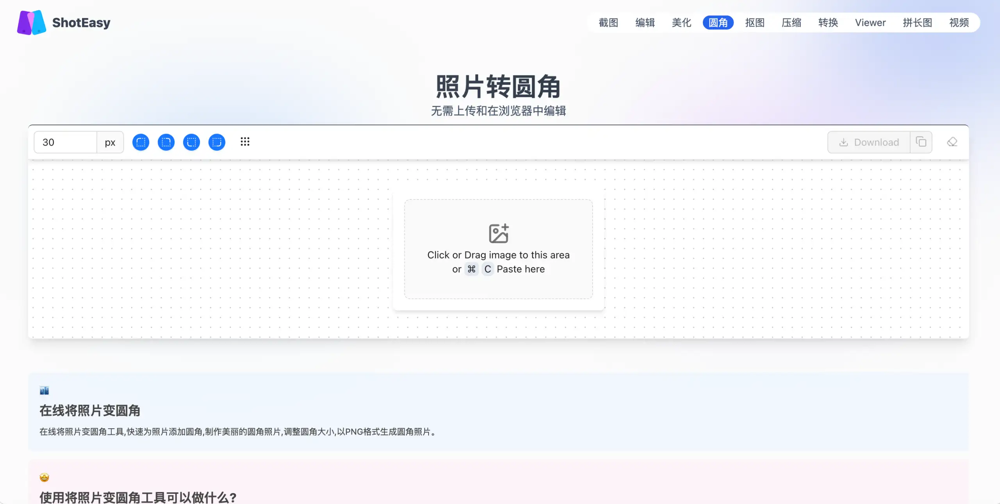

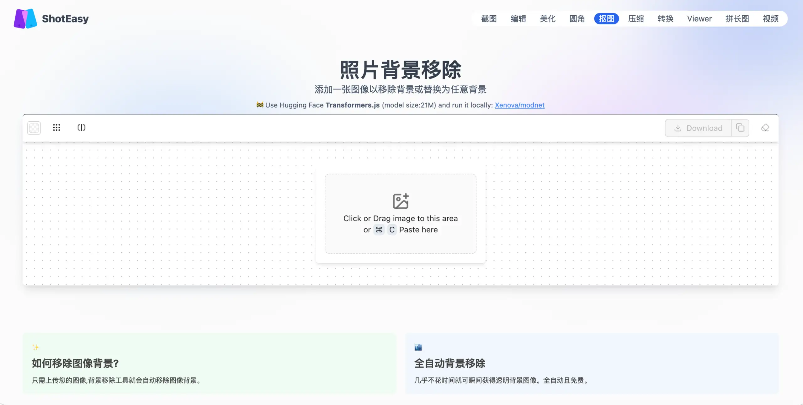

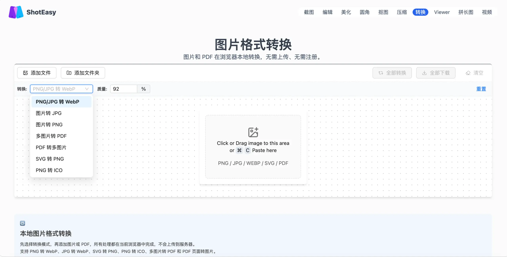

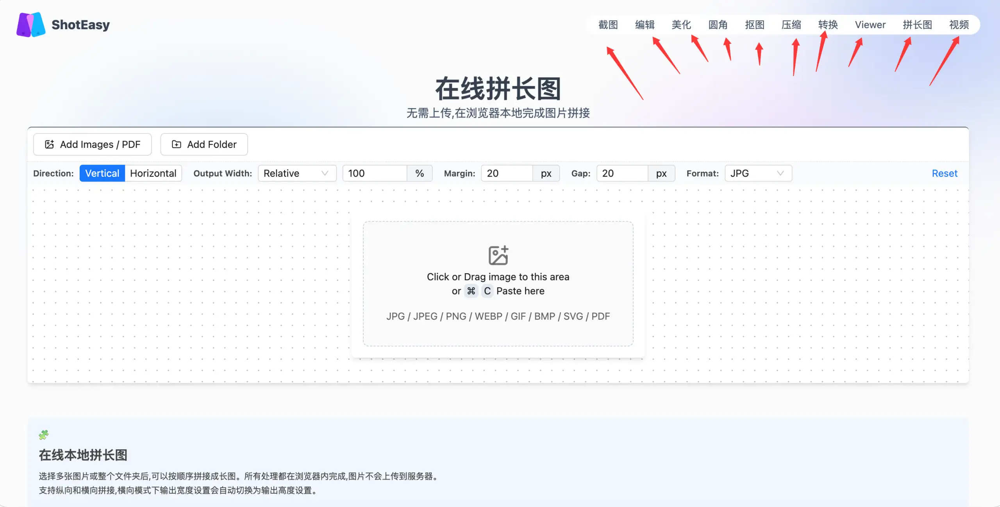

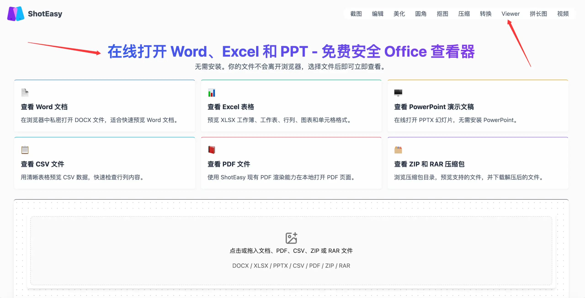

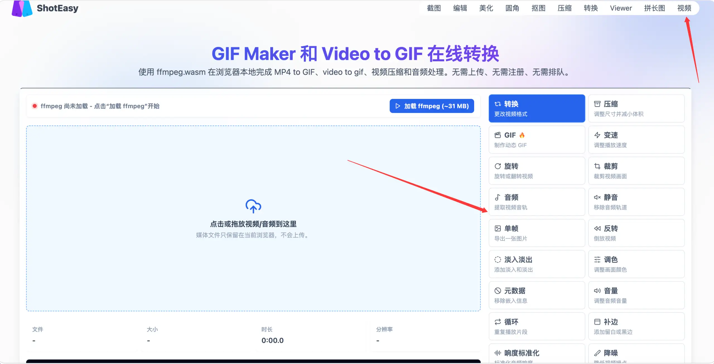

**（也可以用我现成的）在线演示站：[https://photo.kixtools.com](https://photo.kixtools.com)**

---

# **🚀重点来了：我用 Vercel 0成本部署成功了**

这个项目最爽的地方是：

👉 不需要服务器  
👉 不需要运维  
👉 甚至不用买域名也能跑

直接用 Vercel 就能上线。

---

# **🛠️部署步骤（小白也能做）**

1.打开github进入下面地址， 下拉到底点击**Deploy**

```
https://github.com/CH563/shot-easy-website
```

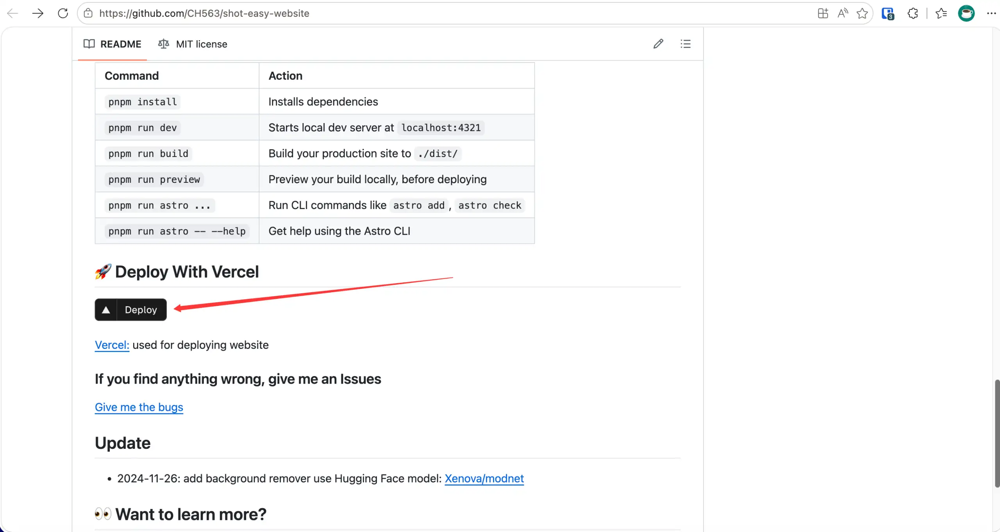

2.来到Vercel免费托管服务平台，如果有账号直接授权登录，如果没有账号点击**注册或者github注册**都可以，简单填写写内容即可注册完成

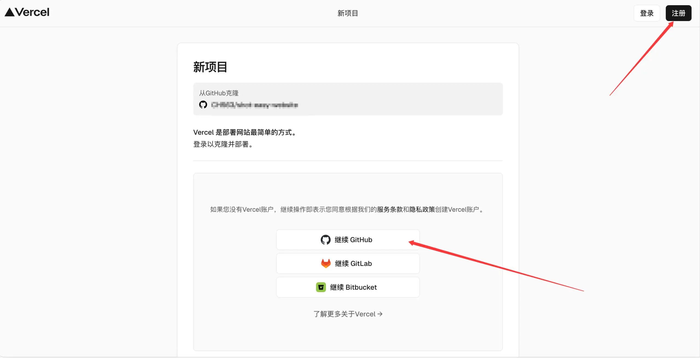

3.我直接用github注册过的账号授权，然后点击**Continue**，**注意：**如果你们没有**vercel**账号，等注册完成，返回该项目重新点击**Deploy（第一步重新走一篇）**

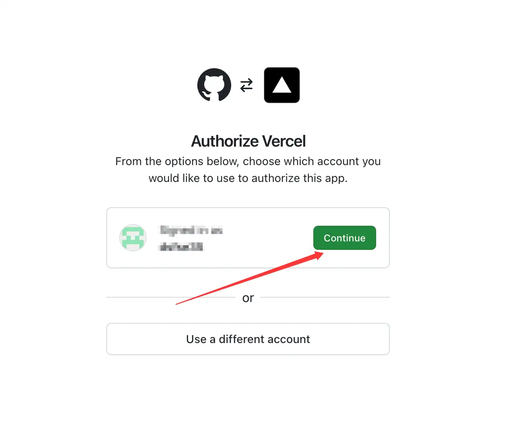

4.第一次授权后会进入**vercel平台

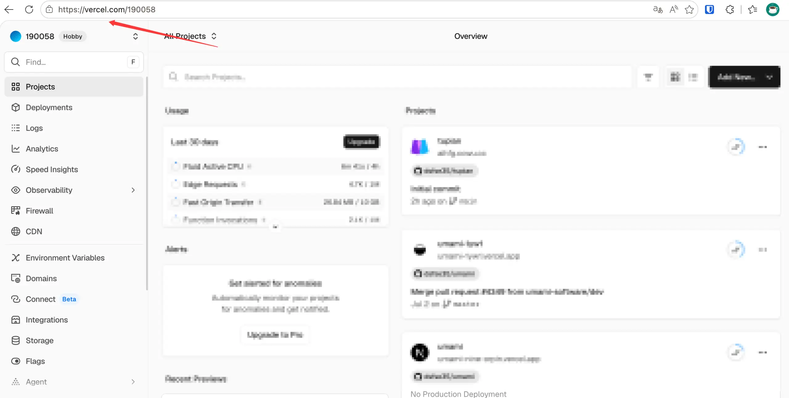**

5.再重新打开该项目，重新点击 **Deploy**


6.此时来到构建页面**Public Repository Name名称**自定义，再点击**Create部署**

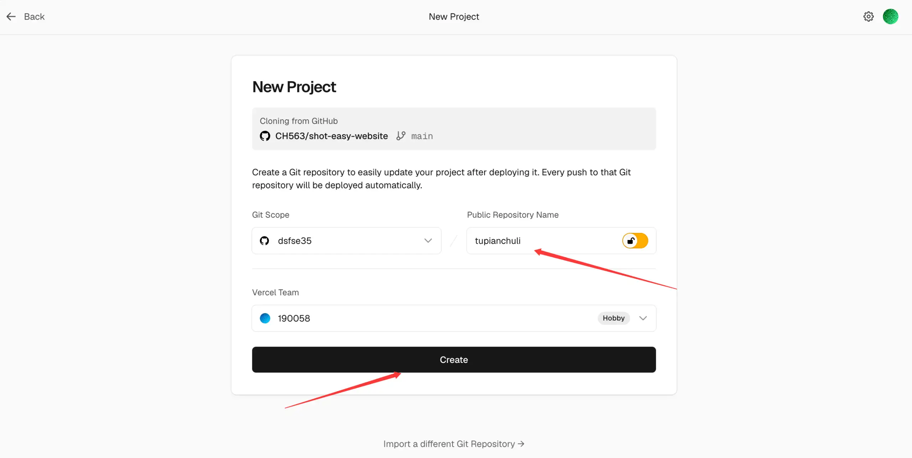

7.项目在部署中，正在构建所需要的环境，等待3-5分钟即可部署完成

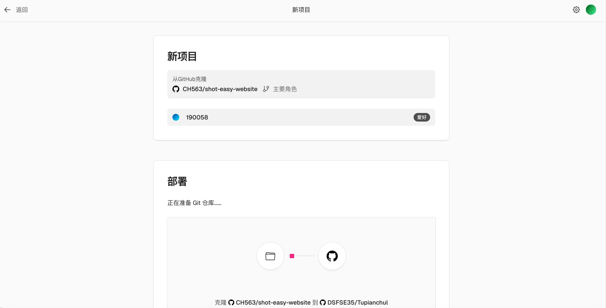

8.已经部署成功，再点击 **Continue to Dashboard**去处理项目

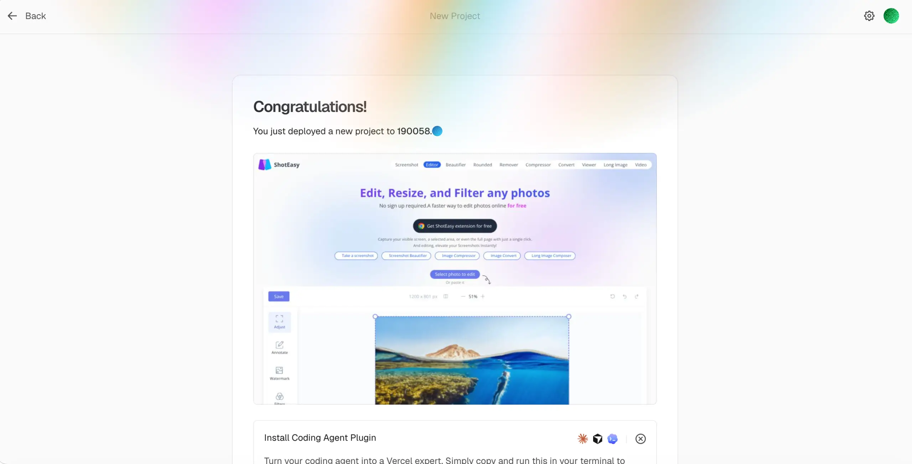

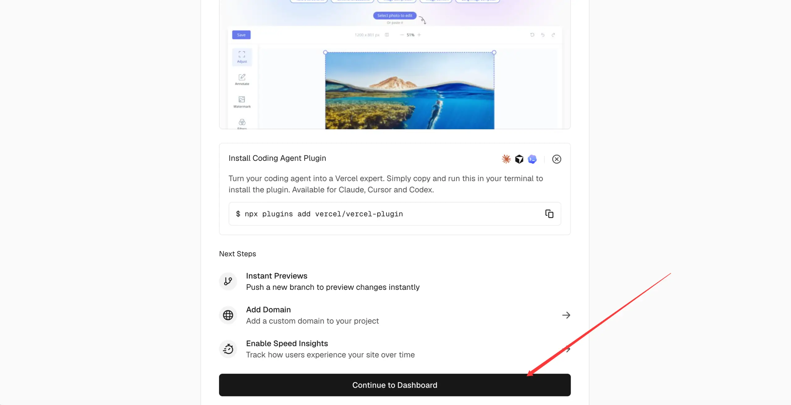

9.可以看到平台免费分配我们的域名（**点击可以看到搭建成功的项目**），如果自定义域名点击**添加按钮**

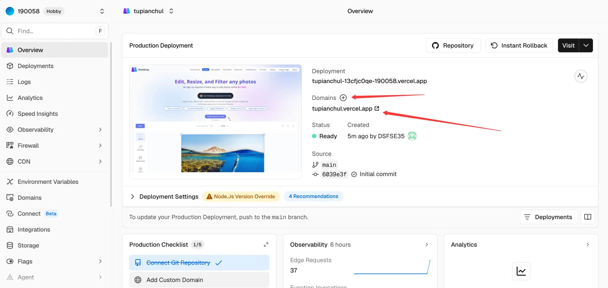

10.**自定义域名**，**添加现有**→输入你的**域名**→点击**添加域

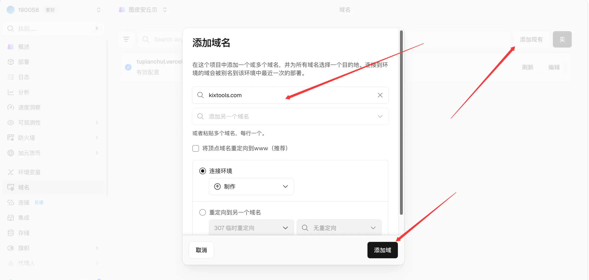**

11.点击**了解更多**，就可以拿到**记录值**了。最后到你**域名平台添加解析**即可

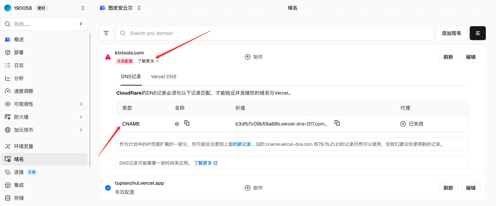
