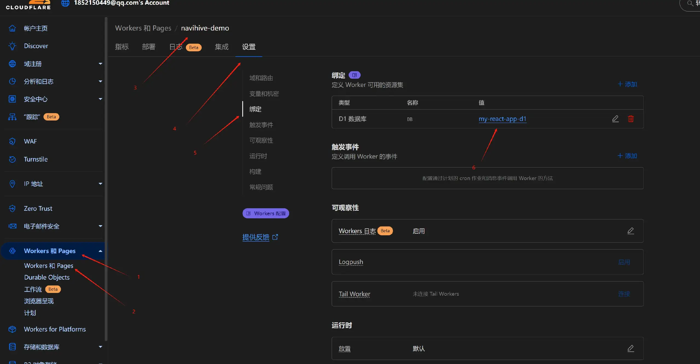
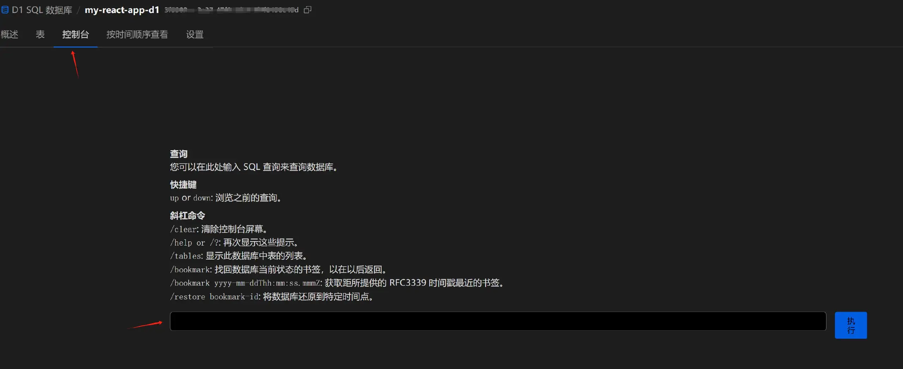

这款 **NaviHive** 用 Cloudflare Workers 做导航站，**不花钱、全球加速、支持拖拽分组和访客模式**， 个人网址收藏，管理学习资源，导航站，团队共享常用工具链接内容创作者的资源汇总主页免费搭建自己的网站入口中心

1.项目地址：[点击这里](https://github.com/qq8099/daihang)

2.原项目项目地址：[点击这里](https://github.com/zqq-nuli/Cloudflare-Navihive)

### 一键部署方法（推荐小白用户）

最简单的部署方式是使用一键部署功能：

1.fork本仓库，修改**wrangler.template.jsonc**为**wrangler.jsonc**  
2.点击上方的”**Deploy to Cloudflare Workers**“按钮  
3.登录您的 Cloudflare 账号  
4.在部署界面上，您需要配置以下内容：  
项目名称：为您的导航站项目取个名字  
D1 数据库：点击”创建新数据库”，命名为navigation-db  
环境变量：  
**AUTH_ENABLED**：设置为**true**启用登录认证  
**AUTH_USERNAME**：管理员用户名  
**AUTH_PASSWORD**：管理员密码  
**AUTH_SECRET**：JWT 密钥（使用随机字符串）  
5.点击”部署”  
6.按钮部署完成后，您将获得一个类似**https://your-project-name.username.workers.dev**的网址，这就是您的导航站地址。

初始化项目数据库

进入”**Workers & Pages**“部分  
选择您刚刚部署的项目  
在**左侧菜单**中点击”设置” > “**数据库**“，您将看到已绑定的数据库（名为”**navigation-db**“）  
点击数据库名称以进入数据库管理界面：



在数据库管理界面，点击”控制台”选项卡进入SQL编辑器  
在SQL编辑器中，逐个复制并粘贴以下**SQL命令**：

**— 创建分组表**

```
CREATE TABLE IF NOT EXISTS groups (
    id INTEGER PRIMARY KEY AUTOINCREMENT, 
    name TEXT NOT NULL, 
    order_num INTEGER NOT NULL, 
    created_at TIMESTAMP DEFAULT CURRENT_TIMESTAMP, 
    updated_at TIMESTAMP DEFAULT CURRENT_TIMESTAMP
);
```

**— 创建站点表**

```
CREATE TABLE IF NOT EXISTS sites (
    id INTEGER PRIMARY KEY AUTOINCREMENT, 
    group_id INTEGER NOT NULL, 
    name TEXT NOT NULL, 
    url TEXT NOT NULL, 
    icon TEXT, 
    description TEXT, 
    notes TEXT, 
    order_num INTEGER NOT NULL, 
    created_at TIMESTAMP DEFAULT CURRENT_TIMESTAMP, 
    updated_at TIMESTAMP DEFAULT CURRENT_TIMESTAMP, 
    FOREIGN KEY (group_id) REFERENCES groups(id) ON DELETE CASCADE
);
```

**— 创建配置表**

```
CREATE TABLE IF NOT EXISTS configs (
    key TEXT PRIMARY KEY,
    value TEXT NOT NULL,
    created_at TIMESTAMP DEFAULT CURRENT_TIMESTAMP,
    updated_at TIMESTAMP DEFAULT CURRENT_TIMESTAMP
);
```

**— 设置初始化标志**

```
INSERT INTO configs (key, value) VALUES ('DB_INITIALIZED', 'true');
```

点击”运行”按钮执行SQL命令：



如果SQL命令执行成功，您将看到”**查询成功**“的提示**信息**

至此，**数据库初始化完成**，您可以访问您的导航站首页并使用配置的**管理员账号登录**
