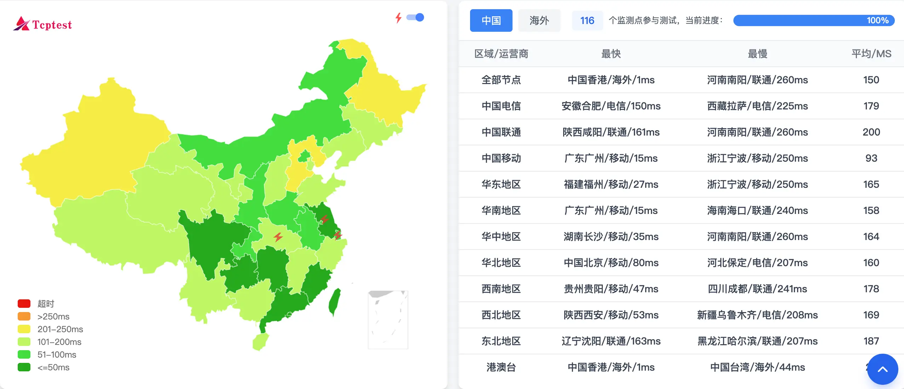
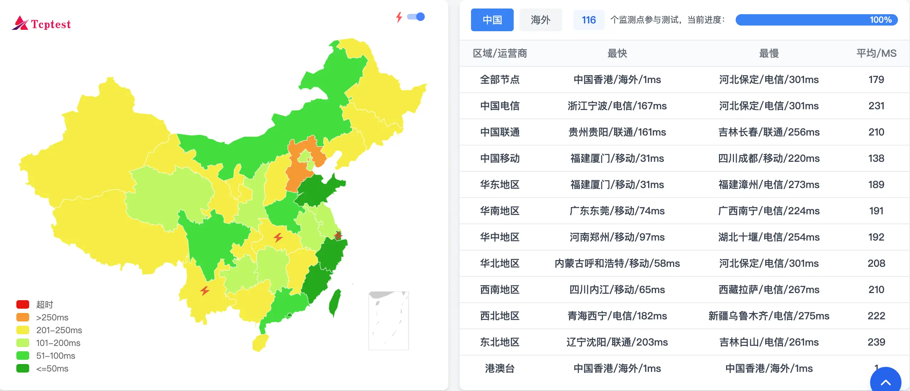
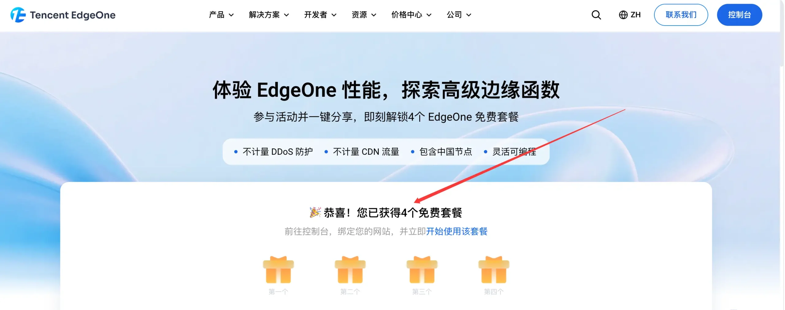

## **网站速度慢，可能不是服务器的问题，而是缺少 CDN**

很多个人站长都有一个误区：

网站打开慢，就想着升级服务器。

换更高配置 CPU、更大内存、更贵带宽。

但实际上，很多时候影响访问速度的关键因素是：

**用户距离服务器太远。**

比如你的服务器在美国、日本，国内用户访问时，需要经过较长网络路径。

这时候 CDN 的作用就体现出来了。

CDN 会把网站内容缓存到全球边缘节点。

用户访问时：

不需要连接你的源服务器，

而是直接从最近节点获取内容。

速度会明显提升。

---

# **两个免费 CDN 选择：Cloudflare VS 腾讯 EdgeOne**

目前个人站长常用的免费 CDN 主要有两个：

## **1. Cloudflare**

Cloudflare 是全球非常知名的 CDN 服务。

优势：

✅ 全球节点覆盖广  
✅ 免费 HTTPS  
✅ 免费 DNS  
✅ 基础安全防护  
✅ 适合海外用户访问

很多 GitHub 项目、个人博客、海外网站都会使用。

不过它的问题也比较明显：

国内访问速度受到线路影响，不同地区体验差距较大。

---

## **2. 腾讯 EdgeOne**

腾讯 EdgeOne 是腾讯推出的新一代边缘加速服务。

对于中文网站和国内用户来说，非常值得关注。

它最大的优势：

### **免费套餐支持 4 个域名永久使用**

对于个人开发者来说非常实用。

例如：

- 博客网站
- 工具网站
- AI 网站
- 导航网站

多个项目都可以接入 CDN。

---

# **实测访问速度对比（未备案全球境外，都没优选ip）**

# **如果域名备案腾讯 EdgeOne CDN不是一般的快，简直就🚀一样。**

我分别测试了：

Cloudflare CDN和腾讯 EdgeOne CDN

测试结果：

Cloudflare：平均延迟约 179ms

腾讯 EdgeOne：平均延迟约 150ms

从全国节点分布来看：

Cloudflare 在海外访问优势明显。

腾讯 EdgeOne 在国内访问表现更加稳定。

**腾讯EdgeOne：**

**cloudflare：**

# **没备案域名可以使用吗？**

很多人认为：

国内 CDN 必须备案。

其实并不是所有场景如此。

如果你的网站面向全球用户：

使用全球加速方案，

没有备案域名也可以接入。

这对于：

海外服务器

个人项目

开源网站

非常方便。

---

# **个人站长应该怎么选？**

其实不用纠结。

根据用户来源选择：

### **用户主要来自海外：**

选择：

Cloudflare

适合：

- 英文网站
- GitHub 项目
- 海外工具

---

### **用户主要来自国内：**

选择：

腾讯 EdgeOne

适合：

- 中文博客
- 工具站
- AI 网站
- 导航网站

---

# **更好的方案：两个一起用**

现在很多站长会采用：

国内用户 → EdgeOne

海外用户 → Cloudflare

这样可以同时获得：

✅ 全球访问速度  
✅ 免费 CDN  
✅ HTTPS 安全  
✅ 降低服务器压力

---

**腾讯 EdgeOne国际站四个永久免费套餐领取。无需要实名。**

**注册地址：[https://edgeone.ai/get-free-plan](https://edgeone.ai/get-free-plan)**

# **总结**

以前网站加速是企业才考虑的问题。

现在免费 CDN 的出现，让个人站长也能用上专业级加速服务。

Cloudflare 解决全球访问。

腾讯 EdgeOne 解决国内访问体验。

特别是 EdgeOne 免费 4 个域名永久套餐，对于拥有多个网站的开发者来说，非常值得尝试。

一个域名、一台服务器、一个免费 CDN，

就能搭建一个高速稳定的网站。

---

> 本文转载整理自 [Ai星码博客](https://aixmb.com/408.html)，版权归原作者所有。

