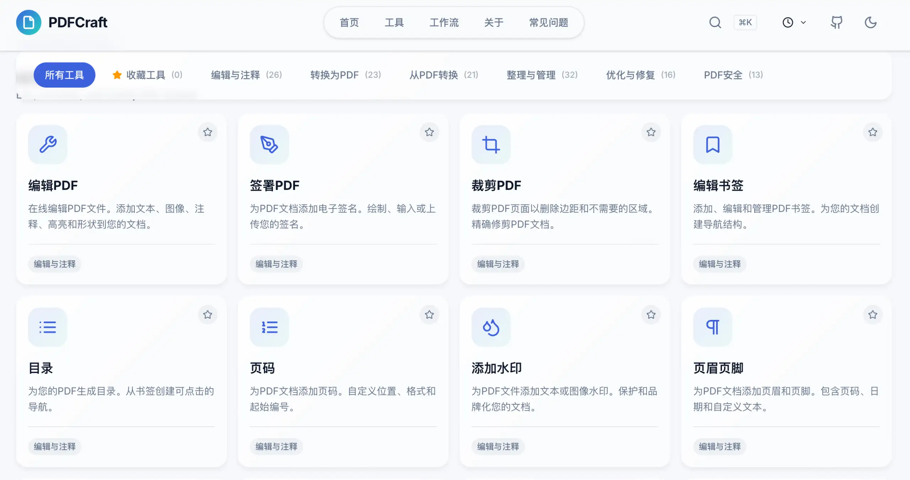
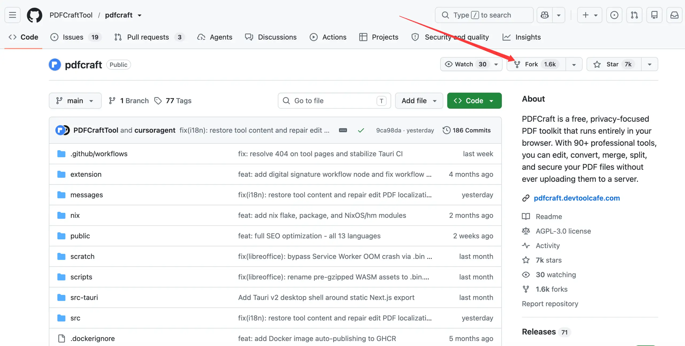
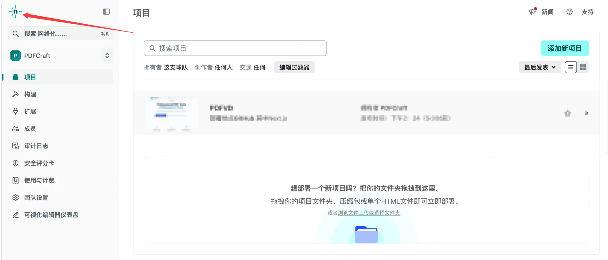
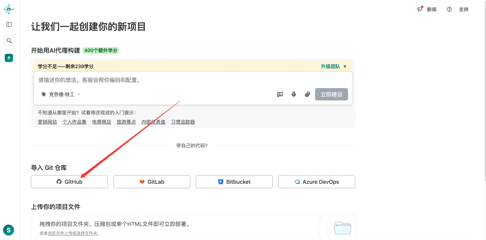
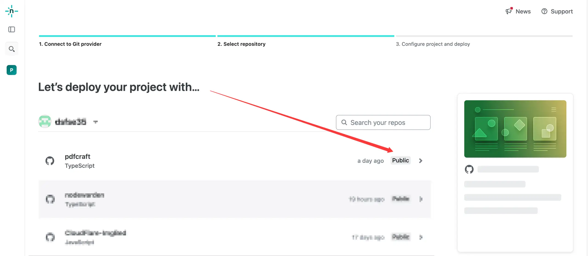
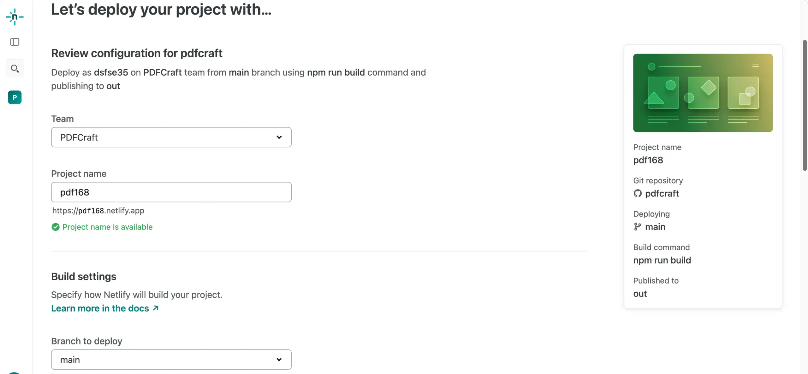
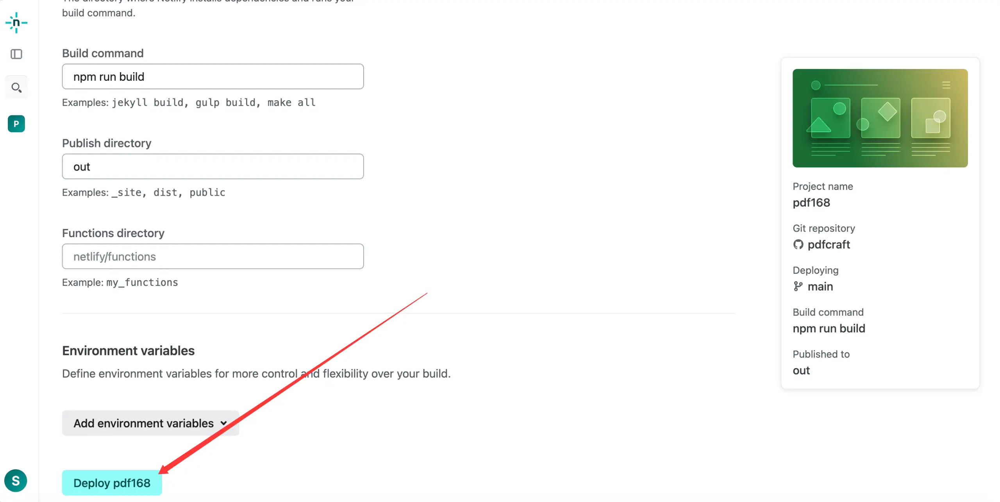
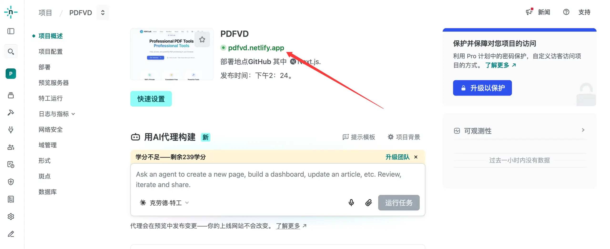
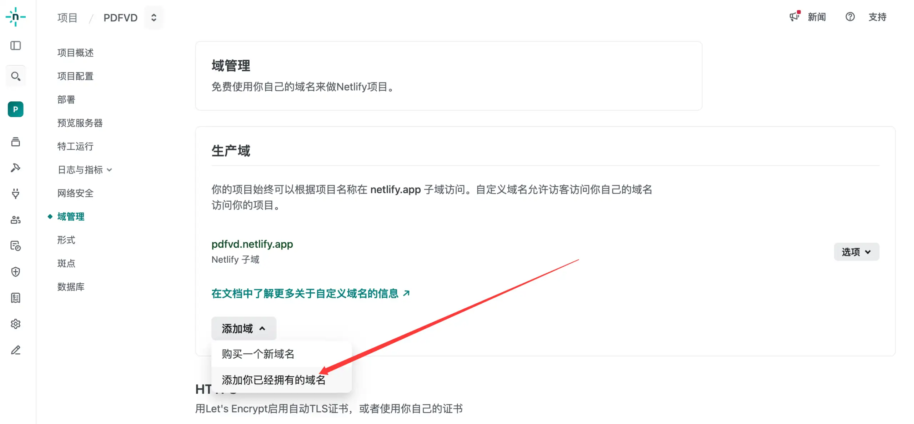

在日常办公、学习、内容运营中，PDF几乎是绕不开的格式：  
合并文件、拆分页面、压缩体积、提取内容、甚至简单编辑，都非常高频。

但现实是——

👉 很多PDF工具要付费  
👉 在线工具上传文件有隐私风险  
👉 本地软件安装复杂、占内存  
👉 跨平台体验差（手机/电脑不一致）

今天介绍一个非常适合“轻量化工具站搭建”的开源项目：  
**pdfcraft**



**演示站：[https://pdf.kixtools.com](https://pdf.kixtools.com)**

它的核心理念很简单：  
**把PDF处理能力搬进浏览器，让文件不再“上传到别人服务器”。**

---

# **📌一、PDFCraft到底解决了什么问题？**

PDFCraft 本质上是一个**前端PDF处理工具集合（Web化工具平台）**，目标是：

## **1️⃣ 解决隐私焦虑**

传统在线PDF工具需要上传文件：

- 上传服务器 → 处理 → 再下载
- 文件内容不可控
- 存在泄露风险

👉 PDFCraft的思路是：  
**尽可能在浏览器本地处理（Client-side）**

文件不出电脑，更安全。

---

## **2️⃣ 解决“工具碎片化”问题**

很多人处理PDF需要：

- 一个网站合并PDF
- 一个网站压缩PDF
- 另一个网站转格式

👉 PDFCraft尝试做的是：

✔ 一个站点  
✔ 多种PDF能力集合  
✔ 一站式处理体验

---

## **3️⃣ 解决部署成本问题（对开发者特别重要）**

传统工具站需要：

- 后端服务器
- 文件存储
- 转换服务
- 带宽成本

而 PDFCraft 这种项目通常支持：

👉 **纯静态部署（Vercel / Netlify / CDN）**  
👉 **零服务器成本运行**  
👉 **适合做工具站SEO流量**

---

# **⚙️二、PDFCraft可能具备的核心能力**

（具体功能以项目实现为准，这类工具通常包括以下方向）

## **📄 PDF基础处理**

- PDF合并（Merge）
- PDF拆分（Split）
- 页面提取
- 页面排序调整

## **📦 文件优化**

- PDF压缩
- 图片降质量
- 文件体积优化

## **🔄 格式转换**

- 图片转PDF
- PDF转图片
- 文档转换（部分扩展）

## **🖊️ 编辑增强（部分版本）**

- 添加水印
- 简单标注
- 页面旋转

👉 这些功能组合起来，就构成一个“轻量版在线Adobe工具箱”。

---

# **💡三、PDFCraft的核心优势（重点）**

## **⚡1. 浏览器本地化处理（很关键）**

相比传统工具：

| **模式** | **文件是否上传** | **风险** |
| --- | --- | --- |
| 传统在线工具 | 是 | 中高 |
| PDFCraft类工具 | 尽量否 | 低 |

👉 对用户来说最大的价值就是：**安心**

---

## **🚀2. 可零成本部署（适合做流量站）**

如果你是：

- 做导航站的人
- 做工具站的人
- 做SEO流量的人

PDFCraft非常适合：

✔ Vercel部署  
✔ Netlify部署  
✔ GitHub Pages扩展

👉 不需要服务器，也能跑工具站

---

## **🌍3. 天然适合SEO**

PDF工具是典型的“搜索型需求”：

用户会搜：

- “PDF合并免费”
- “PDF压缩在线”
- “PDF转图片工具”

👉 每一个功能页都可以做SEO入口

这类项目特点：

🔥 流量稳定🔥 长尾词多🔥 用户精准🔥 广告变现能力强

---

## **🧠4. 易二次开发（适合技术用户）**

开发者可以：

- 增加新PDF工具模块
- 接入AI处理能力
- 做UI二开工具站
- 做SaaS版本

👉 非常适合做“工具创业原型”

---

# **📊四、适合哪些人使用？**

## **👨‍💻开发者**

- 想做工具站练手.想做副业项目.想做SEO网站

## **📈站长/SEO玩家**

- 做流量站做.广告变现站.做联盟营销

## **🧑‍🎓普通用户**

- 临时处理PDF.不想安装软件.不想注册登录

---

# **🔥五、为什么说它适合“轻创业项目”？**

现在很多成功的独立站，本质就是：

👉 一个功能 + 一个关键词 + 一批流量入口

PDFCraft刚好满足：

- 功能刚需（PDF处理）
- 搜索量大（全球需求）
- 技术门槛低（可部署）
- 成本几乎为0

💡 甚至可以这样组合：

- PDF工具站 + 广告（AdSense）
- PDF工具 + 会员功能
- PDF工具 + API服务

---

# **🧭六、总结**

pdfcraft 的价值不只是“做PDF工具”，而是：

👉 给你一个“低成本工具站模板”  
👉 一个可以做SEO流量的入口  
👉 一个可以扩展的轻量SaaS原型

如果你正在做：

- 工具类网站
- SEO流量站
- 或想找一个能落地的副业项目

这个项目非常值得研究。

---

# **🚀一句话总结：**

**PDFCraft = 浏览器端PDF工具 + 零成本部署 + SEO流量入口的组合型开源项目**

# **七.搭建教程：**

1.fork项目自己账号的库。

```
https://github.com/PDFCraftTool/pdfcraft
```



2.进入netlify网站注册登陆账号。

```
https://netlify.com/
```


3.登陆账户后回到首页。



4.授权自己的github账号。



5.找到刚刚fork的项目点击public下一步



6.给该项目 project name 名称，不**重复名称**即可。



7.其他配置全部保持默认，会自动识别需要的构建环境。  



8.静静等待3-5分钟，系统会自动构建完成。然后可以看到系统给我们分配的域名。进入访问



9.如后要自定义域名点击域名管理，绑定解析自定义域名即可。



---

> 本文转载整理自 [Ai星码博客](https://aixmb.com/43.html)，版权归原作者所有。

