建站这件事，困扰过非常多新手站长。

想要搭建个人博客，传统方案总会遇到各种痛点：

- 自建网站必须购买 VPS，每月固定支出，闲置依旧扣费；
- 市面上靠谱虚拟主机年费动辄几百元，长期使用成本很高；
- Cloudflare Pages 仅能部署静态项目，无法运行 PHP 程序；
- 部署 WordPress、PHP 程序配置繁琐，环境适配问题劝退大量新手。

今天给大家分享一个被很多人低估的托管平台 ——Wasmer，依托 WebAssembly 技术，提供永久免费托管环境，可以流畅运行 WordPress、PHP、Python 等项目，搭配人气极高的 Argon 主题，零成本搭建高质量个人博客，普通建站爱好者一定要试一试Wasmer。

## 一、Wasmer 到底是什么？

Wasmer 是拿到 Y‑Combinator 投资、深耕 WebAssembly 边缘计算的平台，通俗来讲，它集合了**Vercel 的部署便捷性 + Cloudflare 全球 CDN + 传统虚拟主机运行环境**，三者优势融为一体，依托边缘节点实现毫秒级启停应用。

### Hobby 免费套餐含金量很高

官方 Hobby 免费计划全部长期可用：

1. 永久免费使用；
2. 每月 150GB 全球 CDN 流量；
3. 每月 100 Compute Hours 计算时长；
4. 全球节点加速、自动签发 SSL 证书；
5. 支持 GitHub 一键部署、自定义域名；
6. 最多能够部署 3 个独立项目。

很多站长会产生疑问：100 个计算小时，是不是网站运行满 100 小时就会关停网站？这里一定要理清 Wasmer 的运行逻辑，它和传统 VPS 完全不一样。

常规服务器只要开机就持续消耗资源，哪怕全天没人访问，服务器资源照样消耗；Wasmer 采用按需调度机制，无人访问时应用休眠，几乎不会占用计算时长；只有访客打开网站时程序才启动执行，平台毫秒级完成暂停与唤醒，计算时长仅统计程序实际运行时间Wasmer。

对于日均几百至几千访问量的个人博客，每月 100 小时的计算额度完全够用，绝大多数个人站长根本消耗不完免费额度。

## 二、适配 Wasmer 可部署的项目清单

1. **WordPress 博客（首选）**

   官方内置 WordPress 快速部署模板，搭配开源热门的 Argon 主题，适配技术博客、个人随笔博客、企业官网、资源分享站点，美观度、加载速度双双在线Wasmer。

   这里重点说下 Argon 主题，它是 WordPress 圈子口碑极佳的免费开源主题，代码精简轻量化，移动端自适应效果优秀；内置日间、夜间模式，几十种配色方案、单栏 / 双栏布局自由切换，100 余项自定义配置选项，文章目录、代码高亮、SEO 标签、社交组件一应俱全，颜值和性能兼顾，适配 Wasmer 的边缘运行环境，不会出现主题臃肿拖垮网站速度的问题。
2. **PHP 全系列项目**

   原生 PHP 项目、Laravel、ThinkPHP、Typecho 等主流 PHP 程序全部兼容，不用手动配置 PHP 版本，平台底层自动适配运行环境。
3. **静态网站项目**

   Astro、Hugo、Next.js、Gatsby、Docusaurus 等前端静态框架，都可以借助 GitHub 仓库自动发布。

## 三、Wasmer 对比传统 VPS 的核心优势

1. **传统 VPS 模式**：按月付费固定开销，服务器 24 小时持续运行，哪怕全天 0 访客，服务器费用一分不少；后期访问量上来后，还需要额外花钱升级配置。
2. **Wasmer 托管模式**：无人访问几乎零资源消耗；流量上涨自动扩容；全球边缘节点分发；免费 HTTPS 证书；真正做到按需计费，访问量小几乎零成本。

## 四、哪些人群适合使用 Wasmer 建站

- 在校学生，零成本搭建个人博客、作品集网站；
- 建站新手，不想折腾服务器环境，避开繁琐配置；
- 个人博主、技术爱好者、资源分享站长；
- 网址导航站、小型企业官网；

  只要你的站点日访问量在几千以内，免费套餐完全足够长期使用。

## 五、总结

如果你一直在寻找免费 PHP 空间、免费 WordPress 托管、零成本搭建个人博客的方案，Wasmer 搭配 Argon 主题就是现阶段性价比极高的选择。

- 零服务器开支，免去 VPS 月租；
- 全球 CDN 加速，国内外打开速度优秀；
- 免费 SSL 加密，域名绑定简单；
- WordPress 完美兼容，Argon 主题美化之后网站高级感十足。

目前 Wasmer 的 Hobby 永久免费套餐政策稳定，还没有收紧限制，想要搭建博客的朋友趁早体验，白嫖高性能建站环境。

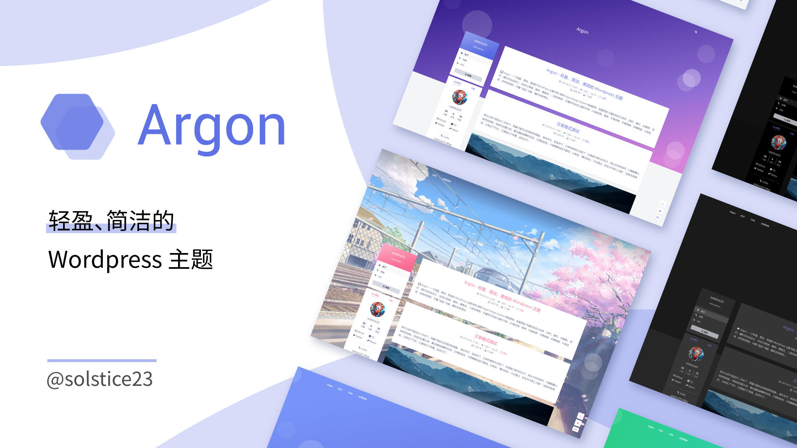

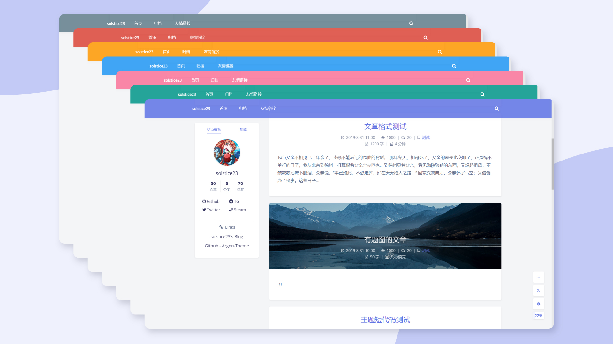

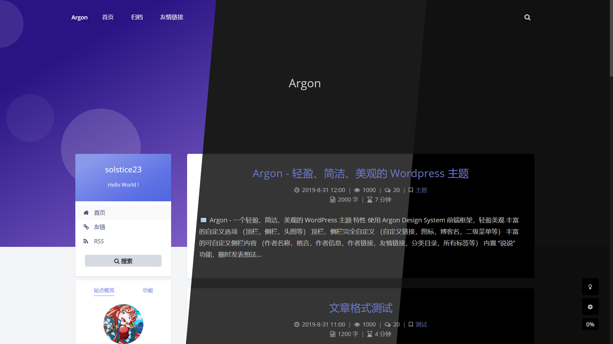

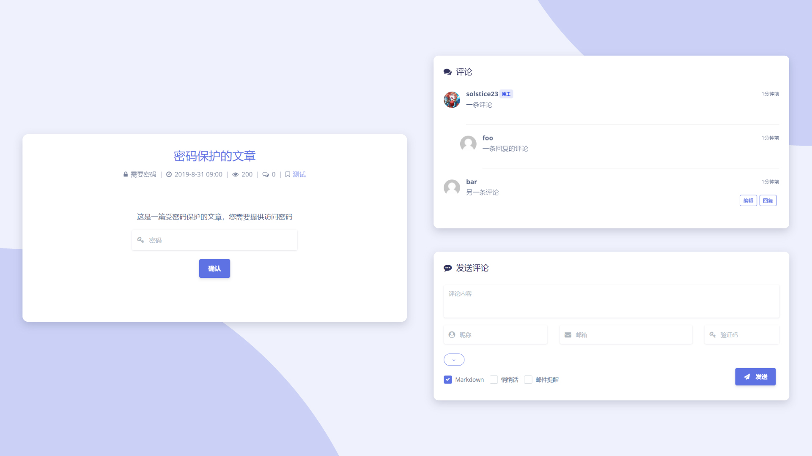

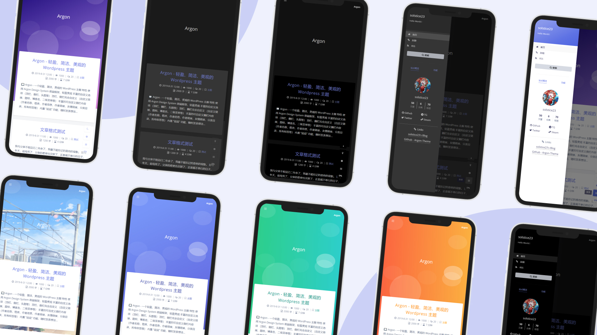

**argon主题项目地址：https://github.com/solstice23/argon-theme**

**国内网盘argon主题下载链接：https://pan.quark.cn/s/267c50773092**

**1.进入官网用邮箱注册一个账号。**

```
https://wasmer.io
```

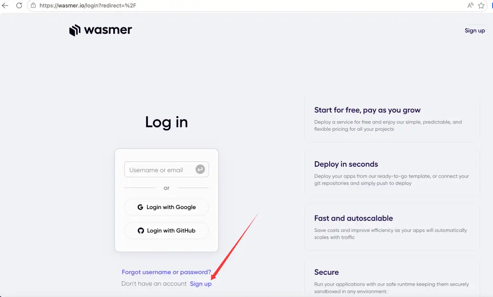

**2.这里我们选择第一个。**

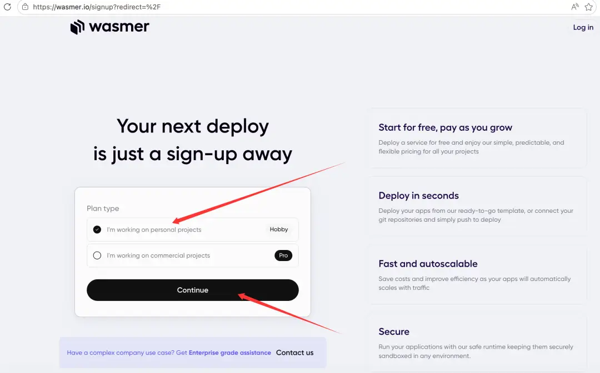

**3.输入用户名密码邮箱点击注册，点击注册后邮箱会收到确认信息，进入邮箱找到该确认信息确认。**

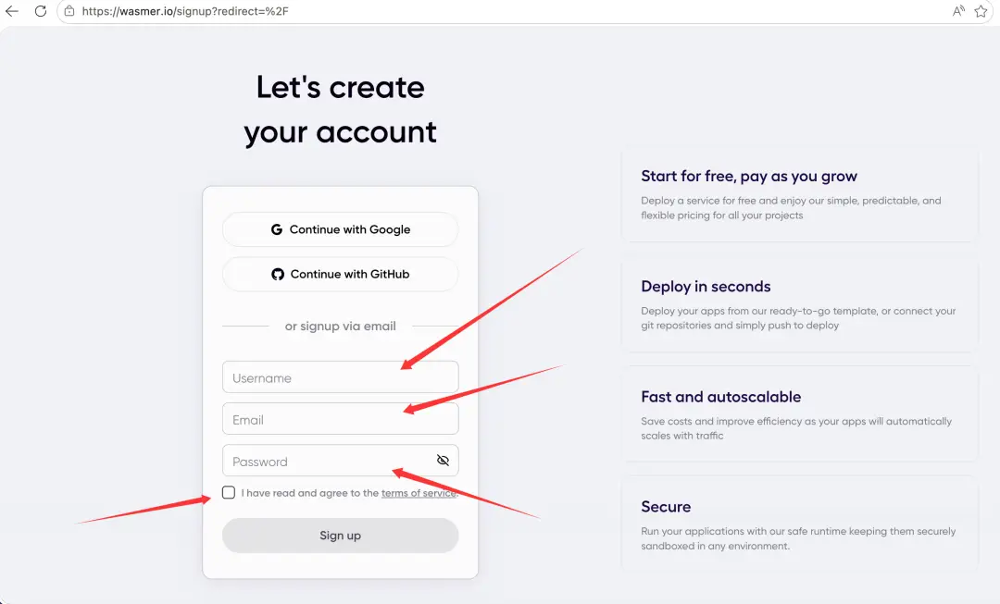

**4.注册成功后把网站翻译成中文，方便查看。**

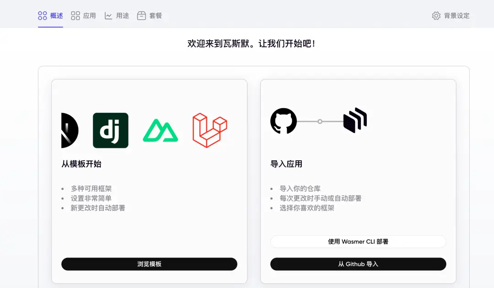

**5.选择应用模版wordpress。**

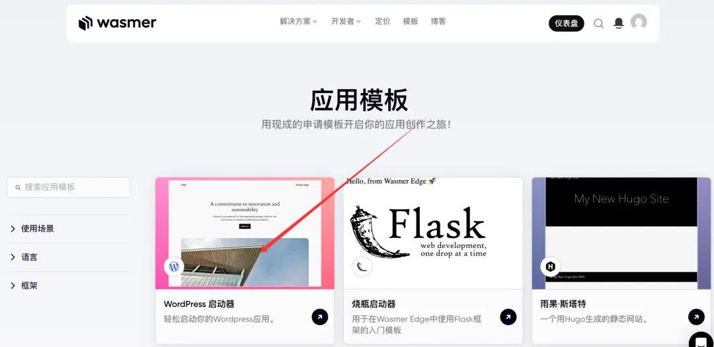

**6.点击部署按钮。**

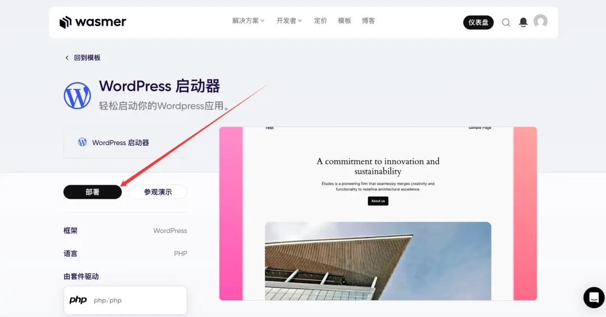

**7.服务器位置有法国和美国选择。保持默认点击立即部署即可。**

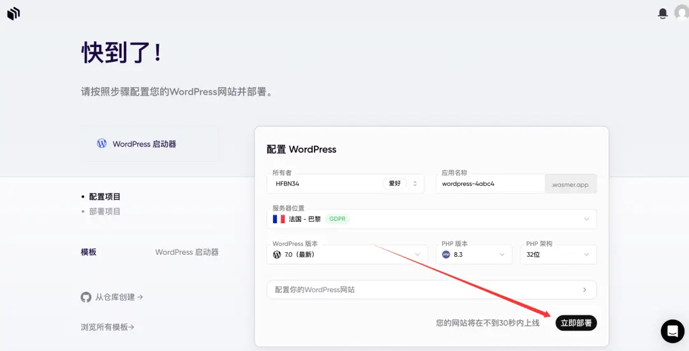

**8.等待几分钟即可完成。**

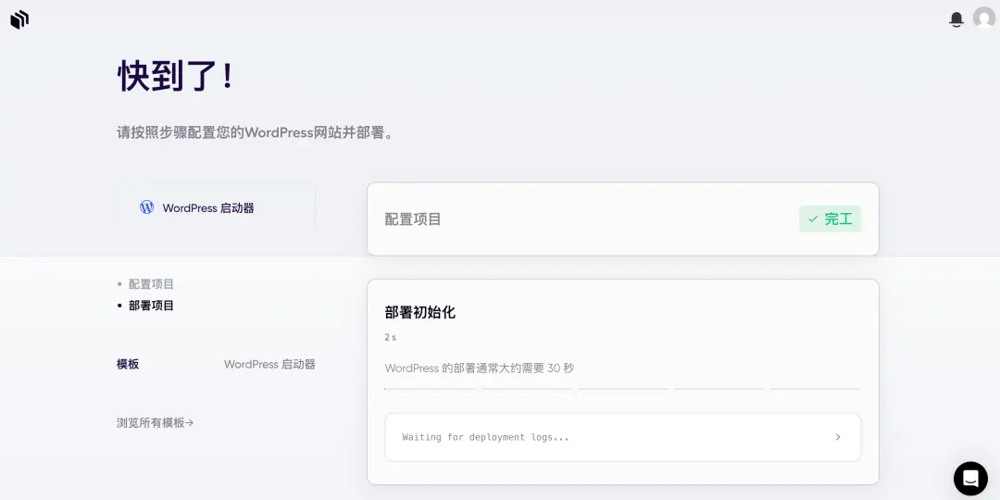

**9.可自由选择是否安装监控插件，建议安装，方便后台管理，博客登陆账号密码/配置自定义域名/等后台查看自己配置。**

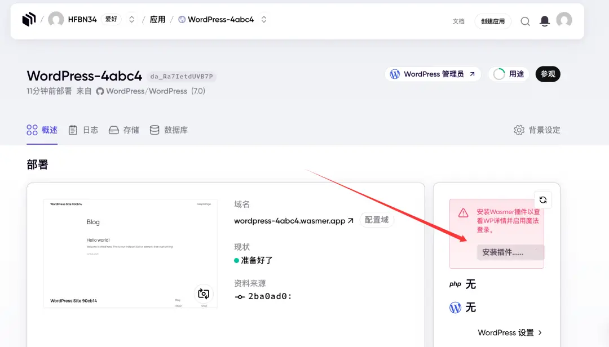

**10.第一次进博客后台把语言改简体中文。点击外观—主题—安装主题—上传argon主题。**

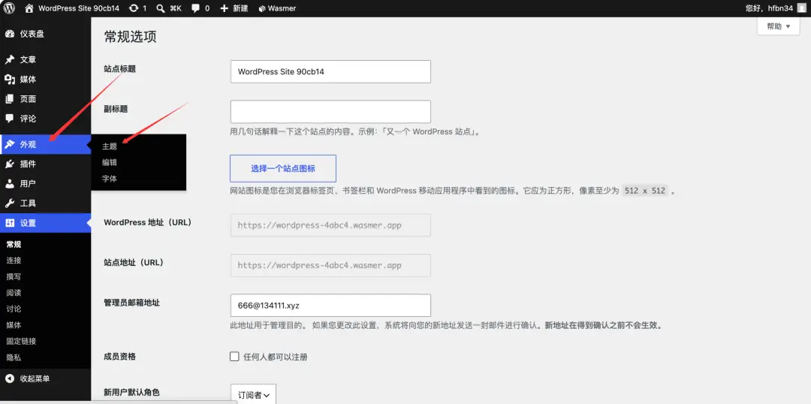

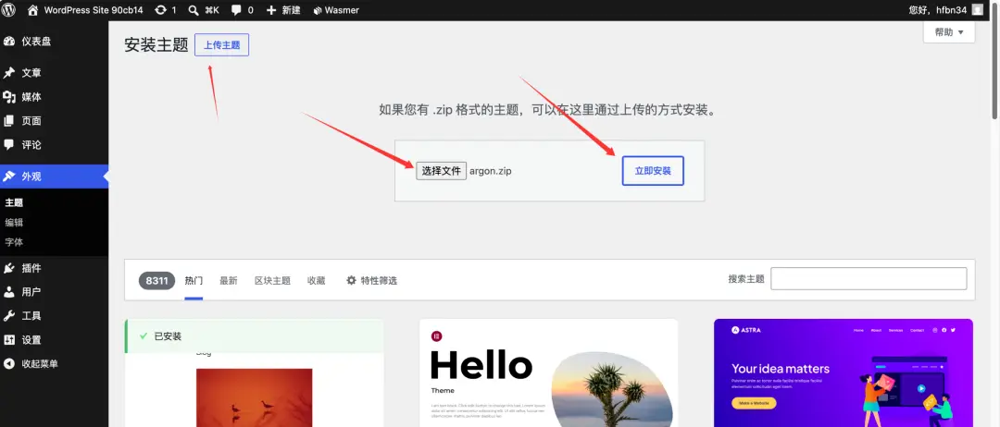

**11.等待上传完启用即可完全，尽情写你的博客吧。**

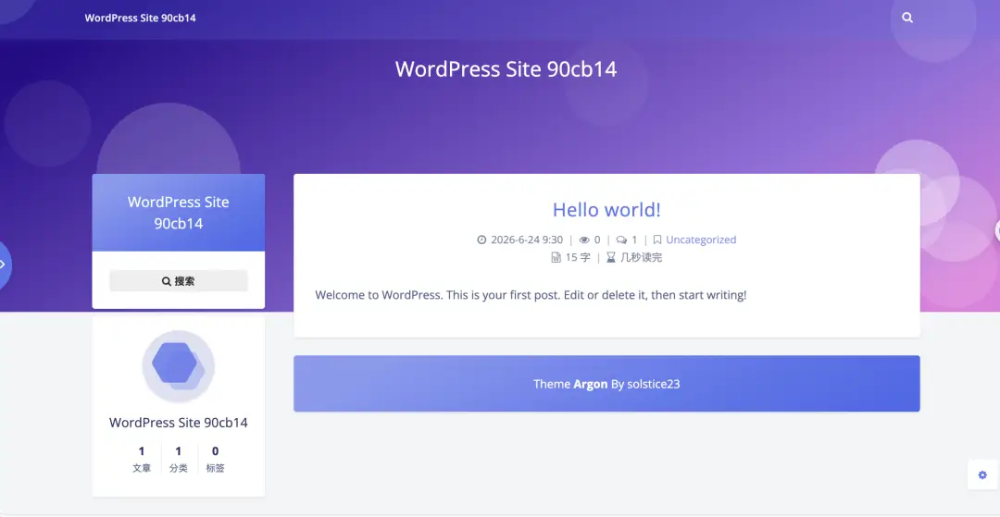
