还在用第三方短链接平台吗？

发个链接：  
广告一堆、速度慢、还可能突然失效。

尤其做公众号、社群、推广的时候，经常会遇到：

❌ 长链接太丑  
❌ 短链平台不稳定  
❌ 链接被封、跳广告  
❌ 数据不受自己控制  
❌ 想统计点击量还得付费

现在不管是：

👉 微信公众号  
👉 Telegram 社群  
👉 小红书引流  
👉 AI 工具导航  
👉 下载页跳转  
👉 海报二维码

一个稳定、干净、可控的短链接系统，已经越来越重要。

而今天这个开源项目 —— Sink，刚好能解决这些问题。

# **Sink 是什么？**

Sink 是一个：

✅ 开源免费  
✅ 无需服务器  
✅ 支持自定义域名  
✅ 支持 Cloudflare Workers / Pages 部署  
✅ 可自建的短链接系统

重点是：

不用 VPS。  
不用数据库。  
不用复杂环境。

只需要一个 Cloudflare 账号，几分钟就能部署完成。

# **Sink 最大优势：零成本**

传统短链系统：

❌ 买服务器  
❌ 配数据库  
❌ 做运维  
❌ 还可能需要备案

而 Sink：

直接基于 Cloudflare。

很多功能甚至可以免费使用。

对于个人站长、自媒体、副业玩家来说，非常香。

---

# **部署到底有多简单？**

Sink 最大特点就是：

轻量、简单。

基本流程：

1️⃣ Fork 项目  
2️⃣ 登录 Cloudflare  
3️⃣ 创建 Workers / Pages  
4️⃣ 绑定 GitHub  
5️⃣ 一键部署

几分钟即可上线。

真正实现：

不用服务器，也能拥有自己的短链接系统。

---

# **适合哪些人？**

### **公众号运营**

链接更简洁，二维码更美观。

---

### **社群运营**

后期换链接，不用重新发二维码。

---

### **做副业推广**

更专业，也更容易提升点击率。

---

### **AI 导航 / 工具站**

管理大量跳转链接会非常方便。

---

### **独立开发者**

低成本搭建自己的跳转系统。

---

# **为什么现在越来越多人用 Cloudflare？**

因为：

✔ 全球 CDN  
✔ 速度快  
✔ 免费额度高  
✔ 不需要维护服务器

以前部署项目：

Linux、Nginx、数据库一堆配置。

现在：

一个 Cloudflare 就够了。

这也是为什么越来越多开源项目，都开始支持 Workers 和 Pages。

---

# **最后**

Sink 最大的价值，不只是“短链接”。

而是：

让普通人也能低成本拥有自己的流量入口。

代码在自己手里，  
数据在自己手里，  
域名也是自己的。

真正做到：

自己掌控。

**后台仪表盘：**

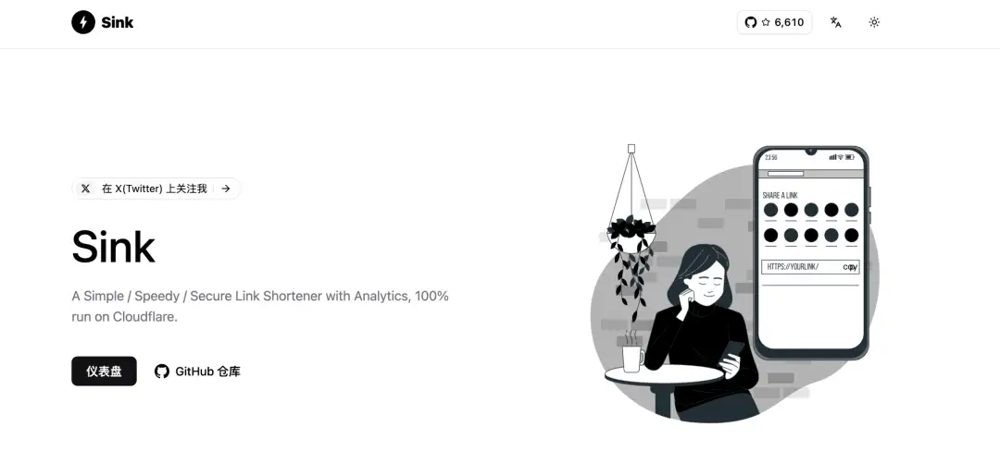

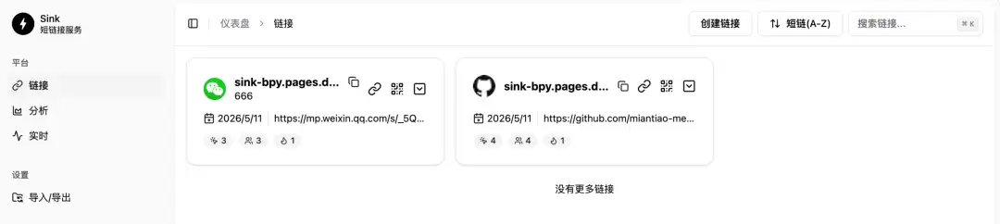

**后台用户数据分析：**

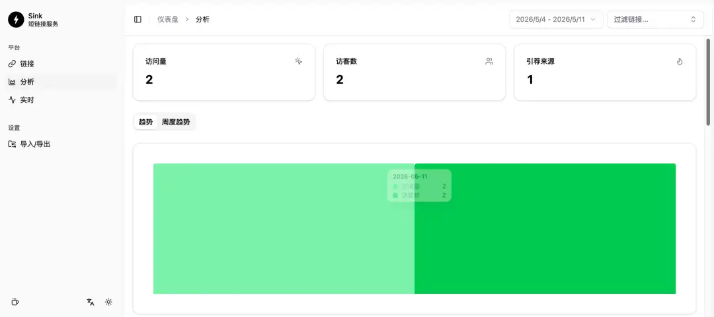

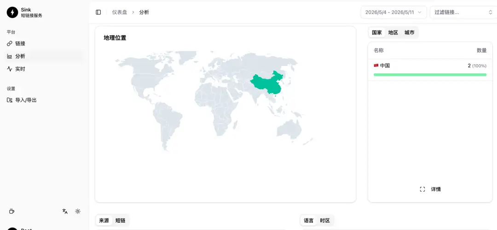

## **搭建教程：**

**打开项目GitHub地址，将代码Fork到自己的账号下。 项目地址**

```
https://github.com/miantiao-me/Sink
```

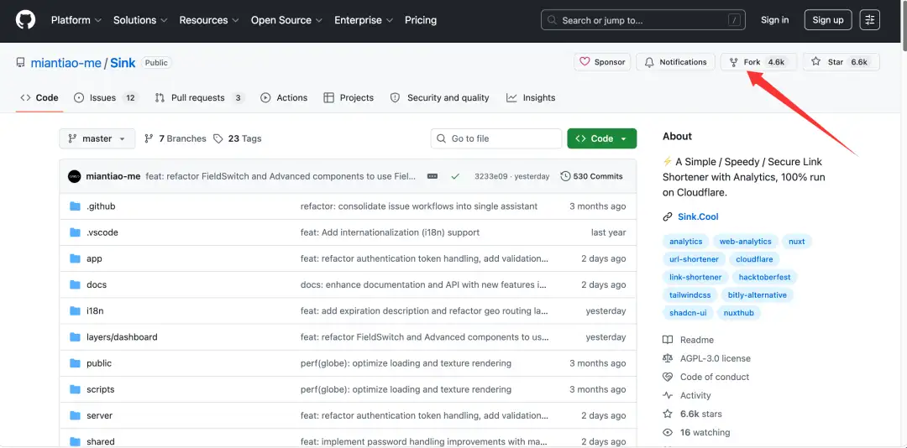

**登陆cloudflare，选择任意域名页面，右下角复制Cloudflare的账号ID，然后点击获取API令牌**

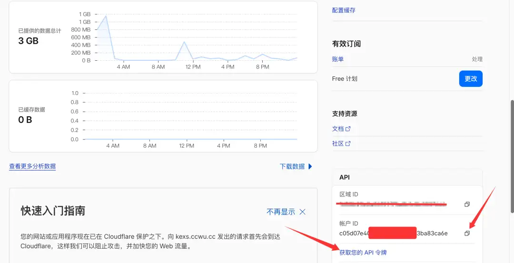

**创建令牌，选择使用阅读分析数据和日志模板。**

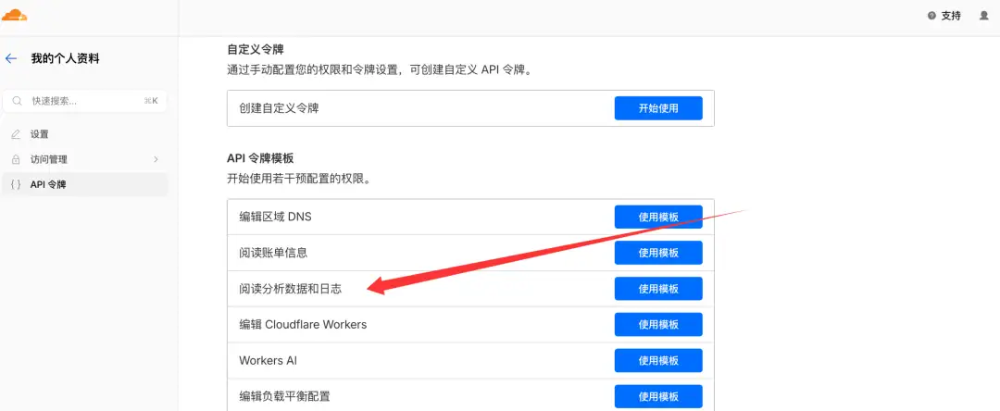

**创建成功后，即可得到API令牌，注意这里只显示一次，务必复制保存**

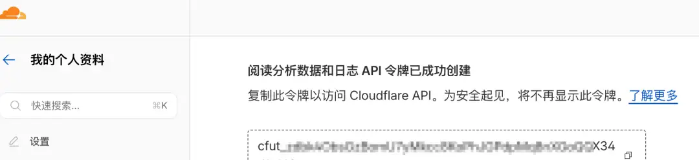

**进入“Workers和Pages”，再点击”创建应用程序“**

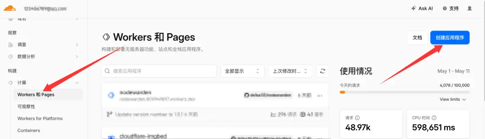

**点击最下方的”开始使用“，创建pages**

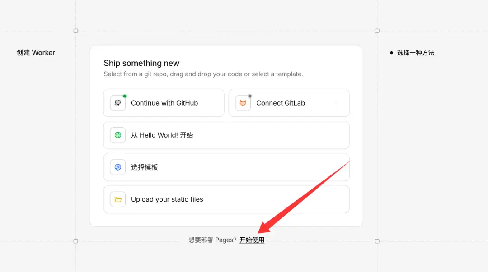

**导入自己GitHub的Git存储，选择刚刚fork的项目**

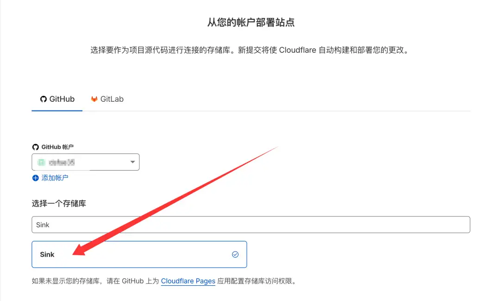

**框架预设选择 Nuxt.js 再添加三环境变量(视频的演示是直接部署再配置三个变量，一样的)**

**NUXT_SITE_TOKEN = 至少8位的密码，英文数字组合**

**NUXT_CF_ACCOUNT_ID = Cloudflare的账号ID**

**NUXT_CF_API_TOKEN = 刚才创建API令牌**

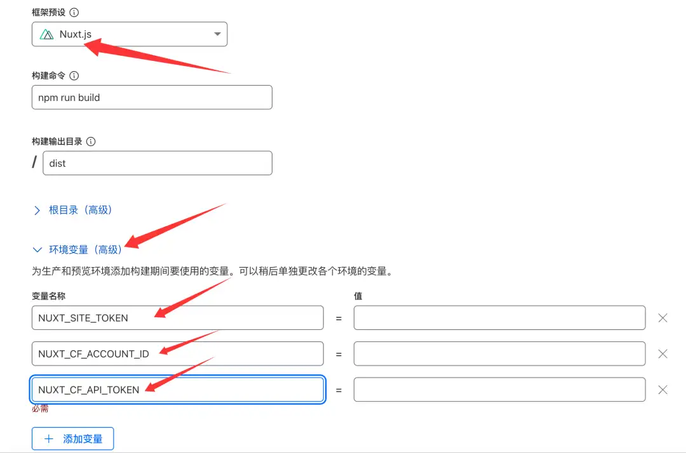

**保存并部署，第一次部署时会失败**

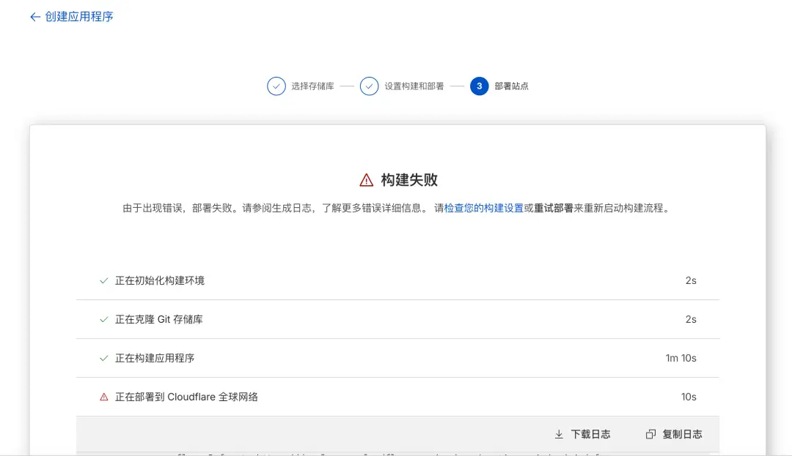

**返回sink项目，点击设置，兼容性标志填写 nodejs_compat**

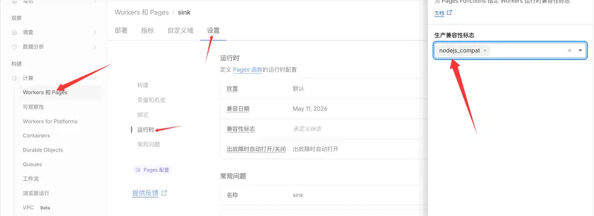

**再重新部署就成功了**

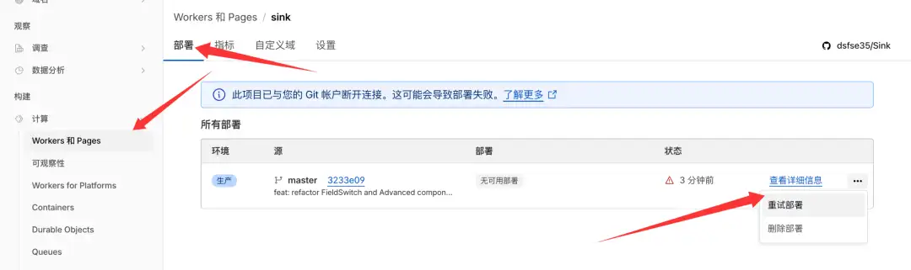

**创建KV空间，选择Workers KV，创建 KV 命名空间，名称sink**

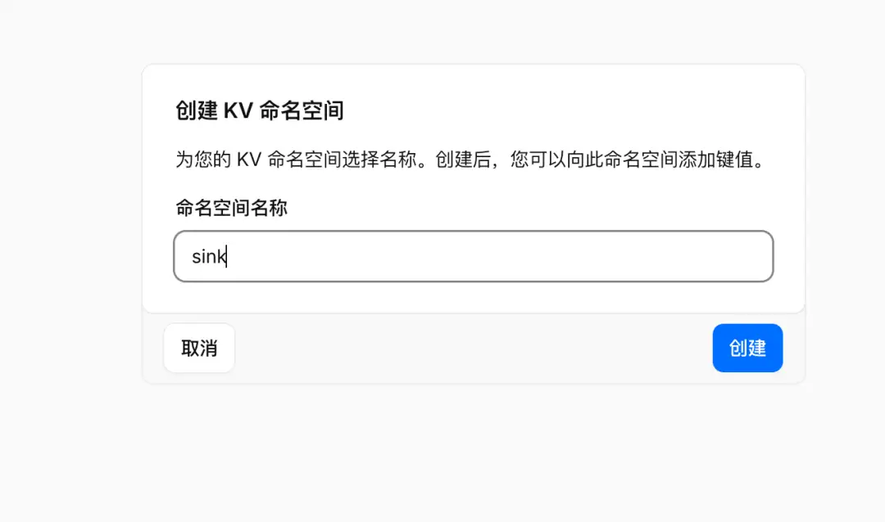

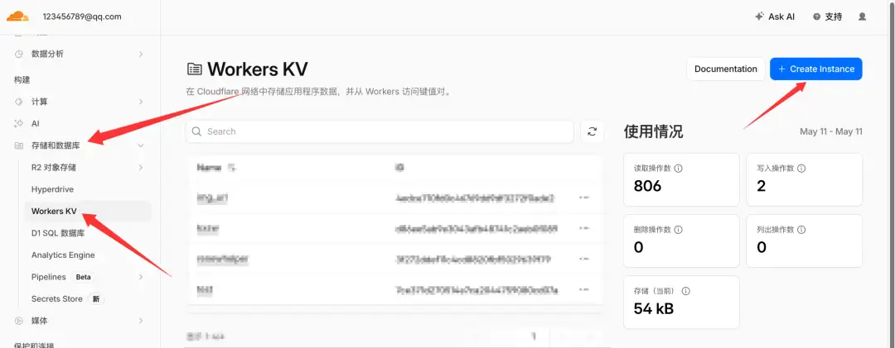

**创建 Analytics Engine，点击 Enable 启用**

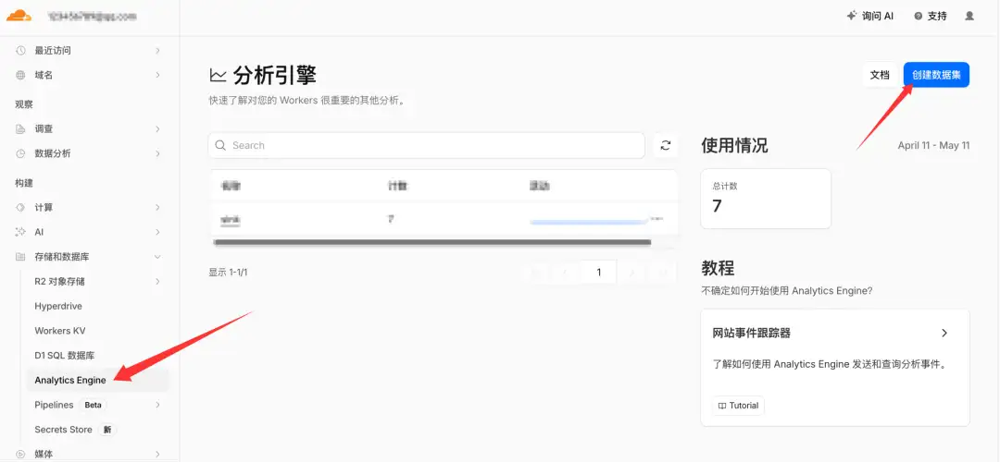

**数据库名填写 ANALYTICS，数据库绑定 填写 sink 注意：创建成功没有绑定会不显示**

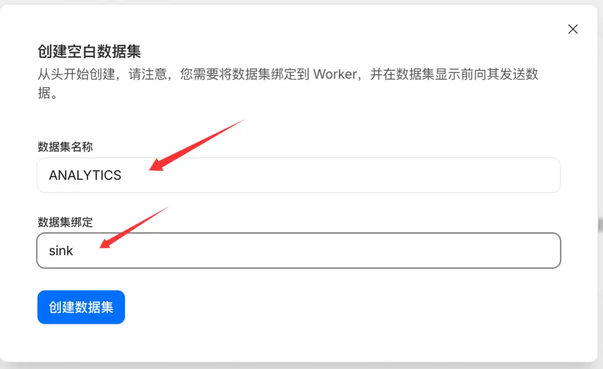

**返回项目设置，分别绑定 KV 命名空间 sink、Analytics Engine sink 以及 Workers AI 目录即可完成**

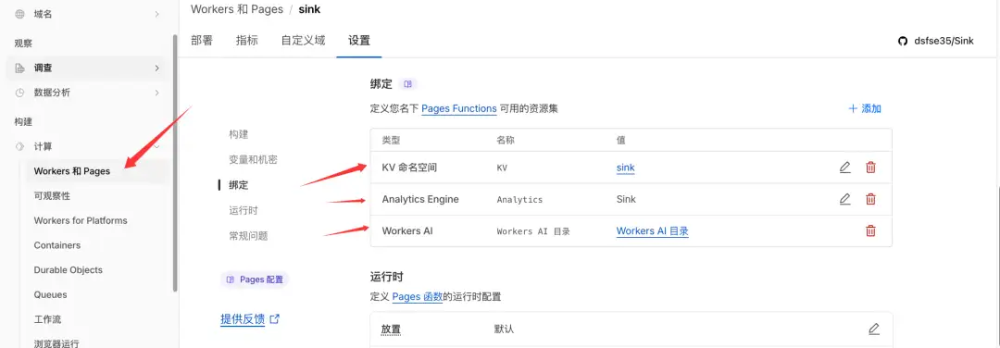

**添加自定义域名**

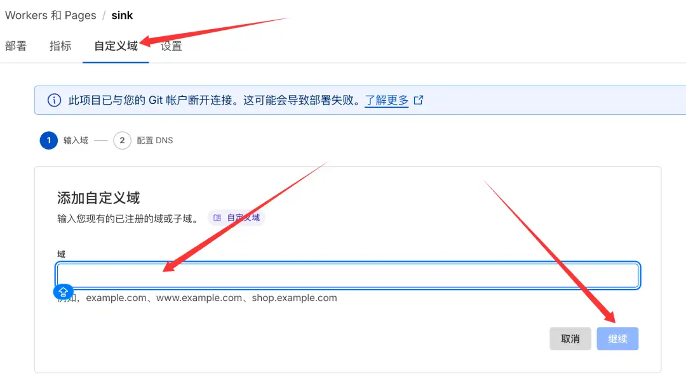

**通过访问自定义域名打开网页，进入仪表盘进行输入密码后台设置**


