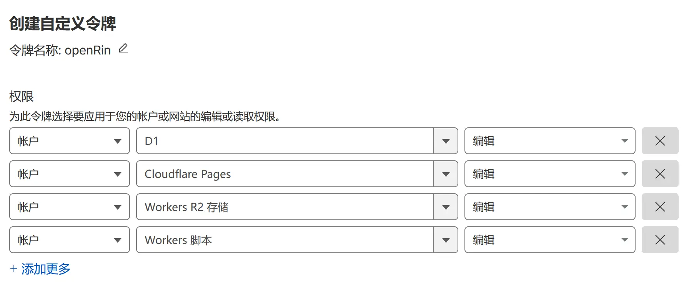
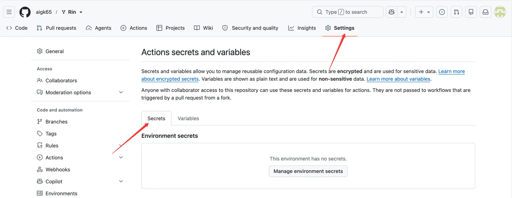
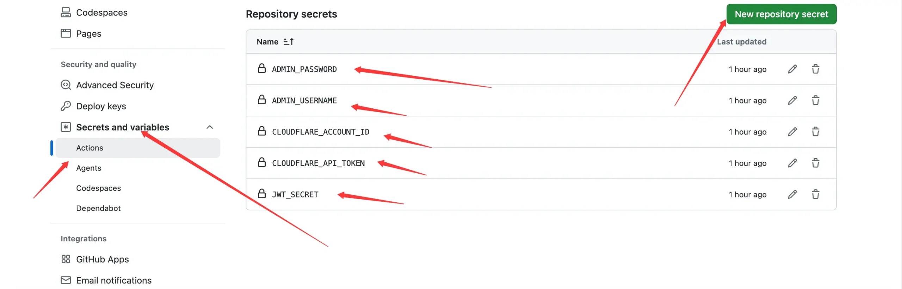
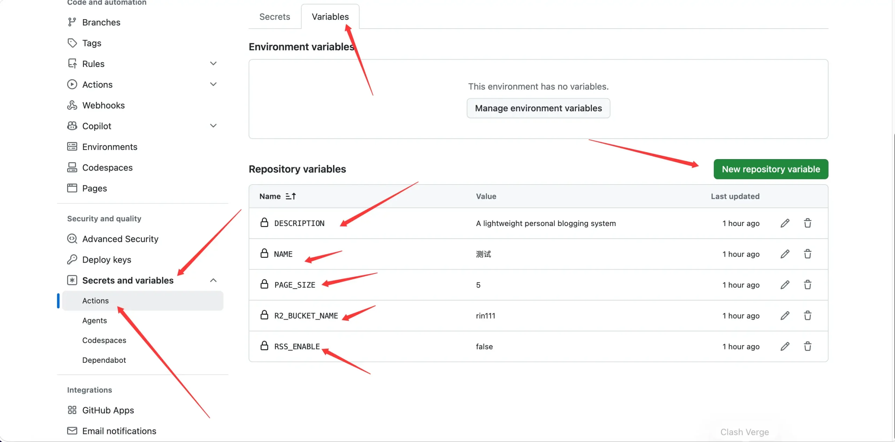
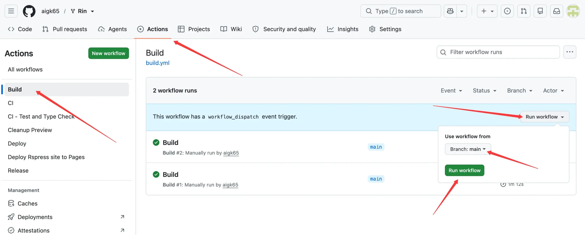

很多人都想拥有一个属于自己的博客：

✍️ 写技术文章  
📚 记录学习笔记  
🌐 分享开源项目  
💡 打造个人知识库

但是传统博客经常遇到这些问题：

❌ 买服务器，每个月都有成本  
❌ 配置环境复杂，新手容易踩坑  
❌ WordPress 插件太多，网站越来越慢  
❌ 数据迁移、维护、安全都很麻烦

明明只是想写文章，最后却变成了“维护服务器”。

有没有一种方式？

不用买服务器，也能拥有一个专业博客？

今天介绍一个开源项目：

# **🌟 Rin —— 下一代轻量化博客系统**

Rin 是一个基于 Cloudflare 生态打造的现代博客系统，可以利用：

☁️ Cloudflare Pages  
⚡ Cloudflare Workers  
🗄️ Cloudflare D1 数据库  
📦 Cloudflare R2 存储

实现低成本甚至免费的博客部署。

---

# **🚀 为什么推荐 Rin？**

## **1️⃣ 不需要服务器**

传统博客：

服务器 + 数据库 + 程序 + 运维

而 Rin：

Cloudflare 全球网络直接运行。

不用买 VPS。

不用维护 Linux。

对于只想专注写内容的人，非常友好。

---

## **2️⃣ 速度快，全球访问体验好 🌍**

Cloudflare 拥有全球 CDN 节点。

用户访问网站时，会自动连接附近节点：

✅ 加载更快  
✅ 稳定性更高  
✅ 适合全球用户访问

---

## **3️⃣ 图片存储更方便 📷**

结合 Cloudflare R2 后：

- 图片独立存储
- 减少网站压力
- 不怕文章越来越多占满空间

非常适合长期运营个人博客。

---

## **4️⃣ 简洁现代的写作体验 ✨**

Rin 支持：

✅ Markdown 写作  
✅ 文章管理  
✅ 标签分类  
✅ 图片管理  
✅ 评论功能  
✅ 个性化设置

没有复杂后台，打开就能写。

---

# **👨‍💻 Rin 适合谁？**

⭐ 程序员：记录技术文章  
⭐ 开发者：展示开源项目  
⭐ 博主：建立个人内容网站  
⭐ 学习者：打造自己的知识库

如果你觉得 WordPress 太重，又不想花钱买服务器，Rin 是一个不错的选择。

---

# **☁️ Cloudflare 零成本部署**

部署流程大概：

1️⃣ 注册 Cloudflare 账号  
2️⃣ Fork Rin 项目  
3️⃣ 配置 Pages / Workers / D1  
4️⃣ 绑定自己的域名

几分钟即可拥有一个属于自己的博客。

---

# **概括 ❤️**

以前搭建博客，需要服务器、数据库和各种配置。

现在 Cloudflare 让建站变得越来越简单。

一个域名 + Cloudflare 免费服务，就能搭建属于自己的内容平台。

Rin 不只是一个博客程序，更是一种新的建站方式：

🌐 让普通用户也能低成本拥有自己的互联网空间。

如果你一直想做一个个人博客，不妨试试这个开源项目

## 搭建教程：

项目地址：[https://github.com/openRin/Rin](https://github.com/openRin/Rin)

完整文档请访问：[https://docs.openrin.org](https://docs.openrin.org)

### 1.Fork 仓库

ID 随意点击一个自己绑定的域名，进入后在右侧（需要向下滑动一段距离）可以找到账户ID

创建 API 令牌：点击右上角头像 > 我的个人资料 > API 令牌 > 创建令牌，模板选择编辑 Cloudflare Workers：

### 2.配置 GitHub Secrets

1. 在您 fork 的仓库页面，点击 **“Settings”** 标签
2. 在左侧菜单中，展开 **“Secrets and variables”**，选择 **“Actions”**
3. 点击 **“New repository secret”** 按钮，添加以下 Secrets：

| （必需）Secret 名称 | 值 | 说明 |
| --- | --- | --- |
| CLOUDFLARE_API_TOKEN | ThEApikeyIsRaNdomStR1ngNearly40CharsLong | Cloudflare API 令牌 |
| CLOUDFLARE_ACCOUNT_ID | 0123456789abcdef0123456789abcdef | Cloudflare 账户 ID |
| JWT_SECRET | 任意随机字符串 | JWT 签名密钥 |

#### 3.登录配置 Secrets

Rin 目前支持账号密码登录与 Github OAuth 登录，可二选一或同时配置

**账号密码登录（推荐）**

| Secret 名称 | 值 | 说明 |
| --- | --- | --- |
| ADMIN_USERNAME | 您想设置的用户名 | 登录用户名 |
| ADMIN_PASSWORD | 您想设置的密码 | 登录密码 |

###  

**4.Variables（明文变量）**  
**这些变量在 wrangler.toml 中明文存储，用于配置功能开关和基本参数。**

| 变量名 | 必填 | 描述 | 默认值 | 配置键名 |
| --- | --- | --- | --- | --- |
| NAME | 否 | 网站名称 | Rin | site.name |
| DESCRIPTION | 否 | 网站描述 | A lightweight personal blogging system | site.description |
| AVATAR | 否 | 网站头像 URL | – | site.avatar |
| PAGE_SIZE | 否 | 默认分页大小 | 5 | site.page_size |
| RSS_ENABLE | 否 | 启用 RSS 链接 | false | rss |

### 5.触发部署

1. 进入仓库的 **“Actions”** 标签
2. 在左侧选择 **“Build”** 工作流
3. 点击 **“Run workflow”** 按钮
4. 保持默认分支（main），点击 **“Run workflow”**

部署过程大约需要 3-5 分钟。您可以在 Actions 页面查看部署进度。

> **提示**: 部署脚本会自动配置前端环境变量，无需手动配置。您可以在 GitHub Variables 中自定义网站名称、描述等（可选）。

**6.GitHub OAuth 登录（可选）**

如果您想使用 GitHub 账号登录，请参考[高级配置](https://docs.openrin.org./guide/deploy.html#github-oauth-%E9%85%8D%E7%BD%AE)部分添加 OAuth 配置。

> **提示**: 账号密码登录和 GitHub OAuth 登录可以同时启用，用户可以在登录页面自由选择登录方式。

---

> 本文转载整理自 [Ai星码博客](https://aixmb.com/506.html)，版权归原作者所有。

