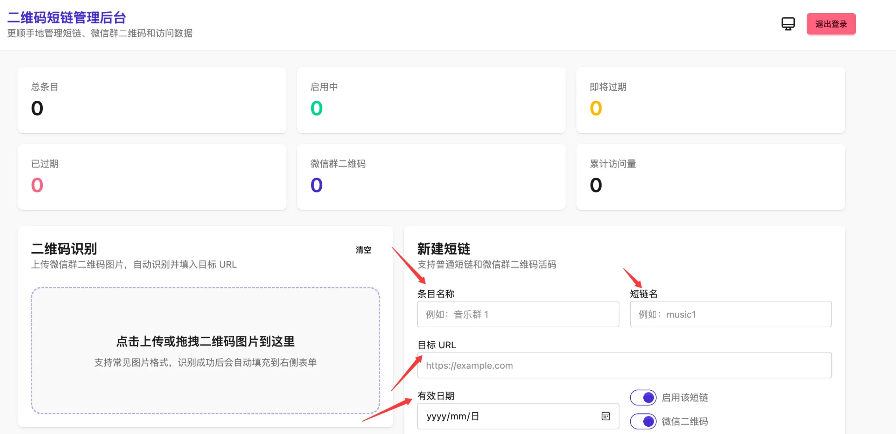
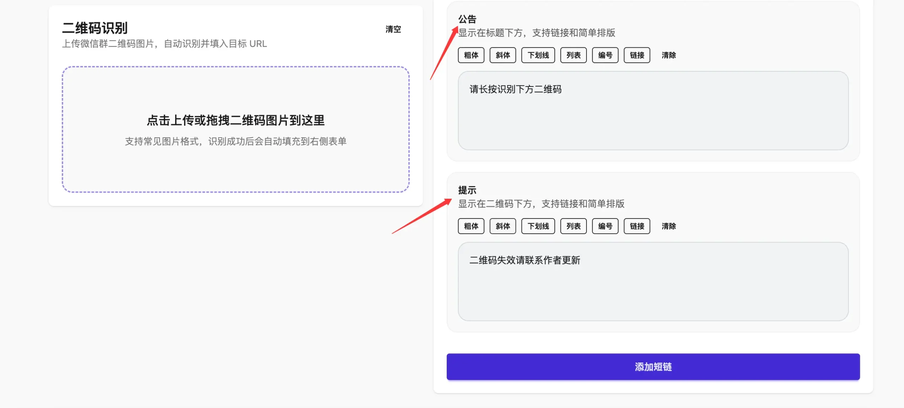

你有没有遇到过这些烦恼？

😫 免费二维码网站广告满天飞，体验很差  
😫 第三方二维码平台限制次数，还需要注册登录  
😫 活动海报上的二维码失效，却无法修改  
😫 微信群二维码只有 **7天有效期**，过期后又要重新生成、重新替换

其实，我们需要的不只是一个二维码生成器，而是一个**真正属于自己的二维码管理平台**。

今天分享一个开源项目：

🎯 **serverless-qrcode-hub**

利用 Cloudflare 免费资源，就能快速搭建一个自己的二维码中心。

---

## **🔥 它解决了哪些问题？**

普通二维码生成后基本无法修改。

比如：

📌 网站地址更换  
📌 活动页面更新  
📌 下载链接变化  
📌 微信群二维码过期

都需要重新生成二维码，非常麻烦。

而自建二维码中心，可以让二维码管理更加灵活：

✅ 长期保存二维码入口  
✅ 修改跳转地址，不需要重新制作二维码  
✅ 管理多个推广链接  
✅ 适合个人网站、社群运营、活动推广

特别是微信群二维码：

💬 微信普通群二维码有效期最长只有 **7天**。

如果你运营交流群、用户群，每隔几天换二维码非常麻烦。

通过自己的二维码中心，可以固定一个二维码入口，后续只需要更新后台链接即可。

---

# **☁️ 为什么选择 Cloudflare？**

以前搭建一个网站，需要：

❌ 买服务器  
❌ 配置环境  
❌ 安装程序  
❌ 维护安全

对于普通用户来说门槛较高。

而 Cloudflare Serverless 部署：

✨ 免费 Workers / Pages  
✨ 免费 HTTPS  
✨ 全球 CDN 加速  
✨ 不需要服务器  
✨ 自动运行维护

只需要一个域名，就可以拥有自己的二维码服务。

真正做到：

**0成本搭建，长期稳定使用。**

---

# **👥 适合哪些人？**

👨‍💻 **个人站长**

给博客、导航站、工具站增加二维码功能。

📱 **自媒体运营者**

管理公众号、社群、推广活动二维码。

🏢 **小团队或创业者**

用于产品介绍、用户入口、营销推广。

🧑‍🎓 **开发者**

学习 Cloudflare Workers 和 Serverless 架构。

---

# **🌟 总结**

serverless-qrcode-hub 虽然是一个小项目，但解决的是很多人都会遇到的问题。

它让二维码不再依赖第三方平台，而是掌握在自己手里。

通过 Cloudflare 免费生态：

🚀 不买服务器  
🚀 不需要复杂配置  
🚀 自动 HTTPS  
🚀 全球访问加速  
🚀 拥有自己的二维码管理中心

如果你经常使用二维码，或者正在运营网站、社群，这个项目非常值得收藏 ⭐

---

### 搭建教程：

📌 **项目➕文字教程地址：**[https://github.com/xxnuo/serverless-qrcode-hub](https://github.com/xxnuo/serverless-qrcode-hub)

---

> 本文转载整理自 [Ai星码博客](https://aixmb.com/524.html)，版权归原作者所有。

