📧 邮箱  
💻 网站后台  
🔑 社交账号  
☁️ 云服务账号

但是很多人都会遇到：

❌ 密码太多记不住  
❌ 重复使用密码不安全  
❌ 第三方密码管理器担心隐私  
❌ 自建服务又觉得太复杂

有没有一种简单的方法，拥有自己的密码管理工具？

今天分享一个开源项目：

# **🚀 NodeWarden**

NodeWarden 是一个基于 Cloudflare Workers 的开源密码管理器，可以帮助你搭建属于自己的在线密码保险箱。

无需购买服务器，也不用复杂配置，利用 Cloudflare 免费资源即可部署。

---

## **🌟 NodeWarden 有什么功能？**

### **🔐 密码管理**

支持保存：

✅ 网站账号密码  
✅ 安全笔记  
✅ 私密信息  
✅ 常用登录数据

让你的账号信息集中管理。

---

### **📱 多设备同步**

支持连接密码管理客户端：

💻 电脑  
📱 手机  
🌐 浏览器插件

随时访问自己的密码库。

---

### **🔄 数据迁移**

支持：

✅ Bitwarden 数据导入  
✅ 数据导出备份

更换设备更加方便。

---

### **☁️ Cloudflare 免费部署**

传统密码管理器需要：

❌ VPS服务器  
❌ Docker环境  
❌ 数据库维护

而 NodeWarden 可以部署到 Cloudflare Workers：

✅ 免费运行  
✅ 全球访问  
✅ 无需服务器维护

非常适合喜欢折腾开源项目的小伙伴。

---

## **👨‍💻 适合哪些人？**

⭐ 开发者：保存 API Key、服务器密码  
⭐ 普通用户：管理各种账号密码  
⭐ 小团队：共享内部账号信息

---

## **总结**

NodeWarden 让自建密码管理器变得更加简单。

通过 Cloudflare 免费资源，你可以拥有一个属于自己的密码保险箱，提高账号安全性，同时掌握数据控制权。

如果你想体验开源、自托管、免费部署项目，NodeWarden 值得收藏！🚀

## 搭建教程：

项目官方地址：https://github.com/shuaiplus/nodewarden

1.**fork**项目创库

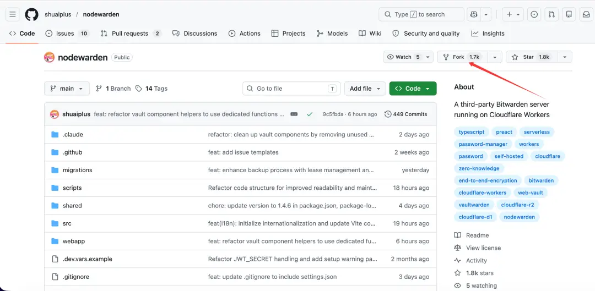

2.先进入你复刻后的仓库页面，找到「**Actions**」选项，点开后选择「**Sync upstream**」工作流，点击启用即可。开启后系统会在每日凌晨三点，自动拉取原版项目的最新内容，完成版本同步更新

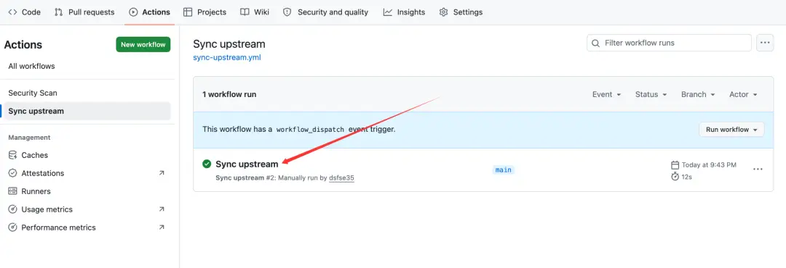

3.创建**workers**，选择**Continue with GitHub**，选择刚刚**fork的项目**

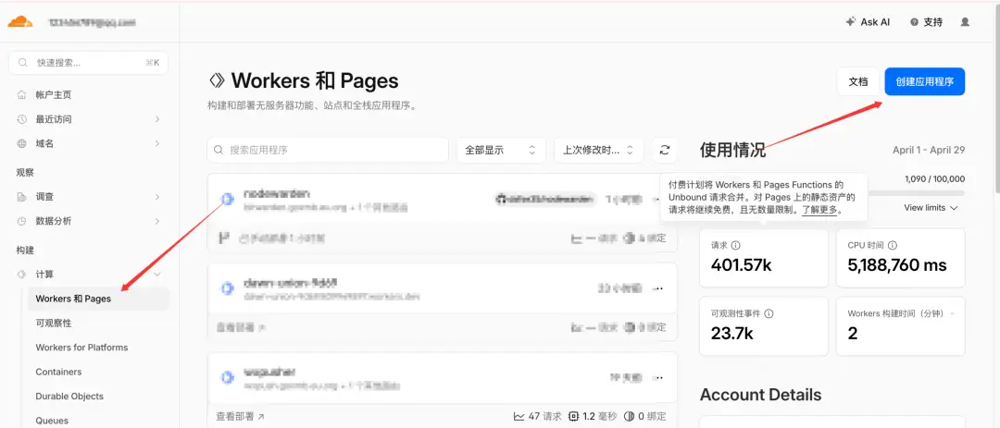

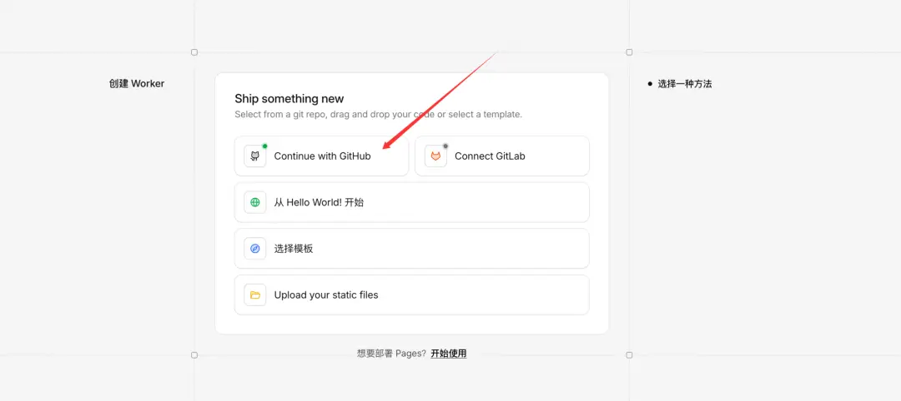

4.默认使用 **R2 存储**；若未开通，可用 **KV 来代替**，将部署命令改为 **npm run deploy:kv** 然后点击部署

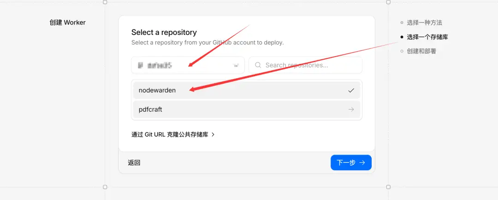

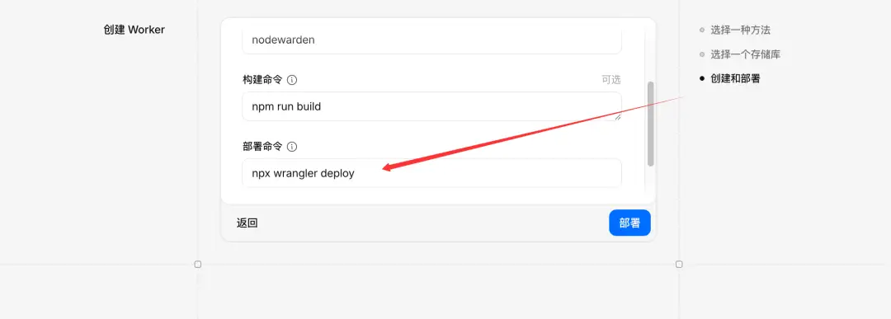

5.等待部署成功返回**Workers 和 Pages**，找到刚部署项目点击进入。**绑定自己域名即可**。

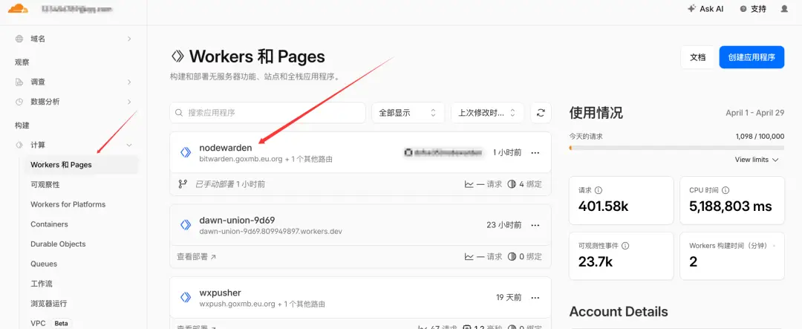

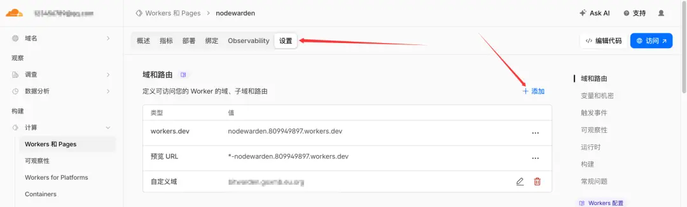

6.第一次进入域名访问会提示 未检测到 **JWT_SECRET**

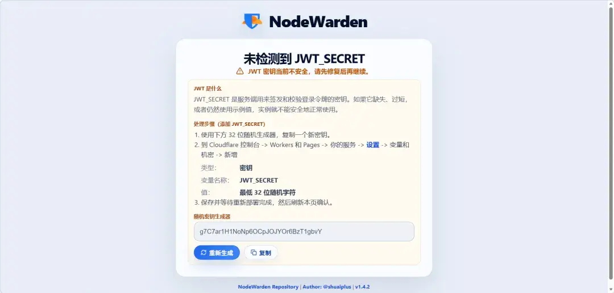

7.复制随机密钥生成器添加变量即可，选文本 密钥 都没问题，文本方便查看而已 变量名称填 **JWT_SECRET** 值填**第六步随机随机密钥生成器**

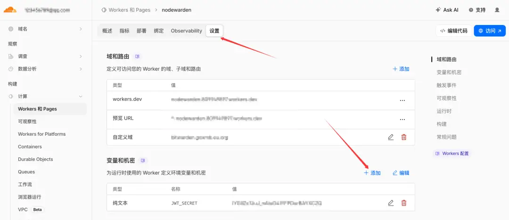

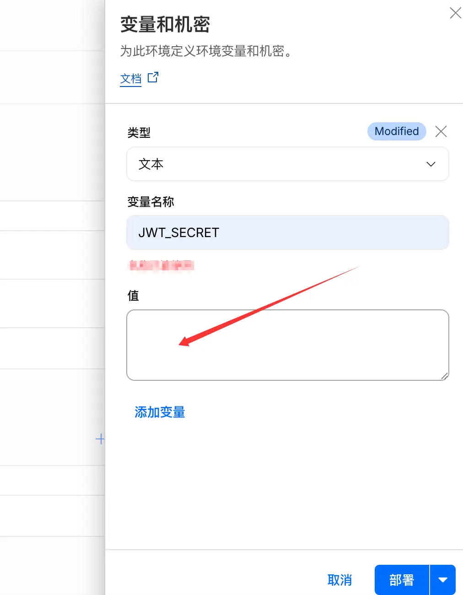

8.重新刷新页面，创建管理员账号即可。

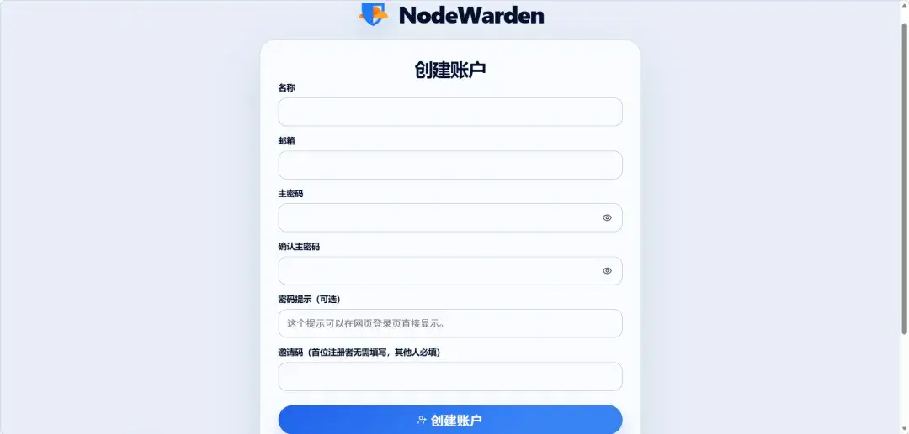

9.比原版Bitwarden多了DAV云端备份，这点还是非常实用的

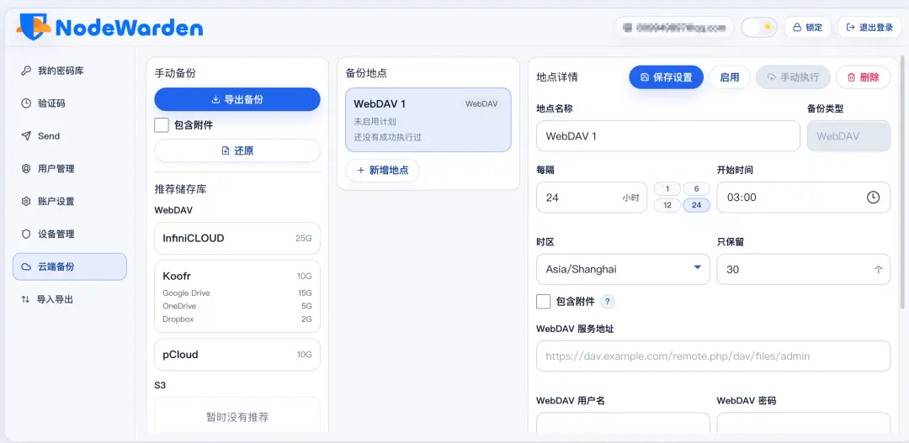

10.登陆选择自托管，填写域名即可。使用方法和客户端均与Bitwarden相同

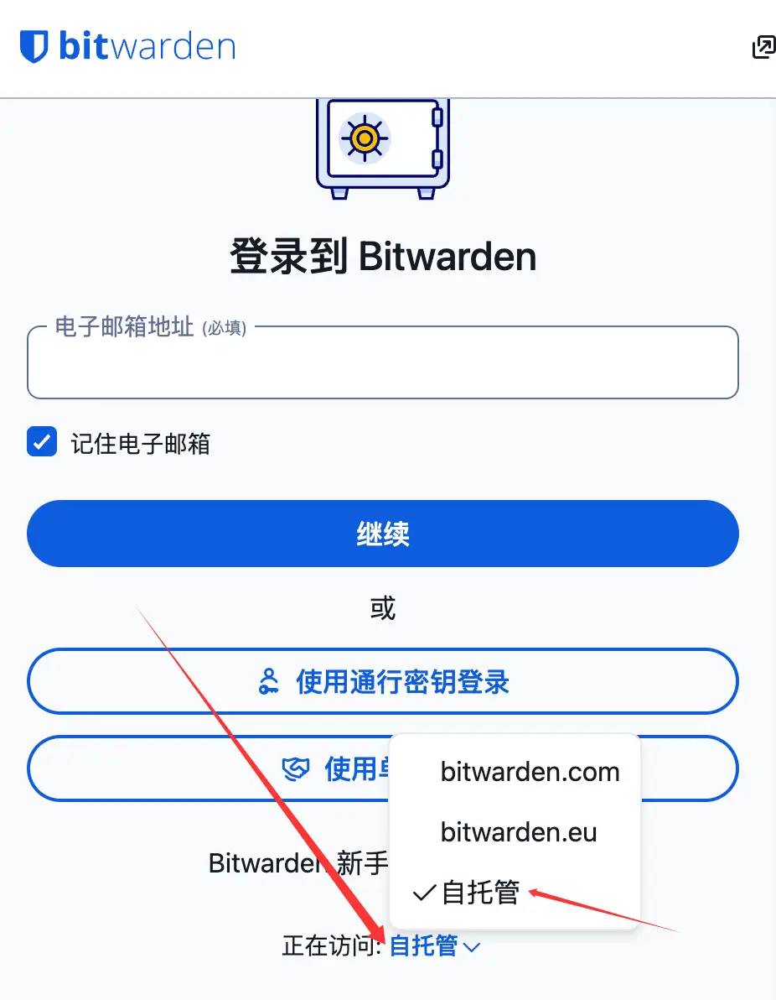

---

> 本文转载整理自 [Ai星码博客](https://aixmb.com/532.html)，版权归原作者所有。

