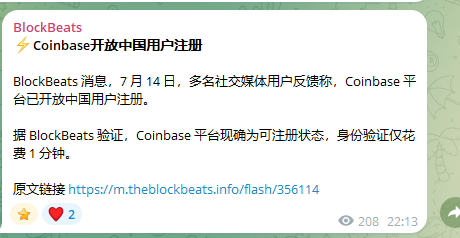
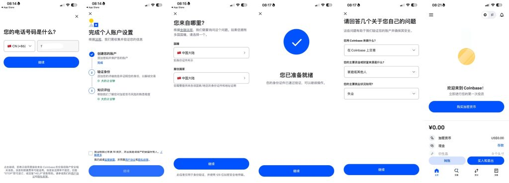
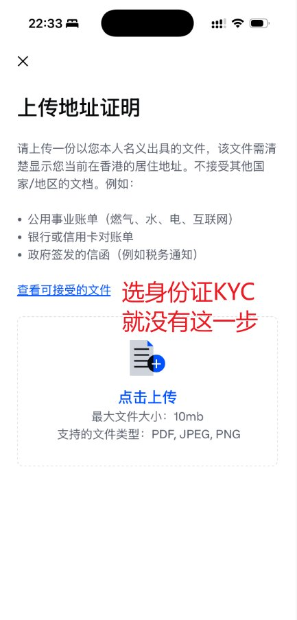

最近，加密货币社区出现一个热门话题：

**Coinbase 是否重新开放中国大陆用户注册？**

不少用户发现，在 Coinbase App 注册流程中，已经可以选择“中国大陆”地区，并完成手机号注册、身份验证等步骤。

这一消息迅速在 Telegram、社群以及加密圈传播。

很多人认为：

“是不是以后中国用户可以正常使用 Coinbase 了？”

但实际情况可能没有那么简单。

---

## **Coinbase中国注册入口出现，用户实测流程曝光**

根据部分用户测试，目前 Coinbase 注册流程已经出现中国大陆地区选项。

注册过程包括：

✅ 手机号码验证  
✅ 创建账户  
✅ 选择所在国家/地区  
✅ 身份信息认证  
✅ 安全设置

从流程来看，与其他地区用户注册体验类似。

图片说明建议：

Coinbase 注册页面已经出现中国大陆地区选项，用户可以正常进入账户创建流程。

---

## **注册成功，不代表所有功能完全开放**

很多用户看到“可以注册”后，会认为 Coinbase 已经全面向中国用户开放。

但这里需要注意：

**账户注册和完整交易权限，并不是一回事。**

海外交易平台通常会根据：

- 用户所在地
- 当地监管政策
- 风控规则
- 支付渠道

决定开放哪些功能。

部分用户反馈，目前注册后可能存在：

- 法币充值渠道有限
- 部分支付方式无法使用
- 部分金融功能不可用
- 账户可能需要进一步审核

简单来说：

能创建账户，只代表进入平台，不代表所有功能都已经开放。

---

# **KYC身份认证成为关键步骤**

Coinbase 作为全球大型加密交易平台，对用户身份验证要求比较严格。

新用户通常需要完成：

- 身份证明
- 个人信息填写
- 地址验证（部分情况）

图片说明建议：

Coinbase要求用户完成身份认证，以符合平台安全和合规要求。

很多用户容易忽略：

海外平台的 KYC 并不是简单注册。

一旦账户涉及交易、提现、大额资金操作，可能会触发进一步审核。

因此：

不要使用：

❌ 虚假资料  
❌ 他人身份信息  
❌ 不一致的信息

否则可能影响后续账户使用。

---

# **为什么很多老用户提醒不要盲目充值？**

在 Coinbase 开放注册消息出现后，也有不少老用户提醒：

不要因为“可以注册”就马上投入大量资金。

原因很简单：

任何中心化交易平台，都存在一定风险。

过去几年，一些海外交易平台用户曾遇到：

- 风控审核
- 提现延迟
- 账户限制
- 身份重新验证

这些情况并不代表所有用户都会遇到，但对于新用户来说，需要提前了解。

---

# **地址证明审核，也是很多人的关注点**

部分用户在注册过程中发现：

如果选择某些地区，平台可能会要求上传地址证明。

例如：

- 银行账单
- 水电账单
- 政府文件

图片说明建议：

Coinbase部分用户可能需要提交地址证明，用于完成身份审核。

需要注意：

地址证明必须是真实有效文件。

不要相信网络上所谓：

“代认证”  
“快速过KYC”  
“购买认证资料”

这些方式可能导致账户风险。

---

# **Coinbase安全吗？还能使用吗？**

Coinbase 是全球较知名的加密货币交易平台之一。

但用户需要明白：

安全 ≠ 没有风险。

交易平台可能面临：

### **平台风险**

例如：

- 政策调整
- 服务变化
- 账户审核

### **用户风险**

例如：

- 密码泄露
- 钓鱼网站
- 私钥管理错误

因此：

不要把交易平台当作永久钱包。

如果长期持有数字资产，更应该了解不同资产管理方式。

---

# **新用户注册Coinbase建议**

如果你准备尝试 Coinbase：

建议：

### **1、小额测试**

不要刚注册就存入大量资金。

可以先测试：

✅ 注册  
✅ 身份认证  
✅ 小额交易  
✅ 小额提现

确认流程正常。

---

### **2、开启账户安全保护**

建议开启：

✅ 双重验证  
✅ 独立邮箱  
✅ 强密码

不要使用和其他网站一样的密码。

---

### **3、警惕假Coinbase链接**

近期相关热点增加后，也可能出现大量诈骗信息。

例如：

“Coinbase中国开放注册领取奖励”

“Coinbase免费送币”

“内部邀请码”

等等。

不要通过陌生群链接登录账户。

---

# **总结：Coinbase开放注册，是机会也是提醒**

Coinbase 出现中国地区注册入口，确实引起了不少关注。

但对于普通用户来说：

不要只关注：

“能不能注册。”

更应该关注：

“注册后有哪些限制？”

“资金是否安全？”

“平台规则是否适合自己？”

加密市场机会很多，但风险同样存在。

理性了解规则，小额体验，不盲目投入，才是长期使用海外交易平台更稳妥的方式。
