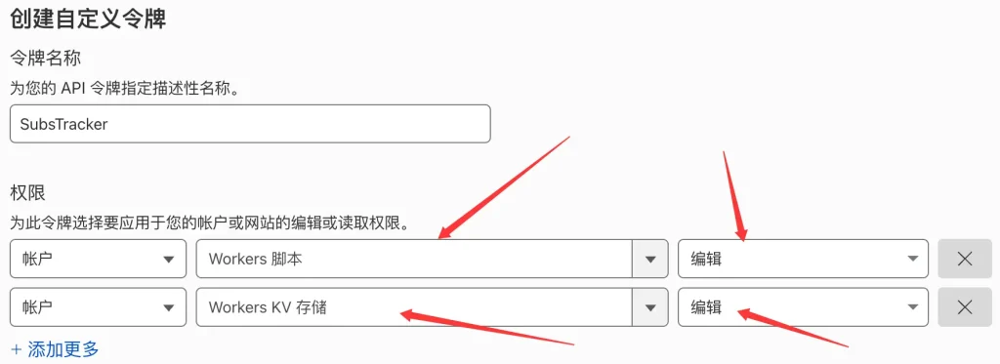
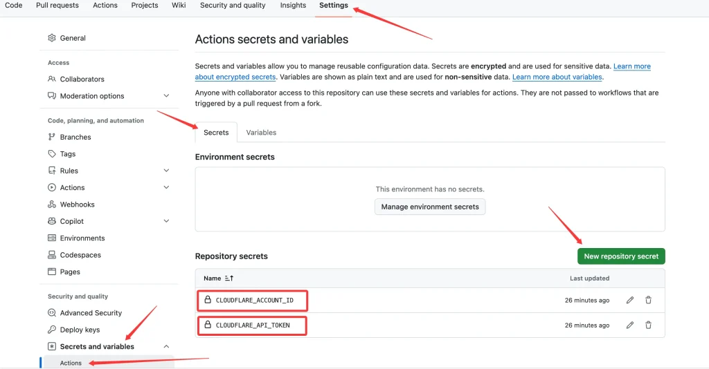
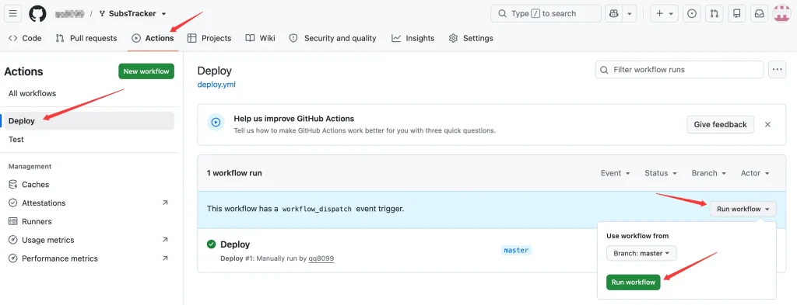
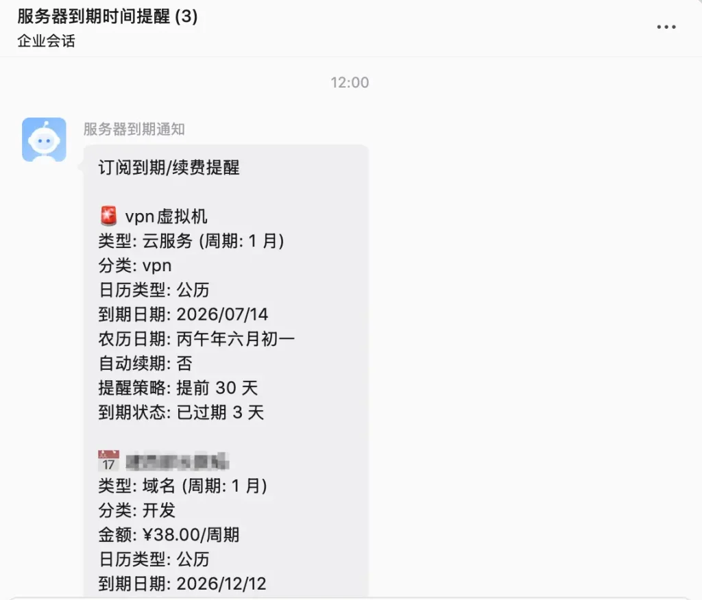

每个月都有各种订阅自动扣费？

🤖 ChatGPT Plus、Claude、Cursor、域名、服务器、Netflix……订阅越来越多，一不留神就忘记续费，甚至白白浪费几个月的钱。

今天分享一个开源项目 **SubsTracker**，支持 **Cloudflare 零成本部署**，无需服务器，几分钟即可搭建属于自己的订阅管理平台！

### **✨ 它能解决什么问题？**

✅ 统一管理所有会员、软件、域名、服务器、AI 工具订阅

✅ 自动统计每月、每年订阅支出 💰

✅ 到期前自动提醒，再也不用担心忘记续费 ⏰

✅ 可视化消费统计，一眼看清钱花在哪 📊

✅ 保存续费历史，方便查看每次付款记录

✅ 支持多币种、多周期（月付、年付等）

### **🔔 支持哪些通知？**

到期前可自动发送提醒，支持多种通知方式，包括：

📱 **Telegram Bot**

💬 **企业微信机器人**

🤖 **飞书机器人**

🟢 **钉钉机器人**

🔔 **Bark（iPhone 推送）**

📨 **Webhook（可接入更多平台）**

有了通知提醒，再也不用担心域名过期、服务器到期或会员自动扣费。

### **☁️ 为什么推荐 Cloudflare 部署？**

🌍 **零成本部署**，无需购买服务器

⚡ 全球 CDN 加速，访问速度快

🔒 自带 HTTPS，更安全

🛠️ 后期几乎免维护，非常适合个人和开发者长期使用。

### **👨‍💻 适合哪些人？**

✅ AI 工具重度用户

✅ 开发者、程序员

✅ 网站站长

✅ 域名、服务器用户

✅ 经常购买各种会员的人

---

## **🎉 总结**

如果你已经有十几个甚至几十个订阅，却总记不住什么时候续费，那么 **SubsTracker** 非常值得体验。

## **搭建教程：**

项目地址：[https://github.com/wangwangit/SubsTracker?tab=readme-ov-file](https://github.com/wangwangit/SubsTracker?tab=readme-ov-file)

**1.Fork 本仓库 。登陆cloudflare复制 ID 和 创建令牌**

**2.仓库 Settings → Secrets and variables → Actions 增加：**

| Secret | 说明 |
| --- | --- |
| CLOUDFLARE_API_TOKEN | 需 Workers 编辑 + KV 编辑权限 |
| CLOUDFLARE_ACCOUNT_ID | cloudflare ID可选 |

**3.推送到 master / main 或手动运行 Deploy workflow**

**4.默认登录：用户名 admin 密码：password**

**登录后请立刻在「系统配置」修改密码。 公网暴露默认密码会被接管。**

**忘记密码**  
**Cloudflare Dashboard → Workers & Pages → KV → 打开 SUBSCRIPTIONS_KV → 编辑 key config 的 JSON，修改 ADMIN_PASSWORD 后保存。**

**通知推送效果图：**

---

> 本文转载整理自 [Ai星码博客](https://aixmb.com/592.html)，版权归原作者所有。

