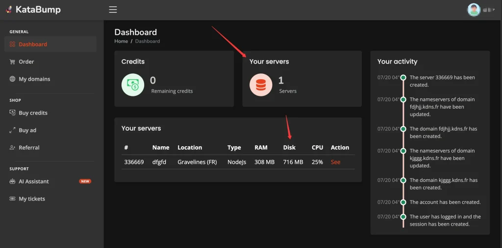
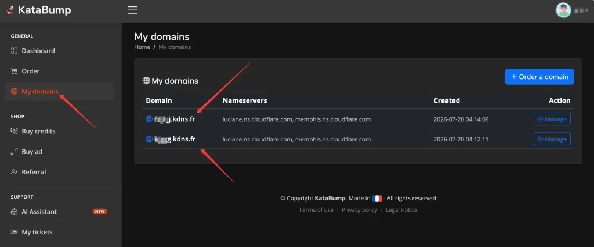

对于喜欢折腾网站、API、机器人、开源项目的开发者来说，域名和运行环境一直都是刚需。

但是购买域名需要长期续费，购买服务器也需要成本。

今天分享一个非常适合开发者体验的平台 —— **KataBump** 🎁

它可以免费领取 **2个永久域名 + 免费容器环境**，再结合 **Cloudflare DNS 托管**，打造属于自己的零成本开发环境！

---

## **🌟 KataBump 是什么？**

KataBump 是一个面向开发者的云服务平台，提供免费域名和容器运行环境。

无需购买 VPS，也不用单独购买域名，就可以快速部署自己的小项目。

适合：

✅ 个人网站  
✅ API 接口服务  
✅ Web 应用  
✅ Python 项目  
✅ Node.js 项目  
✅ 自动化脚本  
✅ Bot机器人  
✅ 开源项目测试

---

## **🎁 可以免费获得什么？**

注册 KataBump 后，可以获得：

🔥 **2个永久免费域名**

🔥 **1个免费容器环境**

🔥 **支持 Node.js、Python 等开发环境**

🔥 **支持部署 Web 应用、API 服务和自动化程序**

🔥 **域名支持自主管理 DNS**

🔥 **可以将域名托管到 Cloudflare**

对于个人开发者来说，这些资源非常适合学习、测试以及运行轻量级项目。

---

## **🖥️ 创建免费容器**

进入 KataBump 控制面板，创建服务器即可。

📌

创建完成后，可以看到自己的容器资源：

- 类型：Nodejs
- 内存：308 MB
- 磁盘：716 MB
- CPU：25%

虽然资源属于轻量级配置，但运行一些小型项目完全够用。

例如：

🚀 Node.js 网站  
🚀 Python 程序  
🚀 API 服务  
🚀 自动化工具  
🚀 小型 Web 应用

---

## **⏰ 注意：免费容器需要定期续期**

KataBump 的免费容器并不是永久保持运行状态。

目前免费容器需要 **每4天进行一次免费续期操作**。

也就是说：

✅ 域名可以长期使用  
✅ 容器可以免费续期继续运行  
✅ 不需要支付费用

只需要定期进入控制面板点击续期即可，非常适合个人测试项目和学习使用。

---

## **🌐 免费领取两个永久域名**

除了容器环境，KataBump 最大的亮点就是免费域名。

进入 **My domains** 页面即可查看领取的域名。

**📌域名后缀为：kdns.fr**

---

## **☁️ KataBump 域名接入 Cloudflare**

通过修改域名 Nameservers，可以将 KataBump 免费域名托管到 Cloudflare。

接入后可以享受：

✅ 免费 DNS 解析  
✅ 全球 CDN 加速  
✅ 免费 HTTPS SSL  
✅ 更方便的 DNS 管理  
✅ 更稳定的网站访问

组合：

**KataBump 免费域名 + Cloudflare + 免费容器**

即可搭建一个低成本的个人云环境 🚀

---

## **💡 可以用 KataBump 搭建什么？**

你可以部署：

🔥 个人博客  
🔥 在线工具网站  
🔥 Python 自动化脚本  
🔥 Node.js 应用  
🔥 API 接口  
🔥 Telegram Bot  
🔥 Discord Bot  
🔥 开源项目展示页

对于想学习云部署、没有服务器预算的新手开发者来说，是一个不错的练习平台。

---

## **⚡ 总结**

KataBump 的优势：

✅ 免费领取2个永久域名  
✅ 免费获得容器环境  
✅ 支持 Python / Node.js  
✅ 域名可托管 Cloudflare  
✅ 容器每4天免费续期  
✅ 零成本体验云部署

如果你正在寻找：

**免费域名、免费容器、Python部署、Node.js部署、Cloudflare域名托管方案**

KataBump 值得收藏体验！🔥

### 申请地址：[https://dashboard.katabump.com](https://dashboard.katabump.com)

---

> 本文转载整理自 [Ai星码博客](https://aixmb.com/609.html)，版权归原作者所有。

