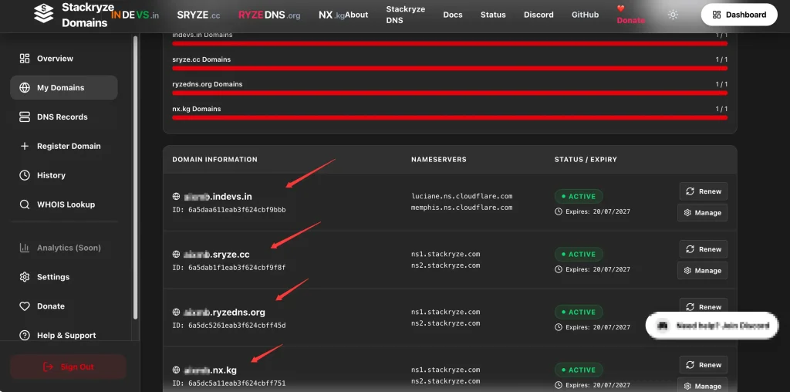

对于喜欢搭建网站、测试项目、部署工具的小伙伴来说，一个免费域名一直都是非常实用的资源。

今天分享一个开源免费的域名项目 —— **Stackryze Domains** 🎁

通过简单操作，可以领取 **4个免费域名**，有效期一年，并且支持提前免费续约，非常适合个人项目、测试站点和开发学习使用。

---

## **🌟 Stackryze Domains 是什么？**

Stackryze Domains 是一个面向开发者的免费域名服务项目。

无需购买商业域名，就可以拥有自己的专属域名，用于：

✅ 个人主页  
✅ 开源项目展示  
✅ 测试网站  
✅ API 服务  
✅ 技术博客  
✅ 学习建站

---

## **🎁 免费领取4个域名**

目前支持领取以下域名后缀：

🔥 **.indevs.in**

🔥 **.sryze.cc**

🔥 **.ryzedns.org**

🔥 **.nx.kg**

每个域名有效期：

✅ **1年免费使用**

✅ **到期前60天可以免费续约**

不需要支付费用，可以长期用于个人项目。

---

## **🌐 域名支持 Cloudflare 托管**

领取后的域名可以自定义 Nameservers。

其中：

✅ **.indevs.in 支持托管 Cloudflare**

✅ **.sryze.cc 支持托管 Cloudflare**

可以享受：

☁️ Cloudflare DNS  
🚀 全球 CDN 加速  
🔒 免费 HTTPS SSL  
🛡️ 安全防护

而：

⚠️ **.ryzedns.org 和 .nx.kg 暂时不支持 Cloudflare 托管**

后续是否支持可以关注项目更新。

---

## **📸 我的域名领取展示**

可以看到领取后的域名状态、Nameservers 和到期时间。

---

## **⭐ 如何领取？**

项目采用 GitHub 支持方式：

方式一：

⭐ GitHub 注册账号，并给作者项目点一个 Star，即可领取更多域名。

方式二：

📧 使用邮箱注册，只能领取 **1个免费域名**。

推荐支持作者 GitHub 项目，让优秀的免费服务持续维护。

---

## **💡 可以用这些免费域名做什么？**

你可以搭建：

🚀 个人博客  
🚀 在线工具网站  
🚀 开源项目主页  
🚀 API 接口  
🚀 Demo 演示站  
🚀 学习测试环境

搭配 Cloudflare、Vercel、Netlify 等免费平台，可以实现低成本甚至零成本建站。

---

## **⚡ 总结**

Stackryze Domains 是一个非常适合开发者收藏的免费域名项目：

✅ 免费领取4个域名  
✅ 一年有效期  
✅ 提前60天免费续约  
✅ 两个后缀支持 Cloudflare  
✅ 适合个人项目和测试使用

如果你正在寻找 **免费域名、开发者资源、零成本建站方案**，这个项目值得收藏！🔥

### 领取链接：[https://domain.stackryze.com](https://domain.stackryze.com)

**美国地址生成器：[https://address.aixmb.cn](https://address.aixmb.cn)**

---

> 本文转载整理自 [Ai星码博客](https://aixmb.com/616.html)，版权归原作者所有。

