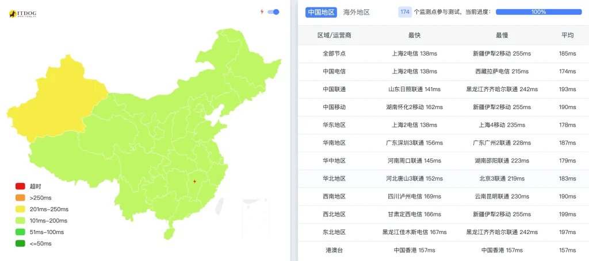
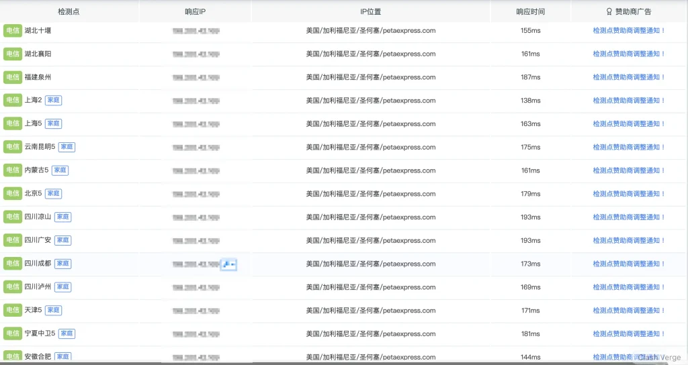
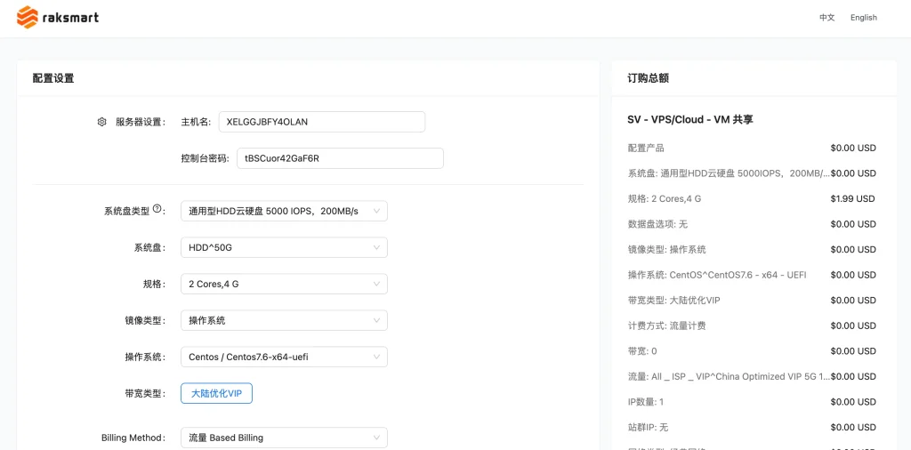
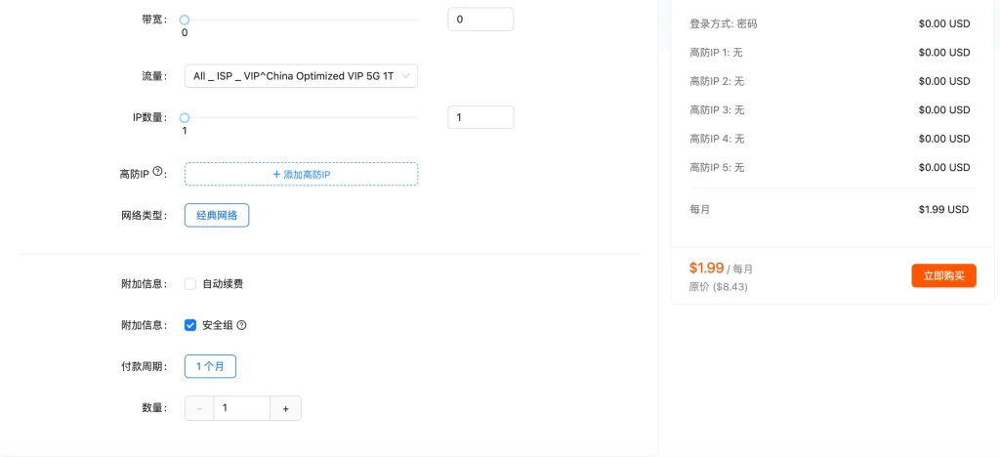

做海外 WordPress 博客、独立站的站长看过来📢

RakSmart 美西大陆优化 VIP 特惠机上新，**2 核 4G 大内存高配仅 1.99 美元 / 月**

无首月低价套路，续费永久同价，库存有限，售罄后不定期补货，有建站需求直接囤！

## 🌐全网实测｜三网低延迟，国内访问不卡顿

美西加州圣何塞 CN2 直连回国专线，174 个全国节点实测表现稳定：

✅电信平均 174ms，上海电信最低仅 138ms

✅联通平均 193ms，华北、华中节点延迟 150ms 左右

✅移动平均 190ms，全国无大面积超时丢包

配图 3：电信分节点测速详情

华东、华南、西北偏远地区访问流畅，打开图文站、工具站加载丝滑，日常建站完全够用。

## 📦整机完整配置

- ⚙️硬件：2 核 CPU + 4G 大内存，多站点、缓存程序无压力
- 💾硬盘：50G HDD 云盘，5000IOPS 稳定读写
- 📶网络：大陆优化 VIP 5G 端口，每月赠送 1T 专属流量
- 🔐IP：1 个干净独立原生 IP，无混段黑名单风险
- 🖥系统：CentOS7.6/Ubuntu/Debian 全主流 Linux 可选
- 🧑‍💻售后：7×24 小时中文客服，全中文后台，新手轻松上手

## ✨三大核心优势

1. 💰高配低价稀缺款

   市面少见 2 核 4G 机型月租不到 2 美元，同时跑多个 WP 站点、轻量采集、API 工具都不卡顿。
2. 📌续费永久同价

   拒绝套路营销，到期续费依旧 1.99 美元 / 月，长期建站不用频繁迁移服务器。
3. ⏳库存不定时补货

   机房特惠资源有限，页面显示可购买代表有货，一旦售罄只能等官方下一轮放货。

## 🎯适合人群

WordPress 多博客、外贸独立站、静态工具站、轻量爬虫、Linux 学习测试。

## 🛒购买指引

**官网地址：[进入官网](https://cn.raksmart.com/)**

**访问后台：[优惠地址入口](https://billing.raksmart.com/ec/price?pid=1889&amp;sample_id=psam_01KW1E6JHXBP5X48YV08KKP7QQ&amp;activity_id=act_01KXFYY7JAD4PFSEQ5XXY5KPBD&amp;lang=cn)**

进入 VPS 分类找到大陆优化套餐，系统推荐 CentOS7.6，普通建站无需额外购买高防 IP。

2 核 4G CN2 优化线路低价机型非常稀缺，长期海外建站刚需别错过，库存实时变动，看到有货抓紧入手！
