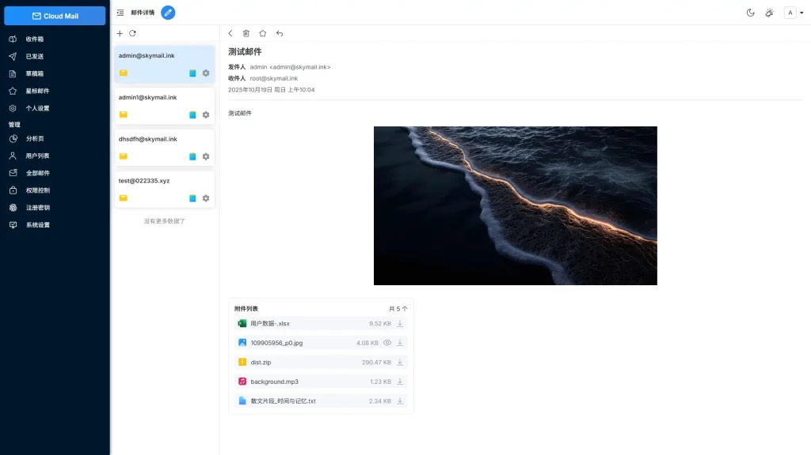
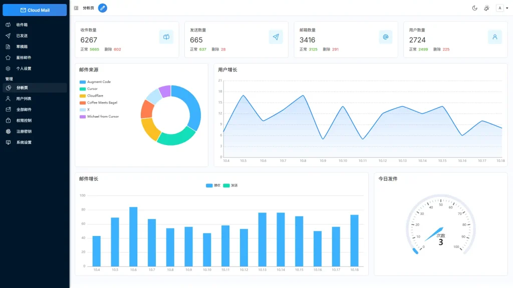
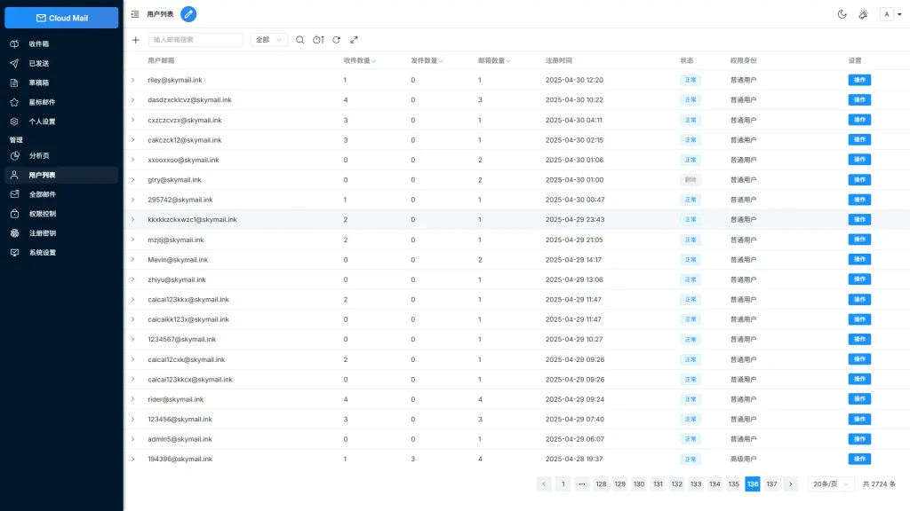
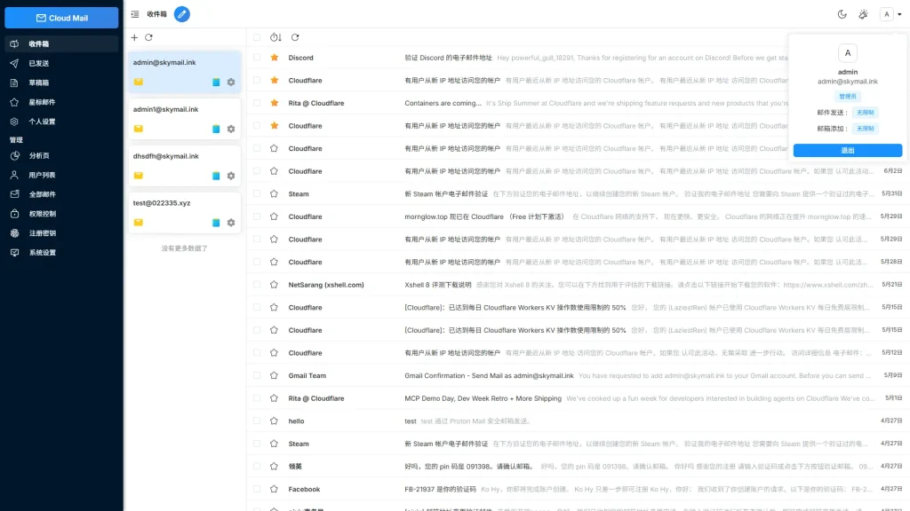

注册各种网站时，经常会遇到需要填写邮箱的情况。面对大量营销邮件、垃圾邮件，甚至一些不太信任的网站，使用自己的常用邮箱反而容易带来隐私泄露问题。

今天分享一个不错的开源项目：**Cloud Mail**。

它可以利用 **Cloudflare** 的基础设施搭建一个属于自己的临时邮箱服务，免服务器、低成本甚至零成本部署，适合个人用户搭建和使用。🚀

## **✨ Cloud Mail 能做什么？**

📧 **临时邮箱**

生成临时邮箱地址，用于网站注册、测试服务等场景，减少主邮箱收到垃圾邮件。

🔒 **保护个人隐私**

不需要随意暴露自己的常用邮箱，降低邮箱地址泄露的风险。

☁️ **Cloudflare 部署**

基于 Cloudflare 相关服务进行部署，不需要购买传统服务器，适合个人开发者和喜欢折腾 Serverless 的用户。

🛠️ **开源项目**

项目源码公开透明，可以根据自己的需求进行修改和二次开发。

## **💡 适合哪些场景？**

- 🌐 注册不太熟悉的网站
- 🧪 测试邮箱验证码功能
- 📩 接收一次性验证邮件
- 🛡️ 防止主邮箱被垃圾邮件骚扰
- 👨‍💻 开发者测试邮件相关功能
- ☁️ 想体验 Cloudflare Serverless 部署的用户

## **🚀 为什么值得搭建？**

相比购买服务器搭建传统邮件系统，Cloud Mail 的优势在于部署思路更加轻量。结合 Cloudflare 的全球网络和 Serverless 服务，可以降低服务器维护成本。

对于喜欢 **Cloudflare、GitHub、开源项目** 的朋友来说，这也是一个值得尝试的小项目。

如果你平时经常需要注册各种网站，又不想暴露自己的真实邮箱，不妨搭建一个属于自己的临时邮箱服务。📮

### 相关截图

**项目地址：**

⁠Cloud Mail GitHub 开源项目：https://github.com/maillab/cloud-mail

官方教程： https://doc.skymail.ink/guide/dashboard.html
